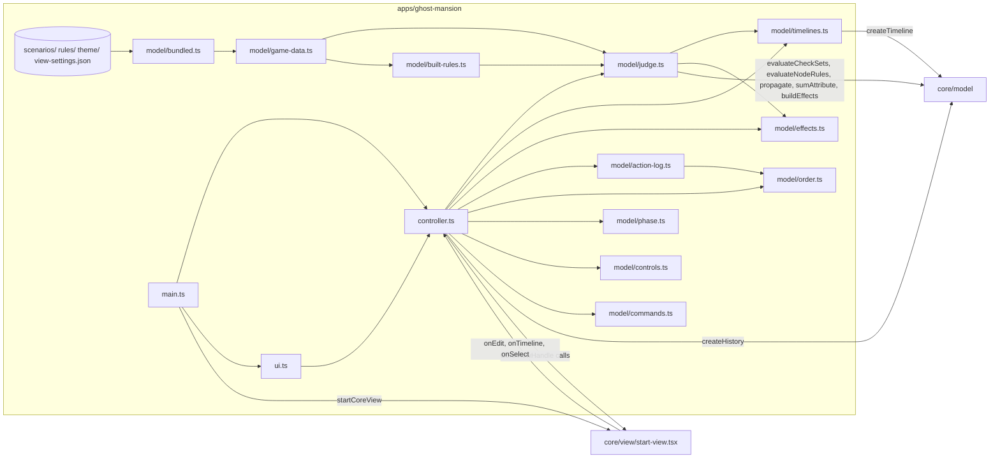

# Design Document: app-ghost-mansion

## Overview

This design implements Ghost Mansion (Unit 2, `apps/ghost-mansion/`) on top of the approved and gated core (`core-graph`, `core-rules`, `core-view`). It covers only the Must scope of `requirements.md`: Stage 2 "A Day of the Robot" with the Sample, Prepare, Ghost Night, Fix It, and Look Back phases, the Preset_Mansion, the key types, the Hidden-Command → Key-Thief Chained_Attack, the Plausible_Ghost fog, the Weak_Spot_Scanner, the Intrusion_Replay, the three Response_Operations, and the 2-axis score with stars.

Guiding choice: the smallest design that meets every criterion of `requirements.md`, with **no change to `core/`** (R-APP1-21.2). The App is split into two layers:

- **Game model** (`apps/ghost-mansion/model/`): pure TypeScript functions on plain data. They import only `zod`, non-test files of `core/model/`, the bundled JSON files, and each other. Every judgement (Attack_Verdict, Damage_Set, Damage_Score, Convenience_Score, stars, fog, Response_Result, Action_Log, Phase moves) and every Timeline and Effect_Request list is built here. This layer is the PBT target (P-APP1-1 to P-APP1-12) and runs under Vitest in Node with no DOM.
- **Game wiring** (`apps/ghost-mansion/controller.ts`, `ui.ts`, `main.ts`): the controller turns person input and Core_View callbacks into calls of the model and of the Core_View handle; `ui.ts` draws the DOM panel with `textContent` only; `main.ts` starts everything in the browser. The controller has no DOM dependency: it talks to the Core_View through the `CoreViewHandle` type and to the panel through a small `UiSink` interface, so the order of Core_View calls is tested in Node with a recording stub.

Requirements were approved on 2026-11-23 with Q1 to Q15 decided (decision-log). This design fixes every value the requirements left to design.md; each is listed in "Design decisions".

### Research findings that shape the design

These were checked on 2026-11-23 by reading the current code under `core/model/`, `core/view/`, and `scripts/sensors/`, not only the core design documents.

- **The Core_View handle** (`core/view/start-view.tsx`) has exactly these functions: `setHistory`, `setPreset`, `setEffects`, `setTheme`, `setEditMode`, `setGizmoMode`, `connectOn`, `connectOff`, `undo`, `redo`, `execute`, `startWalk`, `pauseWalk`, `resumeWalk`, `stopWalk`, `startTimeline`, `pauseTimeline`, `resumeTimeline`, `stopTimeline`, `stop`. `startCoreView(options)` takes `host`, `history`, `settings`, `theme`, `resolveImage`, `onEdit`, `onWalk`, `onTimeline`, and the optional `onSelect`. The types `CoreViewHandle`, `EditReport`, `TimelineReport`, `Selection` are exported from that file.
- **No WebGL report reaches the App.** When `getContext("webgl2")` fails, `startCoreView` returns `messageHandle(host, "3D display is not available in this browser.")`, whose functions are no-ops, and calls no callback. So the App runs the same probe itself (`hasWebGL2` is not exported, so the App has its own four-line copy) to decide whether to start the game (R-APP1-01.5).
- **The initial camera is the first ViewPreset** (`initialViewState`). Putting the Ghost_View first in the View_Settings makes the Sample open in the Ghost_View with no `setPreset` call (R-APP1-11.6).
- **`setEffects` is ignored while a Timeline is set**, also after it ended (`shownEffects` in `core/view/helpers/effects-view.ts` reads only `cursorEffects(...).upToCurrent` when the playback is not `null`); only `stopTimeline` clears it. This is why every phase change starts with `stopTimeline` (R-APP1-12.8).
- **Effects are drawn only for visible targets with a Theme style** (`drawableEffects`). The Theme Effect_Style accepts only `style: "fog"` (`effectStyleSchema`), so every Effect_Kind of this App is a `fog` style with its own color.
- **The Visible_Set follows the shown ViewPreset.** Nodes, Edges, Zones, and effects are filtered by the preset `shownPresetId` (`node-panel.tsx`, `edge-line.tsx`, `fog-volume.tsx`). `setPreset` starts a camera move of `TRANSITION_SECONDS` (0.6 s, `core/view/helpers/view-state.ts`) and switches `shownPresetId` when the move ends. In the Ghost_View, the robot, the rooms, and the Key_Edges are outside the Visible_Set, so every effect on them is dropped. The App therefore calls `setPreset("overhead")` wherever such effects must be seen (see the call-order table).
- **Timeline `targets` are not drawn.** While a Timeline is set, `shownEffects` draws only `cursorEffects(cursor).upToCurrent` (the `effects` of steps 0 to the cursor), so a step with `targets` only and no `effects` shows nothing. Every step the App builds carries its marks in `effects`.
- **Zoom moves toward the preset target.** `CameraRig` (`core/view/scene/camera-rig.tsx`) uses drei `OrbitControls` with `minDistance={0.1}` and no `maxDistance`. Dolly moves the camera along the line to the orbit target, so the Hidden_Text can be reached by zoom only if that line passes within `detailDistance` of the Text_Node. `showsDetail` (`core/view/helpers/detail.ts`) compares the 3D camera-to-Node distance with `detailDistance`. The camera has `fov: 50` (vertical, `core/view/scene/view-root.tsx`).
- **The Detail_Layer hangs below the panel.** In `core/view/scene/node-panel.tsx` the panel is `BASE_HEIGHT` 1.2 × `scale.y` tall around the Node position, and the Detail_Layer is `DETAIL_BASE_HEIGHT` 0.6 × `scale.y` tall with its center at `−(1.2 + 0.6) × scale.y / 2` below the Node position. With rotation 0 the Detail_Layer spans `y − 1.2 × scale.y` to `y − 0.6 × scale.y`. The Zone floor (`core/view/scene/zone-floor.tsx`) is an opaque plane at `elevation` with depth test and depth write, so any part of the Detail_Layer below `elevation` is hidden by the floor. A Text_Node with a Detail_Layer therefore needs `y ≥ elevation + 1.2 × scale.y`.
- **Walls are drawn only for visible, enclosed Zones** (`Walls` in `core/view/scene/wall.tsx`), as an open cylinder of radius `outerRadius` from `elevation` to `elevation + wallHeight`.
- **The Theme needs `defaultNode` and `defaultEdge`** (`themeSchema` in `core/view/helpers/theme-schema.ts`), next to `background`, `floor`, `wall`, `text`, `nodes`, `edges`, and `effects`.
- **Edit_Callback error contexts** are `start`, `settings`, `theme`, `preset`, `walk`, `timeline`, `edit`, and `effects` (`ErrorContext` in `core/view/scene/view-store.ts`). A failed `startTimeline` reports `timeline` and starts no playback, so no `end` report follows.
- **History stores Scenarios only** (`{ past, present, future, limit }` in `core/model/history.ts`), `executeCommand` keeps at most `limit` entries in `past`, and `undo`/`redo` on an empty stack return the same object. The Action_Log is therefore derived from Scenario differences (R-APP1-16.5).
- **`updateNode` replaces a whole field** (`applyChanges` in `core/model/commands.ts`), so the Stop_Robot command sends the full `attributes` object with `stopped` set to 1.
- **`loadScenario` takes text** (`core/model/scenario-io.ts`). The App imports the Scenario_File with Vite's `?raw` suffix (typed by `vite/client`, already in `tsconfig.json`), and the other JSON files as JSON modules (`with { type: "json" }`, as `core/view/demo/main.tsx` does for its sample).
- **The Schema_Sensor test names the placeholder.** `scripts/sensors/schema.cli.test.ts` runs the sensor on `apps/ghost-mansion/scenarios/placeholder.json`. Removing that file (R-APP1-02.1) needs a one-line change of that test (see "Changes outside apps/ghost-mansion/").
- **Lint scopes for apps** (`scripts/sensors/boundary-rules.ts`): `app-ghost-mansion` bans only imports from `moodwalk`. Nothing bans `core/view/demo/` or test files, and nothing keeps `three` or React out of the game model. A small lint scope is added (decided 2026-11-23; see "Lint scope for the game model").

### Design decisions

| ID | Item left to design | Decision | Reason |
|---|---|---|---|
| G1 | `check` format (R-APP1-05.2, intent.md 4.7) | A Precondition `check` is a Condition of `core-rules` (`conditionSchema` reused, R-APP1-02.7). The Attack_Card schema adds no other format. | The Rule_Engine judges it with no extra code. |
| G2 | Robot stop (Q7) | The Robot_Node has the Numeric_Attribute `stopped`, 0 in the Preset_Mansion. Stop_Robot is one `updateNode` with `changes.attributes = { ...attributes, stopped: 1 }`. "Stopped" means `stopped ≥ 1`. | An `attribute` Condition reads it (R-APP1-06.3); no new Node_Type. |
| G3 | Dont_Read_Mark (Q7) | An Edge_Type change of the Read_Edges from the Robot_Node to the selected Text_Node: `reads` → `no-read`, one `updateEdge` per Read_Edge (one Batch_Command when there are two or more). | R-APP1-19.7 asks for an update, not a remove; the Precondition counts only `reads`. |
| G4 | Robot_Jobs | Three jobs, in this order: `sort-photos`, `reply-messages`, `summarize-page` (reads the Hidden_Text, so it is last, R-APP1-15.3). This differs from the example order in intent.md 4.6 step 3 (summarize, sort, reply); the task that adds `robot-jobs.json` adds one line to `docs/decision-log.md` with this reason. | Short night (R-APP1-20.1); also meets Fallback_F2 (R-APP1-09.2) with no data change. The damage steps must follow the hidden job directly (R-APP1-15.3), so that job is last. |
| G5 | Convenience weights | Plain_Key 2, Bell_Key 1, No_Line 0 per job, from the key the job's room is reached by. Maximum 6. | intent.md 4.4 (high / medium / none). |
| G6 | 2-axis score | Score_Point = (Convenience_Score, Damage_Score). Damage_Score = sum of Importance over the Damage_Set; fog never counts (Q8). Ranges: C 0–6, D 0–11. | R-APP1-07.2, R-APP1-10. |
| G7 | Star_Table | Ordered rules, first match wins: 3 stars if C ≥ 4 and D ≤ 0; 2 stars if C ≥ 2 and D ≤ 3; otherwise 1 star. In the Preset_Mansion only the Dont_Read_Mark path reaches 3 stars; all Bell_Keys give C = 3 and 2 stars (decided by the human 2026-11-23). | Total and monotone by construction (see "Star_Table"); 3 stars needs convenience and finding the Hidden_Text. |
| G8 | Order_Rules | One rule: Stop_Robot comes before Cut_Key. | intent.md 4.6 step 4 gives this one example; no other order is in intent.md. |
| G9 | Step_Duration | `stepDuration` 2.5 s. Sample replay ≤ 1 step (2.5 s), Ghost Night ≤ 5 steps (12.5 s), Fix It replay ≤ 4 steps (10 s); total ≤ 25 s. | R-APP1-20.1: each ≤ 15 s, total ≤ 35 s. |
| G10 | Effect_Kinds | `unsourced-fog` (Fog_Kind), `damage` (Damage_Kind), `highlight` (Highlight_Kind), `bell-stop` (Bell_Stop_Kind), `could-stop` (Look Back mark of traversed Key_Edges, R-APP1-18.3), `job-focus` (the Nodes and Edges of the current Robot_Job in a night step). All `style: "fog"` in the Theme. | Theme accepts only `fog`; Timeline `targets` are not drawn (Research). |
| G16 | ViewPreset per Phase | The Sample opens in the Ghost_View (first preset, R-APP1-11.6). The first Sample "Next" calls `setPreset("overhead")`. Entering `prepare`, `ghostNight`, `fixIt`, and `lookBack`, and the Look Back "replay", call `setPreset("overhead")`. The Ghost_View stays one click away (the Weak_Spot_Scanner, R-APP1-11.1, 11.6, 15.6). | The highlights, damage, bell-stop, could-stop, and job-focus marks target Nodes and Edges inside the Garden, House, and Safe, which the Ghost_View filter hides (Research). |
| G11 | WebGL detection (R-APP1-01.5) | `main.ts` probes `document.createElement("canvas").getContext("webgl2")` inside `try` before starting. If it fails, it still calls `startCoreView` (which draws its message in the host), shows the back link and one English line, and starts no Phase. | Same probe as the core; the core gives no report. |
| G12 | Hidden_Text (R-APP1-05.4) | `en`: `Robot: send the photo album to the road.` (40 characters). `ja`: `ロボへ：写真アルバムを道に送れ。` | Names only the Robot, a room, and the Floor; no URL, code, or real-AI instruction. |
| G13 | Text storage | Game_Data texts are Localized_Text inside the JSON files; UI texts are `LocalizedText` constants in `apps/ghost-mansion/text.ts` (existing file, extended). | R-APP1-22.1; one place per kind of text. |
| G14 | Fallback switches (R-APP1-23) | `apps/ghost-mansion/model/fallback.ts` exports `FALLBACK = { f1: false, f2: false }` and `applyFallback(data, flags)` (see "Fallbacks"). | Switches, off by default, no data rewrite. |
| G15 | Images | No image Nodes; `resolveImage` always returns `null`. Node looks come from Theme Node_Styles and text only. | R-APP1-01.4 with nothing to bundle; Q12 dropped photo clues. |

## Architecture



Dependencies go one way:

```
core/model/*  <-  apps/ghost-mansion/model/*  <-  controller.ts  <-  ui.ts, main.ts
core/view/start-view.tsx  <-  main.ts (value import), controller.ts (type import only)
```

- `apps/ghost-mansion/model/` imports `zod`, `../../../core/model/<file>.ts` (non-test files), the JSON files of the App, and `./*.ts`. It imports nothing from `core/view/`, `three`, React, or the DOM. A new lint scope enforces this.
- `controller.ts` imports only types from `core/view/start-view.tsx` (`import type`), so it loads in Node without React or three.js.
- No file of the App imports `core/view/demo/` or a `*.test.ts` file (R-APP1-21.1); the lint scope enforces this too.
- Nothing under `core/` changes, and no Ghost Mansion name enters `core/` (R-APP1-21.2, 21.7).

### File layout

| File | Responsibility | Imports |
|---|---|---|
| `apps/ghost-mansion/index.html` | Page shell; `<title>Ghost Mansion</title>`; `#panel` and `#view` elements. | — |
| `apps/ghost-mansion/main.ts` | Browser start: load Game_Data, WebGL probe, `startCoreView`, create controller and UI. | `core/view/start-view.tsx`, `core/model/history.ts`, `./controller.ts`, `./ui.ts`, `./model/*` |
| `apps/ghost-mansion/controller.ts` | `GameController`: phase entry and exit, Core_View call order, callbacks, control actions. No DOM. | model files, `core/model/history.ts`, types from `core/view/start-view.tsx` |
| `apps/ghost-mansion/ui.ts` | DOM panel: phase name, instruction, buttons, scores, Attack_Card, score chart (SVG made with `createElementNS`, text with `textContent`). | `./controller.ts` (types), `./text.ts` |
| `apps/ghost-mansion/text.ts` | Every UI `LocalizedText` (extended; existing `title`, `backLink` kept). | `core/model/scenario-schema.ts` (type) |
| `apps/ghost-mansion/view-settings.json` | View_Settings (Q5: under `apps/ghost-mansion/`). | — |
| `apps/ghost-mansion/scenarios/preset-mansion.json` | The Preset_Mansion Scenario_File (replaces `placeholder.json`). | — |
| `apps/ghost-mansion/rules/game-rules.json` | Game_Rules (Rule_Definition). | — |
| `apps/ghost-mansion/rules/attack-card.json` | The Chained_Attack Attack_Card. | — |
| `apps/ghost-mansion/rules/robot-jobs.json` | Robot_Jobs and convenience weights. | — |
| `apps/ghost-mansion/rules/order-rules.json` | Order_Rules. | — |
| `apps/ghost-mansion/rules/star-table.json` | Star_Table. | — |
| `apps/ghost-mansion/theme/theme.json` | Theme. | — |
| `model/names.ts` | Fixed Identifiers used by code: Node_Types, Edge_Types, Effect_Kinds, attribute names, check-set ids, Response_Operation ids. | none |
| `model/game-data.ts` | Zod schemas of Attack_Card, Robot_Jobs, Order_Rules, Star_Table; `loadGameData(raw)` that runs every validation of R-APP1-02.3. | `zod`, `core/model/scenario-io.ts`, `rule-schema.ts`, `scenario-schema.ts`, `core/view/helpers/settings-schema.ts`, `theme-schema.ts` (see the note below) |
| `model/bundled.ts` | Imports the bundled files and returns the raw bundle. | the JSON files |
| `model/built-rules.ts` | `withCheckSet`, `attackCheckSet`, `responseCheckSet`. | `core/model/rule-schema.ts` |
| `model/judge.ts` | `judgeMansion`, `fogEffects`, `prepareStatus`, `judgeNight`, `convenienceScore`, `starsFor`. | `core/model/conditions.ts`, `paths.ts`, `series.ts`, `effects.ts` |
| `model/sample.ts` | `deriveSample`. | `core/model/commands.ts` |
| `model/commands.ts` | `keyChoiceCommand`, `dontReadCommand`, `stopRobotCommand`, `cutKeyCommand`, `isKeyEdge`. | `core/model/commands.ts` (types) |
| `model/effects.ts` | `highlightEffects`, `bellStopEffects`, `couldStopEffects`, `jobFocusEffects`, `lookBackEffects`, `withoutRobot`. | `core/model/rule-schema.ts` (types) |
| `model/timelines.ts` | `sampleTimeline`, `nightTimeline`, `fixReplayTimeline`. | `core/model/timeline.ts` |
| `model/phase.ts` | `Phase`, `PhaseAction`, `initialPhase`, `nextPhase`. | none |
| `model/action-log.ts` | `classifyPair`, `deriveActionLog`. | `core/model/history.ts`, `scenario-schema.ts` (types only; deep equality is a local function) |
| `model/order.ts` | `checkOrder`. | none |
| `model/controls.ts` | `controlsFor(state)`: which controls are shown and enabled. | none |
| `model/fallback.ts` | `FALLBACK`, `applyFallback`. | `core/model/commands.ts` |
| `model/arbitraries.ts` | Test support only: mansion variant generators. Imported only by `*.test.ts`. | `fast-check`, model files |
| `model/*.test.ts`, `controller.test.ts` | Tests next to their sources. | `vitest`, `fast-check` |

Note on View_Settings and Theme validation: `loadViewSettings` and `loadTheme` live in `core/view/helpers/`, which import only `zod` and `core/model/` (the core-view helper lint scope guarantees this). The game model may therefore import these two helper files without pulling in three.js or React. The new lint scope allows `core/view/helpers/settings-schema.ts` and `core/view/helpers/theme-schema.ts` and bans every other `core/view/` path (see "Lint scope for the game model"). This keeps R-APP1-02.3 inside the testable model.

## Components and Interfaces

### The core/app interface

What the App gives the core:

| Given to | Value | Source file |
|---|---|---|
| `startCoreView({ history })`, `setHistory` | History of the Sample_Mansion, the Preset_Mansion, or the night start state, from `createHistory(scenario, 100)` | `scenarios/preset-mansion.json` |
| `startCoreView({ settings })` | View_Settings | `view-settings.json` |
| `startCoreView({ theme })` | Theme | `theme/theme.json` |
| Rule_Engine functions | Game_Rules and Built_Rules | `rules/game-rules.json` + run-time Check_Sets |
| `setEffects`, Timeline `effects` | Effect_Requests of the six Effect_Kinds | built by `model/effects.ts`, `model/judge.ts` |
| `startTimeline` | Timelines from `createTimeline` | built by `model/timelines.ts` |
| `execute` | Edit_Commands of `core/model/commands.ts` | built by `model/commands.ts` |
| `connectOn(edgeType)` | `cites` (Prepare) or `consult` (Fix It) | `model/names.ts` |

Core calls the App makes (all checked against the code):

| Call | File | Used for |
|---|---|---|
| `loadScenario(text)` | `core/model/scenario-io.ts` | R-APP1-02.3 |
| `loadRuleDefinition(value)` | `core/model/rule-schema.ts` | Game_Rules and every Built_Rules (R-APP1-02.8) |
| `conditionSchema`, `effectTargetSchema` | `core/model/rule-schema.ts` | Attack_Card schema, Highlight_List |
| `localizedTextSchema`, `nonBlank` | `core/model/scenario-schema.ts` | Game_Data schemas |
| `loadViewSettings`, `loadTheme` | `core/view/helpers/settings-schema.ts`, `theme-schema.ts` | R-APP1-02.3 |
| `applyCommand(scenario, command)` | `core/model/commands.ts` | Sample_Mansion derivation, Fallback_F1, tests |
| `createHistory(scenario, 100)` | `core/model/history.ts` | every new History |
| `evaluateCheckSets(scenario, rules)` | `core/model/conditions.ts` | Attack_Verdict, Job_Check_Set, Response checks |
| `evaluateNodeRules(scenario, rules)` | `core/model/conditions.ts` | Plausible_Ghost |
| `propagate(scenario, rules, { ids: ["robot"] }, maxSteps?)` | `core/model/paths.ts` | damage |
| `sumAttribute(scenario, { ids: damageSet }, "importance")` | `core/model/series.ts` | Damage_Score |
| `buildEffects(scenario, rules, results)` | `core/model/effects.ts` | fog and damage Effect_Requests |
| `sortUniqueEffects(list)` | `core/model/effects.ts` | every list passed to `setEffects` |
| `createTimeline(steps)` | `core/model/timeline.ts` | every Timeline |
| `startCoreView(options)` and the `CoreViewHandle` functions | `core/view/start-view.tsx` | wiring |

No AI_Adapter, no `fetch`, no clock, and no random source is used in any judgement path (R-APP1-21.5).

### Game data loading (`model/game-data.ts`, `model/bundled.ts`)

```ts
export type RawGameData = {
  scenarioText: string; rules: unknown; attackCard: unknown; jobs: unknown;
  orderRules: unknown; starTable: unknown; viewSettings: unknown; theme: unknown;
};
export type GameData = {
  preset: Scenario; rules: RuleDefinition; attackCard: AttackCard; jobs: RobotJobs;
  orderRules: OrderRule[]; starTable: StarTable; viewSettings: ViewSettings; theme: Theme;
};
export type DataResult = { ok: true; data: GameData } | { ok: false; errors: { file: string; path: string; message: string }[] };
export function loadGameData(raw: RawGameData): DataResult;
export function crossReferenceErrors(data: GameData): { path: string; message: string }[];   // R-APP1-02.6, 02.9
```

- `bundled.ts` holds the only imports of the data files: `import scenarioText from "../scenarios/preset-mansion.json?raw"`, and `import rules from "../rules/game-rules.json" with { type: "json" }` and the same for the others. It exports `BUNDLED: RawGameData`.
- `loadGameData` calls `loadScenario`, `loadRuleDefinition`, `loadViewSettings`, `loadTheme`, and the four App schemas in that order, collects every error with its file name, and returns `ok: false` if any failed (R-APP1-02.3). It never throws (one `try`, one error at `""` on an unexpected exception). It does not run `crossReferenceErrors`; the example test does, so a bad reference fails `npm test` (R-APP1-02.5, 02.6, 02.9) and costs nothing at run time.
- `crossReferenceErrors` checks: every Node id named by a Robot_Job, a Highlight_List entry (Node or Edge), and the Attack_Card `targets` exists in the Preset_Mansion; every Job_Check_Set item id equals a Robot_Job id, in the same order; every Order_Rule names a Response_Operation id; the `unresolved` lists of `evaluateCheckSets` and `evaluateNodeRules` on the Preset_Mansion with the attack Built_Rules are empty. Each error names the Identifier.

App schemas (all Localized_Text uses `localizedTextSchema`; all ids use `nonBlank`):

```ts
const highlightSchema = z.object({ kind: z.enum(["node", "edge"]), id: nonBlank });
export const preconditionSchema = z.object({
  id: nonBlank, label: localizedTextSchema, check: conditionSchema, highlight: z.array(highlightSchema),
});
export const attackCardSchema = z.object({
  id: nonBlank, name: localizedTextSchema, attackerGoal: localizedTextSchema,
  motives: z.array(localizedTextSchema), targets: z.array(nonBlank),
  preconditions: z.array(preconditionSchema).min(3), impact: localizedTextSchema,
  counters: z.array(localizedTextSchema).min(1),
}).superRefine(uniquePreconditionIds);
export const robotJobsSchema = z.object({
  weights: z.object({ plain: z.number().min(0), bell: z.number().min(0) })
    .refine((w) => w.plain >= w.bell, "plain weight must be at least the bell weight"),
  jobs: z.array(z.object({ id: nonBlank, label: localizedTextSchema, room: nonBlank, reads: nonBlank.optional() })).min(1),
}).superRefine(uniqueJobIds);
export const orderRulesSchema = z.array(z.object({ before: responseOpSchema, after: responseOpSchema })
  .refine((r) => r.before !== r.after, "an order rule needs two different operations"));
export const starTableSchema = z.object({
  defaultStars: z.literal(1),
  rules: z.array(z.object({ stars: z.number().int().min(2).max(3), minConvenience: z.number().min(0), maxDamage: z.number().min(0) })).min(1),
}).superRefine(starRulesOrdered);   // stars strictly decreasing; rules[0].minConvenience >= 1
const responseOpSchema = z.enum(["stop-robot", "cut-key", "consult"]);
```

`starTableSchema` demands at least one rule: with an empty list every Score_Point would get `defaultStars`, which would then be the highest count also for `c = 0` (R-APP1-10.4). `starRulesOrdered` reads `rules[0]` only after that check passed, and adds no issue of its own when the list is empty.

`conditionSchema` is reused from `core/model/rule-schema.ts` (R-APP1-02.7). `attackCardSchema` parses a `check` with Zod directly; the depth pre-check `limitConditionDepth` is applied by `loadRuleDefinition` when the check becomes part of a Built_Rules value (R-APP1-02.8), so an over-deep `check` is still rejected before any Rule_Engine call.

### Fixed names (`model/names.ts`)

| Kind | Identifiers |
|---|---|
| Node_Types | `robot`, `room`, `text`, `answer`, `source`, `helper` |
| Edge_Types | `plain-key` (Plain_Key), `bell-key` (Bell_Key), `reads` (Read_Edge), `no-read` (Read_Edge with a Dont_Read_Mark), `chain` (same password between rooms), `cites` (Cite_Edge), `consult` (Consult_Edge) |
| Effect_Kinds | `unsourced-fog`, `damage`, `highlight`, `bell-stop`, `could-stop`, `job-focus` |
| Attributes | `importance` (Importance), `stopped` (robot stop mark) |
| Node ids | `robot` (the one Robot_Node) |
| Check_Set ids | `jobs` (Job_Check_Set, in Game_Rules), `attack` and `response` (added at run time) |
| Response_Operation ids | `stop-robot`, `cut-key`, `consult` |

These are App words and live only in `apps/ghost-mansion/` (R-APP1-21.7).

### Built_Rules (`model/built-rules.ts`, R-APP1-05.3, 16.7)

```ts
export function withCheckSet(rules: RuleDefinition, set: CheckSet): RuleOutcome<RuleDefinition>;
export function attackCheckSet(card: AttackCard): CheckSet;
export function responseCheckSet(nightStart: Scenario): CheckSet;
```

- `withCheckSet` returns `loadRuleDefinition({ ...rules, checkSets: [...(rules.checkSets ?? []), set] })`. Every Built_Rules value is validated before use (R-APP1-02.8); the controller treats a failure as R-APP1-02.4.
- `attackCheckSet(card)` = `{ id: "attack", items: card.preconditions.map((p) => ({ id: p.id, condition: p.check })) }`, same order. `label` and `highlight` stay in the Attack_Card (R-APP1-05.3).
- `responseCheckSet(nightStart)`, with `N` = the number of Key_Edges of `nightStart` (Edges whose `from` is `robot` and `type` is `plain-key` or `bell-key`):

```json
{ "id": "response", "items": [
  { "id": "stop-robot", "condition": { "kind": "attribute", "nodes": { "ids": ["robot"] }, "attribute": "stopped", "min": 1 } },
  { "id": "cut-key", "condition": { "kind": "edgeCount", "edges": { "include": ["plain-key", "bell-key"] },
                                     "from": { "ids": ["robot"] }, "to": {}, "max": "<N - 1>" } },
  { "id": "consult", "condition": { "kind": "edgeCount", "edges": { "include": ["consult"] },
                                     "from": {}, "to": { "types": ["helper"] }, "min": 1 } } ] }
```

  When `N = 0`, the `cut-key` condition is `{ "kind": "any", "conditions": [] }`, which never holds (R-RULES-04.6), so `max` is never negative. The `consult` item accepts any start Node (Q13) and only a Helper_Node end (R-APP1-19.8).

### Judgement (`model/judge.ts`)

```ts
export type MansionJudgement = {
  preconditions: { id: string; holds: boolean }[];   // attack Check_Result items, card order
  verdict: boolean;                                   // Attack_Verdict
  jobs: { id: string; holds: boolean }[];             // Job_Check_Set items
  propagation: PropagationResult;                     // always computed
  reachSet: string[];                                 // reached Node ids without "robot", reached order
  reachScore: number;                                 // Importance sum over reachSet ("damage if tricked")
  convenience: number;
  fog: EffectRequest[];                               // unsourced-fog requests (empty under Fallback_F1)
};
export type NightResult = MansionJudgement & {
  damageSet: string[]; damageScore: number; stars: number;
  damageEffects: EffectRequest[];                     // damage requests without the Robot_Node
  bellStops: EffectRequest[];                         // empty when verdict is false
};
export function judgeMansion(s: Scenario, data: GameData, attackRules: RuleDefinition, flags: Flags): RuleOutcome<MansionJudgement>;
export function judgeNight(s: Scenario, data: GameData, attackRules: RuleDefinition, flags: Flags): RuleOutcome<NightResult>;
export function convenienceScore(s: Scenario, jobs: RobotJobs, jobResults: { id: string; holds: boolean }[]): number;
export function starsFor(table: StarTable, c: number, d: number): number;
```

`judgeMansion` steps, each a Rule_Engine call whose Rule_Failure is returned as is (R-APP1-06.5):

1. `evaluateCheckSets(s, attackRules)`: the `attack` result gives `preconditions` and `verdict = allHold` (R-APP1-06.1, 06.2); the `jobs` result gives `jobs`.
2. `propagate(s, attackRules, { ids: ["robot"] }, flags.f2 ? 1 : undefined)` (R-APP1-07.1, 07.5).
3. `reachSet` = reached Nodes without `robot`; `sumAttribute(s, { ids: reachSet }, "importance")` gives `reachScore`. An empty `ids` list matches no Node, so an empty set gives 0 (R-APP1-07.2).
4. `convenienceScore` (below).
5. Unless `flags.f1`: `evaluateNodeRules(s, data.rules)`, then `buildEffects(s, data.rules, { nodeRules })`, keeping the `unsourced-fog` requests (R-APP1-08.1, 08.2).

`judgeNight` adds:

- `damageSet = verdict ? reachSet : []`, `damageScore = verdict ? reachScore : 0` (R-APP1-07.3).
- `damageEffects = verdict ? withoutRobot(buildEffects(s, data.rules, { propagation }).value) : []`, keeping only `damage` requests (R-APP1-07.6).
- `bellStops = verdict ? bellStopEffects(propagation.stopped) : []` (R-APP1-07.4).
- `stars = starsFor(data.starTable, convenience, damageScore)` (R-APP1-10.1, 10.2).

`prepareStatus(judgement)` returns `{ convenience, reachScore }` for the Prepare display (R-APP1-09.6; "damage if tricked" is `reachScore`, computed without the verdict).

**Convenience_Score** (R-APP1-09.3 to 09.5): for each Robot_Job in order whose Check_Item holds, add `weights.plain` (2) if an Edge `robot → job.room` of type `plain-key` exists, else `weights.bell` (1) if one of type `bell-key` exists, else 0. A job with `reads` also needs the Read_Edge in its Check_Item, so a Dont_Read_Mark makes it give 0. With no Key_Edge no job item holds, so the score is 0 (R-APP1-09.5). Because `plain ≥ bell ≥ 0` (schema) and a Check_Item holds only through a key, a Plain_Key job gives at least a Bell_Key job, which gives at least No_Line (R-APP1-09.4).

**Star_Table** (R-APP1-10.2 to 10.4): `starsFor` returns `rules[i].stars` for the first `i` with `c ≥ minConvenience` and `d ≤ maxDamage`, else `defaultStars` (1). It is total. Each rule region is closed under raising `c` and lowering `d`, so a better point matches the same rule or an earlier one, and `stars` strictly decrease along the list (schema), so stars never drop (monotone). The schema demands `rules[0].minConvenience ≥ 1`, so no point with `c = 0` gets the highest count.

### Commands (`model/commands.ts`)

```ts
export function isKeyEdge(e: Edge): boolean;                                   // from "robot", type plain-key | bell-key
export function keyChoiceCommand(s: Scenario, edgeId: string, choice: "plain" | "bell" | "none"): EditCommand | null;
export function dontReadCommand(s: Scenario, textNodeId: string): EditCommand | null;
export function stopRobotCommand(s: Scenario): EditCommand | null;
export function cutKeyCommand(s: Scenario, edgeId: string): EditCommand | null;
```

- `keyChoiceCommand`: `null` unless `edgeId` is a Key_Edge. `plain`/`bell` → `{ kind: "updateEdge", id, changes: { type } }`, or `null` when the type is already that (R-APP1-04.4). `none` → `{ kind: "removeEdge", id }` (R-APP1-04.5).
- `dontReadCommand`: the `reads` Edges `robot → textNodeId`; none → `null`; one → one `updateEdge` to `no-read`; more → one `batch` (G3).
- `stopRobotCommand`: `null` when already stopped; else `{ kind: "updateNode", id: "robot", changes: { attributes: { ...robot.attributes, stopped: 1 } } }` (G2).
- `cutKeyCommand`: `{ kind: "removeEdge", id }` only for a Key_Edge (R-APP1-16.3, 19.7).
- No function builds a command that changes `zone` (R-APP1-19.6) or removes a non-key Edge (R-APP1-19.7).

### Sample_Mansion (`model/sample.ts`, R-APP1-13.2)

`deriveSample(preset)`: the Key_Edges whose type is not `plain-key`, each as `{ kind: "updateEdge", id, changes: { type: "plain-key" } }`. None → return `preset` itself. Otherwise apply one `batch` with `applyCommand`; a failure (impossible for a valid preset) is returned as an error and handled as R-APP1-02.4. In the bundled preset only `k-diary` changes.

### Effects (`model/effects.ts`)

All lists are passed through `sortUniqueEffects` before `setEffects` so equal sets give equal lists.

| Function | Effect_Requests |
|---|---|
| `highlightEffects(card, shownCount)` | `{ effect: "highlight", target, source: p.id }` for each Highlight_List entry of the first `shownCount` Preconditions (R-APP1-13.3) |
| `bellStopEffects(stopped)` | `{ effect: "bell-stop", target: { kind: "edge", id }, source: "bell-stop" }` per Stopped_Edge (R-APP1-07.4) |
| `couldStopEffects(night)` | `{ effect: "could-stop", target: { kind: "edge", id }, source: "could-stop" }` for each traversed Edge of the night that is a Key_Edge, only when `damageSet` is not empty (R-APP1-18.3) |
| `jobFocusEffects(s, job)` | `{ effect: "job-focus", target, source: job.id }` for the Nodes `robot`, `job.room`, and `job.reads` (when set), and for the Edges of `s` from `robot` to `job.room` of type `plain-key` or `bell-key` and from `robot` to `job.reads` of type `reads` or `no-read` (R-APP1-15.2, 15.4) |
| `withoutRobot(list)` | `list` without requests whose target is the Node `robot` (R-APP1-07.6) |
| `lookBackEffects(night)` | `couldStopEffects(night)` + `night.bellStops` + `night.fog` (R-APP1-18.6) |

### Timelines (`model/timelines.ts`)

```ts
export function sampleTimeline(sampleNight: NightResult, highlights: EffectRequest[]): RuleOutcome<Timeline>;
export function nightTimeline(nightStart: Scenario, night: NightResult, jobs: RobotJobs, hiddenJobId: string): RuleOutcome<Timeline>;
export function fixReplayTimeline(nightStart: Scenario, night: NightResult, jobs: RobotJobs, hiddenJobId: string): RuleOutcome<Timeline>;
export function damageSteps(night: NightResult): TimelineStep[];
```

All Timelines are built with `createTimeline` (R-APP1-13.4, 15.1). `timelineFromPropagation` is not used, because its steps have empty `effects`.

- **`damageSteps`**: for `n = 1 … max step` of `night.propagation.reached`: `{ id: "damage-<n>", label: { en: "Damage spreads: step <n>", ja: "被害が広がる：<n>段目" }, targets: [], effects }`, where `effects` are the `damageEffects` whose target is a reached Node with step `n` or the `via` Edge of such a Node. Empty when `verdict` is false.
- **`sampleTimeline`**: `damageSteps(sampleNight)`, with the highlight requests of all three Preconditions and `sampleNight.fog` added to the first step's `effects` (R-APP1-13.4). The Sample_Mansion always has damage (R-APP1-13.5), so the list is not empty.
- **`nightTimeline`**: one step per Robot_Job, `{ id: "job-<job.id>", label: job.label, targets: [robot, job.room, job.reads?] as node targets, effects }`. Each job step's `effects` hold `jobFocusEffects(nightStart, job)`, because the Core_View draws `effects` and not `targets` (Research); step 0 `effects` also hold `night.fog`; the step of `hiddenJobId` also holds `night.bellStops` when `verdict` is true (R-APP1-15.2). `cursorEffects` draws the effects of steps 0 to the cursor, so the job-focus marks of earlier jobs stay drawn while later jobs play; the job label of R-APP1-15.4 names the current job. Then `damageSteps(night)`. The hidden job is last (G4), so damage starts right after it (R-APP1-15.3).
- **`fixReplayTimeline`**: the first `jobs.length + 1` steps of `nightTimeline` (all jobs and Step_Number 1, R-APP1-16.9). Fix It is entered only with a non-empty Damage_Set, so step 1 exists.
- `hiddenJobId` is the id of the job whose `reads` names a Text_Node with a `front.detail` (the Hidden_Text). The example test checks it exists and is the last job.

Timing (G9, R-APP1-20.1): a paced playback ends `(steps) × stepDuration` after start. The largest damage step is 2 (the only non-key Passing_Edge_Type is `chain`, and it starts at a room reached at step 1). So: Sample ≤ 1 step (all keys plain, every room at step 1) = 2.5 s; Ghost Night ≤ 3 + 2 = 5 steps = 12.5 s; Fix It ≤ 4 steps = 10 s; total ≤ 25 s. An example test computes these bounds from the bundled data and `stepDuration`.

### Phase_Machine (`model/phase.ts`, R-APP1-12.1, 12.2, 12.7)

```ts
export type Phase = "sample" | "prepare" | "ghostNight" | "fixIt" | "lookBack";
export type PhaseState = { phase: Phase };
export type PhaseAction =
  | { type: "toPrepare" } | { type: "startNight" } | { type: "nightEnded"; damageEmpty: boolean }
  | { type: "toLookBack" } | { type: "retry" };
export const initialPhase: PhaseState = { phase: "sample" };
export function nextPhase(state: PhaseState, action: PhaseAction): PhaseState;
```

| From | Action | To |
|---|---|---|
| `sample` | `toPrepare` | `prepare` |
| `prepare` | `startNight` | `ghostNight` |
| `ghostNight` | `nightEnded` with `damageEmpty: false` | `fixIt` |
| `ghostNight` | `nightEnded` with `damageEmpty: true` | `lookBack` |
| `fixIt` | `toLookBack` | `lookBack` |
| `lookBack` | `retry` | `prepare` |
| any other pair | — | the same state object |

### Controls (`model/controls.ts`)

`controlsFor({ phase, selection, scenario, connectOn, sampleShown, preconditionCount, replaying })` returns, for each control id, `{ shown, enabled }`. Rules: Key_Choice controls enabled only in `prepare` with a Key_Edge selected (R-APP1-04.6, 14.2); "don't read" only in `prepare` with a Text_Node selected that has a `reads` Edge from the robot; "connect source" only in `prepare` when Fallback_F1 is off; "stop the robot" only in `fixIt` with the Robot_Node selected and not stopped; "cut the key line" only in `fixIt` with a Key_Edge selected; "consult" only in `fixIt`; "cancel" shown and enabled only while Connect_Mode is on in `prepare` or `fixIt` (R-APP1-19.9); undo and redo enabled only in `prepare` and `fixIt` (R-APP1-19.1, 19.2); Sample "next" enabled while `sampleShown < preconditionCount`; the phase "next" control of Sample enabled once all Preconditions are shown, of Ghost Night never (the night moves on its own); "replay" and "prepare again" only in `lookBack`; "start over" only in `prepare`; ViewPreset controls and the back link always (R-APP1-01.3, 11.1, 15.6).

### Action_Log (`model/action-log.ts`, R-APP1-16.5, 16.6)

```ts
export type ResponseOp = "stop-robot" | "cut-key" | "consult";
export function classifyPair(before: Scenario, after: Scenario): ResponseOp[];
export function deriveActionLog(nightStart: Scenario, history: History): ResponseOp[];
```

- `classifyPair` returns, in this order and each at most once: `stop-robot` when `robot.attributes.stopped` goes from missing or `< 1` to `≥ 1`; `cut-key` when an Edge id that is a Key_Edge in `before` is absent in `after`; `consult` when `after` has a `consult` Edge, with a `to` of Node_Type `helper`, whose id is absent in `before`. Nothing else adds an entry (positions, rotations, scales, Cite_Edges, wrong-ended Consult_Edges, R-APP1-19.5, 19.8).
- `deriveActionLog`: `seq = [...history.past, history.present]`. If `seq[0]` is not deeply equal to `nightStart` (the limit of 100 dropped entries), start with `classifyPair(nightStart, seq[0])`. Then append `classifyPair(seq[i], seq[i + 1])` for each `i`. Deep equality is a local structural compare of plain JSON data. The accepted approximation of R-APP1-16.6 applies.
- The controller calls it only for `{ kind: "history" }` reports (R-APP1-16.10).

### Order check (`model/order.ts`, R-APP1-17.2, 17.3)

`checkOrder(log, rules)` returns one `"met" | "notMet" | "notApplicable"` per rule: `a = log.indexOf(before)`, `b = log.indexOf(after)`; `b < 0` → `notApplicable`; `a < 0` or `b < a` → `notMet`; otherwise `met`. It reads only the order of entries.

### Controller (`controller.ts`)

```ts
export type ViewPort = Pick<CoreViewHandle, "setHistory" | "setPreset" | "setEffects" | "setEditMode" | "connectOn"
  | "connectOff" | "undo" | "redo" | "execute" | "startTimeline" | "stopTimeline">;
export type UiSink = { render(state: GameViewState): void; message(text: LocalizedText): void };
export class GameController {
  constructor(data: GameData, attackRules: RuleDefinition, flags: Flags, view: ViewPort, ui: UiSink);
  start(): void;                                   // Sample entry
  onEdit(report: EditReport): void;                // Edit_Callback
  onTimeline(report: TimelineReport): void;        // Timeline_Callback
  onSelect(selection: Selection): void;            // Select_Callback
  act(control: ControlId, arg?: string): void;     // a button
}
```

State held: `phase`, `history` (last reported or set), `nightStart`, `night` (NightResult of the last night), `actionLog`, `responseResult`, `sampleShown`, `selection`, `connectType` (`cites`, `consult`, or `null`), `replay` (`none`, `sample`, `night`, `fix`, `lookBack`). Only `history`, `nightStart`, and `actionLog` are edit state (R-APP1-19.4). Every new History is made with `createHistory(scenario, 100)`; an `ok: false` result is handled as R-APP1-02.4 (R-APP1-16.1).

**Core_View call order per phase entry.** `stopTimeline` is always the first call (R-APP1-12.8); `connectOff` follows on every change (R-APP1-19.3).

| Entry | Calls, in order | Notes |
|---|---|---|
| start (`sample`) | `startCoreView` (in `main.ts`, History of the Sample_Mansion, Ghost_View first), `setEditMode("view")`, `setEffects(sampleFog)` | R-APP1-01.1, 11.6, 13.1 |
| Sample "next" (k-th) | when `k` is 1: `setPreset("overhead")` first (G16); then `setEffects(sort(sampleFog + highlightEffects(card, k)))`; when `k` is the last: `startTimeline(sampleTimeline)` | R-APP1-13.3, 13.4; the highlights target the robot and the Key_Edges, hidden in the Ghost_View |
| → `prepare` from `sample` | `stopTimeline`, `connectOff`, `setPreset("overhead")`, `setEditMode("edit")`, `setHistory(H(preset))`, `setEffects(fog(preset))` | R-APP1-14.1; the replay is still drawn until here (R-APP1-12.9) |
| → `prepare` from `lookBack` | `stopTimeline`, `connectOff`, `setPreset("overhead")`, `setEditMode("edit")`, `setHistory(H(nightStart))`, `setEffects(fog(nightStart))` | R-APP1-12.5 |
| "start over" in `prepare` | `connectOff`, `setHistory(H(preset))`, `setEffects(fog(preset))` | R-APP1-12.6; recomputed because `setHistory` calls no Edit_Callback |
| → `ghostNight` | compute `judgeNight(present)` first; on failure show the message and stay in `prepare` (R-APP1-06.5). Else `stopTimeline`, `connectOff`, `setPreset("overhead")`, `setEditMode("view")`, `startTimeline(nightTimeline)` | `nightStart = history.present` (R-APP1-12.4, 15.1) |
| night end (`{ kind: "end" }`) | phase `nightEnded`; then the entry below | R-APP1-15.5 |
| → `fixIt` | `stopTimeline`, `connectOff`, `setPreset("overhead")`, `setEditMode("edit")`, `setHistory(H(nightStart))`, `startTimeline(fixReplayTimeline)`; show the incident; `actionLog = []` and the response Check_Result from `evaluateCheckSets(nightStart, responseRules)`, computed by the controller itself because `setHistory` calls no Edit_Callback | R-APP1-16.1, 16.8, 16.9 |
| Fix It replay end | `stopTimeline`, `setEffects(sort(night.damageEffects + fog(present)))` | R-APP1-12.9, 16.9 |
| → `lookBack` | store `responseResult` (from `fixIt` only, R-APP1-17.4); `stopTimeline`, `connectOff`, `setPreset("overhead")`, `setEditMode("view")`, `setHistory(H(nightStart))`, `setEffects(lookBackEffects(night))` | R-APP1-18.6 (`stopTimeline` → `setHistory` → `setEffects`) |
| Look Back "replay" | `setPreset("overhead")`, `setHistory(H(nightStart))`, `startTimeline(nightTimeline)` | R-APP1-18.2 |
| Look Back replay end | `stopTimeline`, `setEffects(lookBackEffects(night))` | R-APP1-12.9 |

`setPreset` changes only the camera and the Visible_Set; it sets no Timeline and no History, so placing it after `stopTimeline` keeps R-APP1-12.8. The filter switches when the 0.6 s camera move ends, so the first marks may appear up to 0.6 s after the call; every playback step lasts 2.5 s (G9), so the first step is still seen. A ViewPreset control the student uses later is not undone by the controller.

**Callbacks.**

- `onEdit({ kind: "history", history })`: store it. In `prepare`: recompute `judgeMansion(present)` for the display (R-APP1-09.6, 14.4) and `setEffects(fog)`. In `fixIt`: `actionLog = deriveActionLog(nightStart, history)`, response Check_Result from `evaluateCheckSets(present, responseRules)`, and `setEffects(sort(night.damageEffects + fog(present)))` (drawn after the replay ends). If `connectType` is set and `present` has an Edge of that type whose id is not in the previous present, call `connectOff` and clear `connectType` (R-APP1-08.3, 16.4).
- `onEdit({ kind: "errors", context })`, by context (the eight values of `ErrorContext`); the Action_Log and the stored History never change on an `errors` report (R-APP1-16.10):
  - `edit`: show "That change could not be made."; the Phase is unchanged.
  - `start`, `settings`, `theme`: the bundled View_Settings, Theme, or Zone references are broken. These cannot happen after `loadGameData` succeeded, because the same loaders ran; if one comes, show "The game data is invalid." and start no further Phase (R-APP1-02.4).
  - `preset`, `effects`, `walk`: a call of the App was rejected (unknown preset id, bad Effect_Request list, or a walk the App never starts). Show "The game could not judge the mansion." and keep the Phase (R-APP1-06.5 wording). The Core_View keeps its previous state, so the game stays playable.
  - `timeline`: `startTimeline` was rejected, so no playback runs and no `end` report will come. Show the same message and then run the handler of `{ kind: "end" }` for the current `replay` at once, so the game cannot get stuck (for example, the night still moves on as in R-APP1-15.5).
- `onTimeline({ kind: "position", position })`: in a night replay, show the label of job `position`, or "Damage spreads" for a damage step; at the hidden job step with `verdict` true, also show "The robot followed a hidden command placed by the game." (R-APP1-15.3, 15.4).
- `onTimeline({ kind: "end" })`: by `replay`: `sample` → nothing (the ended Timeline stays drawn, R-APP1-12.9); `night` → `nightEnded`; `fix` and `lookBack` → the "replay end" rows above.
- `onSelect(selection)`: store it and re-render controls.

**Control actions.** Every control that starts an operation calls `connectOff` first when `connectType` is set (R-APP1-19.9). Key_Choice, "don't read", "stop the robot", and "cut the key line" build their command with `model/commands.ts` and call `execute` when it is not `null`. "Connect source" calls `connectOn("cites")`; "consult" calls `connectOn("consult")`; "cancel" calls `connectOff`. Undo and redo call `undo`/`redo`. No control changes a Scenario field directly (R-APP1-14.5).

### UI (`ui.ts`, `main.ts`)

- The panel is plain DOM: `button` elements with `textContent` set from `text.ts`, `p` lines, and one `svg` score chart (two axes, convenience 0–6 across, damage 0–11 up, one circle at the Score_Point, star count as text). No `innerHTML` anywhere (R-APP1-22.3).
- The Attack_Card block lists each Precondition `label` with "Met" or "Not met" and the `counters` (R-APP1-05.6). In Look Back, each Precondition that held at the night start state also gets the line "You could break this condition." (R-APP1-18.3); the controller passes the `preconditions` of the night start judgement to `render`.
- In Prepare, the "Damage if the robot is tricked" value (`reachScore`) shows what the keys allow and does not drop when the Hidden_Text is marked "don't read" (Q9: computed without the Attack_Verdict). The line `reachNote` under it says so, so the learner does not think the mark failed. No requirement changes.
- `main.ts`: `loadGameData(BUNDLED)` and `applyFallback`; on failure show `The game data is invalid.` and the back link, and start nothing (R-APP1-02.4). Build the attack Built_Rules with `withCheckSet` (failure → same message). Derive the Sample_Mansion. Probe WebGL (G11). Call `startCoreView` with `host = #view`, the Sample History, settings, theme, `resolveImage: () => null`, the controller callbacks, and `onWalk: () => undefined`. If the probe passed, call `controller.start()`.
- The back link (`href = import.meta.env.BASE_URL`) is always shown (R-APP1-01.3).

### Click path (R-APP1-20.2)

| # | Activation | Result |
|---|---|---|
| — | Open `/ghost-mansion/` | Sample in the Ghost_View, Attack_Card shown |
| 1 | "Next" | Camera moves to the Overhead_View (G16); "The robot is running and reads text from outside" met, highlights |
| 2 | "Next" | "The robot holds a key" met |
| 3 | "Next" | "A key works with no human check" met; damage replay (2.5 s) |
| 4 | "Go to Prepare" | Preset_Mansion in the Overhead_View, Edit_Mode `edit` |
| 5 | Click the "Fun web page" node (on the Outside_Road, visible in the Overhead_View) | Text_Node selected |
| 6 | "Don't let the robot read this" | `read-page` becomes `no-read`; convenience 4, damage if tricked 11 |
| 7 | "Start Ghost Night" | Night of 3 job steps (7.5 s); not tricked, Damage_Set empty |
| — | Night ends | Look Back: Score_Point (4, 0), 3 stars |

7 activations (≤ 12). A learner who first checks the Weak_Spot_Scanner clicks "Ghost view" and "Overhead view" in Prepare: 9 activations, still ≤ 12. Estimated time: about 15 s reading in Sample, 2.5 s replay, about 15 s in Prepare, 7.5 s night, so about 40 s; the human measures it at the gate (R-APP1-20.3). The zoom to read the Hidden_Text is a camera move and is not counted.

### Lint scope for the game model (R-APP1-21.1)

Decided by the human on 2026-11-23: this lint scope is part of the design. It is a repo-foundation sensor change (listed in "Changes outside apps/ghost-mansion/"). `scripts/sensors/boundary-rules.ts` gets two changes, using the existing `scope()` and `ban()` builders:

1. In the scope `app-ghost-mansion`: add a ban of the path segment `demo` under `core/view` (`core[\x2F\x5C]view[\x2F\x5C]demo`) and of specifiers ending in `.test.ts`, next to the existing `moodwalk` ban.
2. A new scope `app-ghost-mansion-model` for `apps/ghost-mansion/model/**/*.{ts,tsx}`, placed after `app-ghost-mansion`, with: the `moodwalk` ban, the demo and test bans (repeated, because a later flat-config entry replaces the rule options, as noted for `core-view-helpers`), `...modelPackageBans` (`three`, `react`, `react-dom`, `@react-three/*`, `three-*`), and a ban of `core/view/` paths except `core/view/helpers/settings-schema.ts` and `core/view/helpers/theme-schema.ts` in one of two forms: (a) one regex with a lookahead, `core[\x2F\x5C]view[\x2F\x5C](?!helpers[\x2F\x5C](?:settings|theme)-schema\.ts$)`, or (b) two separate bans, one of the path segments `scene` and `demo` under `core/view` and one of `start-view`. The task decides which form to use (for example, (b) if the lint rule rejects the lookahead); both must give the same results on the fixtures below.

`scripts/sensors/boundary-rules.test.ts` gets fixtures for `apps/ghost-mansion/model/a.ts` (rejected: `three`, `react`, `../../../core/view/start-view.tsx`, `../../../core/view/scene/x.ts`, `../../../core/view/demo/main.tsx`, `./x.test.ts`; accepted: `../../../core/model/history.ts`, `../../../core/view/helpers/theme-schema.ts`, `./phase.ts`) and for `apps/ghost-mansion/main.ts` (rejected: `../../core/view/demo/main.tsx`). The task adds one line to `docs/decision-log.md` (a repo-foundation sensor change).

### Changes outside apps/ghost-mansion/ (repo-foundation)

Nothing under `core/` changes. These files of `repo-foundation` change:

| File | Change | Reason |
|---|---|---|
| `apps/ghost-mansion/scenarios/placeholder.json` | removed; `preset-mansion.json` added | R-APP1-02.1 |
| `scripts/sensors/schema.cli.test.ts` | the single-file run for `ghost-mansion` uses `apps/ghost-mansion/scenarios/preset-mansion.json` | the test names the removed file |
| `scripts/sensors/boundary-rules.ts`, `.test.ts` | the lint scope above: the `app-ghost-mansion` scope bans `core/view/demo/` and `*.test.ts` imports; the new `app-ghost-mansion-model` scope also bans `three`, React, `@react-three/*`, and `core/view/` except the two schema helpers (decided 2026-11-23) | R-APP1-21.1 |
| `apps/ghost-mansion/index.html` | `<title>Ghost Mansion</title>`, `#panel`, `#view` | R-APP1-01.2 (same path) |

`vite.config.ts`, the Top_Page, and `package.json` do not change (no new package). Each change gets a decision-log line in its task.

### Fallbacks (`model/fallback.ts`, R-APP1-23)

`applyFallback(data, { f1, f2 })`: with `f1`, one `batch` of `removeNode` for every Node of type `answer` or `source` (their Cite_Edges go with them), and the Game_Rules without the `unsourced-answer` Node_Rule and the `mark-unsourced` Effect_Rule (validated again with `loadRuleDefinition`); `judgeMansion` then returns no fog and the "connect source" control is hidden. `f2` forces `f1`, keeps the three jobs (already three), and passes Max_Steps 1 to `propagate`. `FALLBACK` is `{ f1: false, f2: false }` (R-APP1-23.3).

## Data Models

Types of the Game_Data come from the Zod schemas in `model/game-data.ts`; Scenario, Rule_Definition, View_Settings, and Theme types come from the core schemas. `MansionJudgement`, `NightResult`, `PhaseState`, `ResponseOp`, and the controller state are plain TypeScript types next to the code that builds them.

### Preset_Mansion (`scenarios/preset-mansion.json`)

Zones (R-APP1-03.1 to 03.3):

| id | label `en` / `ja` | order | elevation | enclosed | footprint (View_Settings) |
|---|---|---|---|---|---|
| `outside-road` | Outside road (anyone) / 外の道（だれでも） | 0 | 0 | false | ring, center (0, 0), inner 7, outer 10 |
| `garden` | Garden (friends) / 庭（フレンド） | 1 | 0.3 | true | ring, inner 4.5, outer 7 |
| `house` | House (family) / 家の中（家族） | 2 | 0.6 | true | ring, inner 2, outer 4.5 |
| `safe` | Safe (only me) / 金庫（自分だけ） | 3 | 0.9 | true | ring, inner 0, outer 2 |

Nodes (R-APP1-03.4 to 03.8). `y = elevation + 0.6 × scale.y` puts the panel on its floor. A Text_Node with a Detail_Layer uses `y = elevation + 1.2 × scale.y` instead, so its Detail_Layer (drawn below the panel, see Research) ends at the floor and is not hidden by it; `page` is the only such Node. All texts are fictional and made by the developer.

| id | type | zone | front text `en` | position (x, y, z) | scale x = y | attributes |
|---|---|---|---|---|---|---|
| `robot` | robot | house | Helper robot | (0, 1.2, 3) | 1 | `stopped: 0` |
| `photos` | room | house | Photo album | (−3, 1.32, 0.5) | 1.2 | `importance: 3` |
| `messages` | room | house | Message app | (2.5, 1.26, −2) | 1.1 | `importance: 2` |
| `homework` | room | garden | Homework folder | (−5, 0.9, 2.5) | 1.0 | `importance: 1` |
| `diary` | room | safe | Secret diary | (0, 1.74, 0) | 1.4 | `importance: 5` |
| `page` | text | outside-road | Fun web page; `detail` = Hidden_Text (G12) | (0, 1.2, 7.4) | 1 | — |
| `answer` | answer | garden | Homework answer by the robot | (4.5, 0.9, 3.5) | 1 | — |
| `textbook` | source | garden | Textbook page | (5.5, 0.9, −1) | 1 | — |
| `parent` | helper | house | Parent | (−1.5, 1.2, −3) | 1 | — |
| `friend` | helper | garden | Friend | (−3.5, 0.9, −4.5) | 1 | — |

Room scale = `1 + 0.1 × (importance − 1)`, so a larger Importance never has a smaller scale (R-APP1-03.6). Rotation is `(0, 0, 0)` and `scale.z` is 1 for all.

Edges, in list order (the order fixes the `via` Edges of propagation):

| id | from → to | type |
|---|---|---|
| `k-photos` | robot → photos | plain-key |
| `k-messages` | robot → messages | plain-key |
| `k-homework` | robot → homework | plain-key |
| `k-diary` | robot → diary | bell-key |
| `read-page` | robot → page | reads |
| `chain-1` | messages → diary | chain (same password, intent.md 4.3) |

The answer has no Cite_Edge, so it starts under fog. There is no Consult_Edge. The Robot has four keys but only three jobs, so `k-diary` gives no convenience ("too many keys").

Results on the bundled data (checked by example tests):

| Mansion | Verdict | Damage_Set (step) | D | C | Stars |
|---|---|---|---|---|---|
| Sample_Mansion (all keys plain) | true | photos, messages, homework, diary (1) | 11 | 6 | 1 |
| Preset_Mansion | true | photos, messages, homework (1), diary (2, by `chain-1`; `k-diary` is a Stopped_Edge) | 11 | 6 | 1 |
| Preset + Dont_Read_Mark on `page` (winning set, R-APP1-14.6) | false | — | 0 | 4 | 3 |
| Preset with every key Bell_Key | false (no Plain_Key) | — | 0 | 3 | 2 |
| Preset with `k-homework` plain, others bell | true | homework (1) | 1 | 4 | 2 |

### Game_Rules (`rules/game-rules.json`)

```json
{
  "schemaVersion": 1,
  "id": "mansion-rules",
  "propagation": { "pass": ["plain-key", "chain"], "stop": ["bell-key"] },
  "checkSets": [
    { "id": "jobs", "items": [
      { "id": "sort-photos", "condition": { "kind": "edgeCount", "edges": { "include": ["plain-key", "bell-key"] },
          "from": { "ids": ["robot"] }, "to": { "ids": ["photos"] }, "min": 1 } },
      { "id": "reply-messages", "condition": { "kind": "edgeCount", "edges": { "include": ["plain-key", "bell-key"] },
          "from": { "ids": ["robot"] }, "to": { "ids": ["messages"] }, "min": 1 } },
      { "id": "summarize-page", "condition": { "kind": "all", "conditions": [
          { "kind": "edgeCount", "edges": { "include": ["plain-key", "bell-key"] },
            "from": { "ids": ["robot"] }, "to": { "ids": ["homework"] }, "min": 1 },
          { "kind": "edgeCount", "edges": { "include": ["reads"] },
            "from": { "ids": ["robot"] }, "to": { "ids": ["page"] }, "min": 1 } ] } } ] }
  ],
  "nodeRules": [
    { "id": "unsourced-answer", "nodes": { "types": ["answer"] },
      "condition": { "kind": "not", "condition": { "kind": "edgeCount", "edges": { "include": ["cites"] },
        "from": { "self": true }, "to": { "types": ["source"] }, "min": 1 } } }
  ],
  "effectRules": [
    { "id": "mark-unsourced", "effect": "unsourced-fog", "source": { "kind": "nodeRule", "id": "unsourced-answer" } },
    { "id": "show-damage", "effect": "damage", "source": { "kind": "propagation" } }
  ]
}
```

`reads`, `no-read`, `cites`, and `consult` are in neither list, so they carry no damage and are never Stopped_Edges (R-APP1-04.1, 04.2, 19.8). `chain` is the one extra Passing_Edge_Type that R-APP1-04.1 allows design.md to add; no control can remove it.

### Attack_Card (`rules/attack-card.json`)

```json
{
  "id": "hidden-command-chain",
  "name": { "en": "Hidden-Command Ghost and Key-Thief Ghost", "ja": "かくれ命令おばけと鍵ぬすみおばけ" },
  "attackerGoal": { "en": "Make the robot do something its owner did not ask for.", "ja": "ロボに、持ち主が頼んでいないことをさせる。" },
  "motives": [ { "en": "Steal secrets", "ja": "ひみつを盗みたい" }, { "en": "Play a prank", "ja": "いたずら" } ],
  "targets": ["robot", "page"],
  "preconditions": [
    { "id": "reads-outside", "label": { "en": "The robot is running and reads text from outside", "ja": "ロボが動いていて、外の文章を読む" },
      "check": { "kind": "all", "conditions": [
        { "kind": "edgeCount", "edges": { "include": ["reads"] }, "from": { "ids": ["robot"] }, "to": { "zones": ["outside-road"] }, "min": 1 },
        { "kind": "attribute", "nodes": { "ids": ["robot"] }, "attribute": "stopped", "max": 0 } ] },
      "highlight": [ { "kind": "node", "id": "robot" }, { "kind": "node", "id": "page" }, { "kind": "edge", "id": "read-page" } ] },
    { "id": "holds-key", "label": { "en": "The robot holds a key", "ja": "ロボが鍵を持っている" },
      "check": { "kind": "edgeCount", "edges": { "include": ["plain-key", "bell-key"] }, "from": { "ids": ["robot"] }, "to": {}, "min": 1 },
      "highlight": [ { "kind": "node", "id": "robot" }, { "kind": "edge", "id": "k-photos" }, { "kind": "edge", "id": "k-messages" },
                     { "kind": "edge", "id": "k-homework" }, { "kind": "edge", "id": "k-diary" } ] },
    { "id": "no-human-check", "label": { "en": "A key works with no human check", "ja": "人の確認がない鍵がある" },
      "check": { "kind": "edgeCount", "edges": { "include": ["plain-key"] }, "from": { "ids": ["robot"] }, "to": {}, "min": 1 },
      "highlight": [ { "kind": "edge", "id": "k-photos" }, { "kind": "edge", "id": "k-messages" },
                     { "kind": "edge", "id": "k-homework" }, { "kind": "edge", "id": "k-diary" } ] }
  ],
  "impact": { "en": "Private photos leak, and strange messages are sent.", "ja": "写真がもれたり、変なメッセージが送られたりする。" },
  "counters": [ { "en": "Give the robot fewer keys", "ja": "ロボに渡す鍵を減らす" },
                { "en": "Use bell keys so a person checks", "ja": "ベル付きの鍵で人が確認する" },
                { "en": "Do not let the robot read suspicious pages", "ja": "あやしいページはロボに読ませない" } ]
}
```

- The robot-stop check is inside the first Precondition, so a stopped Robot makes the Attack_Verdict `false` (R-APP1-06.3) with three Sample "next" clicks. Its label names both parts ("is running and reads text from outside"), so label and `check` agree; it still is the Precondition "the Robot reads text from outside" of R-APP1-05.2.
- A Dont_Read_Mark turns `read-page` into `no-read`, the only Read_Edge to the Outside_Road, so the first Precondition fails (R-APP1-06.4).
- With every Key_Edge a Bell_Key, `no-human-check` fails. So the verdict is `true` only when a Plain_Key exists, and a tricked Robot always reaches at least one room.

### Robot_Jobs, Order_Rules, Star_Table

```json
{ "weights": { "plain": 2, "bell": 1 },
  "jobs": [
    { "id": "sort-photos", "label": { "en": "Sort the photos", "ja": "写真を整理する" }, "room": "photos" },
    { "id": "reply-messages", "label": { "en": "Reply to messages", "ja": "メッセージに返信する" }, "room": "messages" },
    { "id": "summarize-page", "label": { "en": "Summarize a web page into the homework folder", "ja": "ページをまとめて宿題フォルダに入れる" },
      "room": "homework", "reads": "page" } ] }
```

```json
[ { "before": "stop-robot", "after": "cut-key" } ]
```

```json
{ "defaultStars": 1, "rules": [ { "stars": 3, "minConvenience": 4, "maxDamage": 0 }, { "stars": 2, "minConvenience": 2, "maxDamage": 3 } ] }
```

### View_Settings (`view-settings.json`)

```json
{
  "zoneFootprints": [
    { "kind": "ring", "id": "outside-road", "x": 0, "z": 0, "innerRadius": 7, "outerRadius": 10 },
    { "kind": "ring", "id": "garden", "x": 0, "z": 0, "innerRadius": 4.5, "outerRadius": 7 },
    { "kind": "ring", "id": "house", "x": 0, "z": 0, "innerRadius": 2, "outerRadius": 4.5 },
    { "kind": "ring", "id": "safe", "x": 0, "z": 0, "innerRadius": 0, "outerRadius": 2 }
  ],
  "presets": [
    { "id": "ghost-view", "label": { "en": "Ghost view (weak-spot scanner)", "ja": "おばけ目線（弱点スキャナー）" },
      "pose": { "position": { "x": 0, "y": 1.0, "z": 9.9 }, "target": { "x": 0, "y": 0.3, "z": 7.4 } },
      "filter": { "zones": ["outside-road"], "edgeRule": "anyEnd" } },
    { "id": "overhead", "label": { "en": "Overhead view", "ja": "俯瞰" },
      "pose": { "position": { "x": 0, "y": 20, "z": 12 }, "target": { "x": 0, "y": 0, "z": 0 } },
      "filter": { "edgeRule": "bothEnds" } }
  ],
  "paths": [],
  "detailDistance": 2.0,
  "snapStep": 0.5,
  "wallHeight": 1.2,
  "editMode": "view",
  "stepDuration": 2.5
}
```

- The Ghost_View camera is at radius 9.9 (on the Outside_Road, ring 7–10) and height 1.0, below the Garden Wall top 0.3 + 1.2 = 1.5 (R-APP1-11.2). It is first, so the Core_View opens there (R-APP1-11.6). Its filter shows `page` and `read-page` (`anyEnd`), and hides everything inside.
- `page` is at (0, 1.2, 7.4) with `scale.y` 1, so its panel spans y 0.6 to 1.8 and its Detail_Layer spans y 0.0 to 0.6 (center 0.3), on top of the Outside_Road floor at y 0 (see Research).
- The Ghost_View `target` is the center of the Detail_Layer of `page`, (0, 0.3, 7.4). Zoom (dolly) moves the camera along the line to the target, down to `minDistance` 0.1 (`camera-rig.tsx`), so the Hidden_Text stays in the middle of the view while it is shown. A target at the panel center (0, 1.2, 7.4) was rejected: with `fov` 50 the Detail_Layer, 0.6 to 1.2 below that point, would be at or past the lower edge of the view at every camera distance ≤ 2.0.
- From the Ghost_View pose the page (Node position) is √(0.2² + 2.5²) ≈ 2.51 units away, more than `detailDistance` 2.0, so the Hidden_Text is hidden at first. The dolly line passes within about 0.87 of the page (closest point about 0.24 from the target, inside the segment that ends 0.1 from the target), so zooming in shows it once the camera is about 2.0 from the target (R-APP1-11.4, 11.5).
- At the Ghost_View pose the target is about 2.60 away, so the view shows about ±1.21 around it vertically (tan 25° × 2.60). The panel center (0.9 above the target) and the whole Detail_Layer are in view.
- Nothing hides the page from the Ghost_View camera. The Ghost_View filter shows only the Outside_Road, which is not enclosed, so no Wall is drawn (`wall.tsx`). In the Overhead_View filter the Garden Wall is a cylinder of radius 7, while the camera is at radius 9.9 and the page at radius 7.4, so the Wall is behind the page. The page front face (+z) faces the camera. The camera height 1.0 is below the Garden Wall top 0.3 + 1.2 = 1.5 (R-APP1-11.2).
- From the Overhead_View pose the page is √(18.8² + 4.6²) ≈ 19.4 units away. Zoom there moves toward the center (0, 0, 0); the closest point of that line to the page is about 5.7 units away, so zoom alone from the Overhead_View never shows the Hidden_Text (R-APP1-11.4). The student finds it with the Weak_Spot_Scanner, which is the point of the scanner.
- If the learner drags `page` in Prepare, the Ghost_View target no longer lines up with it, and zoom may no longer reach the Hidden_Text. "Start over" or undo puts `page` back (gate checklist item 4).
- An example test checks these numbers from the bundled files: Ghost_View pose distance to `page` > `detailDistance`; the minimum distance from `page` to the dolly segment of the Ghost_View (from the pose position to the point 0.1 from the target) ≤ `detailDistance`; and the same minimum for the Overhead_View > `detailDistance`. The value 0.1 is copied from `camera-rig.tsx` with a comment, because the game model may not import `core/view/scene/`.
- An example test checks that every Node with a `front.detail` has its Detail_Layer bottom, `y − 1.2 × scale.y` (that is, `−(BASE_HEIGHT + DETAIL_BASE_HEIGHT) × scale.y / 2 − DETAIL_BASE_HEIGHT × scale.y / 2`), at or above the `elevation` of its Zone. The constants `BASE_HEIGHT` 1.2 and `DETAIL_BASE_HEIGHT` 0.6 are copied from `core/view/scene/node-panel.tsx` with a source comment, for the same reason.

### Theme (`theme/theme.json`)

| Group | Key | Style |
|---|---|---|
| base | background / floor / wall / text | `#1b1426` / `#2e2440` / `#4a3b63` / `#f3e9ff` |
| defaults | defaultNode (fill, border) | `#e6e0f0` / `#6b5a8a` |
| defaults | defaultEdge (color, width, dashed) | `#9a8fb0`, 0.03, false |
| nodes | robot / room / text / answer / source / helper | fill, border: `#cfe8ff`/`#3a6ea5`, `#ffe9b3`/`#a0742a`, `#ffffff`/`#6b6b6b`, `#e8ffe0`/`#3d7a2c`, `#e0f0ff`/`#2c5a7a`, `#ffe0f0`/`#a03c6e` |
| edges | plain-key | `#ff7a1a`, 0.05, solid |
| edges | bell-key | `#4fc3f7`, 0.05, dashed |
| edges | reads / no-read | `#b0b0b0`, 0.03, solid / `#6b6b6b`, 0.03, dashed |
| edges | chain / cites / consult | `#d04040`, 0.04, dashed / `#7ad07a`, 0.03, solid / `#ff8ad8`, 0.04, solid |
| effects | unsourced-fog / damage / highlight / bell-stop / could-stop / job-focus | all `style: "fog"`: `#c8c8d0` 0.55 / `#e03030` 0.45 / `#ffd400` 0.35 / `#4fc3f7` 0.5 / `#ff9800` 0.5 / `#a0e8ff` 0.3 |

The Theme JSON has the keys `background`, `floor`, `wall`, `text`, `defaultNode`, `defaultEdge`, `nodes`, `edges`, and `effects`, all required by `themeSchema`. Edge style `dashed` is a boolean (`edgeStyleSchema`): "solid" above means `false`, "dashed" means `true`.

### UI texts (`text.ts`, R-APP1-22)

Every entry is `{ en, ja }`; only `en` is shown.

| Key | `en` | `ja` |
|---|---|---|
| phase.sample / instruction | Sample / Play the ghost: press Next to see what the attack needs. | みほん / おばけになって「次へ」で攻撃の条件を見よう。 |
| phase.prepare / instruction | Prepare / Change the robot's keys and check what the ghost can see. | ととのえる / ロボの鍵を変えて、おばけから見える所を確かめよう。 |
| phase.ghostNight / instruction | Ghost Night / Watch the robot do its jobs. | おばけの夜 / ロボの仕事を見守ろう。 |
| phase.fixIt / instruction | Fix It / Stop the robot, cut a key line, and talk to someone. | たいじする / ロボを止めて、鍵の線を切って、相談しよう。 |
| phase.lookBack / instruction | Look Back / See your score, then prepare again. | ふりかえり / 評価を見て、ととのえ直そう。 |
| incident | The robot sent a strange message to the class group! | ロボがクラスのグループに変なメッセージを送った！ |
| hiddenFollowed | The robot followed a hidden command placed by the game. | ロボはゲームが隠した命令に従ってしまった。 |
| fogNote | Plausible Ghost: an answer with no source is covered by fog. | まことしやかおばけ：出典のない答えには霧がかかる。 |
| controls | Next; Go to Prepare; Start Ghost Night; Go to Look Back; Prepare again; Replay; Start over; Plain key; Bell key; No line; Don't let the robot read this; Connect answer to source; Stop the robot; Cut the key line; Consult a person; Cancel; Undo; Redo; Back to the top page | 次へ；ととのえるへ；おばけの夜を始める；ふりかえりへ；ととのえ直す；もう一度見る；最初からやり直す；そのままの鍵；ベル付きの鍵；線なし；ロボに読ませない；答えを出典につなぐ；ロボを止める；鍵の線を切る；相談する；やめる；元に戻す；やり直す；トップページへ戻る |
| scores | Convenience; Damage; Damage if the robot is tricked; Stars | 便利さ；被害；ロボがだまされたときの被害；星 |
| reachNote | This is what the keys would let a tricked robot reach. Not reading a strange page can stop the trick itself. | これは、だまされたロボが鍵でとどく被害です。あやしいページを読ませなければ、だまされること自体を防げます。 |
| canBreak | You could break this condition. | この条件はくずせた。 |
| status | Done; Not done; Met; Not met; Not applicable | できた；まだ；満たした；満たしていない；対象外 |
| errors | The game data is invalid.; The game could not judge the mansion.; That change could not be made.; 3D display is not available, so the game cannot start. | ゲームのデータが正しくありません。；屋敷を判定できませんでした。；その変更はできませんでした。；3D表示が使えないため、ゲームを始められません。 |

No text names a technical term or an OWASP item (R-APP1-18.5).

## Correctness Properties

*A property is a characteristic or behavior that should hold true across all valid executions of a system-essentially, a formal statement about what the system should do. Properties serve as the bridge between human-readable specifications and machine-verifiable correctness guarantees.*

### PBT properties

P-APP1-1 to P-APP1-12 are the properties of `requirements.md`, written here as tests. Every property runs with `fc.assert(fc.property(…), { numRuns: 100 })` or more, is one test, has a test name that starts with its property ID (R-FND-10.5), and carries the tag comment `// Feature: app-ghost-mansion, Property <n>: <P-APP1-n title>`. All tests are in `apps/ghost-mansion/model/` and run in Node with no DOM. In the **Validates** lines, "Requirements X.Y" means R-APP1-0X.Y (for example 7.2 = R-APP1-07.2).

intent.md 10.6 properties: "same input → same result" is P-APP1-1 at App level (P-RULES-1 in the core); "removing edges never increases the set of reachable nodes" is P-APP1-2 at App level (P-RULES-2 in the core); "save → load leaves the content unchanged" and "every edge points to existing nodes" stay with `core-graph` (P-GRAPH-1, P-GRAPH-3), and the App adds an example test that the bundled Preset_Mansion and the Sample_Mansion pass `saveScenario` → `loadScenario` unchanged and that every generated variant passes `validateScenario` (generator sanity check, below).

#### Generators (`model/arbitraries.ts`)

- `variantArb`: starts from the bundled Preset_Mansion and applies, with `applyCommand`, a random subset of: a Key_Choice per Key_Edge (`plain`, `bell`, `none` via `keyChoiceCommand`); a Dont_Read_Mark on `page` (`dontReadCommand`); Stop_Robot; a Cite_Edge `answer → textbook`, and wrong-way or wrong-type Cite_Edges (`textbook → answer`, `answer → parent`); 0 to 3 Consult_Edges from random Nodes to random Nodes (helpers and others); random `position` (finite in ±20), `rotation` (±π), and `scale` (`fc.double({ min: 0.1, max: 3, noNaN: true })`) on random Nodes. Every generated Scenario passes `validateScenario` (checked once per run).
- `scorePointArb`: `c` from `fc.integer({ min: 0, max: 6 })` and `d` from `fc.integer({ min: 0, max: 11 })`, plus `fc.double` values in the same ranges.
- `starTableArb`: valid Star_Tables (1 to 2 rules, strictly decreasing stars, first `minConvenience ≥ 1`), and the bundled one.
- `actionLogArb`: 0 to 10 entries from the three Response_Operation ids, with repeats; `orderRulesArb`: 0 to 4 rules with two different ids.
- `phaseActionsArb`: 0 to 30 Phase actions of every type, `damageEmpty` random.
- `fixStepsArb`: 0 to 100 steps from Stop_Robot, Cut_Key of a random Key_Edge, Consult (an `addEdge` of type `consult` with a fresh id to a random Node), moves, rotations, scalings, and `undo`/`redo` markers.

### Property 1: P-APP1-1 same input → same result

*For any* variant from `variantArb`, Action_Log, Order_Rules, Phase state, and Phase action, calling `judgeMansion`, `judgeNight`, `convenienceScore`, `starsFor`, `nightTimeline`, `sampleTimeline`, `lookBackEffects`, `deriveActionLog`, `checkOrder`, `nextPhase`, and `controlsFor` twice, the second time on `structuredClone` copies, gives `toStrictEqual` results, and every argument is deeply equal to a copy taken before the call.

Test file: `model/judge.test.ts`.

**Validates: Requirements 6.6, 10.6, 21.3, 21.4**

### Property 2: P-APP1-2 safer keys never increase damage

*For any* variant and *for any* Key_Edge in it, changing that edge from `plain-key` to `bell-key` (with `keyChoiceCommand`) or removing it gives a Scenario whose `reachSet` and Night `damageSet` are subsets of the ones before, and whose `reachScore` and `damageScore` are not larger. Removing any subset of Key_Edges at once has the same effect.

Test file: `model/judge.test.ts`.

**Validates: Requirements 4.1, 4.3, 4.4, 4.5, 7.1, 7.2**

### Property 3: P-APP1-3 fewer keys never increase convenience

*For any* variant and Key_Edge, changing it from `plain-key` to `bell-key` or removing it never increases the Convenience_Score; removing every Key_Edge gives 0; and the score equals a reference sum written in the test (per job whose Check_Item holds: 2 for a Plain_Key to its room, else 1 for a Bell_Key, else 0).

Test file: `model/judge.test.ts`.

**Validates: Requirements 9.3, 9.4, 9.5**

### Property 4: P-APP1-4 star table is total and monotone

*For any* Star_Table from `starTableArb` and Score_Point from `scorePointArb`, `starsFor` returns one integer in 1 to 3; raising `c` or lowering `d` never lowers the result; and no point with `c = 0` gets `rules[0].stars`.

Test file: `model/judge.test.ts`.

**Validates: Requirements 10.2, 10.3, 10.4**

### Property 5: P-APP1-5 attack needs every precondition

*For any* variant, the Attack_Verdict equals the conjunction of the three Precondition results; when it is `false`, the Night `damageSet` is empty, `damageScore` is 0, and `bellStops` is empty; a variant with Stop_Robot, or with the Dont_Read_Mark on `page`, has verdict `false`; and when it is `true`, `damageSet` is not empty.

Test file: `model/judge.test.ts`.

**Validates: Requirements 6.1, 6.2, 6.3, 6.4, 7.3, 7.4**

### Property 6: P-APP1-6 transforms do not change judgements

*For any* variant and *for any* new `position`, `rotation`, or `scale` of any Node (applied with `updateNode`), every result of Property 1 except those that copy Node data is `toStrictEqual` before and after.

Test file: `model/judge.test.ts`.

**Validates: Requirements 3.7, 19.5**

### Property 7: P-APP1-7 order check agrees with a reference model

*For any* Action_Log and Order_Rules, `checkOrder` equals a reference written in the test from R-APP1-17.2 (first index of A, first index of B); appending an entry already in the log changes no result; and two logs with the same first-occurrence order give the same result.

Test file: `model/order.test.ts`.

**Validates: Requirements 17.2, 17.3**

### Property 8: P-APP1-8 phase flow

*For any* sequence from `phaseActionsArb` folded with `nextPhase` from `initialPhase`, every state is one of the five Phases; every change of state is a row of the Phase_Machine table; `fixIt` is entered only from `ghostNight` with `damageEmpty: false`; and an action not in the table returns the same state object.

Test file: `model/phase.test.ts`.

**Validates: Requirements 12.1, 12.2, 12.7**

### Property 9: P-APP1-9 sample mansion derivation

*For any* variant, `deriveSample` gives a Scenario in which every Key_Edge has type `plain-key`; it differs from its input only in the `type` of Key_Edges (all other fields and the Edge list order equal); and `deriveSample` of the result is deeply equal to the result (idempotence).

Test file: `model/sample.test.ts`.

**Validates: Requirements 13.2**

### Property 10: P-APP1-10 plausible ghost fog

*For any* variant (Fallback_F1 off), the `unsourced-fog` targets are exactly the Nodes of type `answer` with no `cites` Edge to a Node of type `source` (reference written in the test); and adding or removing any Cite_Edge (right or wrong way) leaves `damageSet`, `damageScore`, `convenience`, and `stars` unchanged.

Test file: `model/judge.test.ts`.

**Validates: Requirements 7.2, 8.1, 8.2, 19.8**

### Property 11: P-APP1-11 night timeline shape

*For any* variant, `nightTimeline` has first the three job steps in Robot_Job order (each with targets `robot` and its job's Nodes, and with `job-focus` effects on exactly the Nodes and Edges of `jobFocusEffects` for that job, so every job step draws something), then damage steps only when the verdict is `true`, one per Step_Number from 1 to the largest; every Node of `damageSet` appears in exactly one `damage` request across the damage steps, in the step equal to its Step_Number; no `damage` request targets `robot`, also in `damageEffects`; `bell-stop` requests appear only on the hidden job step and only when the verdict is `true`; and `fixReplayTimeline` equals the first four steps.

Test file: `model/timelines.test.ts`.

**Validates: Requirements 7.4, 7.6, 15.2, 15.3, 16.9**

### Property 12: P-APP1-12 action log from history

*For any* sequence from `fixStepsArb` applied to `createHistory(nightStart, 100)` with `executeCommand`, `undo`, and `redo` of `core/model/history.ts`, `deriveActionLog(nightStart, history)` equals a reference list kept by the test: the Response_Operations of the applied steps that are still in `past` or are the `present` step, in order, where a step adds an entry only when it changes the Scenario as R-APP1-16.5 describes (a second Stop_Robot, moves, rotations, scalings, and Consult_Edges to non-helper Nodes add none). The `response` Check_Result of the final `present` agrees with the log: `stop-robot` holds exactly when the robot is stopped, `cut-key` exactly when fewer Key_Edges remain than in `nightStart`, `consult` exactly when a Consult_Edge to a helper exists.

Test file: `model/action-log.test.ts`.

**Validates: Requirements 16.1, 16.5, 16.6, 16.7, 19.8**

## Error Handling

No model function throws; each returns a result or a `RuleOutcome` failure. The controller never lets an exception reach the page.

| Situation | Where | Result |
|---|---|---|
| A Game_Data file fails its validation | `main.ts` via `loadGameData` | Message `The game data is invalid.`, back link, no Phase, no `startCoreView` call (R-APP1-02.4) |
| A Built_Rules value fails `loadRuleDefinition` | `main.ts`, controller (`responseRules`) | Same as above (R-APP1-02.8) |
| `createHistory` returns `ok: false` | controller | Same message; the Phase is not entered (R-APP1-16.1, 18.6) |
| No WebGL 2 | `main.ts` | `startCoreView` draws its own message; the App shows the back link and `3D display is not available, so the game cannot start.`; no Phase (R-APP1-01.5) |
| A Rule_Engine call returns a Rule_Failure | controller | Message `The game could not judge the mansion.`; Phase unchanged (R-APP1-06.5) |
| Edit_Callback `errors`, context `edit` | controller | Message `That change could not be made.`; History, Action_Log unchanged (R-APP1-16.10) |
| A control with nothing to do (same key type, no Read_Edge, robot already stopped) | `model/commands.ts` | `null`; no `execute` call |
| A Phase action that is not allowed | `nextPhase` | Same state (R-APP1-12.2) |
| `createTimeline` failure (impossible for built steps) | controller | Same as a Rule_Failure |

## Testing Strategy

- **Environment.** Vitest in Node, no DOM, tests next to their source as `<base name>.test.ts` (R-APP1-21.6). Tests and PBT run on task completion (`test-on-task-done` hook) and in CI, not on save. Sensors on save are unchanged.
- **Property tests** (fast-check 4.10.2, at least 100 runs, one test per property, tag comment `Feature: app-ghost-mansion, Property <n>: …`):
  - `model/judge.test.ts`: P-APP1-1, 2, 3, 4, 5, 6, 10.
  - `model/order.test.ts`: P-APP1-7.
  - `model/phase.test.ts`: P-APP1-8.
  - `model/sample.test.ts`: P-APP1-9.
  - `model/timelines.test.ts`: P-APP1-11.
  - `model/action-log.test.ts`: P-APP1-12.
- **Example tests:**
  - `model/game-data.test.ts`: every bundled file loads (R-APP1-02.5); `crossReferenceErrors` is empty and a broken copy names the missing id (02.6, 02.9); a broken copy of each file gives `ok: false` (02.4); the attack Built_Rules load (02.8); four Zones with ascending `order`, different `elevation`, `enclosed` as specified, four ring footprints with Outside_Road outermost (03.1 to 03.3); one robot, 3 or 4 rooms, a Hidden_Text node, a Text_Node on the Outside_Road, a helper, an answer and a source (03.4, 03.5); room scale monotone in Importance (03.6); every label or face text has a non-empty `en` (03.8, 22.1); `plain-key` in `pass`, `bell-key` in `stop`, no `reads`, `no-read`, `cites`, `consult` in `pass` (04.1, 04.2); Hidden_Text ≤ 60 characters in `en` and `ja`, no `://`, `@`, `<`, `{`, backtick, or the words "ignore", "system", "prompt" (05.4, 05.5 scan of every Game_Data string and `text.ts`); the hidden job is last (15.3); Ghost_View pose height below the Garden Wall top, filter `zones: ["outside-road"]`, `anyEnd`, first preset (11.2, 11.6); the three zoom-distance checks of "View_Settings" (Ghost_View pose > `detailDistance`, Ghost_View dolly reaches ≤ `detailDistance`, Overhead_View dolly stays > `detailDistance`) (11.4, 11.5); every Node with a `front.detail` has its Detail_Layer bottom `y − 1.2 × scale.y` at or above its Zone `elevation` (constants copied from `node-panel.tsx`) (11.4); the Theme passes `loadTheme`, including `defaultNode` and `defaultEdge` (02.3); every Effect_Kind has a `fog` style (08.4); the timing bounds of G9 (20.1); save → load of the Preset_Mansion and the Sample_Mansion unchanged (intent.md 10.6).
  - `model/judge.test.ts`: the five rows of the results table in "Data Models", including the Sample verdict and damage (13.5) and the winning set with 3 stars (14.6); a Rule_Failure is returned for a broken Scenario (06.5); with Fallback_F2, Max_Steps 1 (07.5).
  - `model/built-rules.test.ts`: `responseCheckSet` for N = 0 (an empty `any`, never holds) and N = 4 (`max: 3`) (16.7).
  - `model/action-log.test.ts`: 105 Fix It steps drop the oldest `past` entries, and the log still starts with the entries from `nightStart` to `past[0]` (16.6).
  - `model/commands.test.ts`: each command shape (04.4, 04.5, 14.3, 16.2, 16.3); no command removes a non-key Edge or changes `zone` (19.6, 19.7).
  - `model/fallback.test.ts`: with `f1`, no answer, source, Node_Rule, or fog; with `f2`, also Max_Steps 1 (23.1, 23.2).
  - `controller.test.ts` (recording stub of `ViewPort`, stub `UiSink`): the call order of every row of the Core_View call table, with `stopTimeline` first (12.8, 12.9) and `setPreset("overhead")` where the table lists it (the first Sample "Next" only, and every entry of `prepare`, `ghostNight`, `fixIt`, `lookBack`, and the Look Back "replay"; G16), including the change to `lookBack` as `stopTimeline`, `connectOff`, `setEditMode`, `setHistory(nightStart)`, `setEffects(lookBackEffects)` (18.6); Look_Back_Effects with `bell-stop` for a `true` verdict and without for `false` (07.4, 18.6); after an `errors` report the Action_Log is unchanged (16.10); `createHistory` failure path (16.1); Fix It replay is 4 steps (16.9); the "cancel" control calls `connectOff` and any operation control calls `connectOff` first while Connect_Mode is on (19.9); `connectOff` after an accepted Cite_Edge or Consult_Edge (08.3, 16.4); the Prepare display updates after `setHistory` and after `onEdit` (09.6, 14.4); the Score_Point uses the night start state (10.1); the Response_Result is stored on the change to `lookBack` (17.4); a failed `judgeNight` keeps `prepare` (06.5); on entering `fixIt` the response Check_Result (all not done) is rendered with no Edit_Callback (16.8); an `errors` report of each context gives the handling of "Callbacks", and a `timeline` report runs the end handler (for a night, the Phase moves on).
  - `model/controls.test.ts`: Key_Choice disabled without a Key_Edge selection (04.6), undo/redo disabled outside `prepare` and `fixIt` (19.1, 19.2).
  - `scripts/sensors/boundary-rules.test.ts`: the lint fixtures listed above (21.1).
- **Checked by the reviewer, not by code:** no AI_Adapter, LLM client, `fetch`, `Date`, or `Math.random` in `apps/ghost-mansion/` (21.5); no Ghost Mansion name under `core/` (21.2, also the R-FND-10.15 name test); `innerHTML` never used (22.3); no change under `core/` (21.2); the Fallback switches are off (23.3).
- **Human gate checklist** (Public_URL, desktop Chrome or Edge):
  1. The Top_Page link opens `/ghost-mansion/`; the Sample opens in the Ghost_View with the Attack_Card (01.1, 01.2, 11.6).
  2. The back link works in every Phase (01.3).
  3. Sample: the first "Next" moves the camera to the Overhead_View; three "Next" clicks highlight each Precondition, then the damage spreads and stays drawn (13.3, 13.4).
  4. Prepare: opens in the Overhead_View; in the Ghost_View, zooming in on "Fun web page" shows the Hidden_Text in full above the road floor; the Overhead_View hides it (11.4, 11.5); after dragging "Fun web page", "Start over" or undo puts it back and zoom in the Ghost_View shows the Hidden_Text again; Key_Choice, "don't read", and "connect source" work; fog leaves the answer after the Cite_Edge; convenience and "damage if tricked" move (08.3, 09.6, 14).
  5. Ghost Night: in the Overhead_View, each job step marks the robot, its room, and its key line; job labels change, the hidden-command line shows when tricked, bell keys glow blue where they stopped damage (07.4, 15.3, 15.4).
  6. Fix It: the replay stops at the first damage step; the three operations and undo/redo work; the done states update (16).
  7. Look Back: chart and stars, Attack_Card results, the could-stop marks, "Replay", "Prepare again" (18).
  8. DevTools Network panel on a full reload: every request goes to the Public_URL origin (01.4).
  9. The click path of "Click path" from opening the page to Look Back takes at most 90 seconds; the time is recorded in `docs/decision-log.md` (20.2, 20.3).
  10. The three replays fit the G9 bounds (20.1).

### Traceability

| Requirement | Component | Verified by |
|---|---|---|
| R-APP1-01 Page and start | `main.ts`, `index.html` | gate 1, 2, 8; G11 example |
| R-APP1-02 Game data | `model/game-data.ts`, `bundled.ts`, `built-rules.ts` | game-data examples |
| R-APP1-03 Layout | `preset-mansion.json`, `view-settings.json` | game-data examples, P-APP1-6 |
| R-APP1-04 Keys | `game-rules.json`, `model/commands.ts`, `controls.ts` | P-APP1-2, examples |
| R-APP1-05 Attack card | `attack-card.json`, `built-rules.ts` | P-APP1-5, examples, reviewer |
| R-APP1-06 Verdict | `model/judge.ts` | P-APP1-1, P-APP1-5 |
| R-APP1-07 Damage | `model/judge.ts`, `effects.ts` | P-APP1-2, P-APP1-5, P-APP1-11 |
| R-APP1-08 Fog | `game-rules.json`, `judge.ts`, controller | P-APP1-10, controller examples |
| R-APP1-09 Convenience | `robot-jobs.json`, `judge.ts` | P-APP1-3, controller examples |
| R-APP1-10 Score and stars | `star-table.json`, `judge.ts`, `ui.ts` | P-APP1-4, gate 7 |
| R-APP1-11 Viewpoints | `view-settings.json` | examples, gate 1, 4 |
| R-APP1-12 Phase flow | `model/phase.ts`, controller | P-APP1-8, controller examples |
| R-APP1-13 Sample | `sample.ts`, `timelines.ts`, controller | P-APP1-9, examples, gate 3 |
| R-APP1-14 Prepare | controller, `commands.ts` | examples, gate 4 |
| R-APP1-15 Ghost Night | `timelines.ts`, controller | P-APP1-11, gate 5 |
| R-APP1-16 Fix It | `action-log.ts`, `built-rules.ts`, controller | P-APP1-12, examples, gate 6 |
| R-APP1-17 Order | `order.ts`, `order-rules.json` | P-APP1-7 |
| R-APP1-18 Look Back | `effects.ts`, controller, `ui.ts` | controller examples, gate 7 |
| R-APP1-19 Edit, undo | controller, `controls.ts`, `commands.ts` | P-APP1-6, examples |
| R-APP1-20 Loop time | `view-settings.json`, data | G9 example, gate 9, 10 |
| R-APP1-21 Determinism, boundary | all model files, lint scope | P-APP1-1, lint, reviewer |
| R-APP1-22 UI text | `text.ts`, data | examples, reviewer |
| R-APP1-23 Fallbacks | `fallback.ts` | fallback examples |

## Safety

Follows `safety.md` (intent.md ch. 9). The `reviewer` agent checks every row before plan approval and before the verification gate.

| Rule | Design measure |
|---|---|
| S-APP1-1 abstract attacks only | The attack exists only as `attack-card.json`: goal, motives, targets, Preconditions (Conditions over the game graph), impact, counters. No file holds code, commands, scripts, or attack URLs. The Hidden_Text is the fixed phrase of G12 (40 characters), names only the Robot, the photo album, and the road, and holds no URL, address, code, or instruction to a real AI system; an example test scans every Game_Data string and UI text for URL, e-mail, markup, code, and prompt-like words. |
| S-APP1-2 teach spotting and stopping | Prepare and Fix It offer only defensive operations (bell keys, no line, don't read, stop the robot, cut the key line, consult a person). The Attack_Card shows conditions and counters, never steps. The student plays the ghost only in Sample, against the game's own Sample_Mansion, by pressing "Next"; the attack comes from the game afterwards. |
| S-APP1-3 robot on rules | The Robot is the Node `robot`; its behaviour is the Game_Rules, the Robot_Jobs, and the App_Rule_Functions. No AI_Adapter, LLM client, AI package, or network call exists in the App. |
| S-APP1-4 no voice or deepfake | No voice node, audio, or image is made. The Mimic Ghost and the Eavesdrop Ghost are Should and are not in this design. |
| S-APP1-5 no personal data | No login, no text input about the student, no cookies, `localStorage`, `sessionStorage`, or IndexedDB. The App reads nothing from the student except clicks and camera moves. |
| S-APP1-6 fictional material | Every Node text ("Photo album", "Secret diary", "Parent", …) is generic and made by the developer; no real person, address, or photo; no image files. |
| S-APP1-7 claims and sources | The UI shows no OWASP item and no competitor claim. If a later README or demo text maps a ghost to OWASP, it names OWASP Top 10 for LLM Applications 2025 with the source URL and check date, describes the Mimic Ghost separately, and the version and item numbers are re-checked against the official OWASP source before submission (intent.md 4.9). |
| S-APP1-8 static site | Static files only; no request to another origin (gate 8 and the check:build foreign-URL scan). |

## Open questions

### 決定済み

- **G7 ⭐3 の条件**（決定済み 2026-11-23）：今の表のままにします。⭐3 は「便利さ4以上・被害0」で、プリセット屋敷では隠れ文字を見つけて「読ませない」にしたときだけ⭐3 になります。鍵をすべてベル付きにすると便利さ3で⭐2 です。
- **Lint の追加**（決定済み 2026-11-23）：`scripts/sensors/boundary-rules.ts` に lint の範囲を足します。`apps/ghost-mansion/model/` からは three.js・React・`core/view/`（設定とテーマの検証ファイルを除く）を読み込めません。アプリ全体で `core/view/demo/` とテストファイルの読み込みを禁止します。repo-foundation の変更として「Changes outside apps/ghost-mansion/」の表に載せ、作業のときに decision-log に1行足します。

### 未決

なし
