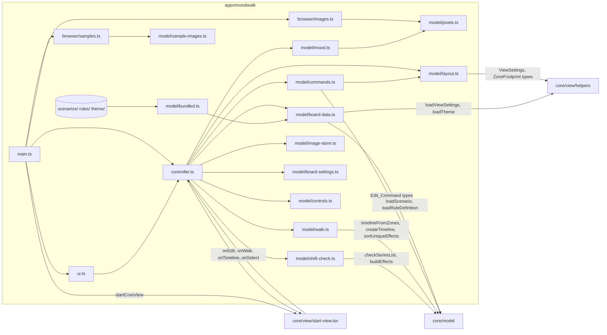

# Design Document: app-moodwalk

## Overview

This design implements Moodwalk (Unit 3, `apps/moodwalk/`) on top of the approved and gated core (`core-graph`, `core-rules`, `core-view`). It covers only the Must scope of `requirements.md` (R-APP2-01 to R-APP2-16): Route_Zones from Entrance to Exit, image placement, a Mood_Curve computed from image colors by rules, the Shift_Check with fog and Intentional_Shift_Marks, two viewpoints, the Walkthrough at visitor eye level, and the Demo_Board "School festival haunted house plan".

Guiding choice: the smallest design that meets every criterion, with **no change to `core/`** (R-APP2-14.3). The App has three layers:

- **Board model** (`apps/moodwalk/model/`): pure TypeScript functions on plain data. They import only `zod`, non-test files of `core/model/`, the View_Helpers `core/view/helpers/settings-schema.ts`, `theme-schema.ts`, `camera-path.ts`, and `link.ts` (which themselves import only `zod`, `core/model/`, and other View_Helpers; for example `link.ts` imports types from `./camera-path.ts` and `./settings-schema.ts`; this is enforced by the existing `core-view-helpers` lint scope), the bundled JSON files, and each other. The Mood_Analyzer, the Route_Layout, the Shift_Check, the Board_Settings schema, the Linked_Timeline builder, the Edit_Command builders, and the sample pixel recipes live here. This layer is the PBT target (P-APP2-1 to P-APP2-12) and runs under Vitest in Node with no DOM (R-APP2-14.2).
- **Browser part** (`apps/moodwalk/browser/`): the only code that touches image bytes and canvases: decoding an Image_File, scaling it to the Analysis_Size, reading Pixel_Data, making a display copy, and turning sample pixel data into same-origin `blob:` URLs (R-APP2-16.3).
- **Wiring** (`controller.ts`, `ui.ts`, `main.ts`): the controller turns person input and Core_View callbacks into model calls and Core_View handle calls. It has no DOM dependency: it talks to the Core_View through a `ViewPort` type, to images through an `ImagePort`, and to the page through a `UiSink`, so the order of Core_View calls is tested in Node with recording stubs (as in `app-ghost-mansion`). `ui.ts` draws the Route_Controls and the Curve_Panel with DOM calls and `textContent` only.

Requirements were approved on 2026-11-25 (decision-log). This design fixes every value the requirements left to design.md (Q7, Q9, Q10, Q11, and the values named in "Rules for this spec"); each is listed in "Design decisions". The human approved this design on 2026-11-25 with the recommended options; the decisions taken at that approval are listed in "Decided at design approval".

### Research findings that shape the design

Checked on 2026-11-25 by reading the current code under `core/model/`, `core/view/`, `scripts/sensors/`, and `apps/ghost-mansion/`, not only the core design documents.

- **The Core_View handle** (`core/view/start-view.tsx`) has `setHistory`, `setPreset`, `setEffects`, `setTheme`, `setEditMode`, `setGizmoMode`, `connectOn`, `connectOff`, `undo`, `redo`, `execute`, `startWalk(pathId, duration, linked?)`, `pauseWalk`, `resumeWalk`, `stopWalk`, `startTimeline`, `pauseTimeline`, `resumeTimeline`, `stopTimeline`, `stop`. There is no function that replaces the View_Settings, so a change of the Route_Zones restarts the Core_View (R-APP2-03.9, Q3).
- **The first ViewPreset is the start camera** (`initialViewState` in `core/view/helpers/view-state.ts` uses `settings.presets[0]`). The App keeps the Active_Preset across a restart by putting it first in the presets list it builds (R-APP2-11.5); no `setPreset` call is needed after the restart.
- **A linked walk hides the App effects.** `startWalk` with a Linked_Timeline sets `view.timeline` (mode `linked`). While `view.timeline` is not `null`, `shownEffects` (`core/view/helpers/effects-view.ts`) draws only `cursorEffects(cursor).upToCurrent`, the `effects` of steps 0 to the cursor, and ignores the list given with `setEffects`. `timelineFromZones` builds steps with `effects: []`. A Linked_Timeline built only by `timelineFromZones` would therefore remove all fog during the Walkthrough, against R-APP2-09.13. The App puts the current Mood_Effects into the `effects` of step 0, so `upToCurrent` holds them from the first frame to the end of the walk (decision M11). `checkLinkedTimeline` (`core/view/helpers/link.ts`) checks only the step count and the `targets`, so the `effects` do not affect the Link_Conditions.
- **A finished linked walk keeps its Timeline.** When the walk reaches Path_Progress 1, the Walk_State becomes `finished` and the linked playback becomes `ended`, but `view.timeline` stays set until `stopWalk` or `stopTimeline`. `setPreset` in `finished` turns the walk to `idle` without clearing the Timeline, and `stopWalk` in `idle` does nothing. The App therefore calls `stopTimeline()` when the Walk_Callback reports `finished`. `timelineStop` always clears `view.timeline`; the camera stays at the end pose because `cameraFor` follows the walk in `finished` (decision M12).
- **Waypoints of a `fromZones` path** (`buildZoneWaypoints` in `core/view/helpers/camera-path.ts`): one per Zone with a footprint, in ascending `order`, at `(fp.x, elevation + height, fp.z)`; each target is the next Waypoint; the last target continues the last direction. Two Zones with the same center fail.
- **Panels face +z.** A Node panel is a box `1.6 × scale.x` wide and `1.2 × scale.y` tall around its `position` (`BASE_WIDTH`, `BASE_HEIGHT` in `core/view/scene/node-panel.tsx`); the image texture is on the face toward +z at rotation (0, 0, 0). The image is fitted into a 512 × 384 panel texture (`PANEL_WIDTH`, `PANEL_HEIGHT`), so a large source image costs no more GPU memory per panel than a small one.
- **Zone floors are opaque planes at `elevation`** (`core/view/scene/zone-floor.tsx`), so a panel needs `position.y ≥ elevation + 0.6 × scale.y` to stay above the floor. A layer-0 slot (`y = 1.3`) keeps this up to `scale.y ≈ 2.17`; a panel scaled larger with the gizmo sinks partly into the floor. This is visual only (scale has no meaning in the rules), and the App does not move the panel up. The floor shows the Zone `label` (`en`).
- **Zone fog** is the footprint extruded up by `min(1, wallHeight)` (core-view D14). Effects are drawn only for an Effect_Kind with a Theme `fog` style and a visible target with a footprint (`drawableEffects`).
- **Drag** (`core/view/helpers/gesture-commands.ts`, `dragCommand`): one `updateNode` that changes only `position.x` and `position.z` (snapped by `snapStep`), never `zone` (R-VIEW-13.9).
- **Images.** `createImageCache` calls the App resolver once per reference, loads the returned URL in an ``, and marks it `failed` if a 1-pixel `getImageData` probe throws (tainted canvas). `blob:` URLs made by the page are same-origin and do not taint.
- **History** (`core/model/history.ts`) is `{ past, present, future, limit }`; `executeCommand` pushes the old `present` object into `past`; `undo` moves it to `future[0]`. The App tells its own actions from Gestures by a flag it sets before calling `undo`, `redo`, or `execute` (see "Controller").
- **Series** (`core/model/series.ts`): `checkSeriesList(scenario, settings[], marks)` returns one Series_Result per entry; Zone_Values are computed only for Zones that have a Node holding the attribute, and Step_Changes and Long_Runs are computed over that list (the Valued_Route_Zones). A shift is `intentional` when its `to` Zone is in the marks. Unknown marks go to `unresolved`, not to an error.
- **`buildEffects`** (`core/model/effects.ts`) validates the Judgement_Results with `judgementResultsSchema`, keeps only targets that exist in the Scenario, and returns a sorted list without repeats. A `shifts` source takes the `to` Zone of each non-intentional shift; a `longRuns` source takes every Zone of every run of the named attribute.
- **Lint scopes** (`scripts/sensors/boundary-rules.ts`): `app-moodwalk` bans only imports from `ghost-mansion`. Nothing keeps `three` or React out of `apps/moodwalk/model/`, and nothing bans `core/view/demo/` or test files (see "Lint scope for the board model").
- **Schema_Sensor test** (`scripts/sensors/schema.cli.test.ts`) runs the sensor on `apps/moodwalk/scenarios/placeholder.json`; replacing that file needs a one-line change of the test (see "Changes outside apps/moodwalk/").
- **Frame budget.** The core-view gate measured a 16.7 ms median frame time with 50 image Nodes on the Reference_Machine (decision-log 2026-11-16 and 2026-11-19). Moodwalk adds no Edges and at most 2 fog boxes per Route_Zone (one per Mood_Effect_Kind). The App sets no limit on the number of Route_Zones, so the fog box count grows with the Zone count: at most `2n` for `n` Zones, at most 14 for the 7 Zones of the Demo_Board (5 with its shipped flags). The gate measures the Demo_Board (7 Zones) with 50 images (R-APP2-15.4, gate item 11); a Board with many more Zones is not measured. If the median is above 16.7 ms, the human is asked which step of "Frame budget fallback" (Error Handling) to take.
- **Gizmo mode.** `setGizmoMode(mode: "rotate" | "scale")` exists on the handle and in `ViewStore`; the scale gizmo is reached only through it, so the App must offer a control for it (R-APP2-05.1).
- **Re-entrant calls from the Edit_Callback.** `ViewStore.execute` commits the new History, calls `onEdit({ kind: "history" })` synchronously, and only then dispatches `modelChanged`, built from `this.snapshot` at that moment. The handle's `execute` first calls `cancelGesture()`. So an App `execute` made synchronously inside `onEdit` runs fully (its own commit, `onEdit`, and `modelChanged`) before the outer `execute` dispatches its `modelChanged`, which then reads the newer snapshot. `undo` and `redo` report `{ kind: "history" }` even when the History did not change. `setHistory` commits and dispatches `modelChanged` but sends **no** `history` report (only a `settings` error report when a Zone lost its footprint), so the App updates its own copy of the History itself.

### Design decisions

| ID | Item left to design | Decision | Reason |
|---|---|---|---|
| M1 | Brightness formula and range | Alpha-weighted mean of BT.709 luma of the 8-bit sRGB values, from 0 to 1 (see "Formulas"). | A published standard; positive weights make it monotone in every channel (P-APP2-2). |
| M2 | Color temperature (Q7) | A unitless **warmth index**, not Kelvin: the alpha-weighted mean of `(R − B) / 255`. Color_Temperature_Range = [−1, 1]; +1 is warm (red, orange, yellow), −1 is cool (blue). Alpha weights each pixel as in M1; a pixel with alpha 0 has no weight. | Follows the blue ↔ yellow/gold axis that photo editors use for "Temperature"; Kelvin (McCamy CCT) is accurate to about ±2 K only from 2856 K to 6500 K and less accurate outside that range, and it gets larger for cooler light (see "Formulas"). |
| M3 | Analysis_Size and scaling (Q10) | 64 px for the largest width and height. Scale factor `k = min(1, 64 / w, 64 / h)`, size `max(1, round(w·k)) × max(1, round(h·k))`. Scaling by one canvas `drawImage` with `imageSmoothingEnabled = true` and `imageSmoothingQuality = "high"`. | A mean color needs few pixels; 64 × 64 = 4,096 pixels keeps every sum an exact integer (see "Formulas") and meets the P-APP2 generator bound min(64, Analysis_Size) = 64. |
| M4 | Attribute names | Brightness_Attribute `brightness`, Color_Temperature_Attribute `temperature`, Same_Mood_Attribute `sameMood`. | Short; `sameMood` differs from both (R-APP2-09.4). |
| M5 | Node_Type | `image`. | One image type. |
| M6 | Mood_Effect_Kinds and flag kinds | Flags `sudden-brightening`, `same-mood-too-long`; Effect_Kinds `sudden-brightening-fog`, `same-mood-fog`, both `style: "fog"` in the Theme. | The Theme accepts only `fog`. |
| M7 | Board_Settings | One value of each setting, shared by both attributes. Defaults: Shift_Threshold 0.15, Run_Tolerance 0.05, Min_Run_Length 3. | R-APP2-08.1 lets design choose; one field per setting is simpler. The defaults flag the Demo_Board as R-APP2-13.4 asks (see "Demo_Board"). |
| M8 | Route axis and layout (Q9) | Route axis `z`. Each Route_Zone gets a `rect` footprint 8 wide (x) and 4 deep (z), center `x = 0`, `z = 5 × rank` (rank 0 for the Entrance, by ascending `order`). Gap between footprints: 1. Every Zone has `elevation 0` and `enclosed false`. | Strictly increasing centers, no overlap, same size (R-APP2-03.2, 03.3). All Waypoints lie on the line `x = 0, y = Eye_Height`, so the straight-line fallback holds with no extra switch. |
| M9 | Image facing (Q9) | Every Image_Node is created with `rotation (0, π, 0)`, so its image faces −z, toward a visitor walking from the Entrance (+z direction). New images go to fixed slots beside the walking line (see "Route_Layout"). Rotation stays visual only. | The camera walks along `x = 0` toward +z; panels at rotation 0 would show their back. |
| M10 | Eye_Height, Walk_Duration | Eye_Height 1.5. Walk_Duration `4 × (n − 1)` seconds for `n` Route_Zones (24 s for the 7 Zones of the Demo_Board). | A standing eye height in the unit of the scene; a short walk that fits the 60-second path. |
| M11 | Fog during the Walkthrough | The Linked_Timeline is `timelineFromZones(scenario)` with the sorted Mood_Effects put into the `effects` of step 0. | Keeps the fog drawn during the walk (Research; R-APP2-09.13). |
| M12 | End of a walk | On Walk_Callback `finished`: `stopTimeline()`, `setEditMode("edit")`. The camera stays at the Exit until the person presses Stop, a viewpoint button, or Start again. | `setEffects` works again after the Timeline is cleared (Research); R-APP2-12.6. |
| M13 | Sample images (Q11) | The Sample_Images are **procedural pixel recipes** in `model/sample-images.ts` (pure, 64 × 48 pixels, alpha 255). The browser part turns each into a PNG `blob:` URL at start (canvas `putImageData`, `toBlob("image/png")`). No image file is committed or fetched. The example test computes `analyzeMood(samplePixels(recipe))` in Node and compares it with the Demo_Board values. | No decoder and no new dependency in Node; the test and the page use the same pixel data, so they cannot drift apart. Approved by the human on 2026-11-25 (D-O1); the committed-PNG alternative was rejected. |
| M14 | Byte budget (R-APP2-13.8) | Demo_Board Scenario_File at most 16 KB; Sample_Images 0 bytes transferred (made in the page); Moodwalk's own JavaScript (all chunks that are not shared with Ghost Mansion or the core demo) at most 60 KB before gzip. | The shared core and three.js chunk is already measured by the core-view gate; the App adds little. |
| M15 | Image display copy | The browser part keeps for display a copy of each Image_File scaled to fit 512 × 384 (the panel texture size) as a PNG `blob:` URL, and keeps no reference to the original `File`. | Memory stays bounded with 50 images of up to 10 MB; the panel never draws more than 512 × 384. |
| M16 | Image_Reference format | `sample:<recipe-id>` for Sample_Images, `upload:<n>` for Image_Files, with `n` a session counter that is never reused. | A key can never point to a different image later. |
| M17 | Ids of new Nodes and Zones | `image-<k>` and `zone-<k>`, with the smallest integer `k ≥ 1` that no Node or Zone uses. A new Zone gets `order = max(order) + 1`, `elevation 0`, `enclosed false`, `label { en: "New zone <k>", ja: "新しいゾーン <k>" }`. | Same rule as core-view D15; depends only on the Scenario. |
| M18 | Entrance and Exit labels (R-APP2-03.10) | The 3D floor shows each Zone `label`. The Curve_Panel axis and the "Add images to" list mark the first Zone "Entrance" and the last "Exit". The Demo_Board names its first and last Zones "Entrance" and "Exit". | A 3D tag would need an extra Node in the Scenario. |
| M19 | Curve display range | Brightness chart 0 to 1. Color temperature chart −0.5 (cool) to +0.5 (warm); a value outside is drawn at the edge, and its pointer text shows the true value. | Photos rarely leave ±0.5, so a ±1 axis would draw a flat line. Display only; the Shift_Check uses the true values. |
| M20 | Fallback switch | `model/fallback.ts` exports `FALLBACK = { brightnessOnly: false }`. With `brightnessOnly`, new Image_Nodes store only `brightness`, the Mood_Curve and the Shift_Check use only the Brightness series, and the Same_Mood_Runs are the Brightness Long_Runs. The straight-line fallback needs no switch (M8). | intent.md ch. 7 fallbacks, off by default. |
| M21 | No WebGL | `main.ts` probes `getContext("webgl2")` as Ghost Mansion does. Without it, the App still calls `startCoreView` (which draws its own message), shows the back link and `3D display is not available, so the board cannot be shown.`, and wires no control. | Same behaviour as App 1; the core gives no report. |

## Architecture



Dependencies go one way:

```
core/model/*, core/view/helpers/*  <-  apps/moodwalk/model/*  <-  controller.ts  <-  ui.ts, main.ts
apps/moodwalk/model/pixels.ts, sample-images.ts  <-  apps/moodwalk/browser/*  <-  main.ts
core/view/start-view.tsx  <-  main.ts (value import), controller.ts (type import only)
```

- `apps/moodwalk/model/` imports `zod`, `../../../core/model/<file>.ts` (non-test files), `../../../core/view/helpers/<file>.ts` (non-test files), the JSON files of the App, and `./*.ts`. It uses no DOM global, no `fetch`, no `Date`, and no `Math.random`.
- `apps/moodwalk/browser/` uses DOM APIs (`document`, `createImageBitmap`, canvas, `URL.createObjectURL`) and imports only `../model/pixels.ts`, `../model/sample-images.ts`, and types. It imports nothing from `core/`.
- `controller.ts` imports only types from `core/view/start-view.tsx` (`import type`), so it loads in Node without React or three.js.
- No file imports `core/view/demo/`, `core/view/scene/`, or a `*.test.ts` file (R-APP2-14.1).
- Nothing under `core/` changes, and no Moodwalk word enters `core/` (R-APP2-14.3).
- Every relative import is written with its `.ts` (or `.tsx`) extension (lessons.md 2026-11-23).

### File layout

| File | Responsibility | Imports |
|---|---|---|
| `apps/moodwalk/index.html` | Page shell: `<title>Moodwalk</title>`, `#app` with `#header`, `#view` (3D host, with a CSS height from the start and `aspect-ratio: 16 / 9`, see "View_Settings"), `#panel` (Route_Controls), `#curve` (Curve_Panel), `#notice`. | — |
| `apps/moodwalk/main.ts` | Browser start: load the board data, make the Sample_Image URLs, WebGL probe, create the controller and the UI, `startCoreView`, page-wide drop handlers. | `core/view/start-view.tsx`, `core/model/history.ts`, `./controller.ts`, `./ui.ts`, `./browser/*`, `./model/*` |
| `apps/moodwalk/controller.ts` | `BoardController`: Board state, Core_View call order, callbacks, image adding, restart on Route_Zone changes. No DOM. | model files, `core/model/history.ts`, types from `core/view/start-view.tsx` |
| `apps/moodwalk/ui.ts` | DOM: Route_Controls, Curve_Panel (SVG with `createElementNS`), messages. `textContent` only, never `innerHTML`. | `./controller.ts` (types), `./text.ts`, `./model/curve-layout.ts` |
| `apps/moodwalk/text.ts` | Every UI `LocalizedText` (extended; `title` and `backLink` kept, `body` removed). | `core/model/scenario-schema.ts` (type) |
| `apps/moodwalk/scenarios/school-festival-haunted-house.json` | Demo_Board Scenario_File (replaces `placeholder.json`). | — |
| `apps/moodwalk/rules/mood-rules.json` | Rule_Definition with the two Effect_Rules (replaces `rules/.gitkeep`). | — |
| `apps/moodwalk/rules/board-settings.json` | Default Board_Settings. | — |
| `apps/moodwalk/theme/theme.json` | Theme (replaces `theme/.gitkeep`). | — |
| `model/names.ts` | Fixed names: Node_Type, attribute names, Effect_Kinds, flag kinds, preset ids, path id, Eye_Height, reference prefixes. | none |
| `model/pixels.ts` | `PixelData`, `ANALYSIS_SIZE`, `analysisSize`. | none |
| `model/mood.ts` | `analyzeMood` (Mood_Analyzer). | `./pixels.ts` |
| `model/board-settings.ts` | `boardSettingsSchema`, `loadBoardSettings`, `parseSettingField`. | `zod`, `core/model/scenario-schema.ts` |
| `model/layout.ts` | Route_Layout: `routeFootprints`, `buildViewSettings`, `footprintAt`, `slotPosition`, `freeSlot`, `walkDuration`. | `core/view/helpers/settings-schema.ts` (types), `core/model/scenario-schema.ts` (types) |
| `model/shift-check.ts` | `seriesSettingsFor`, `sameMoodRuns`, `checkMood` (Mood_Curve, Mood_Flags, Mood_Effects). | `core/model/series.ts`, `effects.ts`, `rule-schema.ts` |
| `model/walk.ts` | `linkedTimeline`, `canWalk`. | `core/model/timeline.ts`, `effects.ts` |
| `model/commands.ts` | `newImageId`, `newZone`, `addImageCommand`, `addZoneCommand`, `removeZoneCheck`, `removeImageCommand`, `classifyMove`, `checkImageFile`. | `core/model/commands.ts` (types), `./layout.ts` |
| `model/image-store.ts` | `referencesIn`, `ImageStore` (release function injected). | `core/model/history.ts` (type) |
| `model/board-data.ts` | `loadBoardData(raw)` and `crossReferenceErrors(data)`. | `core/model/scenario-io.ts`, `rule-schema.ts`, `core/view/helpers/settings-schema.ts`, `theme-schema.ts`, `./board-settings.ts`, `./layout.ts` |
| `model/bundled.ts` | The only imports of the JSON files; exports `BUNDLED`. | the JSON files |
| `model/sample-images.ts` | `SAMPLE_RECIPES`, `samplePixels`. | `./pixels.ts` |
| `model/curve-layout.ts` | `curveLayout`: point coordinates and labels of the Curve_Panel from a Mood_Curve (pure). | `./shift-check.ts` (types) |
| `model/controls.ts` | `controlsFor(state)`: which controls are enabled; `statusFor(state)`: the status hint under "Start walkthrough". | none |
| `model/fallback.ts` | `FALLBACK`. | none |
| `model/arbitraries.ts` | Test support only: generators. Imported only by `*.test.ts`. | `fast-check`, model files |
| `browser/images.ts` | `readImageFile(file)`: decode, scale to Analysis_Size, read Pixel_Data, make the display copy. | `../model/pixels.ts` |
| `browser/samples.ts` | `renderSamples(recipes)`: recipes to `blob:` URLs. | `../model/sample-images.ts` |
| `*.test.ts` | Tests next to their sources. | `vitest`, `fast-check` |

### Lint scope for the board model

R-APP2-14.2 asks that the model files import no three.js, React, React Three Fiber, or drei, and R-APP2-14.1 forbids `core/view/demo/` and test files. Today the `app-moodwalk` scope bans only `ghost-mansion`. This design makes the same kind of change that was decided for Ghost Mansion on 2026-11-23. It is a **repo-foundation sensor change**, approved by the human on 2026-11-25 (D-O2). The Ghost Mansion scopes do not change. In `scripts/sensors/boundary-rules.ts`, with the existing `scope()` and `ban()` builders:

The existing `demoBan` and `testFileBan` carry messages that name `ghost-mansion`, so they are not reused. New Moodwalk bans, each with its own message, are defined next to them with the existing `ban()` builder and the separator class `S`:

| Ban | Regex | Message (after `[boundary] `) |
|---|---|---|
| `ghostMansionBan` (the existing inline ban, given a name) | `GHOST_MANSION_SEGMENT` | `import-boundary: moodwalk must not import from ghost-mansion.` |
| `moodwalkDemoBan` | `core${S}view${S}demo` | `import-boundary: moodwalk must not import core/view/demo.` |
| `moodwalkTestFileBan` | `\.test\.ts$` | `import-boundary: moodwalk must not import a *.test.ts file.` |
| `moodwalkModelViewBan` | `core${S}view${S}(?!helpers${S})` | `import-boundary: the moodwalk model may import only View_Helpers (core/view/helpers/) from core/view.` |
| `moodwalkHelpersDotDotBan` | `core${S}view${S}helpers${S}(?:.*${S})?\.\.(?:${S}\|$)` | `import-boundary: the moodwalk model must not use '..' after core/view/helpers/.` |
| `moodwalkModelDotDotBan` | `core${S}model${S}(?:.*${S})?\.\.(?:${S}\|$)` | `import-boundary: the moodwalk model must not use '..' after core/model/.` |

In the table, `\|` stands for a plain `|` in the regex (escaped only for the Markdown table).

1. Scope `app-moodwalk` (`apps/moodwalk/**`): `[ghostMansionBan, moodwalkDemoBan, moodwalkTestFileBan]`.
2. New scope `app-moodwalk-model` for `apps/moodwalk/model/**/*.{ts,tsx}`, placed after `app-moodwalk`: `[ghostMansionBan, moodwalkDemoBan, moodwalkTestFileBan, ...modelPackageBans, moodwalkModelViewBan, moodwalkHelpersDotDotBan, moodwalkModelDotDotBan]`. `moodwalkModelDotDotBan` closes a path such as `core/model/../view/scene/x.ts`, which would otherwise pass `moodwalkModelViewBan` because the text after `core/model/` is not `core/view/`. It is used only in this Moodwalk scope; the Ghost Mansion scopes do not change. The first three are repeated because a later flat-config entry replaces the rule options. `modelPackageBans` keeps its existing message (it names `core/model`); it is reused as it is, because its text states the package rule, and the scope name in the lint output tells which scope fired. `moodwalkModelViewBan` uses a negative lookahead in the same way as the existing `modelViewBan` of `app-ghost-mansion-model`, which the lint rule and the esquery selectors already accept.

`scripts/sensors/boundary-rules.test.ts` gets fixtures for `apps/moodwalk/model/a.ts` (rejected: `three`, `react`, `@react-three/fiber`, `../../../core/view/start-view.tsx`, `../../../core/view/scene/x.ts`, `../../../core/view/demo/main.tsx`, `../../../core/view/helpers/../scene/x.ts`, `../../../core/model/../view/scene/x.ts`, `./x.test.ts`, `../../ghost-mansion/x.ts`; accepted: `../../../core/model/series.ts`, `../../../core/view/helpers/camera-path.ts`, `./mood.ts`) and for `apps/moodwalk/main.ts` (rejected: `../../core/view/demo/main.tsx`, `./x.test.ts`; accepted: `../../core/view/start-view.tsx`). The demo and test-file rejections in Moodwalk files carry the Moodwalk messages, not the Ghost Mansion ones.

Test files under `apps/moodwalk/model/` fall under the same scope; they need only `vitest`, `fast-check`, model files, and the View_Helpers, which the scope allows.

A ban of DOM globals in the model (for example `no-restricted-globals` for `document`, `window`, `fetch`) is not proposed: the scope builder sets only import and syntax rules, and the reviewer checks this (R-APP2-06.1).

### Changes outside apps/moodwalk/ (repo-foundation)

Nothing under `core/` changes. These files of `repo-foundation` change:

| File | Change | Reason |
|---|---|---|
| `apps/moodwalk/scenarios/placeholder.json` | removed; `school-festival-haunted-house.json` added | R-APP2-02.3 |
| `scripts/sensors/schema.cli.test.ts` | the single-file run for `moodwalk` uses `apps/moodwalk/scenarios/school-festival-haunted-house.json`, and the test title names the Demo_Board instead of the placeholder | the test names the removed file |
| `scripts/sensors/boundary-rules.ts`, `.test.ts` | the lint scope above (approved 2026-11-25, D-O2) | R-APP2-14.1, 14.2 |
| `apps/moodwalk/index.html` | `<title>Moodwalk</title>` and the page elements | R-APP2-01 (same path) |

`vite.config.ts`, the Top_Page, `package.json`, and the check:build allow list do not change (no new package, no new URL string). Each change gets a decision-log line in its task.

## Components and Interfaces

### The core/app interface

What the App gives the core:

| Given to | Value | Source |
|---|---|---|
| `startCoreView({ history })`, `setHistory` | History of the Board, from `createHistory(scenario, 100)` | `scenarios/school-festival-haunted-house.json` |
| `startCoreView({ settings })` | View_Settings built by `buildViewSettings(zones, activePreset)` | `model/layout.ts` |
| `startCoreView({ theme })` | Theme | `theme/theme.json` |
| `startCoreView({ resolveImage })` | `(ref) => imageStore.url(ref)` | `model/image-store.ts` |
| Rule_Engine functions | Rule_Definition and Series_Settings from the Board_Settings | `rules/mood-rules.json`, `rules/board-settings.json` |
| `setEffects` | Mood_Effects | `model/shift-check.ts` |
| `startWalk("route", duration, linked)` | Walk_Duration and Linked_Timeline | `model/layout.ts`, `model/walk.ts` |
| `execute` | Edit_Commands | `model/commands.ts` |

Core calls the App makes (checked against the code):

| Call | File | Used for |
|---|---|---|
| `loadScenario(text)`, `saveScenario(s)` | `core/model/scenario-io.ts` | R-APP2-01.3; P-APP2-9 |
| `loadRuleDefinition(value)` | `core/model/rule-schema.ts` | R-APP2-01.3 |
| `localizedTextSchema`, `validateScenario` | `core/model/scenario-schema.ts` | tests, `board-data.ts` |
| `loadViewSettings`, `loadTheme` | `core/view/helpers/settings-schema.ts`, `theme-schema.ts` | R-APP2-01.3, 14.5 |
| `createHistory(s, 100)`, `executeCommand`, `undo`, `redo` | `core/model/history.ts` | start; P-APP2-10 |
| `applyCommand` | `core/model/commands.ts` | tests and generators |
| `checkSeriesList(s, settings, marks)` | `core/model/series.ts` | Mood_Curve, Shift_Check |
| `buildEffects(s, rules, results)`, `sortUniqueEffects` | `core/model/effects.ts` | Mood_Effects, step 0 effects |
| `timelineFromZones(s)`, `createTimeline(steps)` | `core/model/timeline.ts` | Linked_Timeline |
| `buildZoneWaypoints`, `checkLinkedTimeline` | `core/view/helpers/camera-path.ts`, `link.ts` | P-APP2-8, P-APP2-11 (tests only) |
| `startCoreView` and the handle functions | `core/view/start-view.tsx` | wiring |

No AI_Adapter, `fetch`, clock, or random source is used in any judgement path (R-APP2-06.9, 14.4).

### Fixed names (`model/names.ts`)

| Kind | Value |
|---|---|
| Node_Type | `image` |
| Attributes | `brightness`, `temperature`, `sameMood` (Series_Result only) |
| Flag kinds | `sudden-brightening`, `same-mood-too-long` |
| Effect_Kinds | `sudden-brightening-fog`, `same-mood-fog` |
| Effect_Rule ids | `mark-sudden-brightening`, `mark-same-mood` |
| ViewPreset ids | `overview` (Overview_Preset), `visitor` (Visitor_Preset) |
| Camera_Path id | `route` |
| `EYE_HEIGHT` | 1.5 |
| Reference prefixes | `sample:`, `upload:` |

These words live only in `apps/moodwalk/` (R-APP2-14.3).

### Pixel data and Mood_Analyzer (`model/pixels.ts`, `model/mood.ts`)

```ts
export const ANALYSIS_SIZE = 64;
export type PixelData = { readonly width: number; readonly height: number; readonly data: ArrayLike<number> };  // RGBA, row-major
/** Size after scaling down to fit ANALYSIS_SIZE (never enlarged); null for a width or height that is not a positive integer. */
export function analysisSize(width: number, height: number): { width: number; height: number } | null;

export type MoodValues = { brightness: number; temperature: number };
export type AnalysisFailure = { ok: false; reason: "no-pixels" | "transparent" | "bad-data" | "too-large" };
export type MoodResult = { ok: true; value: MoodValues } | AnalysisFailure;
export const TEMPERATURE_RANGE = { min: -1, max: 1 } as const;
export function analyzeMood(pixels: PixelData): MoodResult;
```

`analyzeMood` steps (no exception escapes; one `try` returns `bad-data`):

1. `width` or `height` not a non-negative integer, or `data.length ≠ 4 × width × height`, or any value not an integer from 0 to 255 → `bad-data`.
2. `width` or `height` greater than `ANALYSIS_SIZE` → `too-large` (the browser part never passes such data; the bound keeps the sums exact).
3. `width × height = 0` → `no-pixels` (R-APP2-06.3, 06.7).
4. One pass over the pixels in index order, with integer sums `A = Σ a`, `Y = Σ a·(2126 r + 7152 g + 722 b)`, `W = Σ a·(r − b)`.
5. `A = 0` → `transparent` (R-APP2-06.3).
6. `brightness = Y / (A × 2,550,000)`, `temperature = W / (A × 255)`; return both.

The function reads only its argument, writes nothing, and has no state (R-APP2-06.4, 06.7). It imports no browser API (R-APP2-06.1).

### Browser image reading (`browser/images.ts`, R-APP2-04, R-APP2-16)

```ts
// ReadResult is declared in model/pixels.ts, so the controller can use it without importing browser code.
export type ReadResult = { ok: true; pixels: PixelData; displayUrl: string } | { ok: false; reason: "decode" };
export async function readImageFile(file: Blob): Promise<ReadResult>;
```

1. `const bitmap = await createImageBitmap(file)` (decodes PNG, JPEG, and WebP; a failure gives `decode`).
2. `analysisSize(bitmap.width, bitmap.height)`; draw the bitmap into a canvas of that size with `imageSmoothingEnabled = true` and `imageSmoothingQuality = "high"`; `getImageData(0, 0, w, h)` in the default sRGB color space (R-APP2-16.1, 16.2). When the size equals the bitmap size, the draw is 1:1 (no enlarging).
3. Display copy: draw the bitmap into a canvas that fits 512 × 384 (never enlarged), `toBlob("image/png")`, `URL.createObjectURL` (M15).
4. `bitmap.close()`. No reference to `file` is kept.

The function reads no metadata and calls no network API (S-APP2-3, S-APP2-4). It is not unit-tested (browser only); the controller tests use a stub `ImagePort`.

### Sample images (`model/sample-images.ts`, `browser/samples.ts`, R-APP2-13.5, 13.6, 16.4)

```ts
export type Rgb = readonly [number, number, number];
export type SampleRecipe = {
  id: string;                       // reference is `sample:<id>`
  top: Rgb; bottom: Rgb;            // vertical gradient
  spot?: { cx: number; cy: number; radius: number; color: Rgb; strength: number };  // soft light, pixel units
};
export const SAMPLE_WIDTH = 64;     // 64 × 48 = 4:3, the panel ratio; fits ANALYSIS_SIZE
export const SAMPLE_HEIGHT = 48;
export const SAMPLE_RECIPES: readonly SampleRecipe[];
export function samplePixels(recipe: SampleRecipe): PixelData;   // alpha 255 everywhere
```

Pixel `(x, y)`: `t = y / (h − 1)`; base = `top + t·(bottom − top)` per channel; with a spot, `d = Math.sqrt(dx·dx + dy·dy)`, `s = strength × u·u` with `u = max(0, 1 − d / radius)`; color = `base·(1 − s) + spot·s`; each channel `Math.round`, clamped to 0..255. Only `+ − × /`, `Math.sqrt`, and `Math.round` are used, which IEEE 754 defines exactly, so the pixels are the same in Node and in every browser.

`renderSamples(recipes): Promise<Map<string, string>>` puts each `samplePixels` result into an `ImageData`, draws it with `putImageData` on a 64 × 48 canvas, and makes a PNG `blob:` URL. Alpha is 255 everywhere, so premultiplied alpha cannot change a pixel. The Sample_Images are fictional abstract color fields made by the developer's code, not by AI (S-APP2-2, S-APP2-5).

### Board_Settings (`model/board-settings.ts`, R-APP2-08)

```ts
export const boardSettingsSchema = z.strictObject({
  shiftThreshold: z.number().min(0),        // zod 4 rejects NaN and ±Infinity
  runTolerance: z.number().min(0),
  minRunLength: z.number().int().min(2),    // zod 4 int() = safe integer
});
export type BoardSettings = z.infer<typeof boardSettingsSchema>;
export function loadBoardSettings(value: unknown): { ok: true; settings: BoardSettings } | { ok: false; errors: ValidationError[] };
export type SettingField = keyof BoardSettings;
export function parseSettingField(field: SettingField, text: string): { ok: true; value: number } | { ok: false };
```

- `loadBoardSettings` wraps `safeParse` in `try`, maps issues with `toValidationErrors`, and returns one error at `""` on an unexpected exception, so it never throws (R-APP2-08.6, P-APP2-12).
- `parseSettingField` trims the text; an empty text, a text that `Number()` does not turn into a finite number, a negative number, or (for `minRunLength`) a non-integer or a value below 2 gives `{ ok: false }` (R-APP2-08.5). `Number("")` is 0, so the empty check comes first.

### Route_Layout (`model/layout.ts`, R-APP2-03, R-APP2-11)

```ts
export const LAYOUT = { width: 8, depth: 4, pitch: 5, panelY: 1.3, layerStep: 1.4,
  slotX: [-1.5, 1.5, -3, 3], slotDz: [1.5, 1.5, -0.5, -0.5], snapStep: 0.5 } as const;
export type PresetId = "overview" | "visitor";
export function routeFootprints(zones: readonly Zone[]): ZoneFootprint[];            // in ascending order
export function buildViewSettings(zones: readonly Zone[], active: PresetId): ViewSettings;
export function footprintAt(footprints: readonly ZoneFootprint[], x: number, z: number): string | null;
export function slotPosition(center: { x: number; z: number }, elevation: number, index: number): Vec3;
export function freeSlot(scenario: Scenario, zoneId: string, footprints: readonly ZoneFootprint[]): Vec3 | null;
export function walkDuration(zoneCount: number): number;                                 // 4 × (n − 1), at least 4
```

- **Footprints.** Zones sorted by `order`; rank `k` gives `{ kind: "rect", id, x: 0, z: 5k, width: 8, depth: 4 }`. The sort uses `order` only, so the result does not depend on the list order (R-APP2-03.4). Centers differ by 5 and each footprint spans `z ∈ [5k − 2, 5k + 2]`, so footprints never overlap (R-APP2-03.2, 03.3).
- **`footprintAt`** returns the id of the footprint with `|x − fx| ≤ width / 2` and `|z − fz| ≤ depth / 2`, or `null`. The 1-unit gap between footprints is outside every footprint.
- **Slots** (R-APP2-04.7). Slot `i`: column `c = i mod 4`, layer `L = floor(i / 4)`; position `(slotX[c], elevation + 1.3 + 1.4·L, center.z + slotDz[c])`. Columns stay at `|x| ≥ 1.5`, so a panel (half width 0.8) never crosses the walking line `x = 0`. The outer columns at `|x| = 3` reach to `|x| = 3.8`, 0.2 inside the footprint edge, and stand at `center.z − 0.5`, in front of the inner columns (`center.z + 1.5`) as seen from a camera that approaches from −z. Because the outer panels are nearer to the camera and farther to the side, they leave the image first when the camera comes close; the Visitor_Preset is placed far enough back that every slot of layers 0 and 1 of the Entrance is in view (see "View_Settings"). Every slot `x` and `z` is a multiple of 0.5 (the `snapStep`). `freeSlot` returns the first slot whose position equals the position of no Image_Node of that Zone; `null` only for an unknown Zone.
- **View_Settings** (`buildViewSettings`):

```json
{ "zoneFootprints": "<routeFootprints(zones)>",
  "presets": ["<active preset first, then the other>"],
  "paths": [{ "id": "route", "fromZones": { "height": 1.5 } }],
  "detailDistance": 2, "snapStep": 0.5, "wallHeight": 1.2, "editMode": "edit", "stepDuration": 2 }
```

  With `n` Zones, `z0 = 0`, `zLast = 5(n − 1)`, `zMid = zLast / 2`, `span = zLast + 4`, `D = max(12, 1.2 × (span / 2) / tan(25°))` (25° is half the vertical field of view 50° of `view-root.tsx`):
  - Overview_Preset `overview`, label `{ en: "Overview", ja: "全体" }`: position `(0, 0.8·D, zMid − 0.6·D)`, target `(0, 0, zMid)`, filter `{ edgeRule: "bothEnds" }`. The camera looks down the route from behind and above the Entrance, so the images (facing −z) face it and depth reads as order (R-APP2-11.2).
  - Visitor_Preset `visitor`, label `{ en: "Visitor view", ja: "来場者の目線" }`: position `(0, e₀ + 1.5, z0 − 7)` (5 units in front of the near edge of the Entrance footprint, on the walking line), target `(0, e₁ + 1.5, z1)` with `e₀`, `e₁` the `elevation` of the first two Zones, filter `{ edgeRule: "bothEnds" }`. The camera stands at eye height just before the Entrance and looks along the route at it, as the amended R-APP2-11.3 ("at eye height just before the Entrance") asks.
  - **Visitor_Preset field-of-view check.** The vertical field of view is 50° (`view-root.tsx`), so `tan(25°) ≈ 0.466`; the horizontal half-angle tangent is `0.466 × aspect` (0.829 at 16:9, 0.622 at 4:3). From `z0 − 7`, the outer Entrance slots (`|x|` up to 3.8, `z = z0 − 0.5`, depth 6.5 from the camera) need `3.8 / 6.5 ≈ 0.585`, and the inner slots (`|x|` up to 2.3, depth 8.5) need 0.27; both fit at 16:9 and at 4:3 (any aspect of at least 1.26). Vertically, the top of layer 1 (`y = 3.3`, 1.8 above the eye) at depth 6.5 needs 0.28 and the bottom of layer 0 (`y = 0.7`) needs 0.12; both are below 0.466. Layer 2 (slot index 8 and up, top `y = 4.7`) needs 0.49 at depth 6.5 and may be cut at the top edge; with at most 8 images in the Entrance this does not occur, and the Demo_Board has 1 there. **Aspect ratio of the 3D view:** the `#view` CSS keeps the aspect ratio of the 3D view at or above 1.26 with `aspect-ratio: 16 / 9` (the width follows the layout column, the height follows the width), so the horizontal check above holds at every window size. Gate item 4 checks it. This remains a **known constraint**, not checked by code: a ninth image in the Entrance can put an Entrance image partly outside the Visitor_Preset view. The person can still see it in the Overview or during the Walkthrough.
  - The Visitor_Preset is not inside the Entrance footprint; it stands in the open space before it. The Walkthrough starts at the first Waypoint (the Entrance center), not at the Visitor_Preset.
  - No filter lists Zones or Node_Types, so every Route_Zone, Image_Node, and fog is visible in both presets.
  - With fewer than 2 Zones, `buildViewSettings` still returns valid settings (Visitor target `(0, 1.5, 5)`), and `canWalk` is `false` (R-APP2-12.9). The App never shows such a Board (R-APP2-03.1).

### Shift_Check (`model/shift-check.ts`, R-APP2-07, R-APP2-09, R-APP2-10)

```ts
export type CurveSeries = { attribute: string; series: { zone: string; value: number }[]; noData: string[] };
export type MoodCurve = { zones: { id: string; label: LocalizedText; order: number }[]; attributes: CurveSeries[] };
export type FlagReason =
  | { kind: "sudden-brightening"; from: string; change: number; threshold: number }
  | { kind: "same-mood-too-long"; run: string[]; minRunLength: number; runTolerance: number };
export type MoodFlag = { zone: string; reason: FlagReason };
export type MoodReport = { curve: MoodCurve; flags: MoodFlag[]; effects: EffectRequest[]; sameMoodRuns: string[][];
  brightness: SeriesResult; temperature: SeriesResult | null };
export function seriesSettingsFor(settings: BoardSettings, flags: Fallback): SeriesSettings[];
export function sameMoodRuns(bRuns: string[][], tRuns: string[][], minRunLength: number): string[][];
export function checkMood(scenario: Scenario, settings: BoardSettings, marks: readonly string[],
  rules: RuleDefinition, flags?: Fallback): RuleOutcome<MoodReport>;
```

`seriesSettingsFor` returns, in this order, `{ attribute: "brightness", zoneValue: "mean", shiftThreshold, direction: "up", runTolerance, minRunLength }` and (unless `brightnessOnly`) the same for `temperature`. The `temperature` Series_Settings keeps `direction: "up"`; its shifts are never used.

`checkMood` steps:

1. `checkSeriesList(scenario, seriesSettingsFor(settings, flags), [...marks])`. A Rule_Failure is returned as is (R-APP2-07.9, 09.12).
2. Mood_Curve: Zones sorted by `order`; for each Series_Result, its `series` and `noData` = the Zone ids in ascending `order` that are not in `series` (R-APP2-07.1, 07.2).
3. `sameMoodRuns(b.longRuns, t.longRuns, M)`: for every pair `(bRun, tRun)`, `bRun.filter((z) => tSet.has(z))`; keep it when its length is at least `M`. Pairs are visited in `bRuns` order, then `tRuns` order. With `brightnessOnly`, the result is `b.longRuns` (R-APP2-09.3, fallback). This step reads Zone ids only, no Zone_Value (R-APP2-09.1).
4. Judgement_Results: `{ series: [b, { attribute: "sameMood", series: [], changes: [], shifts: [], longRuns: runs, unresolved: [] }] }`.
5. `buildEffects(scenario, rules, results)`: the `shifts` rule names `brightness` (non-intentional shifts only), the `longRuns` rule names `sameMood` (R-APP2-09.4). A Rule_Failure is returned as is.
6. Mood_Flags, sorted by Zone `order`, then kind (`sudden-brightening` first): one `sudden-brightening` per shift of `b.shifts` with `intentional: false` (reason: `from`, `change`, Shift_Threshold), and one `same-mood-too-long` per Zone of the union of the runs (reason: the run that holds it, Min_Run_Length, Run_Tolerance). The flags are read from the same Series_Results as the effects, so each Effect_Request matches exactly one Mood_Flag (P-APP2-7).

`checkMood` depends only on its arguments, writes nothing, and returns deeply equal reports for deeply equal arguments (R-APP2-09.8). `position`, `rotation`, `scale`, Faces, and Metadata are not read by `checkSeriesList` (R-RULES-03.7), so they cannot change the report (R-APP2-05.5, 07.6).

### Linked_Timeline (`model/walk.ts`, R-APP2-12)

```ts
export function linkedTimeline(scenario: Scenario, effects: readonly EffectRequest[]): RuleOutcome<Timeline>;
export function canWalk(scenario: Scenario, footprints: readonly ZoneFootprint[]): boolean;
```

- `linkedTimeline`: `timelineFromZones(scenario)` (one step `step-i` per Zone in ascending `order`, `targets: [{ kind: "zone", id }]`), then step 0 gets `effects: sortUniqueEffects(effects)` and the result is checked with `createTimeline` (M11, R-APP2-12.3).
- `canWalk`: at least 2 Zones and every Zone id has a footprint (R-APP2-12.9).

### Edit_Commands (`model/commands.ts`, R-APP2-03 to R-APP2-05)

```ts
export type FileFacts = { name: string; type: string; size: number };
export type FileCheck = { ok: true } | { ok: false; reason: "format" | "size" | "limit" };
export function checkImageFile(file: FileFacts, imageCount: number): FileCheck;   // R-APP2-04.3 to 04.5
export function newImageId(s: Scenario): string;
export function newZone(s: Scenario): Zone;
export function addImageCommand(s: Scenario, input: { reference: string; zone: string; mood: MoodValues },
  footprints: readonly ZoneFootprint[], flags?: Fallback): EditCommand | null;
export function addZoneCommand(s: Scenario): EditCommand;
export type RemoveZone = { ok: true; command: EditCommand } | { ok: false; reason: "has-images" | "too-few-zones" | "unknown" };
export function removeZoneCheck(s: Scenario, zoneId: string): RemoveZone;
export function removeImageCommand(s: Scenario, nodeId: string): EditCommand | null;
export type MoveOutcome = { kind: "none" } | { kind: "zone"; command: EditCommand } | { kind: "outside" };
export function classifyMove(before: Scenario, after: Scenario, footprints: readonly ZoneFootprint[]): MoveOutcome;
```

- `checkImageFile`: `type` must be `image/png`, `image/jpeg`, or `image/webp` (`format`); `size ≤ 10,485,760` (`size`); `imageCount < 50` (`limit`). Checked in this order.
- `addImageCommand` builds one `addNode` with `{ id: newImageId(s), type: "image", position: freeSlot(...), rotation: { x: 0, y: Math.PI, z: 0 }, scale: { x: 1, y: 1, z: 1 }, front: { image: reference }, zone, metadata: {}, attributes: { brightness, temperature } }` (only `brightness` under `brightnessOnly`). An uploaded image gets no Face text, so its file name is not stored (S-APP2-4). `null` for an unknown Zone.
- `addZoneCommand`: `{ kind: "addZone", zone: newZone(s) }` (R-APP2-03.6).
- `removeZoneCheck`: `unknown` for a missing Zone; `has-images` when a Node names it; `too-few-zones` when the Board has 2 Zones or fewer; otherwise `{ kind: "removeZone", id }` (R-APP2-03.7, 03.8).
- `removeImageCommand`: `{ kind: "removeNode", id }` for an `image` Node, else `null` (R-APP2-05.2).
- `classifyMove` (R-APP2-05.3, 05.4): `none` unless `after` differs from `before` only in the `position` of one Node (same lists and every other field equal). For that Node, `footprintAt(footprints, x, z)`: `null` gives `outside`; the Node's own Zone gives `none`; another Zone gives `zone` with `{ kind: "updateNode", id, changes: { zone } }`.

No builder creates an Edge (R-APP2-02.2), and no command other than `addImageCommand` writes `brightness` or `temperature` (R-APP2-06.8).

### Image_Store (`model/image-store.ts`, R-APP2-04.6, 04.11, 15.6)

```ts
export function referencesIn(history: History): Set<string>;   // front.image of every Node in past, present, future
export class ImageStore {
  constructor(release: (url: string) => void);
  put(reference: string, url: string): void;
  url(reference: string): string | null;     // the Image_Resolver
  remove(reference: string): void;           // releases the URL
  prune(history: History): string[];         // removes and releases every entry not in referencesIn(history)
}
```

`main.ts` injects `URL.revokeObjectURL` as `release`. The controller calls `prune` after every History change; an entry is removed only when no Scenario of the History holds it (R-APP2-15.6). Sample entries follow the same rule. The resolver returns `null` for any reference not in the store, so the Core_View loads nothing else (R-APP2-04.11).

### Board data loading (`model/board-data.ts`, `model/bundled.ts`, R-APP2-01.3, 01.4)

```ts
export type RawBoardData = { scenarioText: string; rules: unknown; settings: unknown; theme: unknown };
export type BoardData = { scenario: Scenario; rules: RuleDefinition; settings: BoardSettings; theme: Theme };
export type DataResult = { ok: true; data: BoardData } | { ok: false; errors: { file: string; path: string; message: string }[] };
export function loadBoardData(raw: RawBoardData): DataResult;
export function crossReferenceErrors(data: BoardData): { path: string; message: string }[];
```

- `bundled.ts`: `import scenarioText from "../scenarios/school-festival-haunted-house.json?raw"` and `with { type: "json" }` imports of `mood-rules.json`, `board-settings.json`, and `theme.json`.
- `loadBoardData` runs `loadScenario`, `loadRuleDefinition`, `loadBoardSettings`, and `loadTheme`, then `loadViewSettings(buildViewSettings(zones, "overview"))`, collects every error with its file name (`view settings` for the last), and never throws (R-APP2-01.3).
- `crossReferenceErrors` (example test only): at least 2 Zones; every Node has type `image`, a `zone`, a `front.image` of the form `sample:<id>` with a recipe in `SAMPLE_RECIPES`, and both attributes; every Effect_Kind of the rules has a `fog` style in the Theme; the rules hold exactly the two Effect_Rules of "Rule_Definition".

### Controller (`controller.ts`)

```ts
export type ViewPort = Pick<CoreViewHandle, "setHistory" | "setPreset" | "setEffects" | "setEditMode" | "setGizmoMode"
  | "undo" | "redo" | "execute" | "startWalk" | "pauseWalk" | "resumeWalk" | "stopWalk" | "stopTimeline"> & {
  restart(history: History, settings: ViewSettings): void;     // main.ts: handle.stop(), then startCoreView(...)
};
export type ImagePort = { read(file: Blob): Promise<ReadResult>; release(url: string): void };
export type FileLike = Blob & { name: string };
export type BoardViewState = {
  zones: { id: string; label: LocalizedText; role: "entrance" | "exit" | null }[];
  targetZone: string; selection: string | null;
  curve: MoodCurve | null; flags: MoodFlag[]; marks: string[]; settings: BoardSettings;
  walk: WalkState; marker: string | null; busy: boolean; presetId: PresetId; gizmoMode: "rotate" | "scale";
  status: LocalizedText | null;   // standing hint of R-APP2-12.8 or 12.9, see "Status hints"
  controls: Record<ControlId, boolean>; notice: LocalizedText | null; fieldNotice: SettingField | null;
};
export type UiSink = { render(state: BoardViewState): void };
export class BoardController {
  constructor(data: BoardData, history: History, store: ImageStore, view: ViewPort, images: ImagePort, ui: UiSink, flags?: Fallback);
  start(): void;
  onEdit(report: EditReport): void;
  onWalk(state: WalkState, progress: number): void;
  onTimeline(report: TimelineReport): void;
  onSelect(selection: Selection): void;
  act(control: ControlId, arg?: string): void;
  addFiles(files: readonly FileLike[]): Promise<void>;
  dropText(): void;                                            // a dropped link or text: message, no image (R-APP2-04.10)
}
```

State: `history` (mirror of the core History), `settings`, `marks`, `activePreset`, `walk`, `marker`, `selection`, `targetZone`, `busy`, `pending` (`"undo" | "redo" | "execute" | null`), `report` (the last `MoodReport`).

**Core_View call order:**

| Event | Calls (in order) |
|---|---|
| `start()` | `recompute()` → `setEffects(effects)`; `render` |
| `recompute()` (after any History, setting, or mark change) | `checkMood`; on success `setEffects(report.effects)`; on failure `setEffects([])` and the message of R-APP2-07.9 |
| Add zone | `pending = "execute"`; `execute(addZoneCommand)`; the `history` report → restart (below) |
| Remove zone | `removeZoneCheck`; on `ok`: `pending = "execute"`, `execute(command)`; the `history` report drops the Zone from `marks` and restarts; else message, no call (R-APP2-03.8, 10.5) |
| Restart (Zone ids or `order` changed between the old and new `present`) | in a `queueMicrotask`: `restart(history, buildViewSettings(zones, activePreset))`; then `setEffects(report.effects)`; then `setGizmoMode(gizmoMode)` (the new Core_View keeps the mode the person chose); then the controller sets `walk = "idle"` and `marker = null` (the new Core_View starts with no walk, so a `finished` state and its Exit marker from the old Core_View are cleared) and calls `render` |
| Undo / Redo button | `pending = "undo"` / `"redo"`; `undo()` / `redo()`; the `history` report → `prune`, recompute, restart if Zones changed |
| Gesture `history` report (`pending === null`) | `classifyMove(prev, new, footprints)`: `zone` → `pending = "execute"`, `execute(command)`; `outside` → `setHistory(prevHistory)` and the message of R-APP2-05.4; then `prune`, recompute |
| Remove image | `execute(removeImageCommand)` |
| Rotate / Scale button | `setGizmoMode("rotate")` / `setGizmoMode("scale")`; `gizmoMode` set; no History change |
| Viewpoint button | if `walk` is `finished`: `stopWalk()`; then `setPreset(id)`; `marker = null` |
| Start walkthrough | `canWalk` check (when false: no call, the 12.9 hint stays); `setEditMode("view")`; `linkedTimeline(present, report.effects)`; `startWalk("route", walkDuration(n), timeline)` |
| Pause / Resume / Stop | `pauseWalk()` / `resumeWalk()` / `stopWalk()`; after Stop: `setEditMode("edit")`, `marker = null` |
| Walk_Callback `finished` | `stopTimeline()`; `setEditMode("edit")`; marker stays on the Exit (M12) |
| Timeline_Callback `position p` | `marker = timeline.steps[p].targets[0].id` |
| Setting field | `parseSettingField`; on `ok`: new settings → recompute; else `fieldNotice`, settings kept |
| Mark / Unmark | add or remove the Zone id in `marks` → recompute |

- **Re-entrant calls and the `pending` flag.** The controller calls handle functions synchronously from inside `onEdit` (the follow-up `execute` of a Gesture move into another Zone, and `setHistory` for a move into a gap). The core allows this (Research, "Re-entrant calls"): the handle's `execute` cancels any Gesture still in progress and then runs the nested `executeCommand`, its own `onEdit`, and its own `modelChanged`; when control returns, the outer `execute` dispatches its `modelChanged` from the current snapshot, so the Core_View ends on the newest History. `pending` works as a stack of one level per call: before each `undo`, `redo`, or `execute` it makes, the controller saves the old value, sets `pending` to its own kind, makes the call, and restores the saved value in a `finally`. An `onEdit` `history` report with `pending !== null` is the App's own action; with `pending === null` it is a Gesture. So inside the Gesture report (`pending === null`) the nested `execute` sets `pending = "execute"`, its nested report is read as the App's own, and `pending` is back to `null` when the outer report handler ends. `setHistory` sends no `history` report, so after each `setHistory` call the controller sets its own `history` to the History it passed, then runs `prune` and `recompute` itself.
- **Edit_Mode while images are added** (amended R-APP2-05.1, which now includes "and no Image_File is being added"). While `busy` is true, the controller sets `setEditMode("view")` (the handle has it; in `view` the Core_View starts no drag, shows no gizmo, and clears the Selection, as `node-panel.tsx`, `gizmo.tsx`, and `view-state.ts` show), so no Gesture can change the Board during `await images.read`. At the end of `addFiles` (also after an exception) it calls `setEditMode("edit")`; a walk cannot be running then, because `start` is disabled while `busy`. Each `addImageCommand` is built from the controller's `history.present` at the moment it is executed, after the `await`, not from a value read before it.
- The outside-drag case restores the History from before the drag with `setHistory`, which puts back the same `present` that `undo` would, and leaves no redo entry of a move that is not allowed (R-APP2-05.4).
- The restart passes the current History with its `past` and `future`, so undo and redo keep working across it (R-APP2-03.9). It is deferred with `queueMicrotask` so the Core_View is never stopped while one of its own functions is running. Context `settings` errors from the old Core_View while a restart is pending are ignored, because the new View_Settings cover every Zone.
- While `walk` is `playing` or `paused`, or `busy` is true, the controls that change the Scenario, the setting fields, and the mark controls are disabled, so the Mood_Effects stay as they are (R-APP2-09.13, 12.8). The viewpoint buttons stay enabled; `setPreset` during a walk only changes the Active_Preset (R-APP2-12.11).
- Every `act`, `onEdit`, and `addFiles` body runs inside `try`. On an exception, the controller puts back the saved `history`, `settings`, and `marks` (with `setHistory` when the History had changed) and shows `That action failed.` (R-APP2-15.1).

**Adding images** (`addFiles`, R-APP2-04, R-APP2-15.5): `busy = true`; `setEditMode("view")`; for each file in the order the browser lists them: `checkImageFile` (message and skip on failure); `await images.read(file)` (message `decode` on failure); `analyzeMood(pixels)` (message and `release(displayUrl)` on failure); `reference = "upload:" + counter++`; `store.put(reference, displayUrl)`; `pending = "execute"`; `execute(addImageCommand(present, { reference, zone: targetZone, mood }, footprints))`. An `errors` report removes the store entry, so no half-added image remains. At the end (in a `finally`): `busy = false`; `setEditMode("edit")`.

`checkImageFile` reads the browser's `File.type`. Some systems give an empty `type` for a WebP file (for example when the operating system does not know the `.webp` extension); such a file is rejected with reason `format`. The message `{file}: only PNG, JPEG, and WebP images can be added.` names the file, and the person can save it again as PNG or JPEG. The App does not guess the type from the file name or the bytes. The Image_Node count is read from the current `present` before each file (R-APP2-04.5).

**Callbacks.** `onEdit` `history`: compare with the previous History, then the table above. `onEdit` `errors`: `edit` → `That change could not be made.`; `walk` → `The walkthrough could not start:` with each Field_Path and message (R-APP2-12.10); `start`, `settings` (no restart pending), `theme` → the board-data message; `preset`, `effects`, `timeline` → `That action failed.`. Each message replaces the previous one (R-APP2-15.2).

### Controls (`model/controls.ts`)

`controlsFor(state)` returns, per `ControlId` (`addImages`, `addZone`, `removeZone`, `removeImage`, `rotateMode`, `scaleMode`, `undo`, `redo`, `settings`, `mark`, `overview`, `visitor`, `start`, `pause`, `resume`, `stop`), whether it is enabled:

| Control | Enabled when |
|---|---|
| `addImages`, `addZone`, `removeZone`, `rotateMode`, `scaleMode`, `undo`, `redo`, `settings`, `mark` | walk not `playing`/`paused`, not `busy`; `undo` also needs `past` non-empty, `redo` `future` non-empty |
| `removeImage` | as above and a Node is selected |
| `start` | walk not `playing`/`paused`, not `busy`, `canWalk` |
| `pause` | walk `playing` |
| `resume` | walk `paused` |
| `stop` | walk `playing`, `paused`, or `finished` |
| `overview`, `visitor` | always |

`rotateMode` and `scaleMode` are the "Rotate" and "Scale" buttons; the one that matches `gizmoMode` is shown as pressed. They change only the gizmo of the selected Image_Node; rotation and scale stay visual only (P-APP2-5).

**Status hints** (`model/controls.ts`, `statusFor(state)`). A status hint is a standing text shown directly under "Start walkthrough". It is a state of the controls, separate from the one message line of R-APP2-15.2, which shows the result of the last action:

| Hint | Shown while | Requirement |
|---|---|---|
| `The board cannot be edited during a walkthrough.` | the Walk_State is `playing` or `paused` (the editing controls are disabled) | R-APP2-12.8 |
| `The walkthrough needs at least 2 zones.` | the walk is not `playing`/`paused`, "Start walkthrough" is disabled, and the Board has fewer than 2 Route_Zones | R-APP2-12.9 |
| `The walkthrough needs a floor area for every zone.` | as above, with at least 2 Route_Zones but a Route_Zone without a Zone_Footprint | R-APP2-12.9 |

Otherwise there is no hint. With the Route_Layout, every Zone has a footprint and the App never leaves a Board below 2 Zones (R-APP2-03.8), so the 12.9 hints appear only if a later change breaks that; they are covered by example tests.

### UI (`ui.ts`, `main.ts`) and Curve_Panel

- **Layout** (`index.html`): header with the title and the back link (R-APP2-01.6); left: the 3D view (`#view`, height set in CSS, lessons.md 2026-11-23); right: the Route_Controls; below the view: the Curve_Panel; one message line next to the Route_Controls (R-APP2-15.2). "Start walkthrough" is the first, largest button of the Route_Controls, visible in the first screen (R-APP2-13.7).
- **Drop**: `main.ts` adds `dragover` and `drop` handlers on `document` with `preventDefault`, so a dropped file never opens in the tab. Files go to `addFiles`; a drop with no file calls `dropText` (R-APP2-04.10).
- **File picker**: `<input type="file" multiple accept="image/png,image/jpeg,image/webp">` (R-APP2-04.1).
- **Curve_Panel**: `curveLayout(curve, width, height)` (pure, `model/curve-layout.ts`) gives, per attribute chart (Brightness, then Color temperature), the x place of each Route_Zone by rank (`x = pad + rank × (width − 2·pad) / max(1, n − 1)`), the y of each point (M19 ranges), the polyline points, the empty places for `noData` Zones, and the Zone labels; the Entrance and Exit are tagged. `ui.ts` draws it as SVG: circles with a `<title>` child holding the value (pointer text, R-APP2-07.4), a polyline, an open circle for `noData`, a flag icon and color under each flagged Zone, and the walk marker (a vertical line at the `marker` Zone, R-APP2-12.5). Under the chart: one line per Mood_Flag with its reason text (R-APP2-09.7) and, for `sudden-brightening`, a "Mark as intended" button; one "Remove mark" button per marked Zone (R-APP2-10.1, 10.3); with no flag, `No sudden change or long same mood found.` (R-APP2-09.6).
- **Redraw**: the controller calls `ui.render` synchronously after each change, so the Curve_Panel is current before the next frame (R-APP2-07.5, 08.4, 10.2).

## Data Models

Scenario, Rule_Definition, View_Settings, and Theme types come from the core schemas; Board_Settings from `model/board-settings.ts`; Pixel_Data, Mood_Values, MoodReport, and the controller state are plain TypeScript types next to their code.

### Demo_Board (`scenarios/school-festival-haunted-house.json`, R-APP2-13)

```json
{
  "schemaVersion": 1,
  "id": "school-festival-haunted-house",
  "title": { "en": "School festival haunted house plan", "ja": "学園祭お化け屋敷プラン" },
  "zones": [
    { "id": "entrance", "label": { "en": "Entrance", "ja": "入口" }, "order": 0, "elevation": 0, "enclosed": false }
  ],
  "nodes": [
    { "id": "image-1", "type": "image", "zone": "entrance",
      "position": { "x": -1.5, "y": 1.3, "z": 1.5 }, "rotation": { "x": 0, "y": 3.141592653589793, "z": 0 },
      "scale": { "x": 1, "y": 1, "z": 1 },
      "front": { "image": "sample:lanterns", "text": { "en": "Paper lanterns at the door", "ja": "入口のちょうちん" } },
      "metadata": {}, "attributes": { "brightness": 0.35, "temperature": 0.0 } }
  ],
  "edges": []
}
```

(Excerpt; the file has 7 Zones and 10 Image_Nodes, no Edge.) Positions are slot positions of "Route_Layout". The `attributes` values in the file are the exact outputs of `analyzeMood(samplePixels(recipe))`, written once by the developer and kept equal by the example test (R-APP2-13.5); the values below are the targets the recipes are tuned to.

| Order | Zone id | Label (en / ja) | Images (`sample:` id, caption en) | Target brightness | Target temperature |
|---|---|---|---|---|---|
| 0 | `entrance` | Entrance / 入口 | `lanterns` "Paper lanterns at the door" | 0.35 | 0.00 |
| 1 | `corridor` | Dark corridor / 暗い廊下 | `corridor` "Long dark corridor", `lamp` "Flickering lamp" | 0.22 | −0.12 |
| 2 | `classroom` | Doll classroom / 人形の教室 | `desks` "Rows of empty desks", `doll` "Doll on the teacher's desk" | 0.21 | −0.13 |
| 3 | `music-room` | Music room / 音楽室 | `piano` "Old piano" | 0.20 | −0.12 |
| 4 | `rest-corner` | Rest corner / 休憩コーナー | `tea` "Warm tea corner", `flowers` "Paper flower wall" | 0.55 | 0.22 |
| 5 | `basement` | Basement stairs / 地下への階段 | `stairs` "Stairs into the dark" | 0.08 | −0.18 |
| 6 | `exit` | Exit / 出口 | `daylight` "Daylight at the exit" | 0.60 | 0.10 |

With the default Board_Settings (0.15, 0.05, 3), the targets give:
- `sudden-brightening` at `rest-corner` (+0.35 from `music-room`) and at `exit` (+0.52 from `basement`) (R-APP2-13.4).
- `same-mood-too-long` at `corridor`, `classroom`, `music-room`: both attributes change by at most 0.02 between them, so each attribute has the Long_Run [corridor, classroom, music-room] and their Run_Intersection has 3 Zones. `entrance` → `corridor` changes brightness by 0.13 and temperature by 0.12, both above 0.05, so the Entrance is outside the run.
- The rise at a midway Zone (`rest-corner`) and the lowest brightness at the last Zone before the Exit (`basement`) (R-APP2-13.3).

**Tolerance.** Each Zone mean of the stored values (mean over the Image_Nodes of the Zone) must lie within ±0.01 of its target in the table, for both attributes; the example test checks this. The flags above still hold at the edge of this tolerance: inside the run, a Step_Change is at most 0.02 + 2 × 0.01 = 0.04 ≤ 0.05; `entrance` → `corridor` changes by at least 0.13 − 0.02 = 0.11 in brightness and 0.12 − 0.02 = 0.10 in temperature, both > 0.05; the rises are at least 0.35 − 0.02 = 0.33 and 0.52 − 0.02 = 0.50, both > 0.15; every other brightness Step_Change is at most 0.01 + 0.02 or negative, so no other Zone is flagged. The example test then asserts that the Mood_Flags of the Demo_Board with the default Board_Settings and no marks are **exactly** this set (Zone, kind): (`corridor`, `same-mood-too-long`), (`classroom`, `same-mood-too-long`), (`music-room`, `same-mood-too-long`), (`rest-corner`, `sudden-brightening`), (`exit`, `sudden-brightening`), and that the Mood_Effects are exactly the matching five Effect_Requests. Every text is fictional and names no real person, place, or brand (S-APP2-5). The demo flow is an example, not a research claim (S-APP2-7).

### Rule_Definition (`rules/mood-rules.json`)

```json
{
  "schemaVersion": 1,
  "id": "mood-rules",
  "propagation": { "pass": [], "stop": [] },
  "effectRules": [
    { "id": "mark-sudden-brightening", "effect": "sudden-brightening-fog", "source": { "kind": "shifts", "attribute": "brightness" } },
    { "id": "mark-same-mood", "effect": "same-mood-fog", "source": { "kind": "longRuns", "attribute": "sameMood" } }
  ]
}
```

No Check_Set, no Node_Rule, no `longRuns` rule for `brightness` or `temperature` (R-APP2-09.4). The Series_Settings are not in this file: `ruleDefinitionSchema` has no field for them, and they come from the Board_Settings at run time (`seriesSettingsFor`).

### Board_Settings (`rules/board-settings.json`)

```json
{ "shiftThreshold": 0.15, "runTolerance": 0.05, "minRunLength": 3 }
```

Held by the controller outside the Scenario, with the Intentional_Shift_Marks (`string[]`, initially `[]`) (R-APP2-02.7, 08.1, 08.2).

### Theme (`theme/theme.json`)

```json
{
  "background": "#120d1c", "floor": "#2a2238", "wall": "#3d3152", "text": "#f5ecff",
  "defaultNode": { "fill": "#1e1729", "border": "#8a6fb3" },
  "defaultEdge": { "color": "#8a6fb3", "width": 0.03, "dashed": false },
  "nodes": { "image": { "fill": "#1e1729", "border": "#c9a2ff" } },
  "edges": {},
  "effects": {
    "sudden-brightening-fog": { "style": "fog", "color": "#ffd166", "opacity": 0.45 },
    "same-mood-fog": { "style": "fog", "color": "#9fb4c7", "opacity": 0.5 }
  }
}
```

### Image_Store entries

`Map<string, string>` from Image_Reference to a `blob:` URL: `sample:<id>` entries made by `renderSamples` at start, `upload:<n>` entries made by `readImageFile`. The map lives in memory for the session; nothing is written to `localStorage`, IndexedDB, or cookies (R-APP2-01.7).

### UI texts (`text.ts`)

All `LocalizedText`; the UI shows `en` (R-APP2-01.5). English labels, approved by the human on 2026-11-25 (D-O3):

| Use | `en` |
|---|---|
| Title / back link | `Moodwalk` / `Back to the top page` |
| Walk controls | `Start walkthrough`, `Pause`, `Resume`, `Stop` |
| Viewpoints | `Overview`, `Visitor view` |
| Images | `Add images…`, `or drop image files on the page`, `Add images to:`, `Remove image` |
| Gizmo | `Rotate`, `Scale` |
| Status hints | `The board cannot be edited during a walkthrough.`, `The walkthrough needs at least 2 zones.`, `The walkthrough needs a floor area for every zone.` |
| Pointer text of a curve point | `{zone}: brightness {value}` and `{zone}: warmth {signed value}`, for example `Rest corner: warmth +0.22` and `Basement stairs: warmth −0.18` (2 decimals, sign always shown) |
| Zones | `Add zone`, `Remove zone`, `Entrance`, `Exit` |
| History | `Undo`, `Redo` |
| Settings | `Sudden change (brightness rise above)`, `Same mood (change at most)`, `Same mood (zones in a row)` |
| Charts | `Brightness`, `Color temperature (cool – warm)`, `no images` |
| Flags | `Sudden brightening`, `Same mood too long`, `Mark as intended`, `Remove mark` |
| Flag reasons | `Brightness rises by {change} here, more than {threshold}.`; `{first} to {last}: {count} zones in a row change by at most {tolerance} (limit {minRunLength}).` |
| Messages | `The board data is invalid.`; `{file}: only PNG, JPEG, and WebP images can be added.`; `{file}: the file is larger than 10 MB.`; `A board can hold at most 50 images.`; `{file}: the image could not be read.`; `{file}: the image has no visible pixels.`; `Images load only from files. Links are not loaded.`; `A zone with images cannot be removed.`; `A board needs at least 2 zones.`; `An image must stay inside a zone.`; `The walkthrough could not start:`; `The mood could not be computed:`; `That change could not be made.`; `That action failed.`; `No sudden change or long same mood found.`; `3D display is not available, so the board cannot be shown.` |

Setting field messages name the allowed values: `Enter a number of 0 or more.` and `Enter a whole number of 2 or more.` (R-APP2-08.5). Placeholders `{…}` are filled with `textContent`; numbers are shown with 2 decimals.

## Formulas

Inputs are 8-bit sRGB values `r, g, b, a ∈ {0, …, 255}` of the Analysis_Pixel_Data (canvas `getImageData` returns sRGB by default).

**Brightness (M1).**

```
B = Σ a·(2126·r + 7152·g + 722·b) / (Σ a × 10000 × 255)
```

This is the alpha-weighted mean of BT.709 luma `Y′ = 0.2126 R′ + 0.7152 G′ + 0.0722 B′` on gamma-encoded values, scaled to 0..1. Source: Recommendation ITU-R BT.709-6 (06/2015), Part 1, item 3.2, the luminance signal equation ([ITU-R BT.709-6](https://www.itu.int/dms_pubrec/itu-r/rec/bt/r-rec-bt.709-6-201506-i!!pdf-e.pdf)). sRGB (IEC 61966-2-1) uses the BT.709 primaries, so these weights fit browser pixel data ([Imatest, "Luminance"](https://docs.imatest.com/docs/luminance)). Luma on gamma-encoded values is used, not linear luminance, because it is closer to how light or dark an image looks and needs no transfer function.

- Range: each pixel term is at most `255 × 10000 × 255`, so `0 ≤ B ≤ 1`.
- Monotone: the weights are positive and the denominator does not change when only `r, g, b` rise, so `B` does not fall (P-APP2-2).

**Color temperature, warmth index (M2).**

```
T = Σ a·(r − b) / (Σ a × 255)
```

- Range [−1, 1]: `−255 ≤ r − b ≤ 255`. +1 is a fully red or yellow image, −1 a fully blue one, 0 neutral gray.
- Red-not-cooler: if `r ≥ b` for every pixel, `T ≥ 0`, and swapping `r` and `b` gives exactly `−T ≤ 0` (P-APP2-3).
- Source and reason: photo editors adjust "Temperature" along a blue ↔ yellow/gold axis (Adobe Lightroom help, [How to adjust photo lighting and color](https://helpx.adobe.com/lightroom-cc/how-to/adjust-image-lighting-color-lightroom-cc.html): the Temp slider runs between blue and gold). `r − b` is the simplest measure on that axis from sRGB values. It is an App-defined index, **not Kelvin**. A Kelvin value from chromaticity (McCamy's 1992 approximation of correlated color temperature) was rejected. The [Color.Temperature docs](https://color.hexdocs.pm/Color.Temperature.html) state that this approximation is accurate to about ±2 K from 2856 K (illuminant A) to 6500 K (D65) and becomes less accurate outside that range; the mean colors of mood images can lie far from that range. In addition, a Kelvin value is larger for cooler (bluer) light, the opposite of "larger is warmer" in the requirements (this last point is the meaning of correlated color temperature, not a statement of the cited page).
- `g` does not enter `T`; green and magenta casts (the "Tint" axis of the same editors) are not part of this index.

**Alpha handling.** Each pixel weighs `a / 255`: fully transparent pixels count as nothing (they show the background, not the image), and partly transparent ones count in part. With `Σ a = 0` there is no usable pixel and the result is an Analysis_Failure (R-APP2-06.3).

**Exactness.** With at most 64 × 64 = 4,096 pixels, `|Σ a·(…)| ≤ 4096 × 255 × 2,550,000 ≈ 2.7 × 10¹²`, below 2⁵³ ≈ 9.0 × 10¹⁵. Every sum is an exact integer in a JavaScript number, and only the final division rounds. The result does not depend on the order of the pixels, and the IEEE 754 division is monotone, so P-APP2-1 to P-APP2-3 hold exactly, not only within a tolerance.

**Zone values, shifts, and runs.** Computed by `checkSeriesList` of `core-rules` (`zoneValue: "mean"`): Zone_Value = mean of the attribute over the Image_Nodes of the Zone; Step_Change = next Zone_Value − previous over the Valued_Route_Zones; sudden brightening = Step_Change > Shift_Threshold; a Long_Run = at least Min_Run_Length Valued_Route_Zones in a row with every |Step_Change| ≤ Run_Tolerance.

**Scaling to the Analysis_Size.** `k = min(1, 64 / w, 64 / h)`; size `max(1, round(w·k)) × max(1, round(h·k))`; one `drawImage` with `imageSmoothingQuality = "high"` (MDN: the default is `"low"`, [imageSmoothingQuality](https://developer.mozilla.org/en-US/docs/Web/API/CanvasRenderingContext2D/imageSmoothingQuality)). The scaled pixels depend on the browser's resampling filter; the Mood_Analyzer is exact on whatever pixels it receives. Decoding uses `createImageBitmap` ([MDN](https://developer.mozilla.org/en-US/docs/Web/API/Window/createImageBitmap)).

Content from the sources above was rephrased for compliance with licensing restrictions.

## Correctness Properties

*A property is a characteristic or behavior that should hold true across all valid executions of a system-essentially, a formal statement about what the system should do. Properties serve as the bridge between human-readable specifications and machine-verifiable correctness guarantees.*

### PBT properties

P-APP2-1 to P-APP2-12 are the properties of `requirements.md`, written here as tests. Each property is one test that runs `fc.assert(fc.property(…), { numRuns: 100 })` or more, has a test name that starts with its property ID (R-FND-10.5), and carries the tag comment `// Feature: app-moodwalk, Property <n>: <P-APP2-n title>`. All tests are in `apps/moodwalk/model/` and run in Node with no DOM. In the **Validates** lines, "Requirements X.Y" means R-APP2-0X.Y or R-APP2-X.Y (for example 6.2 = R-APP2-06.2, 12.3 = R-APP2-12.3). Some properties carry extra clauses from the prework (marked "design clause"); they add no new property ID.

intent.md 10.6 properties: "same input → same result" is P-APP2-4 and P-APP2-11 at App level (P-RULES-1 in the core); "save → load leaves the content unchanged" and "every edge points to existing nodes" are P-APP2-9 at App level (P-GRAPH-1, P-GRAPH-3 in the core; Moodwalk Boards hold no Edge); "removing edges never increases the set of reachable nodes" does not apply, because the App creates no Edge (R-APP2-02.2); it stays covered by P-RULES-2.

#### Generators (`model/arbitraries.ts`)

Every generator builds plain objects (`{}` literals or `JSON.parse(JSON.stringify(x))`), because `fc.record` can make null-prototype objects that break equality checks (lessons.md 2026-11-23). Comparisons of Scenarios use a JSON round trip or `toStrictEqual` on plain objects.

- `pixelDataArb(opts)`: width and height from `opts.minSide` to 64; `data` a plain `number[]` of `4·w·h` integers 0..255. Variants: `visible` (at least one alpha > 0: one random pixel index gets alpha from 1 to 255), `transparent` (every alpha 0, sides 0..64), `empty` (one side 0). Channel values are drawn from `fc.oneof(fc.integer({ min: 0, max: 255 }), fc.constantFrom(0, 1, 254, 255))`, so extremes appear often.
- `raiseArb(pixels)`: for each pixel, non-negative increments of `r`, `g`, `b` with the result clamped to 255; alpha unchanged.
- `zonesArb`: 2 to 12 Zones with ids `z0…`, distinct `order` values from `fc.uniqueArray(fc.integer({ min: 0, max: 10_000 }))`, `elevation 0`, `enclosed false`, a label `{ en: "Zone i" }`; the list is shuffled.
- `boardArb`: a `zonesArb` and 0 to 50 Image_Nodes, each with a random `zone` from a random subset of the Zones (so some Zones have no Image_Node and "no data" Zones appear between Valued_Route_Zones), `position` finite in ±50, `rotation` in ±π, `scale` from `fc.double({ min: 0.1, max: 3, noNaN: true })`, and Mood_Values. To make shifts and long runs common, each Zone first draws a base value pair from `fc.constantFrom` of a small set (for example brightness 0.2, 0.22, 0.5, 0.8 and temperature −0.1, −0.08, 0.2), and each Node in it adds a noise of `fc.double({ min: -0.02, max: 0.02 })`, clamped into the attribute range; a share of the boards uses free `fc.double` values in the full ranges instead. Every generated Scenario passes `validateScenario` (checked once per run).
- `settingsArb`: `shiftThreshold` and `runTolerance` from `fc.oneof(fc.double({ min: 0, max: 1, noNaN: true }), fc.constantFrom(0, 0.02, 0.05, 0.15, 0.3))`, `minRunLength` from 2 to 6.
- `marksArb(zones)`: a subarray of the Zone ids plus 0 to 2 unknown ids.
- `boardOpsArb`: 0 to 30 steps of `addImage` (random Zone, Mood_Values, fresh reference), `addZone`, `removeZone` (random Zone, through `removeZoneCheck`), `removeImage`, `move` (random new `x`, `z`), `undo`, `redo`, applied with `executeCommand`, `undo`, `redo` from the Demo_Board or a `boardArb` start. Used for P-APP2-9 ("Boards the App can produce").
- `anyValueArb`: `fc.anything()`, plus near-valid Board_Settings (each field replaced by `NaN`, `Infinity`, `-1`, `1`, `2.5`, a string, `null`, or removed, and objects with an extra key).

### Property 1: P-APP2-1 analyzer is total, in range, and deterministic

*For any* Pixel_Data from `pixelDataArb({ visible })`, `analyzeMood` returns `ok: true` with `brightness` in [0, 1] and `temperature` in [−1, 1], both finite; a second call on a deep copy returns a `toStrictEqual` result, and the input equals a copy taken before the call. *For any* Pixel_Data from the `transparent` and `empty` variants, it returns `ok: false` with reason `transparent` or `no-pixels`. Design clause (R-APP2-16.1, 16.2): *for any* positive integers `w, h` up to 10,000, `analysisSize(w, h)` has both sides from 1 to 64, is never larger than `(w, h)` in either side, equals `(w, h)` when both are at most 64, and keeps `w/h` within the rounding of one pixel.

Test file: `model/mood.test.ts`.

**Validates: Requirements 6.2, 6.3, 6.4, 6.7, 16.1, 16.2**

### Property 2: P-APP2-2 brightness is monotone

*For any* Pixel_Data from `pixelDataArb({ visible })` and any raise from `raiseArb`, the `brightness` of the raised Pixel_Data is greater than or equal to the `brightness` of the original (exact comparison; see "Formulas", Exactness).

Test file: `model/mood.test.ts`.

**Validates: Requirements 6.5**

### Property 3: P-APP2-3 red is not cooler than blue

*For any* Pixel_Data from `pixelDataArb({ visible })` changed so that every pixel has `r ≥ b` (swap the two values where `r < b`), the `temperature` of that Pixel_Data is greater than or equal to the `temperature` of the same Pixel_Data with `r` and `b` swapped in every pixel.

Test file: `model/mood.test.ts`.

**Validates: Requirements 6.6**

### Property 4: P-APP2-4 curve, flags, and effects are deterministic

*For any* Board from `boardArb`, Board_Settings from `settingsArb`, and marks from `marksArb`, calling `checkMood` twice, the second time on `structuredClone` copies of plain objects, gives `toStrictEqual` reports (Mood_Curve, Mood_Flags, Mood_Effects, Same_Mood_Runs), and every argument equals a copy taken before the call.

Test file: `model/shift-check.test.ts`.

**Validates: Requirements 7.8, 9.8, 14.4**

### Property 5: P-APP2-5 transforms and node order do not change the curve

*For any* Board, Board_Settings, and marks: changing the `position` (to any finite point, with the `zone` unchanged), the `rotation`, or the `scale` of any Image_Node with `updateNode`, leaves the Mood_Curve, the Mood_Flags, and the Mood_Effects `toStrictEqual`; a random permutation of the `nodes` list changes no Zone_Value by more than `1e-9 × (1 + |v|)` and keeps the same Zone ids in `series` and `noData`; and every Brightness Zone_Value lies in [−1e-9, 1 + 1e-9] and every Color temperature Zone_Value in [−1 − 1e-9, 1 + 1e-9].

Test file: `model/shift-check.test.ts`.

**Validates: Requirements 5.5, 7.6, 7.7, 7.8**

### Property 6: P-APP2-6 thresholds are monotone

*For any* Board, Board_Settings `s`, and marks: with `s′` equal to `s` except a larger `shiftThreshold`, the `sudden-brightening` Zones of `s′` are a subset of those of `s`; with a larger `minRunLength`, or a smaller `runTolerance`, the `same-mood-too-long` Zones of `s′` are a subset of those of `s`.

Test file: `model/shift-check.test.ts`.

**Validates: Requirements 9.9, 9.10, 9.11**

### Property 7: P-APP2-7 marks only remove warnings, and every effect has a flag

*For any* Board, Board_Settings, and marks, with a reference written in the test that computes, from the Scenario alone, each Zone mean (sum over the Nodes in list order divided by the count, as `seriesFor` does), the Valued_Route_Zones in ascending `order`, the Step_Changes, the Long_Runs per attribute, and the Run_Intersections of every Brightness Long_Run with every Color temperature Long_Run that hold at least Min_Run_Length Zones:

- the `sudden-brightening` Zones are exactly the later Zones of the Brightness Step_Changes greater than the Shift_Threshold whose Zone is not marked;
- the `same-mood-too-long` Zones are exactly the union of the reference Run_Intersections, and each kept intersection is a consecutive part of the Valued_Route_Zones in ascending `order`;
- the Mood_Curve `series` equals the reference means and `noData` the Zones without a Node holding the attribute;
- every Effect_Request targets a Zone with exactly one Mood_Flag of the matching kind (`sudden-brightening-fog` ↔ `sudden-brightening`, `same-mood-fog` ↔ `same-mood-too-long`), and every Mood_Flag has exactly one Effect_Request;
- adding any Zone id to the marks adds no Mood_Flag and no Effect_Request, and changes no `same-mood-too-long` Mood_Flag and no Zone_Value.

Fixed example tests in the same file: Example 1 and Example 2 of R-APP2-09.3 (no Zone flagged), and a Judgement_Results value built by `checkMood` passes `judgementResultsSchema`.

Test file: `model/shift-check.test.ts`.

**Validates: Requirements 7.1, 7.2, 9.1, 9.2, 9.3, 9.4, 10.4, 10.6**

### Property 8: P-APP2-8 depth is order

*For any* Zones from `zonesArb` (in any list order), `routeFootprints` returns one `rect` footprint per Zone, all with the same width and depth (positive), whose centers along `z` strictly increase with the Zone `order`, with no two overlapping; `buildViewSettings(zones, active)` passes `loadViewSettings`, is `toStrictEqual` for every permutation of the list, lists `active` first, and has one Camera_Path `route` with `fromZones.height = 1.5`; and `buildZoneWaypoints(scenario, footprints, 1.5)` returns `ok: true` with one Waypoint per Zone in ascending `order`, each `target` different from its `position`, `position.x`, `position.z` equal to the footprint center, and `position.y` equal to the Zone `elevation + 1.5`. Design clause (R-APP2-11.3): the Visitor_Preset position has `y = elevation₀ + 1.5`, `x = 0`, and `z = z₀ − 7` (on the walking line, before the Entrance footprint), and its target is the second Waypoint position.

Test file: `model/layout.test.ts`.

**Validates: Requirements 3.2, 3.3, 3.4, 3.5, 11.3, 12.4**

### Property 9: P-APP2-9 save then load leaves the board unchanged

*For any* Board produced by `boardOpsArb` (from the Demo_Board and from `boardArb` starts), `saveScenario` then `loadScenario` returns a Scenario `toStrictEqual` to the saved one; every Image_Node `zone` names a Zone of the Scenario; every Zone and Node `id` is unique in its list; the Scenario holds no Edge; the Zones keep at least 2 entries with distinct `order`; and the saved text is the same for any Board_Settings and marks (the saver never receives them). The Demo_Board passes the same round trip as a fixed case.

Test file: `model/board-data.test.ts`.

**Validates: Requirements 2.2, 2.5, 2.6, 2.7, 3.1**

### Property 10: P-APP2-10 adding an image is one undoable step

*For any* Board from `boardArb` with fewer than 50 Image_Nodes, any Zone of it, and any Mood_Values, `addImageCommand` returns one `addNode` command; `executeCommand` on `createHistory(board, 100)` accepts it; the new Node has type `image`, the given `zone`, `front.image` equal to the reference, `attributes` exactly `{ brightness, temperature }` with the given values, a `position` inside the footprint of that Zone (`footprintAt` returns the Zone id), and a `position` equal to no other Image_Node of the same Zone (design clause, R-APP2-04.7); and `undo` then gives a `present` `toStrictEqual` to the Board before.

Test file: `model/commands.test.ts`.

**Validates: Requirements 4.2, 4.7, 5.7, 6.8**

### Property 11: P-APP2-11 walkthrough link holds

*For any* Board with at least 2 Zones and any Effect_Request list built by `checkMood` on it, `linkedTimeline(board, effects)` returns `ok: true`; the Timeline passes `createTimeline`; `checkLinkedTimeline(route, buildZoneWaypoints(board, footprints, 1.5), timeline)` returns `[]`; it has one step per Zone, step `i` has exactly one target, the Zone of rank `i` in ascending `order`; step 0 `effects` equals `sortUniqueEffects(effects)` and every other step has none (design clause, R-APP2-09.13); and two calls on deep copies give `toStrictEqual` results.

Test file: `model/walk.test.ts`.

**Validates: Requirements 9.13, 12.2, 12.3, 12.12**

### Property 12: P-APP2-12 settings schema is total

*For any* value from `anyValueArb`, `loadBoardSettings` returns without throwing either `ok: true` with values that meet R-APP2-08.4 or `ok: false` with a non-empty list of errors, each with a string `path` and a non-empty English `message`; and two calls on deeply equal values return `toStrictEqual` results.

Test file: `model/board-settings.test.ts`.

**Validates: Requirements 8.6, 8.7**

## Error Handling

No model function throws; each returns a result, `null`, or a `RuleOutcome` failure. The controller never lets an exception reach the page (R-APP2-15.1).

| Situation | Where | Result |
|---|---|---|
| A bundled file fails its validation | `main.ts` via `loadBoardData` | `The board data is invalid.` then one line `<file> <path>: <message>` per error; no `startCoreView` (R-APP2-01.4) |
| `createHistory` fails on the Demo_Board | `main.ts` | Same message |
| No WebGL 2 | `main.ts` | M21 message and back link; no control |
| `renderSamples` fails (canvas or `toBlob` error) | `main.ts` | The Board still starts; the resolver returns `null` for missing samples, so those panels show their fill and caption; message `That action failed.` |
| File with a wrong type, over 10 MB, or over the 50-image limit | `checkImageFile` | Message naming the file and reason; the file is skipped, later files continue (R-APP2-04.4, 04.5) |
| Decode failure | `readImageFile` | `{file}: the image could not be read.`; skip |
| Analysis_Failure | `analyzeMood` | `{file}: the image has no visible pixels.`; display URL released; skip |
| A link or text dropped | `dropText` | `Images load only from files. Links are not loaded.` (R-APP2-04.10) |
| Remove a Zone with images, or the 2nd-to-last Zone | `removeZoneCheck` | Message; Board unchanged (R-APP2-03.8) |
| Drag ends outside every footprint | controller | `setHistory(prevHistory)`; `An image must stay inside a zone.` (R-APP2-05.4) |
| Invalid setting field | `parseSettingField` | Field message; previous settings kept (R-APP2-08.5) |
| `checkMood` Rule_Failure | controller | `setEffects([])`; no Mood_Curve drawn; `The mood could not be computed:` with each Field_Path and message (R-APP2-07.9, 09.12) |
| Edit_Callback `errors`, context `edit` | controller | `That change could not be made.`; a pending image entry is removed from the store |
| Edit_Callback `errors`, context `walk` | controller | `The walkthrough could not start:` with each Field_Path and message; Board unchanged; Edit_Mode back to `edit` (R-APP2-12.10) |
| `linkedTimeline` failure | controller | Same as a `walk` error, no `startWalk` call |
| Any exception in a handler | controller `try` | Saved state put back; `That action failed.` (R-APP2-15.1) |
| File with an empty `type` (for example a WebP on a system that does not know the type) | `checkImageFile` | Rejected as `format`; the message names the file and the accepted formats, so the person can save it as PNG or JPEG |

Only the latest message is shown, in one place next to the Route_Controls (R-APP2-15.2). The next successful action clears it. The status hints of R-APP2-12.8 and 12.9 are separate standing texts (see "Status hints").

### Frame budget fallback

If gate item 11 measures a median frame time above 16.7 ms on the Demo_Board with 50 images, the human is asked which of these steps to take. No step is taken without that answer. The measurement is repeated after each step taken, and each step is logged in `docs/decision-log.md`:

1. **Core panel textures at 256 × 192** instead of 512 × 384: the first fallback already fixed in the core-view design ("Frame driver" and the risk list). **Core-view amendment, outside this spec, an exception to R-APP2-14.3 that needs human approval.** It is a change in `core/view/scene/` that affects both Apps, so it also needs a repeat of the Ghost Mansion 60 fps check. The App display copies (M15) then shrink to 256 × 192 as well.
2. **Core `frameloop="demand"`**, the second core-view fallback. **Core-view amendment, outside this spec, an exception to R-APP2-14.3 that needs human approval.** It needs the same repeat check.
3. **App-side reduction, no core change:** remove the `same-mood-fog` style from the Theme, so the Core_View draws fog only for `sudden-brightening-fog` (`drawableEffects` skips an Effect_Kind with no `fog` style). The same-mood Zones keep their Curve_Panel flag. On the Demo_Board this takes the fog boxes from 5 to 2. This changes the visible behaviour of R-APP2-09.5 and needs a human decision before it is taken.
4. **Image limit:** if the steps above are not enough, ask the human whether to lower the 50-image limit of R-APP2-04.5 (a requirements change), or to record the measured value and keep the limit.

Boards with many more Zones than the Demo_Board are not measured; their fog box count is `2n` at most.

## Testing Strategy

- **Environment.** Vitest in Node, no DOM, tests next to their source as `<base name>.test.ts`. Tests and PBT run on task completion (`test-on-task-done` hook) and in CI, not on save. Sensors on save are unchanged (type-check, lint, required-sections, schema). Run lint with `npm run lint` and only after a wave of parallel tasks ends (lessons.md); run `npm run build` after any large file write.
- **Why PBT applies.** The Mood_Analyzer, the Route_Layout, the Shift_Check, the Linked_Timeline builder, the command builders, and the settings schema are pure functions over large input spaces (pixels, boards, settings). The browser part (`browser/`), `ui.ts`, and the 3D scene are not property-tested; they are covered by examples with stubs where possible and by the human gate.
- **Property tests** (fast-check 4.10.2, at least 100 runs each, one test per property, tag comment `// Feature: app-moodwalk, Property <n>: …`):
  - `model/mood.test.ts`: P-APP2-1, 2, 3.
  - `model/shift-check.test.ts`: P-APP2-4, 5, 6, 7.
  - `model/layout.test.ts`: P-APP2-8.
  - `model/board-data.test.ts`: P-APP2-9.
  - `model/commands.test.ts`: P-APP2-10.
  - `model/walk.test.ts`: P-APP2-11.
  - `model/board-settings.test.ts`: P-APP2-12.
- **Example tests:**
  - `model/board-data.test.ts`: the bundle loads (R-APP2-01.3, 14.5); a broken copy of each file gives `ok: false` with its file name (01.4); `crossReferenceErrors` is empty and a broken copy names the problem; the Demo_Board has the title of R-APP2-13.1, at least 5 Zones with labels, at least 8 Image_Nodes and one in every Zone, every Zone `label` and Face `text` with `en` and `ja` (02.3, 13.2); Brightness rises at a midway Zone and the Zone before the Exit has the lowest Brightness (13.3); every Zone mean of both attributes is within ±0.01 of its target in the Demo_Board table; with the default Board_Settings and no marks, the Mood_Flags are exactly `sudden-brightening` at `rest-corner` and `exit` and `same-mood-too-long` at `corridor`, `classroom`, `music-room`, and the Mood_Effects are exactly the five matching Effect_Requests (13.4); for each Image_Node, `analyzeMood(samplePixels(recipe))` equals the stored attributes within 1e-9 (13.5, 16.4); every recipe is 64 × 48 with alpha 255 (16.2, 16.4); the Scenario_File is at most 16 KB (13.8, M14); the Theme passes `loadTheme` and both Effect_Kinds have a `fog` style (09.5).
  - `model/mood.test.ts`: a 1 × 1 white pixel gives (1, 0); a black one (0, 0); pure red (0.2126, 1); pure blue (0.0722, −1); a `bad-data` and a `too-large` input.
  - `model/board-settings.test.ts`: the bundled defaults load (08.2); `parseSettingField` rejects `-1`, `abc`, `""`, `"NaN"`, `"Infinity"`, `1` and `2.5` for `minRunLength`, and accepts `0`, `0.15`, `3` (08.4, 08.5).
  - `model/shift-check.test.ts`: `seriesSettingsFor` with the defaults (08.1); `brightnessOnly` gives one series and Same_Mood_Runs equal to the Brightness Long_Runs (fallback); a Board with no flag gives `[]` effects (09.6).
  - `model/commands.test.ts`: `checkImageFile` at 10,485,760 and 10,485,761 bytes, 49 and 50 images, each format, `image/gif`, and a `.webp` name with an empty `type` (rejected as `format`) (04.3 to 04.5); `addZoneCommand` order and id (03.6); `removeZoneCheck` for a Zone with images, a Board with 2 Zones, and an empty Zone (03.7, 03.8); `removeImageCommand` (05.2); `classifyMove` for a move inside the own Zone, into another Zone, into the gap, and for a rotation (05.3, 05.4).
  - `model/image-store.test.ts`: `prune` keeps an entry while any of `past`, `present`, `future` refers to it and releases it once none does, through add, undo, a new command that clears `future`, and the History limit (15.6); `url` returns `null` for unknown references (04.11).
  - `model/curve-layout.test.ts`: points ordered by rank, `noData` places, the Entrance and Exit tags, values outside ±0.5 drawn at the edge with the true value in the pointer text (03.10, 07.3, 07.4, M19).
  - `model/controls.test.ts`: the table of "Controls", including `rotateMode` and `scaleMode` disabled while the walk is `playing` or `paused` and while `busy` (05.1, 12.7, 12.8, 12.9); `statusFor` gives the 12.8 hint in `playing` and `paused`, the two 12.9 hints for a Board with 1 Zone and for a Zone without a footprint, and no hint otherwise (12.8, 12.9).
  - `controller.test.ts` (recording stub `ViewPort`, stub `ImagePort`, stub `UiSink`): `start` calls `setEffects` with the Demo_Board effects (01.1, 09.5); add zone → `execute(addZone)` then, after the microtask, `restart(history, settings)` with the active preset first, then `setEffects` (03.9, 11.5); undo of an add zone restarts too; after a finished walk (Walk_Callback `finished`, marker on the Exit), an add zone and its restart leave the controller with `walk = "idle"` and `marker = null` in the last `render` state (03.9, 12.6); remove zone drops its mark (10.5); a Gesture move into another Zone sends one `updateNode` with `zone`, and a move into the gap calls `setHistory(prev)` with the message (05.3, 05.4); undo and redo recompute and prune (05.6); `addFiles` with three files where the second fails gives two `addNode` calls in order and one message (04.4, 15.5); a failing `execute` removes the store entry; a dropped link gives the message and no call (04.10); Start → `setEditMode("view")`, `startWalk("route", 24, timeline)` on the Demo_Board (12.2); `finished` → `stopTimeline`, `setEditMode("edit")`, marker on the Exit (12.6, M12); a viewpoint button after `finished` → `stopWalk` then `setPreset` (12.6, 12.11); Timeline positions move the marker (12.5); a `walk` error shows its paths (12.10); a throwing stub leaves the History, settings, and marks unchanged and shows `That action failed.` (15.1); a mark and an unmark recompute and change the effects (10.2, 10.3); an invalid setting keeps the settings (08.5); the Scale button calls `setGizmoMode("scale")` and the Rotate button `setGizmoMode("rotate")`, and a restart after an add zone calls `setGizmoMode` with the chosen mode again (05.1); `addFiles` calls `setEditMode("view")` before the first `images.read` and `setEditMode("edit")` after the last file, also when a stub read throws (05.1, 15.5); **re-entrancy**: a recording stub `ViewPort` whose `execute` mimics `ViewStore.execute` (applies the command with `executeCommand` and calls `controller.onEdit({ kind: "history", … })` synchronously before returning), driven by a Gesture report of a move into another Zone, records exactly one nested `execute(updateNode zone)`, ends with the controller History equal to the stub History, `pending` back to `null`, and one recompute per History change; and a stub `setHistory` that sends no report still leaves the controller History equal to the History passed (move into a gap).
  - `scripts/sensors/boundary-rules.test.ts`: the lint fixtures of "Lint scope for the board model" (D-O2).
  - `scripts/sensors/schema.cli.test.ts`: the Demo_Board passes the Schema_Sensor in a single-file run (02.3).
- **Checked by the reviewer, not by code:** no AI_Adapter, LLM client, `fetch`, `XMLHttpRequest`, `Date`, or `Math.random` in `apps/moodwalk/` (06.9, 14.4); no DOM global in `apps/moodwalk/model/` (06.1); `innerHTML` never used; no change under `core/` and no Moodwalk name there (14.3, also the R-FND-10.15 name test); no key, token, or personal data (14.7); the `FALLBACK` switch is off.

### Manual verification checklist (verification gate, Public_URL, desktop Chrome or Edge)

From the intent.md 10.6 completion criterion of `app-moodwalk`: within 60 seconds of opening the Public_URL, a person can walk through the sample haunted house.

1. From the Top_Page, the Moodwalk link opens `/SpatialCore/moodwalk/`. The Demo_Board "School festival haunted house plan" appears in the Overview with seven labelled Zones, ten images facing the camera, the Curve_Panel, and fog on `corridor`, `classroom`, `music-room` (same mood) and `rest-corner`, `exit` (sudden brightening). "Start walkthrough" is visible without scrolling (01.1, 13.4, 13.7).
2. One click on "Start walkthrough": the camera walks from the Entrance to the Exit at eye height, the fog stays visible, the Curve_Panel marker moves Zone by Zone, and the walk ends at the Exit. Record the time from opening the URL to the end of the walk in `docs/decision-log.md`; it must be at most 60 seconds (12.1 to 12.6, intent.md 10.6).
3. Pause, Resume, Stop work; Stop returns the camera to the Active_Preset; editing controls are disabled during the walk (12.7, 12.8, 12.11).
4. "Visitor view" shows the Entrance at eye height with its image; "Overview" shows the whole route (11.2 to 11.4). Resize the browser window to a narrow and a wide size: the 3D view keeps an aspect ratio of at least 1.26 (DevTools Elements panel: `#view` width ÷ height), and the Entrance image stays fully in the Visitor view.
5. "Mark as intended" on `rest-corner` removes its fog and flag; "Remove mark" brings them back (10.1 to 10.4).
6. Changing the three settings changes the flags at once; an invalid value shows its field message and keeps the flags (08.3 to 08.5).
7. Add a PNG, a JPEG, and a WebP with the file picker and by dropping them: each appears in the chosen Zone facing the route, and the curve point of that Zone moves; a GIF, a file over 10 MB, and a dropped link each show their message (04.1 to 04.5, 04.10).
8. Drag an image into the next Zone: its Zone changes and the curve updates; two undo steps restore it. Drag one into a gap: it goes back with the message. Select an image, press "Rotate" and rotate it with the gizmo, then press "Scale" and scale it with the gizmo: the curve and the flags do not change, and each gesture is one undo step. A panel scaled up may sink partly into the floor; this is visual only and is not a failure. During a walkthrough, "Rotate" and "Scale" are disabled. Undo and redo work (05.1 to 05.6).
9. Add a Zone (it appears as the new Exit), remove an empty Zone, and try to remove a Zone with images (message) (03.6 to 03.9).
10. DevTools Network panel, cache disabled, full reload and a walkthrough: every request goes to `https://seimu1207.github.io`; adding an image makes no request (01.2, 04.9, S-APP2-3).
11. On the Demo_Board (7 Zones, no Zone added or removed) with 50 images (add 40 images until the limit message), orbit and drag for 10 seconds with the DevTools Rendering panel option "Frame rendering stats" on: the frame rate stays at 60 fps or more (15.4, R-VIEW-16). With the DevTools Performance panel recording, move one image: the task that follows the edit (Mood_Curve, Shift_Check, Mood_Effects) takes at most 100 ms (15.3). With cache disabled, the Demo_Board appears within 5 seconds of opening the page (13.8). Record the values, the machine, and the browser version in `docs/decision-log.md`. If the median frame time is above 16.7 ms, ask the human which step of "Frame budget fallback" to take, and measure again after each step taken.
12. Reload: the Demo_Board is shown again (01.7). The back link returns to the Top_Page (01.6).

### Traceability

| Requirement | Component | Verified by |
|---|---|---|
| R-APP2-01 Page and start | `main.ts`, `index.html`, `board-data.ts` | board-data examples, controller examples, gate 1, 10, 12 |
| R-APP2-02 Board data | Scenario_File, `commands.ts`, controller | P-APP2-9, examples, Schema_Sensor |
| R-APP2-03 Route Zones | `layout.ts`, `commands.ts`, controller | P-APP2-8, P-APP2-9, examples, gate 9 |
| R-APP2-04 Loading images | `browser/images.ts`, `commands.ts`, `image-store.ts`, controller | P-APP2-10, examples, gate 7, 10 |
| R-APP2-05 Placement and editing | controller, `commands.ts` | P-APP2-5, P-APP2-10, examples, gate 8 |
| R-APP2-06 Mood analysis | `mood.ts`, `pixels.ts` | P-APP2-1 to 3, examples, reviewer |
| R-APP2-07 Mood curve | `shift-check.ts`, `curve-layout.ts`, `ui.ts` | P-APP2-4, 5, 7, examples |
| R-APP2-08 Board settings | `board-settings.ts`, controller | P-APP2-12, examples, gate 6 |
| R-APP2-09 Shift check and fog | `shift-check.ts`, `mood-rules.json`, `walk.ts`, controller | P-APP2-4, 6, 7, 11, examples, gate 1, 2 |
| R-APP2-10 Intentional shifts | `shift-check.ts`, controller, `ui.ts` | P-APP2-7, examples, gate 5 |
| R-APP2-11 Viewpoints | `layout.ts`, controller | P-APP2-8, examples, gate 4 |
| R-APP2-12 Walkthrough | `walk.ts`, `layout.ts`, `controls.ts`, controller | P-APP2-8, P-APP2-11, examples, gate 2, 3 |
| R-APP2-13 Demo_Board | Scenario_File, `sample-images.ts`, `browser/samples.ts` | board-data examples, gate 1, 2, 11 |
| R-APP2-14 Boundary and sensors | all model files, lint scope | P-APP2-4, lint, type-check, reviewer |
| R-APP2-15 Errors, limits, speed | controller, `image-store.ts`, `ui.ts` | examples, gate 11 |
| R-APP2-16 Analysis size | `pixels.ts`, `browser/images.ts`, `sample-images.ts` | P-APP2-1, board-data examples, reviewer |

## Safety

Follows `safety.md` (intent.md ch. 9). The `reviewer` agent checks every row before plan approval and before the verification gate.

| Rule | Design measure |
|---|---|
| S-APP2-1 no AI | Brightness and Color_Temperature come only from `analyzeMood` (integer sums and one division). No AI_Adapter call, no model, no remote service, no random number in `apps/moodwalk/`. |
| S-APP2-2 no AI image generation | No function makes an image except `renderSamples`, which draws the developer's fixed pixel recipes (gradients and soft spots); no AI-generated image is bundled. |
| S-APP2-3 images stay on the device | Pixels are read only from `File` objects chosen or dropped by the person, through `createImageBitmap` and a canvas. No `fetch`, no URL is loaded for pixels, and no image data leaves the page. Display copies are `blob:` URLs of the page. |
| S-APP2-4 no personal data, no login | No login, account, or name field. No storage API is used. The file name appears only in a message and is not stored in the Scenario. No EXIF or other metadata is read; `createImageBitmap` decodes pixels only. |
| S-APP2-5 fictional material | The Sample_Images are abstract color fields from code; every Demo_Board text is invented by the developer and names no real person, place, or brand. |
| S-APP2-6 static site | Static files only; no request to another origin (gate 10 and the check:build foreign-URL scan). Source links appear only in this design document, not in shipped code. |
| S-APP2-7 claims and sources | The UI makes no competitor or expected-value claim. The formulas of this design name their sources ("Formulas"). The demo mood flow is called an example. |
| S-APP2-8 OWASP | Moodwalk maps nothing to OWASP. |

## Decided at design approval

Human approval, 2026-11-25, with the recommended options:

- **D-O1 Sample images are recipes generated in the page (M13).** The Sample_Images are pixel recipes bundled in the App's JavaScript, served from the Public_URL origin, and turned into same-origin `blob:` URLs at start; no image file is committed. This meets R-APP2-13.6. The committed-PNG alternative (a Node script with `node:zlib` and an inflate-based test reader) was rejected.
- **D-O2 Lint scope `app-moodwalk-model`** (repo-foundation sensor change in `scripts/sensors/boundary-rules.ts`, see "Lint scope for the board model"). It adds the six named Moodwalk bans with their own messages (`ghostMansionBan`, `moodwalkDemoBan`, `moodwalkTestFileBan`, `moodwalkModelViewBan`, `moodwalkHelpersDotDotBan`, `moodwalkModelDotDotBan`), changes the `app-moodwalk` scope to use the first three, and adds the `app-moodwalk-model` scope. The Ghost Mansion scopes, bans, and messages stay unchanged.
- **D-O3 English labels** as listed in "UI texts", including the pointer text `{zone}: warmth {signed value}` (for example `Rest corner: warmth +0.22`) and the chart title `Color temperature (cool – warm)`. They replace the provisional names of requirements.md ("決定が必要な日本語の項目").
- **Visitor_Preset just before the Entrance.** R-APP2-11.3 now reads "at eye height just before the Entrance". The Visitor_Preset stands at `z₀ − 7`, on the walking line 5 units before the Entrance footprint, so that the Entrance images are in view. The `#view` CSS keeps the 3D view at aspect 16:9 (at least 1.26). Known constraint: more than 8 images in the Entrance can cut an Entrance image at the edge of that view (see "View_Settings").
- **Edit_Mode `view` while images are added.** R-APP2-05.1 now includes "and no Image_File is being added"; the controller sets `setEditMode("view")` while `busy` (see "Controller").
- Also accepted with the design: color temperature is a unitless warmth index in [−1, 1], not Kelvin (M2), with a chart range of −0.5 to +0.5 (M19); Analysis_Size 64 (M3); default thresholds 0.15, 0.05, 3 (M7); Eye_Height 1.5 and 4 seconds per Zone step (M10); the fog stays visible during the Walkthrough because the Linked_Timeline carries the Mood_Effects in step 0 (M11), with no core change.

## Open questions

None for this spec.

Note outside this spec: the `app-ghost-mansion-model` lint scope has the same gap that `moodwalkModelDotDotBan` closes (a `..` after `core/model/`, for example `core/model/../view/scene/x.ts`). This spec does not change it; fixing it would be a separate human decision.

### Core changes

None. Every call uses the existing public interfaces listed in "The core/app interface". The two points where the core behaviour shaped the design (a linked walk draws only Timeline effects; a finished linked walk keeps its Timeline) are handled in the App (M11, M12).
