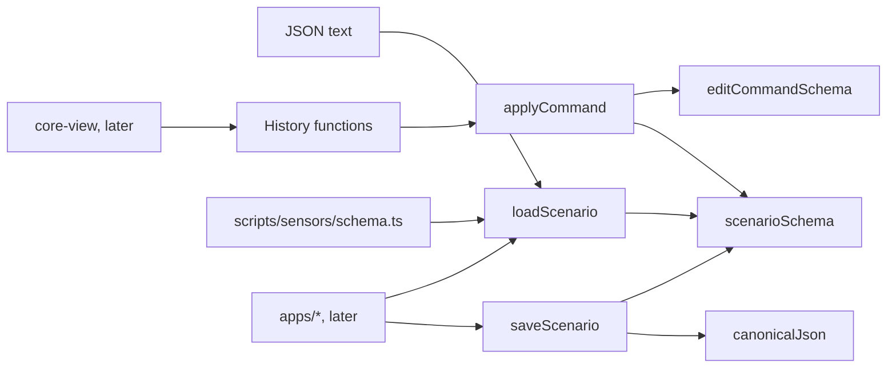

# Design Document: core-graph

## Overview

This design implements the graph data model of `core/model/`: the Scenario_Schema (Node, Edge, Zone, Face, Localized_Text), Scenario_IO (load and save of scenario JSON text), Edit_Commands with the pure Command_Applier, and the History with undo and redo. It also changes the Schema_Sensor so that it calls the Scenario_Loader, updates the two placeholder Scenario_Files, and extends the R-FND-10.15 name test to every file under `core/model/`.

Guiding choice: the smallest design that meets every criterion of `requirements.md`. Five source files, one test file next to each, and one shared test-data file. No new dependency: only `zod` (4.6.7) at run time and `vitest` + `fast-check` (4.10.2) in tests, all already pinned in `package.json`.

All functions in this spec are pure (R-GRAPH-10.6). They take plain data and return plain data. None of them throws for any input (R-GRAPH-07.6, R-GRAPH-08.2, R-GRAPH-11.14, R-GRAPH-12.6, R-GRAPH-12.7, R-GRAPH-12.10).

### Research findings that shape the design

These were checked in the installed package `node_modules/zod` (version 4.6.7), not only in documentation.

- **`z.object` strips unknown keys by default** in Zod 4, and it never copies an input key named `__proto__` into its output ([Zod 4 API: objects](https://zod.dev/api#objects)). This meets R-GRAPH-06.2 for every fixed-shape object (Scenario, Node, `position`, `rotation`, `scale`, Face, Localized_Text, Edge, Zone) with no extra code.
- **`z.record` skips every key named `__proto__`** (source: `$ZodRecord` in `v4/core/schemas.js`, the loops that `continue` on `key === "__proto__"`). `JSON.parse` creates `__proto__` as an ordinary own property, so a record schema would silently drop the attribute `__proto__` and break R-GRAPH-02.9 and P-GRAPH-1. **Decision:** Metadata and Numeric_Attributes are not validated with `z.record` or `z.json()`. They use `z.custom<T>()` plus a `superRefine` that only reads the value. `z.custom` returns the input value itself, so every own key survives.
- **Refinement issues do not stop later checks.** Issues from `refine` and `superRefine` are created with `continue: true` (source: `_superRefine` in `v4/core/api.js`). So Zod's own abort rules cannot guarantee R-GRAPH-06.11 (no Cross_Element_Check while a Structural_Check fails). **Decision:** the cross-element `superRefine` on the Scenario is registered with the option `when: (payload) => payload.issues.length === 0` (the option exists on `$ZodSuperRefineParams`). It then runs only when no Structural_Check reported anything.
- **`z.number()` rejects `NaN`, `Infinity`, and `-Infinity`** in Zod 4 ([Zod 4 changelog: no infinite values](https://zod.dev/v4/changelog)). So every number field is a Finite_Number check by default.
- **`z.discriminatedUnion` reports an unknown discriminator** as one `invalid_union` issue whose path is the discriminator key (source: "No matching discriminator" in `v4/core/schemas.js`). A nested batch inside `commands` therefore reports at `commands.<index>.kind` (R-GRAPH-11.20) with no extra code.
- **Missing required keys** are reported by `z.object` as `invalid_type` with the path `[key]`, so a missing Node `type` reports at `nodes.<index>.type` (R-GRAPH-01.6).
- **Default `Array.prototype.sort` compares UTF-16 code units**, not code points. Keys outside the Basic Multilingual Plane sort differently under the two orders, so the Scenario_Saver uses its own comparator (R-GRAPH-08.8).

Content was rephrased for compliance with licensing restrictions.

## Architecture



Dependencies go one way inside `core/model/`:

```
json.ts  <-  scenario-schema.ts  <-  scenario-io.ts
                    ^
                    +--------------  commands.ts  <-  history.ts
```

### File layout

| File | Responsibility | Imports |
|---|---|---|
| `core/model/json.ts` | Small JSON helpers: `isPlainObject`, `checkJsonValue` (Metadata check), `compareCodePoints`, `canonicalJson` (sorted keys, 2-space indent, trailing newline). | nothing |
| `core/model/scenario-schema.ts` | The one Scenario_Schema (Zod): Localized_Text, Face, Node, Edge, Zone, Scenario with the cross-element check. The `changes` schemas used by update commands. `ValidationError`, `toValidationErrors`, `validateScenario`. Inferred types. | `zod`, `./json.ts` |
| `core/model/scenario-io.ts` | `loadScenario(text)` and `saveScenario(scenario)`. | `./scenario-schema.ts`, `./json.ts` |
| `core/model/commands.ts` | `editCommandSchema` (Zod, built from the schemas and `changes` schemas exported by `scenario-schema.ts`), `EditCommand` type, `applyCommand(scenario, command)`. | `zod`, `./scenario-schema.ts` |
| `core/model/history.ts` | `History` type, `createHistory`, `executeCommand`, `undo`, `redo`. | `./commands.ts`, `./scenario-schema.ts` |
| `core/model/arbitraries.ts` | Test-only fast-check generators and the `jsonEqual` helper, shared by the test files below. No product module imports it. | `fast-check`, `./scenario-schema.ts`, `./commands.ts` |
| `core/model/*.test.ts` | One test file next to each source file above (except `arbitraries.ts`): `json.test.ts`, `scenario-schema.test.ts`, `scenario-io.test.ts`, `commands.test.ts`, `history.test.ts`. | `vitest`, `fast-check`, the file under test, `./arbitraries.ts` |

- No module uses a Node.js-only API (file system, `process`, `path`), so the browser build and the Schema_Sensor in Node.js load the same modules (R-GRAPH-09.7). Relative imports use the `.ts` extension, as Node.js type stripping requires (tsconfig `nodenext` + `allowImportingTsExtensions`).
- `arbitraries.ts` does not match the Vitest `include` pattern `**/*.test.ts`, so it is never run as a test. It sits in `core/model/` so that it is covered by the same lint scope and the same name test as the product code.
- The existing Lint_Sensor scope 1 (`core/model/**`) already bans `three`, React, `@react-three/*`, `three-*`, relative `node_modules` paths, and `view` and `apps` segments (R-GRAPH-10.1). No lint change is needed.
- `ScenarioEnvelope` is removed from `scenario-schema.ts`; no file uses it. `LocalizedText` keeps its name, so the type-only imports in `core/view/simple-page.ts` and `apps/` stay valid.

## Components and Interfaces

### Validation errors and results

```ts
// scenario-schema.ts
export type ValidationError = { path: string; message: string };

// scenario-io.ts
export type LoadResult = { ok: true; scenario: Scenario } | { ok: false; errors: ValidationError[] };
export type SaveResult = { ok: true; text: string } | { ok: false; errors: ValidationError[] };

// commands.ts
export type ApplyResult = { ok: true; scenario: Scenario } | { ok: false; errors: ValidationError[] };

// history.ts
export type CreateHistoryResult = { ok: true; history: History } | { ok: false; errors: ValidationError[] };
export type ExecuteResult =
  | { ok: true; history: History }
  | { ok: false; history: History; errors: ValidationError[] };
```

A failure value never carries a Scenario field, so no partial Scenario can leak (R-GRAPH-07.5, R-GRAPH-11.12, R-GRAPH-11.18). Every failure list has at least one element.

**Zod issue → Field_Path.** `toValidationErrors(issues)` maps each Zod issue to `{ path: issue.path.map(String).join("."), message: issue.message }`. List indexes are numbers in Zod paths and become `"0"`, `"1"`, … (zero-based). An issue at the root has an empty path and maps to `""` (R-GRAPH glossary, Field_Path). The order of the list is the order of `error.issues`.

**Why the order is deterministic (R-GRAPH-07.8).** Zod walks a `z.object` in the order of its shape definition, not the input's key order, and walks arrays by index. The only input-ordered loops are in this design's own checks (Numeric_Attributes, Metadata), and those sort keys with `compareCodePoints` before reporting. The cross-element check uses a fixed order (below). So the same value always gives the same errors in the same order, and two deeply equal values with different key insertion order also give the same errors.

**Messages.** Zod's built-in messages are English (Zod 4's default locale) and deterministic. This design's own checks use fixed English templates, listed with each check. A message names an Identifier, attribute name, or repeated value with `JSON.stringify(value)`, so whitespace in it is visible. No message contains any other part of the input.

### Scenario_Schema (`scenario-schema.ts`)

Building blocks:

```ts
const MAX_INT = Number.MAX_SAFE_INTEGER; // 9,007,199,254,740,991

// One non-blank string check, used for Identifiers, Image_References, and Localized_Text `en`.
// `refine`, not `.trim()`: the value is checked, never changed (R-GRAPH-06.12).
export const nonBlank = z.string().refine((s) => s.trim().length >= 1, "must not be blank");
const identifier = nonBlank;

export const localizedTextSchema = z.object({ en: nonBlank, ja: z.string().optional() });

const vector3 = z.object({ x: z.number(), y: z.number(), z: z.number() });         // position, rotation
const positive = z.number().positive();                                               // > 0, finite by default
const scale3 = z.object({ x: positive, y: positive, z: positive });

const imageReference = nonBlank; // string, ≥ 1 character after trimming

export const faceSchema = z
  .object({ text: localizedTextSchema.optional(), image: imageReference.optional(), detail: localizedTextSchema.optional() })
  .superRefine(requireTextOrImage, { when: (p) => isPlainObject(p.value) });

const metadataSchema = z.custom<JsonObject>().superRefine(checkMetadata);
const attributesSchema = z.custom<NumericAttributes>().superRefine(checkAttributes);

export const nodeSchema = z.object({
  id: identifier, type: identifier,
  position: vector3, rotation: vector3, scale: scale3,
  front: faceSchema, back: faceSchema.optional(),
  zone: identifier.optional(),
  metadata: metadataSchema, attributes: attributesSchema,
});

export const edgeSchema = z.object({
  id: identifier, from: identifier, to: identifier, type: identifier,
  label: localizedTextSchema.optional(),
});

export const zoneSchema = z.object({
  id: identifier, label: localizedTextSchema,
  order: z.number().int().min(0).max(MAX_INT),
  elevation: z.number(),
  enclosed: z.boolean(),
});

export const scenarioSchema = z
  .object({
    schemaVersion: z.number().int().min(1), // unchanged from repo-foundation (R-FND-08.1)
    id: identifier,
    title: localizedTextSchema,
    nodes: z.array(nodeSchema),
    edges: z.array(edgeSchema),
    zones: z.array(zoneSchema),
  })
  .superRefine(checkCrossElements, { when: (p) => p.issues.length === 0 });
```

Notes per rule:

- **Node_Type, Edge_Type, attribute names** are plain `identifier` checks. There is no enum, literal union, default, or allowed-value list anywhere (R-GRAPH-01.4, R-GRAPH-02.3, R-GRAPH-04.4, R-GRAPH-04.5, R-GRAPH-10.3, R-GRAPH-10.4). No field has `.default(...)`, so nothing is filled in.
- **Rotation** is a `vector3` in radians. No function reads it except validation, save, load, and edit (R-GRAPH-01.8).
- **`elevation`** is any Finite_Number; **`order`** is an integer from 0 to `MAX_INT` (R-GRAPH-05.2, R-GRAPH-05.3). `z.boolean()` accepts only `true` and `false`, so `"true"` and `0` fail (R-GRAPH-05.5).
- **`schemaVersion`** keeps the repo-foundation rule `z.number().int().min(1)`: any integer greater than or equal to 1 (R-GRAPH-06.1, R-FND-08.1, Decisions Q5). In Zod 4, `.int()` accepts only safe integers, so the upper bound is `MAX_INT`. `0`, negatives, `1.5`, and the string `"1"` fail at `schemaVersion`. No function reads the value except validation, and the Scenario_Saver writes the value it was given. The Scenario_Files in this Repository use `1`.
- **Edges** have no Metadata and no Numeric_Attributes (R-GRAPH-04.1). Self-loops and parallel Edges pass, because no check compares `from` with `to` or Edges with each other except by `id` (R-GRAPH-04.9).
- **Zones** have no parent and no footprint field (R-GRAPH-05.9).

**`requireTextOrImage` (Face, R-GRAPH-03.4).** It runs only when the Face value is a plain object (the `when` option), so a `null` or array Face gets only Zod's `invalid_type` (R-GRAPH-03.6). If `value.text === undefined && value.image === undefined`, it adds one issue at the Face path with the message `face must have text or image`. A Face with only `detail` gets this issue. A present but invalid `text` or `image` counts as present, because Zod keeps the key in its partial output; that field's own error is reported instead (R-GRAPH-03.7). Because the `when` option makes the check run even after field errors, a Face like `{ detail: 5 }` reports both `…detail` and the Face-level error.

**`checkAttributes` (Numeric_Attributes, R-GRAPH-02).**

1. If the value is not a plain object (missing, array, `null`, string, number, boolean): one issue at the `attributes` path, message `attributes must be a JSON object` (R-GRAPH-02.7). A missing `attributes` also lands here, since `z.custom` accepts `undefined` and this check rejects it (R-GRAPH-01.6).
2. Otherwise, for each own enumerable string key from `Object.keys(value)`, sorted with `compareCodePoints`:
   - Name not an Identifier (blank after trimming): issue at the `attributes` path, message `attribute name ${JSON.stringify(name)} must not be blank` (R-GRAPH-02.5).
   - Value not a Finite_Number (`typeof v !== "number" || !Number.isFinite(v)`): issue at path `[name]`, giving `nodes.<i>.attributes.<name>`, message `attribute value must be a finite number`. The value is never converted (R-GRAPH-02.4).
   - Every invalid name and every invalid value gets its own issue (R-GRAPH-02.8).

**`checkMetadata` (R-GRAPH-01.5, R-GRAPH-01.7).** If the value is not a plain object: one issue at the `metadata` path, message `metadata must be a JSON object`. Otherwise `checkJsonValue(value)` walks it and returns the first fault found in a fixed order (keys sorted with `compareCodePoints`, arrays by index), reported at the `metadata` path with the message `metadata must contain only JSON values`. A JSON value is `null`, a boolean, a string, a Finite_Number, an array of JSON values, or a plain object of JSON values. The walk keeps a stack of the objects on the current path and reports a cycle as a fault, so a cyclic in-memory object returns a failure instead of overflowing the stack. Metadata from `JSON.parse` always passes the walk; the walk matters for the Scenario_Saver and the Command_Applier, whose input comes from memory.

**`checkCrossElements` (R-GRAPH-06.3, 06.4, 06.9, 06.10, 06.11).** It runs only when every Structural_Check passed. It reports issues in this fixed order:

1. Duplicate `id` in `nodes`, then `edges`, then `zones`. For each list, walk by index with a `Map<string, number>` of first index per `id`. Each later element with a seen `id` gets an issue at `<list>.<index>.id`, message `duplicate id ${JSON.stringify(id)}, first used at <list>.<firstIndex>`. Lists are separate maps, so the same `id` in two lists passes.
2. For each Edge by index: if `from` is not a Node `id`, an issue at `edges.<i>.from`, message `no node with id ${JSON.stringify(from)}`; then the same for `to`.
3. For each Node by index with a `zone`: if it is not a Zone `id`, an issue at `nodes.<i>.zone`, message `no zone with id ${JSON.stringify(zone)}`.
4. Duplicate Zone `order` by index, as in step 1: issue at `zones.<i>.order`, message `duplicate order ${order}, first used at zones.<firstIndex>`.

All comparisons use `Map` and `Set` lookups on exact strings and numbers, with no trimming or case change (R-GRAPH-06.12).

**`validateScenario(value: unknown): { ok: true; scenario: Scenario } | { ok: false; errors: ValidationError[] }`.** It calls `scenarioSchema.safeParse(value)` and maps the issues. The loader, the saver, the Command_Applier, and `createHistory` all validate through this one function (R-GRAPH-09.2).

**Changes schemas for update commands.** Also exported from `scenario-schema.ts`, so no second Node, Edge, or Zone schema is declared anywhere else (R-GRAPH-09.1):

```ts
export const nodeChangesSchema = z.object({
  type: identifier.optional(), position: vector3.optional(), rotation: vector3.optional(), scale: scale3.optional(),
  front: faceSchema.optional(), back: faceSchema.nullable().optional(),
  metadata: metadataSchema.optional(), attributes: attributesSchema.optional(),
  zone: identifier.nullable().optional(),
});
export const edgeChangesSchema = z.object({ type: identifier.optional(), label: localizedTextSchema.nullable().optional() });
export const zoneChangesSchema = z.object({
  label: localizedTextSchema.optional(), order: zoneSchema.shape.order.optional(),
  elevation: z.number().optional(), enclosed: z.boolean().optional(),
});
```

`null` means "clear this optional field" (R-GRAPH-11.5, R-GRAPH-11.7). `id` is not in any `changes` schema, so an update cannot change it, and an `id` key in `changes` is an unknown field that Zod drops. `metadataSchema.optional()` and `attributesSchema.optional()` accept `undefined` because `z.custom` with `.optional()` lets `undefined` through before the check runs.

### Scenario_Loader (`scenario-io.ts`)

```ts
export const NOT_JSON_MESSAGE = "JSON could not be parsed: the text is not valid JSON";
export const NOT_OBJECT_MESSAGE = "a JSON object is expected at the top level";
export function loadScenario(text: string): LoadResult;
```

Steps:

1. If `text` starts with U+FEFF, drop that one character (R-GRAPH-07.9).
2. `JSON.parse` inside `try`. On any exception, return `{ ok: false, errors: [{ path: "", message: NOT_JSON_MESSAGE }] }`. The parser's own message is discarded, so no position and no input text is echoed (R-GRAPH-07.2, S-GRAPH-2). `JSON.parse("")` and whitespace-only text throw and take this branch. Repeated keys: `JSON.parse` keeps the last value, which is R-GRAPH-07.10.
3. If the parsed value is not a plain object (array, string, number, boolean, `null`), return one error `{ path: "", message: NOT_OBJECT_MESSAGE }` (R-GRAPH-07.3).
4. `validateScenario(parsed)`. On failure return all its errors in its order, with no cap (R-GRAPH-07.4). On success return the Zod output, which holds exactly the six top-level fields with unknown fields dropped at every fixed-shape level (R-GRAPH-07.1, R-GRAPH-06.2).
5. Steps 3 and 4 run inside one outer `try`. An unexpected exception (for example a stack overflow on extremely deep nesting) returns one error `{ path: "", message: "the scenario could not be validated" }`. So the loader returns a Load_Result for every string (R-GRAPH-07.6, P-GRAPH-7).

The loader uses `JSON.parse` only. It does not evaluate code, read files, use the network, or load modules (R-GRAPH-07.7). Using the value returned by `JSON.parse` directly is safe for `__proto__`: `JSON.parse` defines it as an own data property, and `z.object` drops it, while Metadata and Numeric_Attributes keep it as an ordinary key (R-GRAPH-02.9).

### Scenario_Saver (`scenario-io.ts`)

```ts
export function saveScenario(scenario: Scenario): SaveResult;
```

1. `validateScenario(scenario)` inside `try`. On failure return `{ ok: false, errors }` with the schema's errors in its order (R-GRAPH-08.2, R-GRAPH-08.3). NaN, Infinity, a missing field, a repeated `id`, and a dangling reference all fail here.
2. On success, `canonicalJson(parsed)`. The Zod output already has unknown fields removed (R-GRAPH-08.10).
3. Return `{ ok: true, text }`. The input is only read, never written (R-GRAPH-08.6).

**`canonicalJson(value)` (`json.ts`, R-GRAPH-08.4, 08.8, 08.9).** A small recursive writer. It does not build sorted copies of objects, so it never assigns a `__proto__` key:

- `null`, booleans, numbers, strings: `JSON.stringify(value)`. `-0` is written as `0`, which P-GRAPH-1 treats as equal.
- Arrays: elements in order, one per line, indented by 2 spaces per level; `[]` for an empty array.
- Objects: keys from `Object.keys`, minus keys whose value is `undefined`, sorted with `compareCodePoints`, each written as `JSON.stringify(key): value`; `{}` for an empty object. Skipping `undefined` values is what makes an optional field set to `undefined` count as absent.
- After the root value: exactly one `"\n"`.

The layout matches `JSON.stringify(value, null, 2)` with sorted keys, so any JSON parser reads it (R-GRAPH-08.1). Since the output depends only on the set of keys and values, deeply equal Scenarios give identical text whatever their key insertion order (R-GRAPH-08.4).

**`compareCodePoints(a, b)`** walks both strings with `codePointAt`, advancing by 2 code units for astral characters, and returns the sign of the first differing code point, or of the length difference.

### Edit commands and the Command_Applier (`commands.ts`)

```ts
const nodeCommands = [
  z.object({ kind: z.literal("addNode"), node: nodeSchema }),
  z.object({ kind: z.literal("removeNode"), id: nonBlank }),
  z.object({ kind: z.literal("updateNode"), id: nonBlank, changes: nodeChangesSchema }),
];
// same three shapes for Edges ("addEdge" with `edge`, "removeEdge", "updateEdge" with edgeChangesSchema)
// and for Zones ("addZone" with `zone`, "removeZone", "updateZone" with zoneChangesSchema)

export const singleCommandSchema = z.discriminatedUnion("kind", [...nodeCommands, ...edgeCommands, ...zoneCommands]);
export const editCommandSchema = z.discriminatedUnion("kind", [
  ...singleCommandSchema.options,
  z.object({ kind: z.literal("batch"), commands: z.array(singleCommandSchema).min(1) }),
]);
export type SingleCommand = z.infer<typeof singleCommandSchema>;
export type EditCommand = z.infer<typeof editCommandSchema>;

export function applyCommand(scenario: Scenario, command: EditCommand): ApplyResult;
```

The kinds are generic data edits (R-GRAPH-11.1). Snapping, clicks, gizmos, and selection are not here; a command carries final values only (R-GRAPH-11.16). The `id` fields use `nonBlank`, imported from `scenario-schema.ts`, not redeclared.

`applyCommand` steps, all inside one `try` that turns an unexpected exception into one error at path `""` (R-GRAPH-11.14):

1. `validateScenario(scenario)`; on failure return its errors (R-GRAPH-11.13).
2. `editCommandSchema.safeParse(command)`; on failure return the mapped issues. Paths are relative to the command: `kind` for an unknown kind, `node.scale.y` for a bad field, `commands` for an empty or missing batch list (R-GRAPH-11.19), `commands.<i>.kind` for a nested batch (R-GRAPH-11.20).
3. If the kind is `batch`: fold `applySingle` over `commands` in order, starting from the validated Scenario. Each `applySingle` validates the Scenario it produces, so commands are checked one at a time (Decisions Q41). At the first command `i` that fails, stop, apply none of the later commands, and return that command's errors with each path prefixed by `commands.<i>.` (R-GRAPH-11.18). Otherwise return the Scenario from the last command (R-GRAPH-11.17). There is no separate check of the final Scenario: it is the output of the last validated step, so it always passes the Scenario_Schema.
4. Otherwise return `applySingle(validatedScenario, parsedCommand)`.

`applySingle(s, c)` builds a new Scenario with array spreads and object spreads and never writes into `s`:

| Kind | Change |
|---|---|
| `addNode` / `addEdge` / `addZone` | `[...list, element]` (R-GRAPH-11.3) |
| `removeNode` | Node removed with `filter`; also every Edge with `from === id` or `to === id` removed (R-GRAPH-11.4) |
| `removeEdge` | Edge removed with `filter` (R-GRAPH-11.6) |
| `removeZone` | Zone removed with `filter` (R-GRAPH-11.9) |
| `updateNode` | `{ ...node, ...set }`, where `set` is `changes` without `null` and `undefined` values; then `back` and `zone` are deleted from the copy when `changes` gives them as `null` (R-GRAPH-11.5) |
| `updateEdge` | Same pattern for `type` and `label`; `from`, `to`, `id` are kept (R-GRAPH-11.7) |
| `updateZone` | Same pattern for `label`, `order`, `elevation`, `enclosed` (R-GRAPH-11.10) |

- A remove or update whose `id` is not in the matching list returns one error at path `id`, message `no node with id …` / `no edge with id …` / `no zone with id …` (R-GRAPH-11.11).
- After the change, `applySingle` calls `validateScenario` on the new Scenario. On failure it returns those errors (R-GRAPH-11.12). This one step also gives R-GRAPH-11.8: removing a Zone that Nodes still reference leaves those Nodes with a `zone` naming no Zone, and the cross-element check reports one error per such Node at `nodes.<i>.zone`, naming the Zone Identifier. No special-case code is needed.
- On success it returns the Zod output of the new Scenario, so the result is a fresh value with no unknown fields (R-GRAPH-11.2). Metadata and Numeric_Attributes objects are passed by reference (the `z.custom` output is the input value). They are never written to, so sharing them is safe.

Because each command in a batch is validated on the Scenario its predecessor produced, a batch succeeds exactly when the same commands applied one by one succeed, and gives the same Scenario (P-GRAPH-13). Order inside a batch therefore matters: to remove a Zone that Nodes reference, a caller puts the `updateNode` commands that clear `zone` before the `removeZone`. The reverse order fails at the `removeZone` command with errors at `commands.<i>.nodes.<j>.zone`.

### History (`history.ts`)

```ts
export type History = { past: Scenario[]; present: Scenario; future: Scenario[]; limit: number };
export const DEFAULT_HISTORY_LIMIT = 100;

export function createHistory(scenario: Scenario, limit?: number): CreateHistoryResult;
export function executeCommand(history: History, command: EditCommand): ExecuteResult;
export function undo(history: History): History;
export function redo(history: History): History;
```

`History` is a plain TypeScript type, not a Zod schema; it is session state and never part of scenario JSON (R-GRAPH-12.8).

- **`createHistory`.** `limit` defaults to 100 when it is `undefined`. Otherwise it must be a Positive_Integer: `typeof limit === "number" && Number.isSafeInteger(limit) && limit > 0`. `0`, negatives, `1.5`, strings, `null`, and NaN fail with `{ path: "limit", message: "limit must be a positive integer" }` (R-GRAPH-12.10). The Scenario is checked with `validateScenario`; a failure returns its errors. On success: `{ past: [], present: parsedScenario, future: [], limit }` (R-GRAPH-12.1).
- **`executeCommand`.** Calls `applyCommand(history.present, command)`. On failure returns `{ ok: false, history, errors }`, the input History itself, unchanged (R-GRAPH-12.3). On success: `past = [...history.past, history.present].slice(-history.limit)`, `present = result.scenario`, `future = []`, `limit` unchanged (R-GRAPH-12.2, R-GRAPH-12.11). A batch is one call, so one History step (R-GRAPH-12.9).
- **`undo`.** Empty `past`: returns the input History (R-GRAPH-12.6). Otherwise `present = past.at(-1)`, `past = past.slice(0, -1)`, `future = [history.present, ...history.future]` (R-GRAPH-12.4).
- **`redo`.** Empty `future`: returns the input History (R-GRAPH-12.7). Otherwise `present = future[0]`, `past = [...past, history.present]`, `future = future.slice(1)` (R-GRAPH-12.5). Redo does not trim `past` to `limit`, since redo only moves entries that undo took from `past`, so `past` can never exceed `limit` this way.
- `future` has no size limit (Decisions Q37).

Each History holds full Scenario copies. With the scenario sizes this project expects (tens of Nodes) and the default limit of 100, this is small, and it keeps undo exact. The caller (`core-view`) sends one command per finished gesture (for example at drag end), not one per frame.

### Schema_Sensor change (`scripts/sensors/schema.ts`, R-GRAPH-09.3, 09.4)

```ts
import { loadScenario } from "../../core/model/scenario-io.ts";
import type { ValidationError } from "../../core/model/scenario-schema.ts";

export type SchemaResult = { ok: true } | { ok: false; errors: ValidationError[] };
export function checkScenarioText(text: string): SchemaResult; // = loadScenario(text) without the Scenario
```

- `schema.cli.ts` prints one line per error: `<file>: <path>: <message>`, with `(root)` printed in place of an empty path, so every line has the three parts. The parse-failure line is therefore `<file>: (root): JSON could not be parsed: the text is not valid JSON`, which still contains the text `JSON could not be parsed` that the existing CLI test looks for.
- Exit codes stay `0` / `1` / `2` as defined by R-FND-08. The file is never written.
- `schema.cli.ts` follows R-GRAPH-09.4 and Decisions Q42 for the `(root)` text.
- `schema.test.ts` and `schema.cli.test.ts` are updated only as far as the new required lists and the new result type need: the generators and fixtures add `nodes: []`, `edges: []`, `zones: []`, and assertions read `errors` instead of `kind`/`issues`. The `schemaVersion` generator of P-FND-4 (`fc.integer({ min: 1 })`) stays as it is, because the schema keeps the same rule. A parity test checks that `checkScenarioText(t)` and `loadScenario(t)` give the same verdict and the same errors for generated texts.

### Placeholder Scenario_Files (R-GRAPH-09.5)

Each `apps/*/scenarios/placeholder.json` keeps its `id` and `title` and gains the three empty lists. The file content is replaced with the Scenario_Saver output for that Scenario, so the files are also an example of the saved format:

```json
{
  "edges": [],
  "id": "placeholder",
  "nodes": [],
  "schemaVersion": 1,
  "title": {
    "en": "Placeholder scenario",
    "ja": "仮のシナリオ"
  },
  "zones": []
}
```

### Name test extension (R-GRAPH-10.2)

In `scripts/sensors/repo-rules.test.ts`, the R-FND-10.15 test changes from one file to every file under `core/model/`: `listFiles(join(root, "core", "model"))`, and for each file both its path and its text go through `findAppNames`. The name list is `APP_NAMES` from `repo-rules.ts` plus the folder names under `apps/` read with `readdirSync`. The task that makes this change adds one line to `docs/decision-log.md`, because it changes a repo-foundation test.

## Data Models

Types are inferred from the Zod schemas (R-GRAPH-09.6). No file declares a hand-written type with the same fields.

```ts
export type LocalizedText = z.infer<typeof localizedTextSchema>; // { en: string; ja?: string }
export type Face = z.infer<typeof faceSchema>;                    // { text?: LocalizedText; image?: string; detail?: LocalizedText }
export type Node = z.infer<typeof nodeSchema>;
export type Edge = z.infer<typeof edgeSchema>;
export type Zone = z.infer<typeof zoneSchema>;
export type Scenario = z.infer<typeof scenarioSchema>;
export type NodeChanges = z.infer<typeof nodeChangesSchema>;
export type EdgeChanges = z.infer<typeof edgeChangesSchema>;
export type ZoneChanges = z.infer<typeof zoneChangesSchema>;
```

Two value types are given to `z.custom<T>()`. They are not hand-written copies of any of the six schema types:

```ts
// json.ts
export type JsonValue = null | boolean | number | string | JsonValue[] | { [key: string]: JsonValue };
export type JsonObject = { [key: string]: JsonValue };
// scenario-schema.ts
export type NumericAttributes = Record<string, number>;
```

`Node` is also the name of a DOM global type. Inside `core/model/` the inferred type is exported as `Node`, as R-GRAPH-01.1 names it; files that also use DOM types import it with an alias (`import type { Node as GraphNode }`).

Example of a valid Scenario (generic values only):

```json
{
  "schemaVersion": 1,
  "id": "sample",
  "title": { "en": "Sample", "ja": "サンプル" },
  "zones": [
    { "id": "z1", "label": { "en": "First area" }, "order": 0, "elevation": 0, "enclosed": false }
  ],
  "nodes": [
    {
      "id": "n1", "type": "card", "zone": "z1",
      "position": { "x": 0, "y": 0, "z": 0 }, "rotation": { "x": 0, "y": 1.57, "z": 0 }, "scale": { "x": 1, "y": 1, "z": 1 },
      "front": { "text": { "en": "Front" }, "detail": { "en": "More text when zoomed in" } },
      "back": { "image": "images/back-1.png" },
      "metadata": { "note": "free JSON", "tags": ["a", "b"] },
      "attributes": { "weight": 2.5 }
    },
    {
      "id": "n2", "type": "card",
      "position": { "x": 2, "y": 0, "z": 0 }, "rotation": { "x": 0, "y": 0, "z": 0 }, "scale": { "x": 1, "y": 1, "z": 1 },
      "front": { "text": { "en": "Second" } }, "metadata": {}, "attributes": {}
    }
  ],
  "edges": [
    { "id": "e1", "from": "n1", "to": "n2", "type": "link", "label": { "en": "leads to" } }
  ]
}
```

Example Edit_Commands:

```json
{ "kind": "updateNode", "id": "n1", "changes": { "position": { "x": 1, "y": 0, "z": 0 }, "zone": null } }
{ "kind": "batch", "commands": [
  { "kind": "updateNode", "id": "n1", "changes": { "zone": null } },
  { "kind": "removeZone", "id": "z1" }
] }
```


## Correctness Properties

*A property is a characteristic or behavior that should hold true across all valid executions of a system-essentially, a formal statement about what the system should do. Properties serve as the bridge between human-readable specifications and machine-verifiable correctness guarantees.*

### PBT properties

P-GRAPH-1 to P-GRAPH-13 are the properties of `requirements.md`, written here as tests. P-GRAPH-14 is added by this design: P-GRAPH-8 checks only that every edit keeps the Scenario valid, not that each edit makes the right change, so P-GRAPH-14 compares each accepted command with a small reference model. In the **Validates** lines, "Requirements X.Y" means R-GRAPH-0X.Y (for example 2.6 = R-GRAPH-02.6, 11.4 = R-GRAPH-11.4).

Every property runs with `fc.assert(fc.property(…), { numRuns: 100 })` or more. Each test name starts with its property ID (R-FND-10.5), and each test carries the tag comment `// Feature: core-graph, Property <n>: <P-GRAPH-n title>`. Each property is one test.

#### Shared generators (`core/model/arbitraries.ts`)

- `identifierArb`: `fc.string({ minLength: 1 })` filtered to `s.trim().length >= 1`, mixed with `fc.constantFrom(" a", "a ", "A", "a")` so that ids differing only by case or surrounding whitespace occur.
- `localizedTextArb`: `fc.record({ en: identifierArb, ja: fc.string() }, { requiredKeys: ["en"] })`.
- `faceArb`: one of text only, image only, or both, each with or without `detail`.
- `attributesArb`: `fc.uniqueArray(fc.tuple(attrNameArb, finiteArb), { selector: ([k]) => k })` mapped with `Object.fromEntries`, so that `__proto__` becomes an own key. `attrNameArb` mixes `identifierArb` with `fc.constantFrom("__proto__", "constructor", "prototype", "w", "W", " w")`. `finiteArb` is `fc.double({ noNaN: true, noDefaultInfinity: true })`, which includes `-0`, negatives, and fractions. The empty object is included.
- `metadataArb`: `fc.dictionary(fc.string(), fc.jsonValue())`, also built through `Object.fromEntries` at the top level, plus `fc.constantFrom({}, { "__proto__": 1 })` built the same way.
- `scenarioArb`: `schemaVersion` from `fc.integer({ min: 1, max: Number.MAX_SAFE_INTEGER })` mixed with `fc.constant(1)`, unique node ids (`fc.uniqueArray(identifierArb)`, 0 to 8), unique zone ids and unique zone `order` values (`fc.uniqueArray(fc.nat())`), Nodes with or without `back` and with or without a `zone` taken from the zone ids, Edges whose `from` and `to` are taken from the node ids (only when there is at least one Node), including self-loops and repeated `from`/`to`/`type` with fresh `id`s, `scale` components from `fc.double({ min: Number.MIN_VALUE, noNaN: true, noDefaultInfinity: true })`. All lists can be empty.
- `extraFieldsArb`: `fc.dictionary` of names not defined at that level (plus `"__proto__"`) to `fc.jsonValue()`, with at least one key.
- `commandArb(ids)`: every kind, with ids picked from a pool of existing ids plus `identifierArb` (missing ids), `changes` with random subsets of fields and `null` for clearable fields, and batches of 0 to 4 commands that sometimes contain a nested batch.
- `limitArb`: `fc.integer({ min: 1, max: 20 })`; `badLimitArb`: `fc.constantFrom(0, -1, 1.5, NaN, Infinity, "3", null)`.
- `jsonEqual(a, b)`: deep equality over own enumerable string keys (`Object.keys`), which treats `-0` and `0` as equal (`===` on numbers) and treats a key whose value is `undefined` as absent. It is used instead of `toEqual` wherever a value may carry an own `__proto__` key.

### Property 1: P-GRAPH-1 save → load leaves the content unchanged

*For any* valid Scenario `s` from `scenarioArb`, `saveScenario(s)` returns `{ ok: true, text }`, `loadScenario(text)` returns `{ ok: true, scenario }`, and `jsonEqual(scenario, s)` holds, including `schemaVersion` (any integer ≥ 1, written as given), Metadata, Numeric_Attributes (with `__proto__`, `constructor`, `prototype`, and case- or whitespace-variant names), both Faces with `detail`, Image_References, Node `zone`, and list order. The test also checks that `s` is `jsonEqual` to a deep copy taken before the call, and that `Object.prototype` has no new own key afterwards.

**Validates: Requirements 1.5, 2.6, 2.9, 3.5, 3.8, 3.9, 4.3, 4.8, 5.6, 5.7, 6.1, 8.5, 8.6**

### Property 2: P-GRAPH-2 saved text stays valid and stable

*For any* valid Scenario `s`, the text `t` from `saveScenario(s)` makes `loadScenario(t)` succeed; `t` ends with exactly one `"\n"`; every line's leading spaces are a multiple of 2; every object's keys appear in code point order (checked by walking `JSON.parse(t)` with `compareCodePoints`); and `saveScenario` of the Scenario loaded from `t` returns exactly `t`.

The Schema_Sensor's pure check `checkScenarioText` returns `loadScenario`'s verdict and errors, which the sensor parity test in `scripts/sensors/schema.test.ts` checks on the same generated texts. So "`t` passes the Schema_Sensor's check" follows from this property plus the parity test. Tests under `core/model/` do not import from `scripts/`.

**Validates: Requirements 8.1, 8.7, 8.8, 9.3**

### Property 3: P-GRAPH-3 every reference points to an existing element

*For any* valid Scenario `s`, after a save and load every Edge `from` and `to` is in the set of Node ids and every Node `zone` is in the set of Zone ids. *For any* valid Scenario with at least one Edge or one Node with a `zone`, replacing one chosen Edge `from` or `to`, or one Node `zone`, with an Identifier not in the matching id set makes `loadScenario(JSON.stringify(changed))` return a failure containing an error whose path is `edges.<i>.from`, `edges.<i>.to`, or `nodes.<i>.zone` for that element.

**Validates: Requirements 6.4, 6.5, 6.9, 6.12**

### Property 4: P-GRAPH-4 same input → same result

*For any* string from `fc.oneof(validJsonText, brokenJsonText, fc.string())`, `loadScenario` called twice returns `toStrictEqual` results with the same errors in the same order. *For any* valid Scenario `s`, `saveScenario(s)` and `saveScenario(reorderKeys(s))` return identical text, where `reorderKeys` rebuilds every object with its keys inserted in reverse order.

**Validates: Requirements 7.4, 7.8, 8.4, 10.6**

### Property 5: P-GRAPH-5 broken scenarios fail with a Field_Path

*For any* valid Scenario and any one mutation from this list, `loadScenario(JSON.stringify(mutated))` returns a failure whose errors include the expected path:

| Mutation | Expected path |
|---|---|
| Remove a required field of a Node, Edge, or Zone (including Node `type` and Edge `type`) | `<list>.<i>.<field>` |
| Replace a number field (`position.*`, `rotation.*`, `scale.*`, `order`, `elevation`) with a string, boolean, `null`, or array | path of that field |
| Replace a Numeric_Attributes value with a non-number (including `"1"`) | `nodes.<i>.attributes.<name>` |
| Replace a `scale` component with `0` or a negative number | `nodes.<i>.scale.<c>` |
| Copy the `id` of an earlier element in the same list onto a later one | `<list>.<later>.id` |
| Copy the `order` of an earlier Zone onto a later one | `zones.<later>.order` |
| Remove both `text` and `image` from a Face | `nodes.<i>.front` or `nodes.<i>.back` |

The mutation generator only picks mutations that apply to the generated Scenario (for example, the duplicate-id mutation needs at least two elements in the list).

**Validates: Requirements 1.2, 1.3, 1.6, 2.4, 3.4, 4.6, 5.5, 6.3, 6.10, 10.4**

### Property 6: P-GRAPH-6 unknown fields are ignored

*For any* valid Scenario `s` and any placement of `extraFieldsArb` values at the top level or inside any Node, `position`, `rotation`, `scale`, Face, Localized_Text, Edge, or Zone, giving `s2`: `loadScenario(JSON.stringify(s2))` succeeds with a Scenario `jsonEqual` to `s`, and `saveScenario(s2)` returns the same text as `saveScenario(s)`.

**Validates: Requirements 6.2, 7.1, 8.10**

### Property 7: P-GRAPH-7 the loader never throws

*For any* string from `fc.oneof(fc.string(), fc.fullUnicodeString(), fc.json(), mutatedValidJsonText)`, calling `loadScenario` does not throw, returns `ok: true` with a `scenario` or `ok: false` with a non-empty `errors` and no `scenario` key, and, when the text is not parseable JSON (after removing one leading U+FEFF), returns exactly `[{ path: "", message: NOT_JSON_MESSAGE }]`.

**Validates: Requirements 7.2, 7.5, 7.6**

### Property 8: P-GRAPH-8 edits keep the Scenario valid

*For any* valid Scenario and any sequence of up to 10 commands from `commandArb`, executing them in order with `executeCommand` from `createHistory(s)` leaves a `present` for which `validateScenario` succeeds after every step, so every Edge `from`/`to` names a Node and every Node `zone` names a Zone.

**Validates: Requirements 11.2, 11.12, 12.2**

### Property 9: P-GRAPH-9 undo and redo restore states

*For any* valid Scenario `s` and any sequence of commands, keep only the steps that `executeCommand` accepts, up to `limit` of them (n steps). Undoing n times returns a `present` `jsonEqual` to `s`, and after one execute and one undo the `present` is `jsonEqual` to the `present` before that execute. *For any* History reached this way with a non-empty `past`, `redo(undo(h))` is `jsonEqual` to `h`.

**Validates: Requirements 12.2, 12.4, 12.5**

### Property 10: P-GRAPH-10 same history and command → same result

*For any* valid Scenario, any value from `fc.oneof(commandArb(ids), fc.jsonValue())` used as a command, and any History built from that Scenario: `applyCommand` called twice on deep copies returns `toStrictEqual` results, `executeCommand` called twice on deep copies of the History returns `toStrictEqual` results, neither call throws, and the Scenario, the command, and the History are `jsonEqual` to deep copies taken before the calls.

**Validates: Requirements 10.6, 10.7, 11.14, 11.15**

### Property 11: P-GRAPH-11 rejected commands change nothing

*For any* valid Scenario and any command that `applyCommand` rejects (missing id, duplicate id from an add, dangling `from`/`to`, removal of a still-referenced Zone, bad field, unknown kind, empty or nested batch, a batch with one failing command), `applyCommand` returns `ok: false` with a non-empty `errors` and no `scenario` key, and `executeCommand` returns `ok: false` with the same `errors` and a `history` that is the input History (same reference, also `jsonEqual` to its pre-call copy).

**Validates: Requirements 11.8, 11.11, 11.12, 11.13, 11.18, 12.3**

### Property 12: P-GRAPH-12 History never keeps more than `limit` steps

*For any* valid Scenario, any `limit` from `limitArb`, and any command sequence of up to `limit + 5` commands, `createHistory(s, limit)` succeeds, and after every `executeCommand`, `undo`, and `redo` step `past.length <= limit` and `history.limit === limit`. When an accepted step would make `past` longer than `limit`, the kept entries are the newest `limit` entries (compared with a reference list kept by the test). *For any* value from `badLimitArb`, `createHistory(s, value)` returns `ok: false` with an error at path `limit` and no `history` key, without throwing; `createHistory(s)` gives `limit === 100`.

**Validates: Requirements 12.1, 12.2, 12.10, 12.11**

### Property 13: P-GRAPH-13 a batch equals its commands in sequence, as one step

*For any* valid Scenario and any non-empty list of single (non-batch) commands: if applying them one by one with `applyCommand` succeeds at every step, then `applyCommand` with `{ kind: "batch", commands }` succeeds with a Scenario `jsonEqual` to the last one; executing the batch on a History with `past.length < limit` adds exactly one entry to `past`, and one `undo` returns the Scenario before the batch. If some command fails first at index `k` in the one-by-one run, the batch fails, every error path starts with `commands.<k>.`, and the error list equals the failing command's own errors with that prefix.

**Validates: Requirements 11.17, 11.18, 12.9**

### Property 14: P-GRAPH-14 each accepted command makes exactly its change

*For any* valid Scenario and any single command from `commandArb` that `applyCommand` accepts, the result is `jsonEqual` to a reference model computed in the test: add appends the element at the end of its list; remove Node drops the Node and every Edge with that Node as `from` or `to`; remove Edge and remove Zone drop that element; update sets the given fields, removes `back`, `zone`, or `label` when the change is `null`, and keeps `id` (and `from`/`to` for Edges); every other element and the order of every list stay the same.

**Validates: Requirements 11.2, 11.3, 11.4, 11.5, 11.6, 11.7, 11.9, 11.10**

## Error Handling

No function in this spec throws to its caller. Every expected fault becomes a Validation_Error in a failure value. An unexpected exception inside a function is caught by that function's outer `try` and becomes one error at path `""` with a fixed message, never the exception text.

| Situation | Function | Result |
|---|---|---|
| Text not parseable as JSON (including `""` and whitespace) | `loadScenario` | One error, path `""`, `JSON could not be parsed: the text is not valid JSON` |
| Top-level JSON value not an object | `loadScenario` | One error, path `""`, `a JSON object is expected at the top level` |
| Structural_Check failures | `validateScenario` (all callers) | One error per faulty field, Zod order; no Cross_Element_Check runs |
| Duplicate `id`, dangling `from`/`to`/`zone`, duplicate Zone `order` | `validateScenario` | One error per later duplicate or per dangling field, fixed order (see Components) |
| NaN, Infinity, cyclic Metadata, missing field in an in-memory Scenario | `saveScenario` | Save failure with the schema's errors, no text |
| Invalid input Scenario | `applyCommand`, `createHistory` | Failure with the schema's errors |
| Unknown `kind`, missing or wrong-type command field | `applyCommand` | Failure; paths relative to the command (`kind`, `node.scale.y`, `changes.order`) |
| Empty, missing, or non-array `commands`; nested batch | `applyCommand` | Failure at `commands` or `commands.<i>.kind` |
| Remove or update of a missing id | `applyCommand` | One error at `id`, naming the Identifier |
| Remove of a Zone still referenced | `applyCommand` | One error per referencing Node at `nodes.<i>.zone` |
| A batch command fails | `applyCommand` | Stops at the first failing command `i`; later commands not applied; that command's errors, each path prefixed `commands.<i>.`; input unchanged |
| Rejected command on a History | `executeCommand` | `ok: false`, the errors, and the input History |
| Undo with empty `past`, redo with empty `future` | `undo`, `redo` | The input History, no error |
| `limit` not a Positive_Integer | `createHistory` | One error at `limit`, no History |
| Unexpected exception (for example extreme nesting depth) | loader, saver, applier | One error at `""`, `the scenario could not be validated` |
| Scenario_File fails | `schema.cli.ts` | One line per error `<file>: <path or (root)>: <message>`, exit 1; usage errors exit 2 (R-FND-08) |

## Testing Strategy

- **Property tests** (fast-check 4.10.2, at least 100 runs each, one test per property, names start with the property ID, tag comment `Feature: core-graph, Property <n>: …`):
  - `core/model/scenario-io.test.ts`: P-GRAPH-1, 2, 3, 4, 5, 6, 7.
  - `core/model/commands.test.ts`: P-GRAPH-10 (the `applyCommand` half and the History half both live here, importing `history.ts`), P-GRAPH-11, P-GRAPH-13, P-GRAPH-14.
  - `core/model/history.test.ts`: P-GRAPH-8, P-GRAPH-9, P-GRAPH-12.
  - `scripts/sensors/schema.test.ts`: the parity check for R-GRAPH-09.3. For generated valid texts (from `saveScenario` on `scenarioArb`) and broken texts (P-GRAPH-5 mutations), `checkScenarioText(t)` gives the same verdict and the same errors as `loadScenario(t)`. It imports the generators from `core/model/arbitraries.ts`. Tests under `core/model/` never import from `scripts/`.
- **Example tests**, next to their sources (R-GRAPH-10.5):
  - `json.test.ts`: `compareCodePoints` on an astral character against a BMP character above U+D800 (the case where code-unit order differs); `canonicalJson` layout on a small nested value, `undefined` skipped, `-0` written as `0`, a key `__proto__` written; `checkJsonValue` on a cycle, NaN, a function, a class instance.
  - `scenario-schema.test.ts`: one example per IF/THEN criterion not fully covered by a property: 1.6 (two broken Nodes both reported), 1.7, 1.9, 2.4 (`"1"` not converted), 2.5 (message quotes the name), 2.7, 2.8, 3.3, 3.6, 3.7 (`nodes.2.back.text.en`, `nodes.2.front.detail.en`, `nodes.2.front.image`), 4.7, 5.2 (`1.5`, `-1`), 5.3/5.5 (`"true"`, `0` as `enclosed`), 6.1 (`schemaVersion` `1` and `7` pass; `0`, `-1`, `1.5`, `"1"` fail at `schemaVersion`; three empty lists pass), 6.6/6.8 (plain-string `title`, Zone `label` without `en`), 6.7, 6.11 (a Scenario with a blank Node `type` and a dangling Edge reports only the `type` error), and a Face `{ detail: … }` with an invalid `detail` reporting both errors.
  - `scenario-io.test.ts`: 7.2 (fixed message for `""`, `"   "`, `"{"`; message contains no input text), 7.3 (each non-object kind), 7.9 (BOM), 7.10 (repeated key), 8.2/8.3 (NaN, Infinity, -Infinity in `position.x` give a failure equal to `validateScenario`'s errors), 8.9 (`back: undefined` writes no key), Q5 (a Scenario with `schemaVersion: 7` is saved with `"schemaVersion": 7`), 10.7 (failure paths leave the argument unchanged).
  - `commands.test.ts`: 11.4 (removing a Node with two Edges), 11.8 (paths and message), 11.11 (path `id`), 11.13 (unknown kind, missing `node`), 11.19 (`[]`, missing, string), 11.20 (`commands.1.kind`), 11.17 (the clear-and-remove Zone batch from Data Models succeeding), 11.18 (the same two commands in reverse order fail at `commands.0.nodes.<j>.zone`, and a batch whose command 1 fails returns only errors prefixed `commands.1.`, with command 2 not applied).
  - `history.test.ts`: 12.1 (default 100), 12.6, 12.7, 12.10 (each bad value).
  - `scripts/sensors/schema.cli.test.ts`: the existing cases with updated fixtures, plus the line `<file>: (root): <message>` for invalid JSON and for a non-object top level, a line `<file>: nodes.0.type: <message>` for a nested error, exit code 1 for both, the file left unchanged, and the real placeholder files passing (R-GRAPH-09.4, 09.5).
  - `scripts/sensors/repo-rules.test.ts`: the extended name test over every file under `core/model/`, by path and content (R-GRAPH-10.2).
- **Not tested by code, checked by the reviewer agent before the gate:** one schema definition and inferred types (R-GRAPH-09.1, 09.6), no literal type lists (R-GRAPH-10.3), rotation and Zone fields unused (R-GRAPH-01.8, 05.8), no propagation meaning (R-GRAPH-04.5), no network or file use (R-GRAPH-07.7, S-GRAPH-3), test placement (R-GRAPH-10.5). Import bans are checked by `npm run lint` (R-GRAPH-10.1).
- Tests and PBT run on task completion (`test-on-task-done` hook) and in CI, not on save.

### Traceability

| Requirement | Component | Verified by |
|---|---|---|
| R-GRAPH-01 Node data | `nodeSchema`, `faceSchema`, `checkMetadata` | P-GRAPH-1, P-GRAPH-5, examples 1.6, 1.7, 1.9; reviewer 1.8 |
| R-GRAPH-02 Numeric attributes | `attributesSchema`, `checkAttributes` | P-GRAPH-1, P-GRAPH-5, examples 2.4, 2.5, 2.7, 2.8 |
| R-GRAPH-03 Faces | `faceSchema`, `requireTextOrImage` | P-GRAPH-1, P-GRAPH-5, examples 3.3, 3.6, 3.7; reviewer 3.10 |
| R-GRAPH-04 Edges | `edgeSchema` | P-GRAPH-1, P-GRAPH-5, example 4.7; reviewer 4.5 |
| R-GRAPH-05 Zones | `zoneSchema` | P-GRAPH-1, P-GRAPH-5, examples 5.2, 5.3, 5.5; reviewer 5.8, 5.9 |
| R-GRAPH-06 Structure and references | `scenarioSchema`, `checkCrossElements` | P-GRAPH-1 (`schemaVersion`), P-GRAPH-3, P-GRAPH-5, P-GRAPH-6, examples 6.1, 6.6–6.8, 6.11 |
| R-GRAPH-07 Load | `loadScenario` | P-GRAPH-1, P-GRAPH-4, P-GRAPH-6, P-GRAPH-7, examples 7.2, 7.3, 7.9, 7.10 |
| R-GRAPH-08 Save | `saveScenario`, `canonicalJson`, `compareCodePoints` | P-GRAPH-1, P-GRAPH-2, P-GRAPH-4, P-GRAPH-6, examples 8.2, 8.3, 8.9 |
| R-GRAPH-09 One schema | `scenario-schema.ts`, `schema.ts` sensor, placeholders | sensor parity test (9.3), `schema.cli.test.ts` (9.4 `(root)` lines and exit codes, 9.5), CI `check:schema`; reviewer 9.1, 9.6 |
| R-GRAPH-10 Boundary | file layout, lint scope 1, name test | `npm run lint`, `repo-rules.test.ts`, P-GRAPH-4, P-GRAPH-10; reviewer 10.3, 10.5 |
| R-GRAPH-11 Edit commands | `editCommandSchema`, `applyCommand`, `applySingle` | P-GRAPH-8, P-GRAPH-10, P-GRAPH-11, P-GRAPH-13, P-GRAPH-14, examples 11.4, 11.8, 11.11, 11.13, 11.17, 11.18, 11.19, 11.20 |
| R-GRAPH-12 Undo and redo | `createHistory`, `executeCommand`, `undo`, `redo` | P-GRAPH-8, P-GRAPH-9, P-GRAPH-11, P-GRAPH-12, P-GRAPH-13, examples 12.1, 12.6, 12.7, 12.10 |
| S-GRAPH-1 to S-GRAPH-6 | all files | see Safety |

## Safety

Follows `safety.md` (intent.md ch. 9).

| Rule | Design measure |
|---|---|
| S-GRAPH-1 no attack content | The model holds generic data only. Test data is random strings and fixed generic words (`card`, `link`, `Sample`). Edit_Commands are data edits of a Scenario. |
| S-GRAPH-2 scenario JSON is untrusted | `JSON.parse` only, no evaluation; every fault becomes a failure value; the parse message is fixed and echoes nothing; Metadata and Numeric_Attributes are read with `Object.keys` and never assigned key by key into new objects, and `z.object` never copies `__proto__`, so no input key can change a prototype (checked in P-GRAPH-1 by asserting `Object.prototype` is unchanged). Commands get the same treatment through `editCommandSchema`. |
| S-GRAPH-3 no network, no image fetch | No module calls `fetch`, opens files, or imports by a computed path; Image_References are stored as strings only. The lint rules of R-FND-04.10 ban dynamic imports in `core/`. |
| S-GRAPH-4 no personal data, no login | The model stores only what the App puts in a Scenario. The History is in-memory state of the caller and has no save function. |
| S-GRAPH-5 no AI, no LLM, no image generation | No such dependency; `repo-rules.test.ts` rejects unlisted packages. |
| S-GRAPH-6 no claims | This design makes no claim that needs a source. The research notes cite the Zod documentation and the installed Zod source. |

## Open questions

None at this time. The three questions of the first design review were answered on 2026-11-15 (requirements.md Decisions Q5, Q41, Q42).
