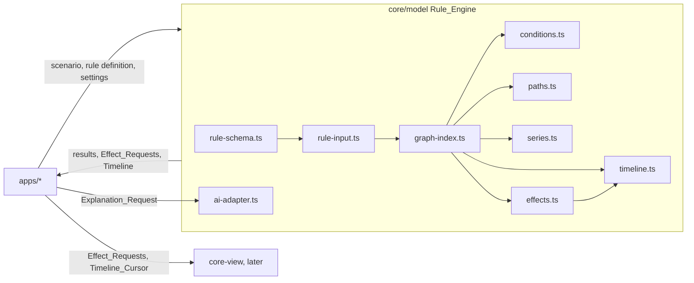

# Design Document: core-rules

## Overview

This design implements the Rule_Engine of `core/model/`: the Rule_Definition_Schema and its loader, Node_Selector matching, Conditions, Check_Sets, Node_Rules, reachability, path search, automatic propagation, sums, Zone_Series with Shift and Long_Run detection, Effect_Requests, the Timeline with its cursor, and the AI_Adapter with the No_AI_Adapter. It builds on the approved `core-graph` design and code (`scenario-schema.ts`, `json.ts`) and changes none of their behaviour.

Guiding choice: the smallest design that meets every criterion of `requirements.md`. Nine small source files, one test file next to each, and new generators added to the shared `core/model/arbitraries.ts`. No new dependency: only `zod` (4.6.7) at run time and `vitest` + `fast-check` (4.10.2) in tests, all already pinned in `package.json`.

Every function in this spec is pure (R-RULES-16.1, R-GRAPH-10.6). It takes plain data, validates every argument, and returns either a result or a Rule_Failure. No function throws for any input (R-RULES-16.5) and no function writes to an argument (R-RULES-16.6). In the text below, "Requirements X.Y" and "R-RULES-XX.Y" both refer to `requirements.md` of this spec.

The requirements were approved with the defaults written in their open questions (decision-log 2026-11-15; Q9 was resolved by moving order checks to the App spec). The defaults of Q1, Q3 to Q8, Q10, Q12, and Q13 are confirmed. Q2 (where Rule_Definitions are stored) is **not decided** (open question D4): `Rule_Definition_Loader` takes an in-memory value, and whether Rule_Definitions are JSON files under `apps/<app>/rules/` and whether the Schema_Sensor covers them is decided before the App specs. This design follows the confirmed defaults: undeclared Edge_Types do not carry propagation (Q1), Series_Settings and Intentional_Marks come from the App (Q3), `sum` and `mean` Zone_Values (Q4), strict Shift with `direction` (Q5), neighbour-step Long_Runs (Q6), Zones with no value are left out (Q7), Shift effects on the later Zone (Q8), Timelines built at runtime (Q10), importance as a Numeric_Attribute (Q12), and a depth limit of 32 (Q13). Q11 is decided in this design (see "AI_Adapter").

### Research findings that shape the design

These were checked against the installed package `node_modules/zod` (4.6.7) with a small Node.js script, not only in documentation.

- **Recursive schemas use getters.** Zod 4 defines a self-referential object by a getter on the key, and recursive type inference works through it; when TypeScript reports a circularity error, a type annotation on the getter fixes it ([Zod 4 API: recursive objects](https://zod.dev/api#recursive-objects)). A `z.discriminatedUnion("kind", …)` whose `all` option has `get conditions() { return z.array(conditionSchema) }` parses nested Conditions, and an unknown `kind` deep inside is reported at `conditions.<i>.kind`. So every Condition type is inferred from the schema (R-RULES-01.1).
- **Zod accepts a cyclic input.** The Zod documentation states that cyclical inputs work out of the box, and the check confirmed it: `conditionSchema.safeParse(a)` for an `all` Condition whose `conditions` list contains `a` itself returns `success: true`. So Zod alone would accept a Condition that contains itself, and R-RULES-01.7 needs a check of its own. A 10,000-level chain would also make Zod recurse 10,000 levels. **Decision:** a depth pre-check walks every Condition iteratively before Zod sees it (see "Condition depth limit").
- **Refinements on an object option keep it usable in a discriminated union.** A `z.object(…).superRefine(…)` option inside `z.discriminatedUnion` still parses, and its issue is reported at the path of that object (the Condition), for example `conditions.0`. When a field of the object already failed (for example `min: "a"`), the refinement does not run, so only the field error is reported. This gives R-RULES-04.8 at the Condition path with no extra code.
- The `core-graph` findings still hold here: `z.object` strips unknown keys and never copies `__proto__` (R-RULES-01.2), `z.number()` rejects NaN and ±Infinity, `.int()` accepts only safe integers, and the default string sort is by UTF-16 code unit, so this design sorts with `compareCodePoints` from `json.ts`.

## Architecture



Dependencies go one way inside `core/model/`. The arrows read "is imported by":

```
json.ts, scenario-schema.ts  <-  rule-schema.ts  <-  rule-input.ts  <-  graph-index.ts
graph-index.ts  <-  conditions.ts, paths.ts, series.ts
graph-index.ts, rule-schema.ts, rule-input.ts  <-  effects.ts  <-  timeline.ts
graph-index.ts, rule-schema.ts, rule-input.ts  <-  timeline.ts
rule-schema.ts, rule-input.ts  <-  ai-adapter.ts
```

`effects.ts` and `timeline.ts` import `graph-index.ts` for `buildIndex` (the element sets of the Scenario and `zonesByOrder`). `effects.ts` does not import `conditions.ts`, `paths.ts`, or `series.ts`: it receives their results as plain data. No module imports `core/view/`, `apps/`, `three`, or React (R-GRAPH-10.1; enforced by the existing Lint_Sensor scope `core/model/**`).

### File layout

| File | Responsibility | Imports |
|---|---|---|
| `core/model/rule-schema.ts` | All Zod schemas of this spec (Rule_Definition and its parts, Series_Settings, judgement results passed back as arguments, Effect_Request, Timeline, Timeline_Cursor, Explanation_Request, Explanation_Table), inferred types, `RuleFailure`, `RuleOutcome`, `MAX_CONDITION_DEPTH`, `limitConditionDepth`, `loadRuleDefinition`. | `zod`, `./json.ts`, `./scenario-schema.ts` |
| `core/model/rule-input.ts` | Argument checks shared by every engine function: `guard`, `prefixErrors`, `parseArg`, `checkScenario`, `checkRules`, `rejectSelf`, `combine`. | `./rule-schema.ts`, `./scenario-schema.ts` |
| `core/model/graph-index.ts` | `GraphIndex` built once per call, Node_Selector matching, Edge_Filter test, Unresolved_Reference collection, `sumOver`, and the public `selectNodes`. | `./json.ts`, `./rule-schema.ts`, `./rule-input.ts`, `./scenario-schema.ts` |
| `core/model/conditions.ts` | `evaluateCondition`, `evaluateCheckSets`, `evaluateNodeRules`. | `./graph-index.ts`, `./rule-input.ts`, `./rule-schema.ts` |
| `core/model/paths.ts` | `findReachable`, `findPath`, `propagate`. | `./graph-index.ts`, `./rule-input.ts`, `./rule-schema.ts` |
| `core/model/series.ts` | `sumAttribute`, `checkSeries`, `checkSeriesList`. | `./graph-index.ts`, `./rule-input.ts`, `./rule-schema.ts` |
| `core/model/effects.ts` | `buildEffects`, `compareEffects`, `sortUniqueEffects`. | `./graph-index.ts`, `./json.ts`, `./rule-input.ts`, `./rule-schema.ts` |
| `core/model/timeline.ts` | `createTimeline`, `timelineFromPropagation`, `timelineFromZones`, `createCursor`, `nextStep`, `previousStep`, `seekStep`, `cursorEffects`. | `./effects.ts`, `./graph-index.ts`, `./rule-input.ts`, `./rule-schema.ts` |
| `core/model/ai-adapter.ts` | `AIAdapter` interface, `createNoAiAdapter`. | `./rule-input.ts`, `./rule-schema.ts`, `./scenario-schema.ts` |
| `core/model/*.test.ts` | One test file next to each source file above. | `vitest`, `fast-check`, the file under test, `./arbitraries.ts` |
| `core/model/arbitraries.ts` (extended) | New test-only generators for this spec (see "PBT properties"). | adds `./rule-schema.ts` |

- No module uses a Node.js-only API, so the browser build and Node.js tests load the same code. Relative imports use the `.ts` extension, as in `core-graph`.
- File names, identifiers, comments, and test data contain no App_Specific_Name. The R-FND-10.15 name test already covers every file under `core/model/` (R-GRAPH-10.2), so the new files are checked with no test change.
- There is no barrel file. An App imports each function from its file. This keeps the import graph visible and adds no file to maintain.

## Components and Interfaces

### Results and Rule_Failure (`rule-schema.ts`)

```ts
import type { ValidationError } from "./scenario-schema.ts";

export type RuleFailure = { ok: false; errors: ValidationError[] };      // errors.length >= 1
export type RuleOutcome<T> = { ok: true; value: T } | RuleFailure;
```

A failure carries no `value` field, so no partial result can leak (R-RULES-04.10, R-RULES-05.7, R-RULES-06.7). `ValidationError` (`{ path, message }`) and `toValidationErrors` are reused from `scenario-schema.ts`; Field_Paths are built the same way (Zod path segments joined with `.`, list indexes as `"0"`, `"1"`, …).

### Public functions (the core/app interface)

Every function below returns `RuleOutcome<…>`. The second column lists the argument names, which are also the Field_Path prefixes of their errors (R-RULES-16.8, decided here). `scenario.` and `rules.` errors come first, in that order (R-RULES-16.4), then the errors of the other arguments in parameter order.

| Function (file) | Arguments → Field_Path prefix | Value on success |
|---|---|---|
| `loadRuleDefinition(value)` (rule-schema) | none: paths are relative to `value` (R-RULES-01.3) | `RuleDefinition` |
| `selectNodes(scenario, selector)` (graph-index) | `scenario.`, `selector.` | `{ nodes: string[]; unresolved: string[] }` |
| `evaluateCondition(scenario, condition)` (conditions) | `scenario.`, `condition` | `{ holds: boolean; unresolved: string[] }` |
| `evaluateCheckSets(scenario, rules)` (conditions) | `scenario.`, `rules.` | `CheckResult[]` |
| `evaluateNodeRules(scenario, rules)` (conditions) | `scenario.`, `rules.` | `NodeRuleResult[]` |
| `findReachable(scenario, start, edges)` (paths) | `scenario.`, `start.`, `edges.` | `{ nodes: string[]; unresolved: string[] }` |
| `findPath(scenario, from, to, edges)` (paths) | `scenario.`, `from`, `to`, `edges.` | `{ path: string[] \| null; unresolved: string[] }` |
| `propagate(scenario, rules, seeds, maxSteps?)` (paths) | `scenario.`, `rules.`, `seeds.`, `maxSteps` | `PropagationResult` |
| `sumAttribute(scenario, nodes, attribute)` (series) | `scenario.`, `nodes.`, `attribute` | `{ sum: number; count: number; unresolved: string[] }` |
| `checkSeries(scenario, settings, marks)` (series) | `scenario.`, `settings.<field>`, `marks.<i>` | `SeriesResult` |
| `checkSeriesList(scenario, settings, marks)` (series) | `scenario.`, `settings.<i>.<field>`, `marks.<i>` | `SeriesResult[]` |
| `buildEffects(scenario, rules, results)` (effects) | `scenario.`, `rules.`, `results.` | `EffectRequest[]` |
| `createTimeline(steps)` (timeline) | `steps`, `steps.<i>.<field>` | `Timeline` |
| `timelineFromPropagation(propagation)` (timeline) | `propagation.` | `Timeline` |
| `timelineFromZones(scenario)` (timeline) | `scenario.` | `Timeline` |
| `createCursor(timeline)` (timeline) | `timeline.` | `TimelineCursor` |
| `nextStep(cursor)`, `previousStep(cursor)` (timeline) | `cursor.` | `TimelineCursor` |
| `seekStep(cursor, position)` (timeline) | `cursor.`, `position` | `TimelineCursor` |
| `cursorEffects(cursor)` (timeline) | `cursor.` | `{ current: EffectRequest[]; upToCurrent: EffectRequest[] }` |
| `createNoAiAdapter(table)` (ai-adapter) | `table`, `table.<key>` | `AIAdapter` |

A prefix written with a trailing `.` is joined to the path inside that argument; an error at the root of the argument (for example a selector that is not an object) gets the bare name (`selector`). `evaluateCondition` uses `condition` the same way (`condition.min`, `condition.conditions.1.kind`).

Parameter types are the inferred types (`Scenario`, `RuleDefinition`, `NodeSelector`, …) so that TypeScript callers get help, but every function validates its arguments at run time because the values come from JSON (R-RULES-16.3, 16.4, 16.9). `rules` is the raw Rule_Definition value; each call runs `loadRuleDefinition` on it. An App may call `loadRuleDefinition` once at start to show errors early; the engine does not cache.

How an App calls the engine (generic names only):

```ts
import { evaluateCheckSets, evaluateNodeRules } from "../../core/model/conditions.ts";
import { propagate } from "../../core/model/paths.ts";
import { checkSeriesList } from "../../core/model/series.ts";
import { buildEffects } from "../../core/model/effects.ts";
import { timelineFromPropagation, createCursor, nextStep, cursorEffects } from "../../core/model/timeline.ts";

const checks = evaluateCheckSets(scenario, rules);                    // verdict + item results
const marked = evaluateNodeRules(scenario, rules);                    // Nodes for which a Node_Rule holds
const spread = propagate(scenario, rules, { types: ["start"] }, 1);   // Max_Steps 1 (fallback of intent.md ch. 7)
const series = checkSeriesList(scenario, appSettings, appMarks);      // settings and marks are App data
if (checks.ok && marked.ok && spread.ok && series.ok) {
  const effects = buildEffects(scenario, rules, {
    nodeRules: marked.value, series: series.value, propagation: spread.value,
  });                                                                  // plain data for core-view
  const timeline = timelineFromPropagation(spread.value);             // one step per Step_Number
}
```

### Rule_Definition_Schema (`rule-schema.ts`)

```ts
import { z } from "zod";
import { compareCodePoints, isPlainObject } from "./json.ts";
import { localizedTextSchema, nonBlank, toValidationErrors } from "./scenario-schema.ts";

const identifier = nonBlank;                 // the same schema object from scenario-schema.ts, not a second definition
const identifiers = z.array(identifier);
const nonNegativeInteger = z.number().refine((n) => Number.isInteger(n) && n >= 0, "must be an integer >= 0");

export const MAX_CONDITION_DEPTH = 32;

export const nodeSelectorSchema = z.object({
  ids: identifiers.optional(),
  types: identifiers.optional(),
  zones: identifiers.optional(),
  self: z.literal(true).optional(),
});

export const edgeFilterSchema = z.object({ include: identifiers.optional(), exclude: identifiers.optional() });

const edgeCountSchema = z.object({
  kind: z.literal("edgeCount"),
  edges: edgeFilterSchema,
  from: nodeSelectorSchema,
  to: nodeSelectorSchema,
  min: nonNegativeInteger.optional(),
  max: nonNegativeInteger.optional(),
}).superRefine(checkRange);

const reachSchema = z.object({
  kind: z.literal("reach"),
  from: nodeSelectorSchema,
  to: nodeSelectorSchema,
  edges: edgeFilterSchema,
});

const attributeSchema = z.object({
  kind: z.literal("attribute"),
  nodes: nodeSelectorSchema,
  attribute: identifier,
  min: z.number().optional(),                // Finite_Number: z.number() rejects NaN and ±Infinity
  max: z.number().optional(),
}).superRefine(checkRange);

const allSchema = z.object({
  kind: z.literal("all"),
  get conditions(): z.ZodArray<typeof conditionSchema> { return z.array(conditionSchema); },
});
const anySchema = z.object({
  kind: z.literal("any"),
  get conditions(): z.ZodArray<typeof conditionSchema> { return z.array(conditionSchema); },
});
const notSchema = z.object({
  kind: z.literal("not"),
  get condition(): typeof conditionSchema { return conditionSchema; },
});

export const conditionSchema = z.discriminatedUnion("kind", [
  edgeCountSchema, reachSchema, attributeSchema, allSchema, anySchema, notSchema,
]);

export const checkItemSchema = z.object({ id: identifier, condition: conditionSchema });
export const checkSetSchema = z.object({ id: identifier, items: z.array(checkItemSchema) });
export const nodeRuleSchema = z.object({ id: identifier, nodes: nodeSelectorSchema, condition: conditionSchema });

export const effectSourceSchema = z.discriminatedUnion("kind", [
  z.object({ kind: z.literal("nodeRule"), id: identifier }),
  z.object({ kind: z.literal("shifts"), attribute: identifier }),
  z.object({ kind: z.literal("longRuns"), attribute: identifier }),
  z.object({ kind: z.literal("propagation") }),
]);
export const effectRuleSchema = z.object({ id: identifier, effect: identifier, source: effectSourceSchema });

export const propagationPolicySchema = z.object({ pass: identifiers, stop: identifiers });

export const ruleDefinitionSchema = z.object({
  schemaVersion: z.number().int().min(1),
  id: identifier,
  propagation: propagationPolicySchema,
  checkSets: z.array(checkSetSchema).optional(),
  nodeRules: z.array(nodeRuleSchema).optional(),
  effectRules: z.array(effectRuleSchema).optional(),
}).superRefine(checkRuleCrossFields, { when: (p) => isPlainObject(p.value) });
```

Notes per rule:

- **One schema, inferred types** (R-RULES-01.1). Identifier and Localized_Text come from `scenario-schema.ts`. `nonBlank` is already exported there; the local name `identifier` is only a reference to it. The getters carry explicit return types, as the Zod documentation advises against circularity errors. If `tsc` still reports a circularity error at implementation time, the fix is recorded in `docs/decision-log.md` before any hand-written type is added.
- **No allowed-value lists** for Node_Types, Edge_Types, attribute names, Effect_Kinds, or `id`s (R-RULES-01.9, 02.5, 13.5). The only literal sets are the generic kinds of this spec: Condition `kind` (R-RULES-04.1), Effect_Rule source `kind`, Effect_Target `kind` (`node`, `edge`, `zone`), `zoneValue`, and `direction`. None names an App concept.
- **Unknown Condition `kind`** is reported by the discriminated union at `<path>.kind` (R-RULES-04.1).
- **`checkRange(value, ctx)`** (R-RULES-04.8): if `min` and `max` are both `undefined`, one issue at the Condition path, message `min or max is required`; if both are given and `min > max`, one issue at the Condition path, message `min must not be greater than max`. `min === max` passes.
- **Field names of Conditions:** `edgeCount` has `edges`, `from`, `to`, `min`, `max`; `reach` has `from`, `to`, `edges`; `attribute` has `nodes`, `attribute`, `min`, `max`; `all` and `any` have `conditions`; `not` has `condition`. The Edge_Filter of `edgeCount` and `reach` is required; `{}` lets every Edge pass.
- **`self`** is `z.literal(true).optional()`, so `self: false` or `self: "yes"` fails at that `self` path wherever it appears (R-RULES-01.6, first half). Its placement is checked in `checkRuleCrossFields` (second half).
- **Duplicates inside `pass` or `stop`** pass (R-RULES-02.1). The engine turns each list into a `Set`.

**`checkRuleCrossFields(value, ctx)`.** It runs whenever the root value is a plain object, also when field errors were found, so that the loader returns every error in one call (R-RULES-01.3). Zod gives it the partially parsed value, so it reads every field defensively: a list is used only if `Array.isArray`, an `id` only if it is a string that is not blank, and an entry only if `isPlainObject`. Values that fail these tests already have their own field error and are skipped, so no fault is reported twice. It reports issues in this fixed order:

1. Duplicate `id`s (R-RULES-01.4): in `checkSets`, then in the `items` of each Check_Set by set index, then in `nodeRules`, then in `effectRules`. As in `core-graph`, a `Map` of first index per `id`; each later entry gets an issue at `<list path>.<index>.id`, message `duplicate id "<id>", first used at <list path>.<firstIndex>`. Each list has its own map.
2. Pass/stop overlap (R-RULES-02.2): for each index `i` of `stop` whose value is in `pass`, an issue at `propagation.stop.<i>`, message `edge type "<t>" is listed in both pass and stop`.
3. `self` placement (R-RULES-01.6, 06.5): every `self` field equal to `true` in the Conditions of `checkSets` (by set, item, then pre-order of the Condition) and in the candidate selector `nodeRules.<i>.nodes`, an issue at that `self` path, message `self may only be used inside the condition of a node rule`. A `self` that is not `true` already has the literal error and is skipped. The pre-order is: `edgeCount` → `from`, `to`; `reach` → `from`, `to`; `attribute` → `nodes`; `all`/`any` → `conditions` by index; `not` → `condition`. The walk is recursive, but the depth pre-check has already cut every Condition to at most 32 levels.
4. Node_Rule references (R-RULES-01.5): for each Effect_Rule whose `source.kind` is `nodeRule` and whose `source.id` equals no Node_Rule `id`, an issue at `effectRules.<i>.source.id`, message `no node rule with id "<id>"`.

Messages name values with `JSON.stringify`, as in `core-graph`; the templates above show the result with quotes.

### Condition depth limit (`limitConditionDepth`, R-RULES-01.7, S-RULES-2)

```ts
export function limitConditionDepth(
  condition: unknown, path: string,
): { value: unknown; error: ValidationError | null };
```

It measures the Condition_Depth and the total number of Condition occurrences without recursion. A **combinator** is a plain object whose `kind` is `all`, `any`, or `not`. Its children are the elements of `conditions` (when it is an array, for `all` and `any`) or the value of `condition` (for `not`). Two limits apply: `MAX_CONDITION_DEPTH = 32` levels and `MAX_CONDITION_OCCURRENCES = 10,000` (Condition_Size limit, R-RULES-01.7; see D5, decided).

1. `frontier` = a `Map` from object (by identity) to its **multiplicity**, the number of places in the expanded tree where it occurs. Start with `{ condition → 1 }`, `level = 1`, `occurrences = 1`.
2. Loop: keep the combinators of `frontier`. If there are none, stop: the depth is at most `level` ≤ 32, return `{ value: condition, error: null }`. If `level === MAX_CONDITION_DEPTH`, a combinator at level 32 means the depth is at least 33: return the replacement and the error below.
3. Otherwise build the next `frontier` from the children of those combinators. Each child occurrence adds the multiplicity of its combinator to the child's entry (capped at 10,001) and to `occurrences`. As soon as `occurrences > 10,000`, return the replacement and the error below without reading further children. Then `level += 1` and repeat.

The error is the same single Validation_Error for both limits: `{ path, message: "condition is nested deeper than 32 levels or has more than 10,000 parts" }`, and the replacement is `{ kind: "all", conditions: [] }`.

The loop runs at most 32 times, whatever the input. A 10,000-level chain stops at level 32 with the error. A Condition that contains itself once gains one occurrence per level, so it also stops at level 32. A Condition that contains itself twice, or that shares one sub-Condition in many places so that the expanded tree is huge (for example 20 levels of `all` with the same child listed twice, 2^20 occurrences), stops at the occurrence limit. The work is bounded by the limits, not by the shape of the input: at most 10,000 child occurrences are read before the loop stops, and an accepted Condition has at most 10,000 occurrences in its expanded tree, so Zod, the walks of `checkRuleCrossFields`, and the evaluator each visit at most 10,000 Conditions per Condition field. Sharing is therefore allowed in memory, but a shared sub-Condition counts once per place it appears. A depth of exactly 32 (31 combinators around a leaf) passes, because the frontier at level 32 then holds no combinator.
The replacement value `{ kind: "all", conditions: [] }` is valid, so Zod reports nothing inside an over-deep or over-large Condition, and the error is the only one for it (R-RULES-01.7: exactly one Validation_Error, at the outermost `condition` path).

### Rule_Definition_Loader (`loadRuleDefinition`, R-RULES-01)

```ts
export function loadRuleDefinition(value: unknown): RuleOutcome<RuleDefinition>;
```

Inside one `try` (an unexpected exception gives one error at path `""`, message `the rule definition could not be validated`):

1. Depth pre-check. When `value` is a plain object, for each `checkSets.<i>.items.<j>.condition` and each `nodeRules.<i>.condition` (only where the lists and entries are arrays and plain objects), call `limitConditionDepth`. Where an error comes back, build a copy of the path down to that `condition` with object and array spreads and put the replacement there. The input is never written. Spread copies define keys as own data properties, so an input key `__proto__` changes no prototype, and `z.object` drops it later.
2. `ruleDefinitionSchema.safeParse(copy)`.
3. Errors are the depth errors (in the walk order above) followed by `toValidationErrors(issues)` in Zod's order. If the list is empty, return the Zod output, with unknown fields removed at every level (R-RULES-01.2).

The order is the same for every deeply equal value: the pre-check walks lists by index, Zod walks objects in shape order, and `checkRuleCrossFields` uses the fixed order above (R-RULES-01.3). The loader evaluates nothing as code (R-RULES-01.8). Only this function parses with `ruleDefinitionSchema`; every engine function that takes `rules` calls it, so the depth check can never be skipped.

### Argument checks (`rule-input.ts`)

```ts
export function guard<T>(run: () => RuleOutcome<T>): RuleOutcome<T>;
export function prefixErrors(prefix: string, errors: readonly ValidationError[]): ValidationError[];
export function parseArg<T>(schema: z.ZodType<T>, value: unknown, prefix: string): RuleOutcome<T>;
export function checkScenario(value: unknown): RuleOutcome<Scenario>;            // validateScenario + "scenario"
export function checkRules(value: unknown): RuleOutcome<RuleDefinition>;         // loadRuleDefinition + "rules"
export function rejectSelf(selector: NodeSelector, prefix: string): ValidationError[];
export function combine(...parts: RuleOutcome<unknown>[]): ValidationError[];
```

- `prefixErrors(p, errors)` maps a path `""` to `p` and any other path `q` to `p.q`. So `rules` + `checkSets.0.items.2.condition.min` gives `rules.checkSets.0.items.2.condition.min` (R-RULES-16.4), and `scenario` + `nodes.3.type` gives `scenario.nodes.3.type` (R-RULES-16.3).
- `combine` concatenates the errors of the failed parts in the order given. Each engine function passes them in parameter order, which puts `scenario.` first and `rules.` second.
- `rejectSelf` gives one error at `<prefix>.self` when a selector given directly as an argument (`selector`, `start`, `seeds`, `nodes`) has `self: true`. `evaluateCondition` walks its Condition the same way, since there is no Self_Node outside a Node_Rule.
- `guard` wraps each public function body in `try`; an unexpected exception gives one error at path `""`, message `the rules could not be evaluated`. The exception text is never shown.
- Every engine function validates every argument before it computes anything. If any argument fails, it returns the combined errors and no result (R-RULES-16.3, 16.4, 16.9).

### Graph index and Node_Selector matching (`graph-index.ts`, R-RULES-03)

```ts
export type GraphIndex = {
  nodes: readonly Node[];                     // scenario.nodes, in list order
  edges: readonly Edge[];                     // scenario.edges, in list order
  nodeIndex: ReadonlyMap<string, number>;     // Node id -> index in nodes
  zoneIds: ReadonlySet<string>;
  edgeIds: ReadonlySet<string>;
  out: readonly (readonly number[])[];        // per Node index: indexes of its outgoing Edges, in edges order
  zonesByOrder: readonly Zone[];              // zones sorted by ascending order
};
export function buildIndex(scenario: Scenario): GraphIndex;
export function matchSelector(g: GraphIndex, s: NodeSelector, self?: number): boolean[];
export type PreparedFilter = { include?: ReadonlySet<string>; exclude?: ReadonlySet<string> };
export function prepareFilter(f: EdgeFilter): PreparedFilter;
export function passesFilter(f: PreparedFilter, type: string): boolean;
export function addUnresolved(g: GraphIndex, s: NodeSelector, into: Set<string>): void;
export function addConditionUnresolved(g: GraphIndex, c: Condition, into: Set<string>): void;
export function sortedIds(ids: Iterable<string>): string[];          // code point order, each once
export function sumOver(g: GraphIndex, picked: readonly boolean[], attribute: string): { sum: number; count: number };
export function selectNodes(scenario: Scenario, selector: NodeSelector): RuleOutcome<{ nodes: string[]; unresolved: string[] }>;
```

- `buildIndex` runs once per call, after validation. Because the Scenario is valid, Node `id`s are unique and every Edge `from`/`to` names a Node.
- **`matchSelector`** builds a `Set` for each given list (`ids`, `types`, `zones`), then for each Node index `i` in list order: picked when `(!ids || ids.has(id)) && (!types || types.has(type)) && (!zones || (zone !== undefined && zones.has(zone))) && (!s.self || i === self)`. The result is a flag per Node, so each Node is picked at most once and in `nodes` order (R-RULES-03.1, 03.2, 03.4). No field means every flag is `true` (03.3); an empty list means every flag is `false` (03.8). `Set.has` compares strings exactly (03.6).
- **`prepareFilter` and `passesFilter`**: `prepareFilter` turns the `include` and `exclude` lists into `Set`s once per Condition evaluation (or per call). `passesFilter` is `(include === undefined || include.has(type)) && !(exclude?.has(type))`. An empty `include` lets no Edge pass.
- **Unresolved_References** (R-RULES-03.5) are collected statically, by walking every Node_Selector of the Condition (or the argument) once, not during evaluation: each `ids` entry not in `nodeIndex` and each `zones` entry not in `zoneIds` is added to a `Set`. So a reference is reported whether or not evaluation needs that selector, and a Node_Rule reports its references even with no candidate (R-RULES-06.6). `sortedIds` sorts with `compareCodePoints`.
- **Fields read** (R-RULES-03.7): Node `id`, `type`, `zone`, `attributes`; Edge `id`, `from`, `to`, `type`; Zone `id`, `order`. `GraphIndex` holds the Scenario's lists, but no function in this spec reads any other field. The reviewer checks this.
- **`sumOver`** (R-RULES-09.1 to 09.3, 09.5): for each picked Node in list order, `if (Object.hasOwn(node.attributes, attribute)) { sum += node.attributes[attribute]; count += 1 }`. An own key named `__proto__` is read as an ordinary own data property, since the Numeric_Attributes object comes from `z.custom` and keeps it (R-GRAPH-02.9). A missing attribute adds nothing (09.2). The finite check is done by the caller (below).

### Conditions, Check_Sets, Node_Rules (`conditions.ts`, R-RULES-04 to 06)

```ts
export function evaluateCondition(scenario: Scenario, condition: Condition): RuleOutcome<{ holds: boolean; unresolved: string[] }>;
export function evaluateCheckSets(scenario: Scenario, rules: RuleDefinition): RuleOutcome<CheckResult[]>;
export function evaluateNodeRules(scenario: Scenario, rules: RuleDefinition): RuleOutcome<NodeRuleResult[]>;
```

All three share one internal evaluator:

```ts
function evaluate(g: GraphIndex, c: Condition, path: string, self: number | undefined, errors: ValidationError[]): boolean;
```

- **No short-circuit.** `all` and `any` evaluate every Condition in their list, then combine the booleans (`every` / `some` over the collected list). So a Rule_Failure in any branch is always found (R-RULES-04.10) and the result never depends on evaluation order. Recursion depth is at most 32, because every Condition passed the depth limit.
- `edgeCount` (04.2): `from` and `to` flags from `matchSelector`; count the Edges `e` in list order with `passesFilter(edges, e.type)`, `from[nodeIndex(e.from)]`, and `to[nodeIndex(e.to)]`. A self-loop counts once; parallel Edges count separately. Return `(min === undefined || count >= min) && (max === undefined || count <= max)`.
- `reach` (04.3): breadth-first search from all Nodes picked by `from`, along Edges that pass the filter. The start Nodes are not marked as visited at first; the queue starts with the `to` Nodes of their passing out-Edges. A visited flag per Node makes each Node enter the queue once, so the search ends on cycles (04.9). Return `true` when some visited Node is picked by `to`. If `from` or `to` picks no Node, the result is `false`.
- `attribute` (04.4): `sumOver` on the picked Nodes. If the sum is not finite, push `{ path: <Condition path>.attribute, message: 'sum of attribute "<name>" is not a finite number' }` and return `false` (the value is discarded, because the call fails). Otherwise compare the sum with `min` and `max`; no picked Node holding the attribute gives sum 0.
- `all`, `any`, `not` (04.5 to 04.7): as above; `all([])` is `true`, `any([])` is `false`, `not` negates.
- Paths: the Condition path of a Check_Item is `rules.checkSets.<s>.items.<i>.condition`, of a Node_Rule `rules.nodeRules.<r>.condition`, of `evaluateCondition` `condition`; nested Conditions append `.conditions.<k>` or `.condition` (R-RULES-04.10, 09.4).
- After evaluation, if `errors` is non-empty, the function returns a Rule_Failure. Equal errors (same path and message, for example from several Node_Rule candidates) are kept once, at their first position.

`evaluateCheckSets` (R-RULES-05): validate `scenario` and `rules`; for each Check_Set in order, for each Check_Item in order, `holds = evaluate(…)` with `self` undefined. Each item starts from the same index and shares no state with other items except the error list, so its result does not depend on other items (05.3). The Check_Result is `{ id, items: [{ id, holds }], allHold: items.every(holds), unresolved }`, where `unresolved` holds the references of every selector in every item (05.4). Absent `checkSets` gives `[]` (05.6). Any error makes the whole call a Rule_Failure (05.7).

`evaluateNodeRules` (R-RULES-06): for each Node_Rule in order, `candidates = matchSelector(g, rule.nodes)`; for each candidate index `i` in list order, `evaluate(g, rule.condition, path, i, errors)`. The result is `{ id, nodes: <ids of candidates that hold, in list order>, unresolved }`, with `unresolved` from the candidate selector and the Condition (06.6). Absent `nodeRules` gives `[]` (06.4).

`evaluateCondition` exists for Apps and tests that need one Condition. It validates `condition` with `limitConditionDepth` and `conditionSchema`, rejects any `self: true` in it, and returns `{ holds, unresolved }`.

The Propagation_Policy is never read by these functions (R-RULES-02.6).

### Reachability, path search, propagation (`paths.ts`, R-RULES-07, 08)

```ts
export function findReachable(scenario: Scenario, start: NodeSelector, edges: EdgeFilter): RuleOutcome<{ nodes: string[]; unresolved: string[] }>;
export function findPath(scenario: Scenario, from: string, to: string, edges: EdgeFilter): RuleOutcome<{ path: string[] | null; unresolved: string[] }>;
export function propagate(scenario: Scenario, rules: RuleDefinition, seeds: NodeSelector, maxSteps?: number): RuleOutcome<PropagationResult>;
```

**Reachable_Set** (07.1, 07.2, 07.6). The same search as `reach`: queue starts with the `to` Nodes of the passing out-Edges of every start Node; a visited flag per Node; out-Edges in `edges` order. A start Node is in the result only when some Path leads back to it. The result lists the visited Nodes in `nodes` order, with the Unresolved_References of `start`.

**Path search** (07.3 to 07.7). `from` and `to` are Identifiers (`identifier` schema, prefixes `from` and `to`). If either names no Node, the result is `{ path: null, unresolved: [the missing ones, each once, in code point order] }` (07.5); when `from === to` and that Node is missing, it is listed once. Otherwise one breadth-first search from the start Node alone:

```
parent: Map<nodeIndex, edgeIndex>         // edge by which each node was first reached
queue = [start]
while queue not empty:
  u = queue.shift()
  for e in out[u] (edges order) where passesFilter(edges, edge[e].type):
    v = nodeIndex(edge[e].to)
    if v == end: return path(u) + [e]     // first visited edge into the end node
    if v != start and v not in parent: parent[v] = e; queue.push(v)
return null
path(u) = the parent edges from start to u (empty when u == start)
```

The start Node is never given a parent, so when `from === to` the search returns the shortest cycle that leaves the start and comes back, and never an empty Path (07.7). The search checks for the end Node when it visits an Edge, before it marks the Node; Nodes are dequeued by level, so the first Edge into the end Node closes a Path with the fewest Edges, and the order of visits is the order of R-RULES-08.3 (07.4). The result is the list of Edge `id`s.

**Automatic propagation** (R-RULES-08). `pass = new Set(rules.propagation.pass)`, `stop = new Set(rules.propagation.stop)`; `maxSteps` is checked with `nonNegativeInteger` at path `maxSteps` when it is not `undefined` (08.7).

```
step: Map<nodeIndex, number>; via: Map<nodeIndex, edgeIndex>
level = seeds picked by matchSelector, in nodes order; each gets step 0      // 08.2, 08.3
reached = [...level]; traversed = []
k = 0
while level not empty and (maxSteps undefined or k < maxSteps):              // 08.6
  next = []
  for u in level (listed order):
    for e in out[u] (edges order) where pass.has(edge[e].type):              // 02.3
      v = nodeIndex(edge[e].to)
      if v not in step: step[v] = k+1; via[v] = e; next.push(v); traversed.push(e)
  reached.push(...next); level = next; k += 1
stopped = [e in edges order where stop.has(edge[e].type) and nodeIndex(edge[e].from) in step]   // 08.5
```

- Undeclared_Edge_Types are in neither set, so they carry nothing and are never Stopped_Edges (02.4).
- A Node gets a step only once, which gives the shortest Step_Number and ends on cycles (08.9).
- With `maxSteps = k`, Nodes at step `k` are not expanded, so their passing out-Edges are neither traversed nor stopped; their stopping out-Edges are Stopped_Edges because their `from` is reached (08.6).
- No seed gives an empty result (08.8). `unresolved` is from `seeds` (08.10).

```ts
type PropagationResult = {
  reached: { node: string; step: number; via?: string }[];   // via absent for Seed_Nodes
  traversed: string[];                                         // Edge ids, in reached order
  stopped: string[];                                           // Edge ids, in edges order
  unresolved: string[];
};
```

### Sums and series (`series.ts`, R-RULES-09 to 11)

```ts
export function sumAttribute(scenario: Scenario, nodes: NodeSelector, attribute: string): RuleOutcome<{ sum: number; count: number; unresolved: string[] }>;
export function checkSeries(scenario: Scenario, settings: SeriesSettings, marks: string[]): RuleOutcome<SeriesResult>;
export function checkSeriesList(scenario: Scenario, settings: SeriesSettings[], marks: string[]): RuleOutcome<SeriesResult[]>;
```

`sumAttribute` (09): `sumOver` on the Nodes picked by `nodes`. A sum that is not finite gives one error at `attribute`, message `sum of attribute "<name>" is not a finite number` (09.4).

**Series_Settings schema:**

```ts
export const seriesSettingsSchema = z.object({
  attribute: identifier,
  zoneValue: z.enum(["sum", "mean"]),
  shiftThreshold: z.number().min(0),
  direction: z.enum(["up", "down", "both"]),
  runTolerance: z.number().min(0),
  minRunLength: z.number().refine((n) => Number.isInteger(n) && n >= 2, "must be an integer >= 2"),
});
export const intentionalMarksSchema = z.array(identifier);
```

No field has a default (R-RULES-10.7). `checkSeries` validates `settings` with prefix `settings`; `checkSeriesList` validates the list with `z.array(seriesSettingsSchema)` and prefix `settings`, so errors are at `settings.<i>.<field>` (10.6). Then `checkSeriesList` reports each later Series_Settings value whose `attribute` was already used, at `settings.<i>.attribute`, message `duplicate attribute "<name>", first used at settings.<first>` (11.9). `marks` is validated with prefix `marks`. If any of these fail, no Series_Result is computed.

`checkSeriesList` calls the same internal `seriesFor(g, s, marks, path)` once per value, where `path` is `settings.<i>.attribute` (or `settings.attribute` in `checkSeries`). Each call depends only on its own Series_Settings value and the shared marks, so the list result equals the single results (11.8).

**`seriesFor` algorithm:**

1. Zone_Series (10.1, 10.2, 10.4): for each Zone in `zonesByOrder`, sum and count the attribute over the Nodes whose `zone` equals the Zone `id` (list order). If `count > 0`, the value is `sum` or `sum / count`. If it is not finite, add an error at `path`, message `value of attribute "<name>" in zone "<zone>" is not a finite number`. Nodes with no `zone` are never counted; Zones with `count === 0` are left out.
2. Step_Changes (10.3): for `i = 1 … n−1`, `change = v[i] − v[i−1]`, stored as `{ from: zone[i−1], to: zone[i], change }`. A non-finite change adds an error at `path`, message `change of attribute "<name>" at zone "<zone[i]>" is not a finite number` (10.5).
3. Shifts (11.1 to 11.5): a Step_Change is a Shift when `up`: `change > t`; `down`: `change < −t`; `both`: `Math.abs(change) > t`, with `t = shiftThreshold`. A change equal to `±t` is never a Shift. Each Shift is `{ from, to, change, intentional: marks.has(to) }`, in series order.
4. Long_Runs (11.6): one scan that cuts the series at every Step_Change with `Math.abs(change) > runTolerance`:

   ```
   start = 0
   for i in 1..n:                                   // i == n closes the last run
     if i < n and abs(change[i-1]) <= runTolerance: continue
     if i - start >= minRunLength: longRuns.push(zones[start..i-1])
     start = i
   ```

   The runs are maximal and do not overlap, and each holds at least `minRunLength` Zones. Shifts and Long_Runs are computed from the same Step_Changes but independently.
5. Unresolved_References (11.7): the marks that name no Zone, each once, in code point order. Marks that name a Zone but no Shift, and repeated marks, change nothing.

If any errors were added, the whole call returns a Rule_Failure (10.5).

```ts
type SeriesResult = {
  attribute: string;
  series: { zone: string; value: number }[];
  changes: { from: string; to: string; change: number }[];
  shifts: { from: string; to: string; change: number; intentional: boolean }[];
  longRuns: string[][];
  unresolved: string[];
};
```

`attribute` is part of the result so that `buildEffects` can find the result named by an Effect_Rule.

### Effect_Requests (`effects.ts`, R-RULES-13)

```ts
export type JudgementResults = { nodeRules?: NodeRuleResult[]; series?: SeriesResult[]; propagation?: PropagationResult };
export function buildEffects(scenario: Scenario, rules: RuleDefinition, results: JudgementResults): RuleOutcome<EffectRequest[]>;
export function compareEffects(a: EffectRequest, b: EffectRequest): number;
export function sortUniqueEffects(list: readonly EffectRequest[]): EffectRequest[];
```

`results` is validated with `judgementResultsSchema` (prefix `results`, R-RULES-16.9). Then for each Effect_Rule `r` in order, by `r.source.kind` (13.1):

| Source | Effect_Requests (`effect = r.effect`, `source = r.id`) |
|---|---|
| `nodeRule` | for each entry of `results.nodeRules` with `id === r.source.id`: one `{ kind: "node", id }` target per Node in its `nodes` |
| `shifts` | for each entry of `results.series` with `attribute === r.source.attribute`: one `{ kind: "zone", id: shift.to }` per Shift with `intentional === false` |
| `longRuns` | same entries: one `{ kind: "zone", id }` per Zone of each Long_Run |
| `propagation` | when `results.propagation` is given: one `node` target per reached Node and one `edge` target per traversed Edge |

- A missing result produces nothing for that Effect_Rule and no error (13.6). No Effect_Rules gives `[]` (13.7).
- Every target whose `id` is not in the matching set of the Scenario (`nodeIndex`, `edgeIds`, `zoneIds`) is dropped (13.3).
- `sortUniqueEffects` sorts with `compareEffects` (Effect_Kind, then target `kind`, then target `id`, then `source`, each with `compareCodePoints`) and then drops each entry equal to the one before it (13.2).

An Effect_Request is `{ effect, target: { kind, id }, source }` and nothing else (13.4). The engine never compares `effect` with any constant (13.5).

**Hand-off to `core-view`.** `core-view` (a later spec) receives `EffectRequest[]` from the App, either from `buildEffects` or from `cursorEffects` during Timeline playback. It looks up each `effect` in the Theme and draws the effects it knows, for example fog. An Effect_Kind it does not know is ignored there. The Rule_Engine never imports `core/view` and gives no drawing parameter. Because the list is sorted and has no duplicates, `core-view` can compare two lists cheaply to see what changed.

### Timeline (`timeline.ts`, R-RULES-14)

```ts
export function createTimeline(steps: TimelineStep[]): RuleOutcome<Timeline>;
export function timelineFromPropagation(propagation: PropagationResult): RuleOutcome<Timeline>;
export function timelineFromZones(scenario: Scenario): RuleOutcome<Timeline>;
export function createCursor(timeline: Timeline): RuleOutcome<TimelineCursor>;
export function nextStep(cursor: TimelineCursor): RuleOutcome<TimelineCursor>;
export function previousStep(cursor: TimelineCursor): RuleOutcome<TimelineCursor>;
export function seekStep(cursor: TimelineCursor, position: number): RuleOutcome<TimelineCursor>;
export function cursorEffects(cursor: TimelineCursor): RuleOutcome<{ current: EffectRequest[]; upToCurrent: EffectRequest[] }>;
```

- **`createTimeline(steps)`** (14.1, 14.2) parses `{ steps }` with `timelineSchema`, so Zod's paths already start with `steps`: an empty list reports at `steps` (`too_small`), a bad field at `steps.<i>.<field>`, a repeated `id` at `steps.<i>.id`. The steps keep their order.
- **Built step `id` format (14.3, 14.4, decided here):** `step-<n>`, where `<n>` is the zero-based index of the step written in decimal (`step-0`, `step-1`, …). For a propagation Timeline the index equals the Step_Number. The ids are distinct by construction and contain no Identifier from the input, so they cannot collide and need no escaping.
- **`timelineFromPropagation`** (14.3, 14.13) validates `propagation` with `timelinePropagationSchema` (prefix `propagation`). No reached Node gives one error at `propagation.reached`, message `propagation reached no node`. Otherwise, for `n = 0 … max step`, step `n` has `targets` = the reached Nodes with step `n` (as `{ kind: "node", id }`, in result order), then for `n > 0` the `via` Edges of those Nodes (as `{ kind: "edge", id }`, same order), `effects: []`, and no `label`.
- **`timelineFromZones`** (14.4, 14.5): one step per Zone in `zonesByOrder`, `targets: [{ kind: "zone", id }]`, `effects: []`. No Zone gives one error at `scenario.zones`, message `scenario has no zone`.
- **Cursor** (14.6 to 14.9, 14.12): `createCursor` validates `timeline` and returns `{ timeline, position: 0 }`. `nextStep` gives `min(position + 1, last)`, `previousStep` gives `max(position − 1, 0)`. `seekStep` validates `position` with `nonNegativeInteger` plus `position < steps.length`, at path `position`, message `position must be an integer from 0 to <last>`. Every move returns a new object; the Timeline in it is deeply equal to the input Timeline (it is the validated copy).
- **`cursorEffects`** (14.10): `current` = the `effects` of the step at `position`, in list order; `upToCurrent` = `sortUniqueEffects` of the `effects` of steps `0 … position`.
- The Timeline holds no time, duration, or speed (14.11). `core-view` decides when to call `nextStep`.

### AI_Adapter (`ai-adapter.ts`, R-RULES-15)

```ts
export type Explanation = LocalizedText | null;            // null = "no explanation"
export interface AIAdapter {
  explain(request: ExplanationRequest): Promise<Explanation>;
}
export function createNoAiAdapter(table: ExplanationTable): RuleOutcome<AIAdapter>;
```

**Decision on Q11: asynchronous.** `explain` returns a `Promise`.

| Option | For | Against |
|---|---|---|
| Synchronous `explain(): Explanation` | Simplest call site | A real AI answers over the network, so the Could swap would change the interface and every caller |
| **Asynchronous `explain(): Promise<Explanation>`** (chosen) | The Could real-AI adapter fits without changing any caller | Callers in `apps/` must `await`; one more line in UI code |

The cost of asynchrony stays outside the Rule_Engine: no judgement function calls `explain` or takes an AI_Adapter (R-RULES-15.5, S-RULES-4), so the engine stays synchronous and deterministic. The No_AI_Adapter answers at once with `Promise.resolve(…)`, and its promise never rejects (15.3).

- `createNoAiAdapter(table)` validates `table` with `explanationTableSchema`: a `z.custom` value with a `superRefine` that reads `Object.keys(table)` sorted with `compareCodePoints` (like `attributesSchema` in `core-graph`, so a key `__proto__` is kept as an ordinary key). A value that is not a plain object gives one error at `table`, message `table must be a JSON object`. Each key that is blank or whose value fails `localizedTextSchema` gives one error at the path `table.` followed by the key written as is, message `entry must have a non-blank key and a localized text` (15.6). The path is built by plain joining, not by splitting the key, so a key containing `.` stays one segment. The blank key `""` therefore gives the path `table.` (with a trailing dot), which differs from the table-level error at `table`; the key `"  "` gives `table.  `.
- On success it copies the table into a `Map<string, LocalizedText>`, holding the parsed (stripped) Localized_Texts. Later changes to the caller's table object have no effect.
- `explain(request)` checks `request` with `explanationRequestSchema` (`{ topic: identifier }`) inside `try`. An invalid request or a `topic` with no entry resolves to `null`. A hit resolves to a fresh copy `{ ...text }`, so a caller that changes an answer cannot change later answers (15.2, 15.4). It makes no network request.

## Data Models

Types are inferred from the Zod schemas in `rule-schema.ts` (R-RULES-01.1). Result types that are only returned (never passed back in) are plain TypeScript types next to the function that builds them.

```ts
// rule-schema.ts — inferred
export type NodeSelector = z.infer<typeof nodeSelectorSchema>;
export type EdgeFilter = z.infer<typeof edgeFilterSchema>;
export type Condition = z.infer<typeof conditionSchema>;
export type CheckItem = z.infer<typeof checkItemSchema>;
export type CheckSet = z.infer<typeof checkSetSchema>;
export type NodeRule = z.infer<typeof nodeRuleSchema>;
export type EffectRule = z.infer<typeof effectRuleSchema>;
export type PropagationPolicy = z.infer<typeof propagationPolicySchema>;
export type RuleDefinition = z.infer<typeof ruleDefinitionSchema>;
export type SeriesSettings = z.infer<typeof seriesSettingsSchema>;
export type NodeRuleResult = z.infer<typeof nodeRuleResultSchema>;     // passed back to buildEffects
export type SeriesResult = z.infer<typeof seriesResultSchema>;         // passed back to buildEffects
export type PropagationResult = z.infer<typeof propagationResultSchema>; // passed back to buildEffects, timelineFromPropagation
export type EffectTarget = z.infer<typeof effectTargetSchema>;
export type EffectRequest = z.infer<typeof effectRequestSchema>;
export type TimelineStep = z.infer<typeof timelineStepSchema>;
export type Timeline = z.infer<typeof timelineSchema>;
export type TimelineCursor = z.infer<typeof timelineCursorSchema>;
export type ExplanationRequest = z.infer<typeof explanationRequestSchema>;
export type ExplanationTable = z.infer<typeof explanationTableSchema>;

// conditions.ts — returned only
export type CheckResult = { id: string; items: { id: string; holds: boolean }[]; allHold: boolean; unresolved: string[] };
```

Schemas of values that are passed back in as arguments:

```ts
export const nodeRuleResultSchema = z.object({ id: identifier, nodes: identifiers, unresolved: identifiers });

export const propagationResultSchema = z.object({
  reached: z.array(z.object({ node: identifier, step: nonNegativeInteger, via: identifier.optional() })),
  traversed: identifiers, stopped: identifiers, unresolved: identifiers,
});

// used only by timelineFromPropagation to validate its argument (not by buildEffects)
export const timelinePropagationSchema = propagationResultSchema
  .superRefine(stepsWithinCount, { when: (p) => p.issues.length === 0 });

export const seriesResultSchema = z.object({
  attribute: identifier,
  series: z.array(z.object({ zone: identifier, value: z.number() })),
  changes: z.array(z.object({ from: identifier, to: identifier, change: z.number() })),
  shifts: z.array(z.object({ from: identifier, to: identifier, change: z.number(), intentional: z.boolean() })),
  longRuns: z.array(identifiers),
  unresolved: identifiers,
});

export const judgementResultsSchema = z.object({
  nodeRules: z.array(nodeRuleResultSchema).optional(),
  series: z.array(seriesResultSchema).optional(),
  propagation: propagationResultSchema.optional(),
});

export const effectTargetSchema = z.object({ kind: z.enum(["node", "edge", "zone"]), id: identifier });
export const effectRequestSchema = z.object({ effect: identifier, target: effectTargetSchema, source: identifier });

export const timelineStepSchema = z.object({
  id: identifier, label: localizedTextSchema.optional(),
  targets: z.array(effectTargetSchema), effects: z.array(effectRequestSchema),
});
export const timelineSchema = z.object({ steps: z.array(timelineStepSchema).min(1) })
  .superRefine(duplicateStepIds, { when: (p) => isPlainObject(p.value) });
export const timelineCursorSchema = z.object({ timeline: timelineSchema, position: nonNegativeInteger })
  .superRefine(positionInRange, { when: (p) => p.issues.length === 0 });

export const explanationRequestSchema = z.object({ topic: identifier });
```

- **`stepsWithinCount`** (decided, D3; it applies only to the argument validation of `timelineFromPropagation`, through `timelinePropagationSchema`, and not to `buildEffects`, whose loops are bounded by the list lengths): each `reached.<i>.step` must be at most `reached.length − 1`, else an issue at `reached.<i>.step`, message `step is larger than the number of reached nodes allows`. Every Propagation_Result made by `propagate` meets this, because each Step_Number from 0 to the largest has at least one Node. The check stops a hand-made value with `step: 9007199254740991` from making `timelineFromPropagation` build billions of steps (S-RULES-2).
- **`positionInRange`**: `position < timeline.steps.length`, else an issue at `position` (giving `cursor.position`).
- `duplicateStepIds` reads ids defensively, as `checkRuleCrossFields` does, and reports at `steps.<i>.id`.

Example Rule_Definition (generic values only):

```json
{
  "schemaVersion": 1,
  "id": "sample-rules",
  "propagation": { "pass": ["open-link"], "stop": ["checked-link"] },
  "checkSets": [
    {
      "id": "goal-a",
      "items": [
        { "id": "reads-outer",
          "condition": { "kind": "edgeCount", "edges": { "include": ["reads"] },
                         "from": { "types": ["agent"] }, "to": { "zones": ["outer"] }, "min": 1 } },
        { "id": "has-open-link",
          "condition": { "kind": "edgeCount", "edges": { "include": ["open-link"] },
                         "from": { "types": ["agent"] }, "to": {}, "min": 1 } },
        { "id": "no-checked-path",
          "condition": { "kind": "not", "condition":
                         { "kind": "reach", "from": { "types": ["agent"] }, "to": { "types": ["card"] },
                           "edges": { "include": ["checked-link"] } } } }
      ]
    }
  ],
  "nodeRules": [
    { "id": "unlinked-answer", "nodes": { "types": ["answer"] },
      "condition": { "kind": "not", "condition":
                     { "kind": "edgeCount", "edges": { "include": ["cites"] },
                       "from": { "self": true }, "to": { "types": ["reference"] }, "min": 1 } } }
  ],
  "effectRules": [
    { "id": "mark-unlinked", "effect": "fog",  "source": { "kind": "nodeRule", "id": "unlinked-answer" } },
    { "id": "mark-shift",    "effect": "fog",  "source": { "kind": "shifts", "attribute": "level" } },
    { "id": "mark-run",      "effect": "fog",  "source": { "kind": "longRuns", "attribute": "level" } },
    { "id": "mark-spread",   "effect": "glow", "source": { "kind": "propagation" } }
  ]
}
```

Every word in it (`agent`, `card`, `answer`, `reference`, `open-link`, `fog`, …) is App data. The engine treats each as an opaque Identifier.

Example Series_Settings and results:

```json
{ "attribute": "level", "zoneValue": "mean", "shiftThreshold": 30, "direction": "up", "runTolerance": 5, "minRunLength": 3 }
```

For Zones `a`, `b`, `c`, `d` (ascending `order`) with means 10, 12, 50, 48, the Series_Result has `changes` 2, 38, −2; one Shift `{ from: "b", to: "c", change: 38, intentional: false }` (or `true` when `marks` contains `"c"`); no Long_Run (the run `a`–`b` has 2 Zones, the run `c`–`d` has 2 Zones, and `minRunLength` is 3). With `mark-shift` above, `buildEffects` returns `{ effect: "fog", target: { kind: "zone", id: "c" }, source: "mark-shift" }`.

Example Propagation_Result and its Timeline, for Nodes `s`, `x`, `y` and Edges `e1: s→x (open-link)`, `e2: x→y (checked-link)`, seeds `{ ids: ["s"] }`:

```json
{ "reached": [ { "node": "s", "step": 0 }, { "node": "x", "step": 1, "via": "e1" } ],
  "traversed": ["e1"], "stopped": ["e2"], "unresolved": [] }
```

`timelineFromPropagation` gives `step-0` with targets `[node s]` and `step-1` with targets `[node x, edge e1]`.

## Correctness Properties

*A property is a characteristic or behavior that should hold true across all valid executions of a system-essentially, a formal statement about what the system should do. Properties serve as the bridge between human-readable specifications and machine-verifiable correctness guarantees.*

### PBT properties

P-RULES-1 to P-RULES-14 (P-RULES-11 removed with R-RULES-12) are the properties of `requirements.md`, written here as tests. P-RULES-15 to P-RULES-17 are added by this design, because the requirement properties check relations and invariants but not that each leaf Condition and Node_Rule gives the right answer or that no function throws: P-RULES-15 compares them with a small reference model, P-RULES-16 checks R-RULES-02.6 and 03.7, and P-RULES-17 checks that no function throws (R-RULES-16.5).

The intent.md 10.6 properties owned by this spec are P-RULES-1 ("same input → same result"), P-RULES-2 ("removing edges never increases the set of reachable nodes"), and P-RULES-3 ("automatic propagation never reaches past an edge type that stops it"). "Save → load leaves the content unchanged" and "every edge points to existing nodes" stay with `core-graph` (P-GRAPH-1, P-GRAPH-3).

The heading "Property <n>" always carries the same number as the ID `P-RULES-<n>` (there is no Property 11), and tests and tags use the P-RULES ID only. Every property runs with `fc.assert(fc.property(…), { numRuns: 100 })` or more. All properties are synchronous; the asynchronous AI_Adapter is covered by example tests. Each property is one test. Each test name starts with its property ID (R-FND-10.5) and carries the tag comment `// Feature: core-rules, <P-RULES-n>: <title>`.

#### Generators (added to `core/model/arbitraries.ts`)

The existing `core-graph` generators are reused: `identifierArb`, `localizedTextArb`, `scenarioArb`, `nodeArbWith`, `extraFieldsArb`, and `jsonEqual`. New generators:

- `typePoolArb`: `fc.constantFrom("t1", "t2", "t3", "T1", " t1")` mixed with `identifierArb` (weight 1 in 5), so that Edge_Types and Node_Types of Scenarios and Rule_Definitions often overlap and sometimes differ only by case or whitespace.
- `attrPool`: `["v", "w", "__proto__"]`; values `fc.integer({ min: -1000, max: 1000 })`, so every sum of up to 8 Nodes is an exact integer far below 2^53. Each Numeric_Attributes object is built with `Object.fromEntries(entries)`, which defines `__proto__` as an own data property (an object literal `{ __proto__: 1 }` would instead try to set the prototype).
- `ruleScenarioArb`: `scenarioArb` with every Edge `type` and Node `type` replaced from `typePoolArb` and every Numeric_Attributes object replaced by a random subset of `attrPool` with integer values. It keeps what `scenarioArb` gives: 0 to 8 Nodes, 0 to 8 Edges with self-loops, cycles, and parallel Edges, Nodes with and without `zone`, and Zones whose list order differs from their `order`.
- `selectorArb(s, { self })`: a record with every field optional: `ids` from Node ids of `s` plus `identifierArb` (missing ids), `types` from `typePoolArb`, `zones` from Zone ids of `s` plus missing ids, each list possibly empty; `self: true` only when `self` is allowed.
- `edgeFilterArb`: optional `include` and `exclude`, each a sub-array of the type pool, with the empty `include` included.
- `conditionArb(s, { self, maxDepth })`: `fc.letrec` over the six kinds, nesting up to `maxDepth` combinators (default 4, so at most 5 levels of Condition_Depth counting the leaf; `maxDepth` 0 gives a leaf only, Condition_Depth 1), far below the limit of 32. `edgeCount` gets `min`/`max` from `fc.nat(4)` with at least one given and `min ≤ max`; `attribute` the same from `fc.integer({ min: -2000, max: 2000 })`, with `attribute` from `attrPool`.
- `ruleDefinitionArb(s)`: `pass` and `stop` as disjoint sub-arrays of the type pool (either may be empty), 0 to 3 Check_Sets of 0 to 4 Check_Items, 0 to 3 Node_Rules (candidate selector without `self`, Condition with `self` allowed), and 0 to 4 Effect_Rules whose sources name an existing Node_Rule `id`, an `attrPool` name, or propagation. All `id`s in one list are unique.
- `maxStepsArb(s)`: `fc.option(fc.integer({ min: 0, max: s.nodes.length }), { nil: undefined })`.
- `seriesSettingsArb`: `attribute` from `attrPool`, `zoneValue` and `direction` from their sets, `shiftThreshold` and `runTolerance` from `fc.integer({ min: 0, max: 20 })`, `minRunLength` from `fc.integer({ min: 2, max: 5 })`.
- `flatZoneScenarioArb`: a Scenario of 0 to 6 Zones in which every Node of one Zone holds the same integer value of the attribute (some Zones hold no Node), so that every `mean` is an exact integer (P-RULES-9).
- `marksArb(s)`: a sub-array of Zone ids of `s`, with repeats, plus missing ids.
- `judgementResultsArb(s)`: Node_Rule_Results, Series_Results, and a Propagation_Result whose ids come from the Scenario plus `identifierArb`, each part present or absent. Every `step` of the generated Propagation_Result is at most `reached.length − 1`, so the same value is also valid for `timelineFromPropagation`.
- `timelineArb`: 1 to 6 Timeline_Steps with unique ids, random targets, and random Effect_Requests (with repeats across steps). `cursorMovesArb(n)`: up to 20 moves from `next`, `previous`, and `seek(fc.nat(n − 1))`.
- `ruleMutationArb(def)`: removes one required field of a valid Rule_Definition (at any level) or replaces it with a value of the wrong type, and reports the Field_Path of that field.
- Example helpers (not generators): `deepNot(n)` builds a chain of `n` `not` Conditions in a loop, without recursion; `selfContaining()` returns an `all` Condition whose `conditions` list holds the Condition itself.

### Property 1: P-RULES-1 same input → same result

*For any* `s` from `ruleScenarioArb`, `def` from `ruleDefinitionArb(s)`, seeds and selectors from `selectorArb`, an Edge_Filter, Max_Steps, Series_Settings, and marks, running the whole pipeline (`evaluateCheckSets`, `evaluateNodeRules`, `findReachable`, `findPath`, `propagate`, `sumAttribute`, `checkSeriesList`, `buildEffects`, `timelineFromPropagation`, `timelineFromZones`) twice, the second time on deep copies (`structuredClone`) of every argument, gives `toStrictEqual` results, including the order of every list. After the calls, every argument is `jsonEqual` to a copy taken before them.

Test file: `core/model/effects.test.ts` (the pipeline ends there).

**Validates: Requirements 3.2, 4.9, 5.4, 6.6, 7.4, 8.3, 13.2, 16.2, 16.6**

### Property 2: P-RULES-2 removing edges never increases the reachable set

*For any* `s`, start selector, and Edge_Filter, and *for any* subset of Edges removed from `s` (giving `s'`), every Node in `findReachable(s', …)` is in `findReachable(s, …)`. *For any* `def` and seeds, every reached Node of `propagate(s', def, seeds)` is a reached Node of `propagate(s, def, seeds)`. Edges are removed by filtering `edges`; Nodes stay, so the result is a valid Scenario.

Test file: `core/model/paths.test.ts`.

**Validates: Requirements 7.1, 8.1**

### Property 3: P-RULES-3 propagation never passes a stopping Edge_Type

*For any* `s`, `def`, seeds, and Max_Steps `undefined`: every reached non-seed Node has a `via` Edge whose type is in `pass`; the set of reached Nodes equals the seeds plus `findReachable(s, seeds, { include: pass })`; every Stopped_Edge has a type in `stop` (so no Undeclared_Edge_Type is stopped). *For any* subset of Edges whose type is changed to a type from `stop` or to a fresh type in neither list, the reached Nodes of the changed Scenario are a subset of those before. When `pass` is empty (generated in at least one case of five), the reached Nodes are exactly the seeds.

Test file: `core/model/paths.test.ts`.

**Validates: Requirements 2.3, 2.4, 8.1**

### Property 4: P-RULES-4 step numbers are shortest distances

*For any* `s`, `def`, and seeds: each reached Node appears once; its `step` equals the shortest distance from a seed over passing Edges, computed in the test by repeated relaxation (Bellman-Ford style, a different algorithm from the BFS under test); the `via` Edge of a non-seed Node starts at a Node whose step is one less; the reached list is sorted by `step`; `traversed` equals the `via` Edges in reached order; `stopped` equals, in `edges` order, the Edges with a type in `stop` and a reached `from`. *For any* Max_Steps `k` from `maxStepsArb`, the reached Nodes with `k` are exactly the reached Nodes without it whose step is at most `k` (same order, same `via`), and the Stopped_Edges with `k` are those of the run without it whose `from` has step at most `k`.

Test file: `core/model/paths.test.ts`.

**Validates: Requirements 8.2, 8.3, 8.4, 8.5, 8.6**

### Property 5: P-RULES-5 path search agrees with reachability

*For any* `s`, Edge_Filter `f`, and pair of Node ids `(a, b)` (including `a === b`): `findPath(s, a, b, f).path` is non-null exactly when `b` is in `findReachable(s, { ids: [a] }, f).nodes`. A non-null Path is non-empty, every element is the `id` of an Edge that passes `f`, the first Edge starts at `a`, each Edge's `to` is the next Edge's `from`, and the last Edge ends at `b`. Its length equals the shortest distance from `a` to `b` with at least one Edge, computed by the reference relaxation of P-RULES-4. The Reachable_Set itself equals a reference transitive closure computed in the test, listed in `nodes` order. When `f` has only `include` (no `exclude`) and `a !== b`, the Path equals the chain of `via` Edges followed back from `b` to `a` in `propagate(s, def', { ids: [a] })`, where `def'` has `pass` equal to `f.include`, an empty `stop`, and no Max_Steps (the two searches visit Nodes and Edges in the same order, R-RULES-08.3).

Test file: `core/model/paths.test.ts`.

**Validates: Requirements 7.1, 7.2, 7.3, 7.6, 7.7**

### Property 6: P-RULES-6 condition logic

*For any* `s` and Conditions `c`, `c1 … cn` from `conditionArb` (no `self`): `evaluateCondition(not(not(c)))` equals `evaluateCondition(c)`; `all([])` holds and `any([])` does not; `all([c1 … cn])` holds exactly when every `ci` holds; `any([c1 … cn])` holds exactly when some `ci` holds. *For any* `edgeCount` Condition and any subset of Edges removed (giving `s'`), checked with the results of `evaluateCondition` (not a reference count): an `edgeCount` with only `max` that holds in `s` still holds in `s'`, and an `edgeCount` with only `min` that does not hold in `s` still does not hold in `s'`. A `reach` Condition that is `false` in `s` stays `false` in `s'`.

Test file: `core/model/conditions.test.ts`.

**Validates: Requirements 4.2, 4.3, 4.5, 4.6, 4.7**

### Property 7: P-RULES-7 check set verdict

*For any* `s` and `def`: `evaluateCheckSets` returns one Check_Result per Check_Set in order; in each, `items` has one entry per Check_Item in order with its `id`; `allHold` equals the conjunction of the item results (`true` for no items); and each item's `holds` equals `evaluateCondition(s, item.condition).value.holds`. Reversing the order of the items of a Check_Set changes no item's `holds`.

Test file: `core/model/conditions.test.ts`.

**Validates: Requirements 5.1, 5.2, 5.3, 5.6**

### Property 8: P-RULES-8 sums

*For any* `s` from `ruleScenarioArb`, selector without `self`, and attribute name from `attrPool`: `sumAttribute` returns the sum and count of a reference loop over `s.nodes` that adds a value only when `Object.hasOwn(attributes, name)`, with sum 0 and count 0 when no picked Node holds it; and *for any* permutation of `s.nodes`, the sum and count are the same.

Test file: `core/model/series.test.ts`.

**Validates: Requirements 9.1, 9.2, 9.3, 9.5**

### Property 9: P-RULES-9 shift detection

*For any* `s` from `flatZoneScenarioArb`, Series_Settings, and marks: the Zone_Series equals a reference list of `(zone, value)` for the Zones that hold the attribute, in ascending `order`, and `changes` has `max(n − 1, 0)` entries of `later − earlier`. With `zoneValue` `mean`, adding the same integer to the attribute of every Node gives the same Shifts. Raising `shiftThreshold` gives a subset of the Shifts. Adding marks changes only `intentional` flags (and `unresolved`). The Shifts with `direction` `both` are the union of those with `up` and `down`, in series order. `checkSeriesList(s, list, marks)` equals the list of `checkSeries(s, item, marks)` for a list of Series_Settings with distinct attributes.

Test file: `core/model/series.test.ts`.

**Validates: Requirements 10.1, 10.2, 10.3, 10.4, 11.1, 11.2, 11.3, 11.4, 11.5, 11.8**

### Property 10: P-RULES-10 long runs

*For any* Zone_Series built from `flatZoneScenarioArb` and Series_Settings: the Long_Runs do not overlap, are listed in series order of their first Zone, each holds at least `minRunLength` neighbouring Zones of the series, every Step_Change inside a run is at most `runTolerance` in size, and each run is maximal (the Step_Change just before and just after it, when it exists, is larger than `runTolerance`). Raising `minRunLength` or lowering `runTolerance` never adds a Zone to the union of the Long_Runs.

Test file: `core/model/series.test.ts`.

**Validates: Requirements 11.6**

### Property 12: P-RULES-12 effect requests are well formed

*For any* `s`, `def`, and `results` from `judgementResultsArb(s)` (with Identifiers that name no element): the Effect_Requests are sorted by `compareEffects`, no two are deeply equal, every Effect_Target names an element of `s` of its `kind`, every request parses with `effectRequestSchema` and has exactly the keys `effect`, `target`, `source`; and the list equals `buildEffects(s, def, cleaned)`, where `cleaned` is `results` with every Identifier that names no element removed. Each request also matches the table of "Effect_Requests": its `source` is an Effect_Rule `id`, its `effect` is that rule's Effect_Kind, and its target comes from the result that rule names (checked against a reference built in the test).

Test file: `core/model/effects.test.ts`.

**Validates: Requirements 13.1, 13.2, 13.3, 13.4**

### Property 13: P-RULES-13 timeline cursor

*For any* Timeline from `timelineArb` and any sequence of moves from `cursorMovesArb`, starting from `createCursor`: each move returns a new cursor whose `timeline` is `jsonEqual` to the input Timeline, and leaves the old cursor `jsonEqual` to its copy; `position` stays in `0 … steps − 1`; a seek gives exactly the requested position; `next` then `previous` returns to the same position when it was not the last step; `cursorEffects` gives `current` equal to the step's `effects` and `upToCurrent` equal to `sortUniqueEffects` of steps `0 … position`. *For any* Propagation_Result from `propagate` with at least one reached Node, `timelineFromPropagation` holds every reached Node exactly once across its steps, in step `n` for a Node with step `n`, and its step ids are `step-0 … step-<max>`.

Test file: `core/model/timeline.test.ts`.

**Validates: Requirements 14.3, 14.6, 14.7, 14.8, 14.9, 14.10, 14.12**

### Property 14: P-RULES-14 rule definitions are checked without throwing

*For any* value from `fc.oneof(fc.jsonValue(), fc.anything())`, `loadRuleDefinition` does not throw and returns `ok: true` with a `value`, or `ok: false` with a non-empty `errors` and no `value` key. *For any* valid `def` and any mutation from `ruleMutationArb(def)`, the errors include the mutated field's path. *For any* valid `def` with `extraFieldsArb` values added at any object level (root, Propagation_Policy, Check_Set, Check_Item, Condition, Node_Selector, Edge_Filter, Node_Rule, Effect_Rule, source), the loader succeeds with a value `jsonEqual` to `def`. *For any* `v` from `fc.jsonValue()` and any mutated input from `ruleMutationArb`, `loadRuleDefinition(v)` and `loadRuleDefinition(structuredClone(v))` return `toStrictEqual` results, so the error list (paths, messages, and order) depends only on the content of the value.

Test file: `core/model/rule-schema.test.ts`.

**Validates: Requirements 1.2, 1.3, 1.8, 1.9, 16.2**

### Property 15: P-RULES-15 leaf conditions, selectors, and node rules agree with a reference model

*For any* `s`, selector `sel` without `self`, Edge_Filter, and leaf Condition from `conditionArb` with `maxDepth` 0: `selectNodes(s, sel)` equals a reference filter over `s.nodes` (each given field must match; `zones` never picks a Node without `zone`) with `unresolved` equal to the sorted, distinct missing `ids` and `zones`; `edgeCount` holds exactly when a reference count over `s.edges` is within `min`/`max`; `reach` holds exactly when some Node picked by `to` is in the reference closure from the Nodes picked by `from`; `attribute` holds exactly when `sumAttribute` is within `min`/`max`. *For any* `def`, each Node_Rule_Result lists, in `nodes` order, exactly the candidates `n` for which the Rule's Condition with every `self: true` replaced by `ids: [n.id]` holds by `evaluateCondition`. *For any* `def`, each Check_Result's `unresolved` equals the distinct Node ids in `ids` and Zone ids in `zones` that name no element of `s`, collected over every Node_Selector of every Condition of every Check_Item of that Check_Set, in code point order; and each Node_Rule_Result's `unresolved` equals the same collection over the candidate selector and the Condition of that Node_Rule (also when there is no candidate), computed by a reference walk in the test.

Test file: `core/model/conditions.test.ts`.

**Validates: Requirements 3.1, 3.2, 3.3, 3.4, 3.5, 3.6, 3.8, 4.2, 4.3, 4.4, 5.4, 6.1, 6.2, 6.3, 6.6**

### Property 16: P-RULES-16 results depend only on the fields the engine reads

*For any* `s`, `def`, and arguments of P-RULES-1: replacing `def.propagation` by any other valid Propagation_Policy leaves the results of `evaluateCheckSets`, `evaluateNodeRules`, `findReachable`, and `findPath` `toStrictEqual`; and changing any Node's `position`, `rotation`, `scale`, Faces, or Metadata, any Edge's `label`, or any Zone's `label`, `elevation`, or `enclosed` (to other valid values) leaves the results of every function of P-RULES-1 `toStrictEqual`.

Test file: `core/model/conditions.test.ts`.

**Validates: Requirements 2.6, 3.7**

### Property 17: P-RULES-17 engine functions never throw

*For any* engine function of the "Public functions" table and *for any* argument values from `fc.anything()` (drawn independently per argument), the call does not throw and returns either `ok: true` with a `value` or `ok: false` with a non-empty `errors` list and no `value` key. The Field_Path prefixes and the `scenario.` then `rules.` order (R-RULES-16.4, 16.8) are checked by one example test per function in `rule-input.test.ts`, not by this property.

Test file: `core/model/rule-input.test.ts`.

**Validates: Requirements 16.5**

## Error Handling

No function in this spec throws to its caller. Every expected fault becomes a Validation_Error in a Rule_Failure. An unexpected exception is caught by `guard` (or the loader's own `try`) and becomes one error at path `""` with a fixed message; the exception text is never shown.

| Situation | Function | Result |
|---|---|---|
| Scenario fails the Scenario_Schema | every function with `scenario` | Rule_Failure with every Scenario_Schema error, paths prefixed `scenario.`; no result (R-RULES-16.3) |
| Rule_Definition fails | every function with `rules` | Rule_Failure with every loader error, prefixed `rules.`, after the `scenario.` errors (16.4) |
| Unknown Condition or source `kind`, missing or wrong-type field | `loadRuleDefinition` | Error at `<path>.kind` or at the field (01.3, 04.1) |
| Neither `min` nor `max`, or `min > max` | `loadRuleDefinition` | One error at the Condition path (04.8) |
| Repeated `id` in one list | `loadRuleDefinition` | One error per later entry at `<list>.<i>.id` (01.4) |
| Effect_Rule names a missing Node_Rule | `loadRuleDefinition` | Error at `effectRules.<i>.source.id` (01.5) |
| `self` not `true`, or `self: true` outside a Node_Rule Condition | `loadRuleDefinition`, `evaluateCondition`, selector arguments | Error at that `self` path (01.6, 06.5) |
| Condition_Depth > 32, 10,000 levels, a Condition that contains itself, or more than 10,000 Condition occurrences in the expanded tree | `loadRuleDefinition`, `evaluateCondition` | Exactly one error at the outermost `condition` path; no deep walk (01.7, including the Condition_Size limit; D5 decided) |
| Edge_Type in both `pass` and `stop` | `loadRuleDefinition` | Error at `propagation.stop.<i>` (02.2) |
| Unresolved_Reference in a selector or marks | all | No error; the Identifier is listed in `unresolved` (03.5, 07.5, 11.7) |
| Non-finite sum in an `attribute` Condition, in any branch or candidate | `evaluateCondition`, `evaluateCheckSets`, `evaluateNodeRules` | Rule_Failure for the whole call, error at `<Condition path>.attribute` (04.10, 09.4) |
| Non-finite sum | `sumAttribute` | Error at `attribute` (09.4) |
| Non-finite Zone_Value or Step_Change | `checkSeries`, `checkSeriesList` | One error per value at `settings.attribute` or `settings.<i>.attribute`; no Series_Result (10.5) |
| Series_Settings out of range | `checkSeries`, `checkSeriesList` | One error per failing field; no Series_Result for any value (10.6) |
| Repeated `attribute` in a Series_Settings list | `checkSeriesList` | Error at `settings.<i>.attribute` per later value (11.9) |
| Max_Steps not an integer ≥ 0 | `propagate` | Error at `maxSteps` (08.7) |
| Judgement result names missing elements | `buildEffects` | Those targets dropped, no error (13.3) |
| Judgement result not given | `buildEffects` | No Effect_Request for that Effect_Rule, no error (13.6) |
| Malformed judgement results | `buildEffects`, `timelineFromPropagation` | Errors at `results.…` or `propagation.…` (16.9) |
| A Propagation_Result `step` larger than its reached count allows | `timelineFromPropagation` only | Error at `propagation.reached.<i>.step` (design decision D3, S-RULES-2) |
| Empty step list, bad step, repeated step `id` | `createTimeline` | Errors at `steps`, `steps.<i>.<field>`, `steps.<i>.id` (14.2) |
| No Zone | `timelineFromZones` | Error at `scenario.zones` (14.5) |
| No reached Node | `timelineFromPropagation` | Error at `propagation.reached` (14.13) |
| Seek outside the Timeline | `seekStep` | Error at `position`, no cursor (14.9) |
| `next` at the last step, `previous` at step 0 | `nextStep`, `previousStep` | New cursor with the same `position`, no error (14.7, 14.8) |
| Bad Explanation_Table entry | `createNoAiAdapter` | One error per failing entry at `table.<key>`; `table` when not an object (15.6) |
| Bad Explanation_Request or no entry | `explain` | Resolves to `null`; never rejects (15.3) |
| Unexpected exception | every function | One error at `""`: `the rules could not be evaluated` (or `the rule definition could not be validated` in the loader) |

## Testing Strategy

- **Environment.** Vitest runs in its default Node environment; no test imports `three`, React, or the DOM (R-GRAPH-10.5). Tests sit next to their source as `core/model/<file>.test.ts`. Tests and PBT run on task completion (`test-on-task-done` hook) and in CI, not on save.
- **Property tests** (fast-check 4.10.2, at least 100 runs each, one test per property, names start with the property ID, tag comment `Feature: core-rules, <P-RULES-n>: …`):
  - `rule-schema.test.ts`: P-RULES-14.
  - `rule-input.test.ts`: P-RULES-17.
  - `conditions.test.ts`: P-RULES-6, P-RULES-7, P-RULES-15, P-RULES-16.
  - `paths.test.ts`: P-RULES-2, P-RULES-3, P-RULES-4, P-RULES-5.
  - `series.test.ts`: P-RULES-8, P-RULES-9, P-RULES-10.
  - `effects.test.ts`: P-RULES-1, P-RULES-12.
  - `timeline.test.ts`: P-RULES-13.
  - Reference models (closure, relaxation distances, counts, sums) live inside the test files. They are simple loops, written independently of the code under test.
- **Example tests**, next to their sources:
  - `rule-schema.test.ts`: 01.4 (duplicate ids in each of the four lists, same id across lists accepted), 01.5, 01.6 (`self: false` in a Node_Rule Condition; `self: true` in a Check_Item, in a Node_Rule candidate selector; `self: true` inside a Node_Rule Condition accepted), 01.7 (depth 32 accepted; depth 33 one error; `deepNot(10000)` one error and no stack overflow; `selfContaining()` one error; a Condition that lists itself twice, and 20 nested `all` levels that list the same child twice (2^20 occurrences in the expanded tree), each give one error from the 10,000-occurrence limit; a tree of exactly 10,000 occurrences is accepted and 10,001 gives one error), 02.1 (duplicates in `pass` and empty lists accepted), 02.2, 04.1 (unknown `kind` at `checkSets.0.items.0.condition.kind`), 04.8 (no bound, `min > max`, `min === max`), and the example Rule_Definition of "Data Models" loading unchanged.
  - `rule-input.test.ts`: one example per function for 16.8 (a bad value in each argument gives the documented prefix), and the scenario-then-rules order of 16.4.
  - `graph-index.test.ts`: 03.5 (a missing id in the second branch of an `any` whose first branch holds is still reported), 03.6 (`"a"`, `"A"`, `" a"` stay distinct), 03.8 (empty lists pick nothing).
  - `conditions.test.ts`: 04.9 (a 2,000-Node cycle evaluated with `reach`), 04.10 (an overflowing `attribute` in the second branch of an `any` whose first branch holds gives a Rule_Failure at `rules.checkSets.0.items.0.condition.conditions.1.attribute`), 05.6 and 06.4 (absent lists give `[]`), 06.6 (references reported with no candidate), 06.7.
  - `paths.test.ts`: 07.4 (two shortest Paths, the one of the R-RULES-08.3 visit order returned), 07.5 (including `findPath` with `from === to` and that Node missing: `unresolved` lists it once), 07.7 (self-loop gives a one-Edge Path; no cycle gives `null`), 08.3 (order of reached Nodes on a small graph), 08.6 (Max_Steps 0 gives only seeds; a passing Edge out of a step-k Node is neither traversed nor stopped), 08.7 (`-1`, `1.5`, `"2"`, NaN), 08.8, 08.10, and a 2,000-Node cycle for termination.
  - `series.test.ts`: 09.4 (two values of `Number.MAX_VALUE`), 09.6, 10.2 (no Zone), 10.5 (overflowing Zone_Value and Step_Change, one error each), 10.6 (each bad field, in both path forms), 11.3 (a change equal to the threshold is never a Shift), 11.7, 11.9, and the series example of "Data Models".
  - `effects.test.ts`: 13.6, 13.7, and the Effect_Request example of "Data Models".
  - `timeline.test.ts`: 14.1, 14.2 (empty, bad field, repeated id), 14.4, 14.5, 14.13, the propagation Timeline example of "Data Models", and the `step` bound of `stepsWithinCount`.
  - `ai-adapter.test.ts`: 15.2 (a hit returns the stored text), 15.3 (missing topic and a blank `topic` resolve to `null`), 15.4 (the same answer after other requests; changing a returned object does not change the next answer; no `fetch` call, checked by stubbing `globalThis.fetch` to fail the test), 15.6 (blank key `""` gives the path `table.`, distinct from the `table` error of a non-object table; entry without `en`), and a table key `__proto__` that is found as an ordinary key.
- **Checked by the reviewer agent before the gate, not by code:** one schema and inferred types (01.1), no Edge_Type or Effect_Kind constants (02.5, 13.5), only the listed fields read (03.7, also P-RULES-16), opaque Check_Item ids (05.5), no defaults in Series_Settings (10.7), no time values in the Timeline (14.11), no AI_Adapter argument in judgement functions (15.5), no Scenario returned (16.7). Import bans are checked by `npm run lint`, and App_Specific_Names by the R-FND-10.15 name test (16.1).

### Traceability

| Requirement | Component | Verified by |
|---|---|---|
| R-RULES-01 Rule definitions | `rule-schema.ts`, `limitConditionDepth`, `loadRuleDefinition`, `checkRuleCrossFields` | P-RULES-14, P-RULES-17, examples 01.4–01.7; reviewer 01.1 |
| R-RULES-02 Propagation policy | `propagationPolicySchema`, `propagate` | P-RULES-3, P-RULES-16, examples 02.1, 02.2; reviewer 02.5 |
| R-RULES-03 Node selectors | `matchSelector`, `addUnresolved`, `selectNodes` | P-RULES-1, P-RULES-15, P-RULES-16, examples 03.5, 03.6, 03.8 |
| R-RULES-04 Conditions | `conditionSchema`, `evaluate` | P-RULES-6, P-RULES-15, examples 04.1, 04.8, 04.9, 04.10 |
| R-RULES-05 Check sets | `evaluateCheckSets` | P-RULES-7, P-RULES-1, examples 05.6, 05.7; reviewer 05.5 |
| R-RULES-06 Node rules | `evaluateNodeRules` | P-RULES-15, P-RULES-1, examples 06.4–06.7 |
| R-RULES-07 Reachability and paths | `findReachable`, `findPath` | P-RULES-2, P-RULES-5, examples 07.4, 07.5, 07.7 |
| R-RULES-08 Propagation | `propagate` | P-RULES-2, P-RULES-3, P-RULES-4, examples 08.3, 08.6–08.8, 08.10 |
| R-RULES-09 Sums | `sumOver`, `sumAttribute` | P-RULES-8, examples 09.4, 09.6 |
| R-RULES-10 Zone series | `seriesFor`, `seriesSettingsSchema` | P-RULES-9, examples 10.2, 10.5, 10.6; reviewer 10.7 |
| R-RULES-11 Shifts and long runs | `seriesFor`, `checkSeriesList` | P-RULES-9, P-RULES-10, examples 11.3, 11.7, 11.9 |
| R-RULES-12 (removed) | none | none (moved to the App spec) |
| R-RULES-13 Effect requests | `buildEffects`, `sortUniqueEffects` | P-RULES-12, P-RULES-1, examples 13.6, 13.7; reviewer 13.5 |
| R-RULES-14 Timeline | `timeline.ts` | P-RULES-13, examples 14.1, 14.2, 14.4, 14.5, 14.13; reviewer 14.11 |
| R-RULES-15 AI adapter | `ai-adapter.ts` | examples 15.2–15.4, 15.6; reviewer 15.1, 15.5 |
| R-RULES-16 Determinism and boundary | `rule-input.ts`, all files | P-RULES-1, P-RULES-17, examples 16.4, 16.8; lint and name test 16.1; reviewer 16.7 |
| S-RULES-1 to S-RULES-6 | all files | see Safety |

## Safety

Follows `safety.md` (intent.md ch. 9).

| Rule | Design measure |
|---|---|
| S-RULES-1 no attack content | The engine holds generic graph and number logic only. Conditions describe Edge counts, reachability, and sums. Test data is random strings and fixed generic words (`t1`, `card`, `agent`, `link`, `mark`, `level`); no text in tests is written as an instruction to an AI system. Attack cards and their texts belong to the App spec. |
| S-RULES-2 inputs are untrusted | Rule_Definitions, settings, results, Timelines, Explanation_Tables, and Scenarios are validated with Zod and never evaluated as code (no `eval`, `Function`, dynamic import, or computed property path). Condition depth is cut at 32 and the expanded size at 10,000 occurrences by an iterative walk before Zod runs, which also handles a Condition that contains itself or shares sub-Conditions. All engine loops are bounded by the number of Nodes, Edges, Zones, or steps; `stepsWithinCount` stops a hand-made Propagation_Result from forcing a huge Timeline. Keys of Explanation_Tables are read with `Object.keys` into a `Map`, and spread copies never assign `__proto__`, so no input key can change a prototype. Every function returns a result or a Rule_Failure instead of throwing, and error messages echo only Identifiers via `JSON.stringify`. |
| S-RULES-3 no network, files, or images | No module calls `fetch`, opens files, or loads images. The No_AI_Adapter answers from its in-memory `Map`; the example test stubs `fetch` to prove it is not called. The R-FND-04.10 lint rules ban dynamic imports in `core/`. |
| S-RULES-4 rules decide, AI only explains | No judgement function takes or calls an AI_Adapter. The only AI_Adapter built is the No_AI_Adapter. A future real-AI adapter (Could) can only return explanation text; it cannot reach any judgement result. No LLM, no AI dependency. |
| S-RULES-5 no personal data, no login | The engine stores nothing and keeps no state between calls. It reads only what the App passes in. |
| S-RULES-6 no claims | This design makes no claim that needs a source. The research notes cite the Zod documentation and the installed Zod package. |

## Open questions

Decided by the user (recorded here so the design reads as written):

- D1 AI_Adapter call style (requirements Q11): **decided.** `explain` is asynchronous (`Promise`) so that the Could real-AI adapter needs no interface change; judgement functions stay synchronous.
- D2 Built Timeline_Step ids (R-RULES-14.3, 14.4): **decided.** Both built Timelines use `step-<index>`.
- D3 Extra check on passed-in Propagation_Results: **decided, kept with a narrower scope.** `stepsWithinCount` rejects a `step` larger than the number of reached Nodes minus 1, only in the argument validation of `timelineFromPropagation` (through `timelinePropagationSchema`), not in `buildEffects`. `judgementResultsArb` generates `step ≤ reached.length − 1` anyway. The check is not in the requirements; it only protects `timelineFromPropagation` from very large step numbers.

Still open:

- D4 Rule_Definition files and the Schema_Sensor (requirements Q2, **open**, to be decided at the App-spec stage): this design keeps the loader in memory only. Whether Rule_Definitions are stored as JSON files under `apps/<app>/rules/`, and whether the Schema_Sensor checks them, is decided before the App specs; if yes, that is a change to `repo-foundation` and is not designed here.
- D5 Condition work limit (**decided**, human-approved 2026-11-15, decision-log): besides the depth limit of 32, this design rejects a Condition whose expanded tree has more than 10,000 Condition occurrences (the Condition_Size limit), with the same single error as the depth error (the message names both limits). R-RULES-01.7 now includes the Condition_Size limit of 10,000, with the Glossary term Condition_Size and S-RULES-2 updated in requirements.md, so no further requirement change is needed. Without this limit, a shared sub-Condition could make Zod, the cross-field walks, and the evaluator do work exponential in the depth.