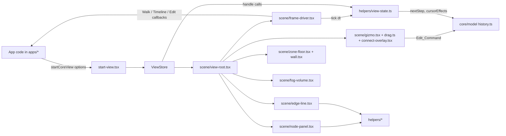

# Design Document: core-view

## Overview

This design implements the view layer in `core/view/`: 3D rendering of a Scenario with React Three Fiber and drei, Zone floors and Walls, zoom detail layers, ViewPresets with a Visibility_Filter, Camera_Paths and the Walkthrough, fog from Effect_Requests, Timeline playback timing, Theme swapping, the Must 3D interaction of intent.md 3.3 (select, drag with snapping, gizmo rotate and scale, connect by two clicks, undo and redo), and the generic Core_Demo page. It builds on the approved `core-graph` and `core-rules` code in `core/model/` and changes none of its behaviour.

Guiding choice: the smallest design that meets every criterion of `requirements.md`. The view is split into two layers:

- **View_Helpers** (`core/view/helpers/`): pure functions on plain data. They import only `zod`, `core/model/`, and each other. Every decision that can be made without a GPU lives here: settings and Theme validation, the Visible_Set, camera interpolation, snapping, the detail decision, Edge offsets, Edge ids, gesture commands, the Link_Conditions, and the View_State_Reducer that runs the Walkthrough and Timeline clocks. These are the PBT target (P-VIEW-1 to P-VIEW-9).
- **Scene** (`core/view/scene/`, `.tsx`): React Three Fiber components that read the helpers' results and draw them. They hold no rule and compute no judgement. They are checked by example tests where possible and by a human at the verification gate.

Requirements were approved on 2026-11-16 with Q2 to Q16 at their defaults (decision-log). This design fixes the items the requirements left to design.md: Euler order, base panel size, text area on image panels, scale minimum and scale mode, Wall occlusion, Reference_Machine and the 50-image test Scenario, the Walk_Callback frame rule, the Core_Demo output path, bundled fonts, and how React starts in the View_Host. Each is listed in "Design decisions" below.

The requirements amendment of 2026-11-16 (Edge selection, the Select_Callback, and the `execute` handle function) is designed in "Amendment 2026-11-16: Selection notification and Edge selection" below. It changes existing files only and adds no file.

### Research findings that shape the design

These were checked on 2026-11-16 with `npm view` against the npm registry and by unpacking the published packages (`npm pack`) and searching their files, not only in documentation.

- **Current versions that fit together.** `three` 0.187.0, `@types/three` 0.187.0, `@react-three/fiber` 9.8.2, `@react-three/drei` 10.7.9, `react` 19.3.1, `react-dom` 19.3.1, `@types/react` 19.3.0, `@types/react-dom` 19.3.0. Fiber 9.8.2 declares the peers `react >=19 <19.4`, `react-dom >=19 <19.4`, `three >=0.156`. Drei 10.7.9 declares `react ^19`, `react-dom ^19`, `three >=0.159`, `@react-three/fiber ^9.0.0`. So the set above meets every peer range.
- **drei `Text` cannot meet R-VIEW-03.9.** drei `Text` uses `troika-three-text` (drei 10.7.9 depends on `^0.52.4`). Its bundle contains the string `https://cdn.jsdelivr.net/gh/lojjic/unicode-font-resolver@v1.0.1/packages/data`: troika fetches fallback fonts from that CDN for any glyph missing from the given font, and uses it as the default font when no `font` is given. That is a remote font fallback, which R-VIEW-03.9 and S-VIEW-3 forbid, and the string would also fail the check:build foreign-URL scan (R-FND-10.12). **Decision D1:** text is drawn with the browser 2D canvas into textures, using one bundled font file loaded with the `FontFace` API. drei `Text` and troika are not used.
- **Fiber embeds its package metadata.** `@react-three/fiber` 9.8.2 `dist/events-*.esm.js` contains `https://github.com/pmndrs/react-three-fiber#readme`, `…/issues`, `https://opencollective.com/react-three-fiber` (funding metadata), and `https://react.dev/link/hydration-mismatch`. None of them is fetched; they are text. They would fail the check:build scan unless allowed. R-FND-02.11 leaves this decision to the design phase (see "repo-foundation changes").
- **Only some drei files hold remote asset URLs.** In drei 10.7.9 the URLs are in `core/Cloud.js`, `core/Gltf.js`, `core/Ktx2.js`, `core/MatcapTexture.js`, `core/NormalTexture.js`, `core/useEnvironment.js`, and `web/FaceLandmarker.js`. This design uses only `OrbitControls`, `TransformControls`, `Line`, and `Billboard`, which hold none. drei's `package.json` has `"sideEffects": false`, so the bundler drops the unused files. The check:build scan confirms this on every build.
- **three.js 0.187.0** holds only `http://www.w3.org/1999/xhtml` in `three.core.js` (already allowed) and a WebGPU debug URL in `three.webgpu.js`, which this design does not import. Since r163, `WebGLRenderer` needs WebGL 2, so the WebGL check of R-VIEW-03.3 asks for a `webgl2` context.
- **Vite 8 reads JSX settings from `tsconfig.json`.** Vite's `OxcOptions` type omits `tsconfig` because Vite passes the resolved tsconfig to the Oxc transformer itself. With `"jsx": "react-jsx"`, `.tsx` files compile with the automatic React runtime. `@vitejs/plugin-react` (already allowed, R-FND-02.7) is needed only for Fast Refresh, which this project does not need.
- **Canvas taint.** Drawing a cross-origin image without CORS headers into a 2D canvas taints it, and `getImageData` then throws `SecurityError`; uploading a tainted canvas to WebGL fails the same way. The Core_View detects this once per image with a 1-pixel `getImageData` probe and treats the image as "fails to load" (R-VIEW-04.6).
- **`z.record` drops the key `__proto__`** (core-graph research). The Theme maps are keyed by Node_Type, Edge_Type, and Effect_Kind, which may be any Identifier (R-VIEW-19.2), so they use the same `z.custom` + `superRefine` pattern as Numeric_Attributes, and lookups use `Object.hasOwn` so that a type named `constructor` never reads `Object.prototype`.

Content was rephrased for compliance with licensing restrictions.

### Design decisions

| ID | Item left to design | Decision | Reason |
|---|---|---|---|
| D1 | Fonts (R-VIEW-03.9) | One bundled font file, `core/view/fonts/inter-regular.woff2` (Inter, SIL Open Font License 1.1, license text in `core/view/fonts/OFL.txt`), imported as a Vite asset URL and loaded with `new FontFace("CoreViewSans", url)`. All text is drawn into canvas textures with `ctx.font = "<px>px CoreViewSans"`. | No CDN fallback exists in this path; the asset is served from the Public_URL origin. |
| D2 | Euler order (R-VIEW-04.1) | `"XYZ"` (three.js default). | Same as `THREE.Euler` default and `TransformControls`. |
| D3 | Base panel size (R-VIEW-04.1) | 1.6 wide × 1.2 high world units, before `scale.x` and `scale.y`. `scale.z` scales the panel's thickness of 0.02, which is not visible. | 4:3 fits both text cards and photos. |
| D4 | Text area on image panels (R-VIEW-04.4) | The bottom 30 % of the panel height, full width. The area is filled with the Node_Style fill color at 85 % alpha, then the text is drawn on it. The image is fit into the whole panel first. | The image stays visible in the upper 70 %. |
| D5 | Scale minimum (R-VIEW-14.7) | `MIN_SCALE = 0.05` for each component. | Small enough for any layout, far above 0, so the Scenario_Schema never rejects it. |
| D6 | Rotate and scale modes | **Rotate:** per axis. Only the `X`, `Y`, `Z` ring handles produce a command; each changes only that Euler component (see "Gizmo"). The view-plane (`E`) and trackball (`XYZE`) handles that three.js shows with all three axes produce no command and no preview. **Scale:** per axis. `showZ` is false, so three.js shows the `X`, `Y`, and `XY` handles (every handle whose name contains `Z`, including the uniform `XYZ` handle, is hidden). `X` changes only `scale.x`, `Y` only `scale.y`, `XY` only `scale.x` and `scale.y`; `scale.z` is never written by a Gesture. | Per-axis meets R-VIEW-14.4 ("only the dragged component"); `scale.z` has no visible effect on a flat panel, so a handle for it would seem to do nothing. |
| D7 | Wall occlusion (R-VIEW-06.4) | Walls are opaque meshes (`MeshStandardMaterial`, `side: DoubleSide`, `depthWrite: true`). Every other drawn element, including text planes and fog volumes, uses `depthTest: true`. The GPU depth buffer then hides exactly the fragments whose line of sight from the camera passes through a Wall. | Standard z-buffering meets the criterion with no extra code and no per-frame CPU work. |
| D8 | ViewPreset move (R-VIEW-08.2) | 0.6 s, `position` and `target` each interpolated linearly with smoothstep easing `e(t) = t²(3 − 2t)`. | Well under the 1.0 s limit. |
| D9 | Walk_Callback frame rule (R-VIEW-17.9, 17.10) | Walk_State changes from handle calls are not reported at once. In each drawn frame, the View_State_Reducer compares the Walk_State with the last reported one: if it differs, it emits one walk event with the new state and the current Path_Progress; otherwise, if the state is `playing`, it emits one progress event. So the Walk_Callback is called at most once per frame. | One rule gives both 17.9 and 17.10 and can be property-tested on plain data. |
| D10 | Core_Demo output path (R-VIEW-21.1) | Source `core/view/demo/index.html`; built to `dist/core-demo/index.html`; served at `/SpatialCore/core-demo/`. | Short path with no `apps` segment, flattened like the App pages. |
| D11 | React start (R-VIEW-03.1) | `startCoreView` appends one `div` (100 % width and height) to the View_Host and calls `createRoot(div).render(<ViewRoot store={store} />)` from `react-dom/client`. No `StrictMode`, so effects run once. | The View_Host's own children are never touched except for that one `div` and the message element. |
| D12 | Who holds the current History | The Core_View keeps the current History. After an accepted Gesture, undo, or redo, it uses the new History at once and also passes it to the Edit_Callback. A later `setHistory` from the App replaces it. | The drawing never waits for the App, and the App always hears about every new History. |
| D13 | Edge drawing | drei `Line` (`Line2`) with `worldUnits: true`, so the Edge_Style line width is in world units, and `dashed` from the Edge_Style. A line is a quadratic Bézier curve (24 segments) whose middle point is offset by the helper of R-VIEW-05.5. The arrow head is a cone of length `max(0.12, 4 × width)`. | World-unit widths make P-VIEW-9's "separated by at least the line width" a statement about one unit. |
| D14 | Fog volume shape (R-VIEW-10.2) | Node: a box 1.25 × panel width, 1.25 × panel height, 0.6 deep, centered on the panel with its rotation. Edge: a tube of radius `0.3` along the drawn curve. Zone: the footprint shape extruded upward from the Zone_Plane by `min(1, Wall_Height)`. Material: `MeshBasicMaterial`, Effect_Style color and opacity, `transparent: true`, `depthWrite: false`. | Plain, cheap, and readable from every ViewPreset. |
| D15 | Edge `id` for a new connection (R-VIEW-15.5) | `edge-<k>` with the smallest integer `k ≥ edges.length + 1` that no Edge `id` equals. | Depends only on the Edge ids, so it is the same for deeply equal Scenarios. |
| D16 | Reference_Machine (R-VIEW-16.4) | The developer's Windows PC with no discrete GPU (CPU with integrated graphics only), running the latest stable Microsoft Edge or Google Chrome. At measurement time the exact CPU model and browser version are written into `docs/decision-log.md` with the measured median (resolved O1). The 16.7 ms median of R-VIEW-16.4 is unchanged. | The machine is the one the developer has. Edge and Chrome share the Chromium engine. |
| D17 | 50-image test Scenario (R-VIEW-16.4) | Generated at runtime by `core/view/demo/perf-scenario.ts`: 50 image Nodes in a 10 × 5 grid, 60 Edges, 5 Zones (4 `rect`, 1 `ring`, 1 of them `enclosed`). Images: 10 developer-made SVG files under `core/view/demo/images/` (1024 × 768 viewBox), each used by 5 Nodes. Each image is drawn into its Node's 512 × 384 panel texture, the same size every image Node uses. | Every Node composites its own 512 × 384 panel texture (see "Panel textures"), so the GPU cost per frame is the same for SVG or raster sources and does not depend on how many sources are distinct. |
| D18 | Helper file grouping (R-VIEW-01.10) | A helper file may hold several closely related View_Helpers (for example `poseAt` and `buildZoneWaypoints`). "Its own file" is read as "a file that holds only View_Helpers, apart from rendering code". Test files may also be shared: `determinism.test.ts` tests every helper, and `settings-schema.test.ts` holds the one P-VIEW-8 test for both loaders (resolved O8). | Fewer files for one developer; the import ban is checked per file. |
| D19 | Text font of DOM elements | The View_Host message `<p>` and the Core_Demo buttons set `font-family: CoreViewSans, sans-serif`. The message is shown before the font loads and may use the local `sans-serif` until then; neither causes a network request. | One font across canvas and DOM text; no remote font (R-VIEW-03.9). |
| D20 | Edge hit tolerance (R-VIEW-23.1) | 6 CSS px on screen on each side of the drawn curve (line, loop, and up to the arrow tip), from one hidden screen-space hit line 12 CSS px wide per Edge. The arrow cone mesh is also hit on its own geometry. | Easy to hit a 0.03-unit line from the overview, small enough that two parallel Edges stay apart at normal zoom. |
| D21 | Edge highlight (R-VIEW-23.2) | The selected Edge's line and arrow cone use the Node outline color `#ffd400` (`SELECTION_COLOR`), and the line width is 2 × its Edge_Style width (world units). Dash style and label are unchanged. | Same selection color as Nodes; a thicker line needs no extra mesh. |

## Architecture



Dependencies go one way:

```
core/model/*  <-  core/view/helpers/*  <-  core/view/scene/*  <-  core/view/start-view.tsx  <-  core/view/demo/*, apps/*
```

- `core/view/helpers/` imports `zod`, `../../model/*.ts`, and `./*.ts` only. A new lint scope enforces this (see "Lint scope for View_Helpers").
- `core/view/scene/` and `start-view.tsx` may import React, `react-dom/client`, `three`, `@react-three/fiber`, `@react-three/drei`, `../helpers/*`, and `../../model/*`.
- Nothing under `core/view/` except `core/view/demo/` itself imports `core/view/demo/` (R-VIEW-21.6). `core/view/demo/main.tsx` imports `../start-view.tsx` like an App would.
- Nothing under `core/` imports `apps/` (existing lint scope `core-view`, R-VIEW-01.4). `core/model/` imports neither `core/view/` nor any 3D or React package (existing lint scope `core-model`, R-VIEW-01.4). No lint change is needed for R-VIEW-01.4.

### File layout

| File | Responsibility | Imports |
|---|---|---|
| `core/view/start-view.tsx` | `startCoreView(options)`: settings and Theme check, WebGL check, font load, React root, the `CoreViewHandle`. | React, `react-dom/client`, `./scene/view-root.tsx`, `./scene/view-store.ts`, helpers, model |
| `core/view/scene/view-store.ts` | `ViewStore`: holds History, View_Settings, Theme, App Effect_Requests, View_State; `dispatch`, `subscribe`, `getSnapshot` for `useSyncExternalStore`; the outbox flush that calls the callbacks. | helpers, model |
| `core/view/scene/view-root.tsx` | `<Canvas>` with camera, lights, background color; mounts every scene component from the store snapshot. | fiber, drei, React, scene files |
| `core/view/scene/frame-driver.tsx` | `useFrame`: dispatches `tick` with the frame delta, applies the camera pose the reducer asks for, flushes the outbox. | fiber, store |
| `core/view/scene/camera-rig.tsx` | drei `OrbitControls` (`makeDefault`, `minDistance: 0.1`), enabled only when the reducer allows orbit. | drei |
| `core/view/scene/node-panel.tsx` | One panel per visible Node: mesh, panel texture, selection outline, Detail_Layer plane. | fiber, three, `panel-texture.ts`, helpers |
| `core/view/scene/panel-texture.ts` | Composites fill, border, image, and text into one 2D canvas per Node; `CanvasTexture`. | three, `text-layout.ts`, `image-cache.ts` |
| `core/view/scene/text-layout.ts` | Word wrap and cut-off for canvas text with `measureText`. | none (DOM canvas) |
| `core/view/scene/image-cache.ts` | Calls the Image_Resolver once per distinct Image_Reference; loads `HTMLImageElement`s; taint probe. | none (DOM) |
| `core/view/scene/font.ts` | The bundled font URL (`import fontUrl from "../fonts/inter-regular.woff2?url"`) and `loadFont()`. | Vite asset import |
| `core/view/scene/edge-line.tsx` | Edge curves, arrow heads, self-loops, labels (drei `Line`, `Billboard`). | drei, three, helpers |
| `core/view/scene/zone-floor.tsx`, `wall.tsx` | Floors (`ShapeGeometry`, ring with a hole), labels, Walls. | three, fiber |
| `core/view/scene/fog-volume.tsx` | Fog boxes, tubes, and extruded footprints for drawable Effect_Requests. | three, fiber |
| `core/view/scene/gizmo.tsx` | drei `TransformControls` on the selected Node, `rotate` or `scale`. | drei |
| `core/view/scene/drag.ts` | Pointer-to-Zone_Plane ray test, 5 px threshold, drag preview. | three |
| `core/view/scene/connect-overlay.tsx` | The screen-space line of R-VIEW-15.6 as an absolutely positioned `<svg>` over the canvas. | React |
| `core/view/helpers/settings-schema.ts` | `viewSettingsSchema`, `loadViewSettings`, types. | zod, model |
| `core/view/helpers/theme-schema.ts` | `themeSchema`, `loadTheme`, `nodeStyleFor`, `edgeStyleFor`, `effectStyleFor`. | zod, model |
| `core/view/helpers/neutral-theme.ts` | `NEUTRAL_THEME` (R-VIEW-19.9). | `./theme-schema.ts` (type) |
| `core/view/helpers/visibility.ts` | `computeVisibleSet`. | model (types) |
| `core/view/helpers/camera-path.ts` | `poseAt`, `waypointMarks`, `buildZoneWaypoints`, `tweenPose`, `posesEqual`. | model (types) |
| `core/view/helpers/snap.ts` | `snap`. | none |
| `core/view/helpers/detail.ts` | `showsDetail`. | none |
| `core/view/helpers/edge-layout.ts` | `edgeOffsets`, `edgeMidpoint`, `loopSizes`. | model (`compareCodePoints`, types) |
| `core/view/helpers/gesture-commands.ts` | `dragCommand`, `gizmoAxes`, `rotationPreview`, `rotateCommand`, `scaleCommand`, `clampScale`, `newEdgeId`, `connectCommand`. | model (types) |
| `core/view/helpers/link.ts` | `checkLinkedTimeline`. | model (`createCursor`, types) |
| `core/view/helpers/effects-view.ts` | `drawableEffects`, `shownEffects`. | model (`cursorEffects`, `effectRequestSchema`, types) |
| `core/view/helpers/zone-refs.ts` | `missingZoneRefs`, `newlyMissingZoneRefs` (R-VIEW-02.8). | model (types) |
| `core/view/helpers/view-state.ts` | `ViewState`, `ViewAction`, `ViewEvent`, `initialViewState`, `reduceViewState`, `cameraFor`, `orbitAllowed`. | model (`nextStep`, `createCursor`, types), `./camera-path.ts` |
| `core/view/helpers/arbitraries.ts` | Test support only: view generators. Imported only by `*.test.ts`. | fast-check, `../../model/arbitraries.ts` |
| `core/view/helpers/*.test.ts` | One test file next to each helper file. | vitest, fast-check |
| `core/view/fonts/inter-regular.woff2`, `OFL.txt` | Bundled font and its license. | — |
| `core/view/demo/index.html`, `main.tsx` | The Core_Demo page and script. | `../start-view.tsx`, helpers |
| `core/view/demo/sample-scenario.json`, `sample-settings.ts`, `sample-scenario.test.ts` | Sample_Scenario, its View_Settings, and the schema example test (R-VIEW-21.2). | model |
| `core/view/demo/perf-scenario.ts`, `images/*.svg` | The 50-image test Scenario of D17, used only with `?perf`. | model |
| `core/view/simple-page.ts` | Unchanged. | model (type) |

- `core/view/helpers/arbitraries.ts` follows the `core/model/arbitraries.ts` convention: it is test support, not a product file, and no product file imports it. For R-VIEW-01.3 it counts as test code (Open question O3 confirms this reading).
- The Sample_Scenario is a `.json` file so that it is also an example of the saved format. It is imported with `import sample from "./sample-scenario.json" with { type: "json" }` and passed through `createHistory`, which validates it.

## Components and Interfaces

### The core/app interface (`start-view.tsx`)

```ts
export type ImageResolver = (reference: string) => string | null; // a URL the browser can draw, or "no image"
export type EditReport =
  | { kind: "history"; history: History }
  | { kind: "errors"; context: ErrorContext; errors: ValidationError[]; history?: History };
export type ErrorContext = "start" | "settings" | "theme" | "preset" | "walk" | "timeline" | "edit" | "effects";
export type EditCallback = (report: EditReport) => void;
export type WalkState = "idle" | "playing" | "paused" | "finished";
export type WalkCallback = (state: WalkState, progress: number) => void;
export type TimelineReport = { kind: "position"; position: number } | { kind: "end" };
export type TimelineCallback = (report: TimelineReport) => void;

export type CoreViewOptions = {
  host: HTMLElement;              // View_Host
  history: History;               // from core/model/history.ts
  settings: unknown;              // View_Settings, checked by loadViewSettings
  theme: unknown;                 // Theme, checked by loadTheme
  resolveImage: ImageResolver;
  onEdit: EditCallback;
  onWalk: WalkCallback;
  onTimeline: TimelineCallback;
  onSelect?: SelectCallback;      // optional Select_Callback (R-VIEW-03.10, amendment 2026-11-16)
};

export type Selection = { kind: "node" | "edge"; id: string } | null;   // from helpers/view-state.ts
export type SelectCallback = (selection: Selection) => void;

export type CoreViewHandle = {
  setHistory(history: History): void;                         // R-VIEW-03.4
  setPreset(id: string): void;                                // R-VIEW-08.1
  setEffects(effects: readonly EffectRequest[]): void;        // R-VIEW-10.1
  setTheme(theme: unknown): void;                             // R-VIEW-19.6, 19.7
  setEditMode(mode: "view" | "edit"): void;                   // R-VIEW-12.7, 15.7
  setGizmoMode(mode: "rotate" | "scale"): void;               // R-VIEW-14.2
  connectOn(edgeType: string): void;                          // R-VIEW-15.1, 15.2
  connectOff(): void;                                         // R-VIEW-15.1
  undo(): void;                                               // R-VIEW-16.1
  redo(): void;                                               // R-VIEW-16.1
  startWalk(pathId: string, duration: number, linked?: Timeline): void; // R-VIEW-17.1
  pauseWalk(): void; resumeWalk(): void; stopWalk(): void;    // R-VIEW-17.6
  startTimeline(timeline: Timeline): void;                    // R-VIEW-18.1
  pauseTimeline(): void; resumeTimeline(): void; stopTimeline(): void;
  execute(command: EditCommand): void;                        // R-VIEW-23.10 to 23.12 (amendment 2026-11-16)
  stop(): void;                                               // R-VIEW-03.5
};

export function startCoreView(options: CoreViewOptions): CoreViewHandle;
```

`startCoreView` steps:

1. `loadViewSettings(options.settings)` and `loadTheme(options.theme)`. If either fails, append one `<p>` (`font-family: CoreViewSans, sans-serif`, D19; text set with `textContent`) with the text `The view settings are invalid.`, call `onEdit({ kind: "errors", context: "start", errors: [...settingsErrors, ...themeErrors] })` once, and return a "message" handle (R-VIEW-03.2).
2. Probe WebGL 2: `document.createElement("canvas").getContext("webgl2")`, inside `try`. If it is `null` or throws, append one `<p>` with `3D display is not available in this browser.` and return a "message" handle; no exception reaches the App (R-VIEW-03.3).
3. Create the `ViewStore` with the History, settings, Theme, an empty App effect list, and `initialViewState(settings)` (first ViewPreset active and shown, Walk_State `idle`, `cameraOnce` = the first ViewPreset's pose). The frame driver applies that pose on the first drawn frame, so the scene opens at the first ViewPreset's camera (R-VIEW-03.1).
4. Report `missingZoneRefs(settings, history.present)` through `onEdit` with `context: "settings"` if non-empty (R-VIEW-02.8).
5. Append the `div` and render `<ViewRoot store={store} />` (D11). Panel textures wait for `loadFont()` before drawing text; until then they draw fill and border only.
6. Return the handle.

A "message" handle has every function, `execute` included, and each is a no-op except `stop`, which removes the message element (R-VIEW-03.6, 03.7). A stopped handle sets `stopped = true`; every function then returns at once, and the store drops every callback (R-VIEW-03.5, 03.6). `stop` calls `root.unmount()`, which makes R3F dispose its `WebGLRenderer`; each scene component disposes the textures and geometries it created in its effect cleanup; then the `div` is removed.

Handle functions that take arguments check them first with helpers and report failures synchronously through `onEdit`. Then they dispatch one View_Action to the reducer. Callbacks caused by the reducer are emitted through the View_State outbox and flushed by the frame driver (D9).

| Function | Check | Failure report |
|---|---|---|
| `setPreset(id)` | `id` is a ViewPreset `id` | `{ path: "presetId" }`, context `preset` (R-VIEW-08.6) |
| `setTheme(t)` | `loadTheme(t)` | the Theme_Loader errors, context `theme` (R-VIEW-19.7) |
| `setEffects(list)` | `z.array(effectRequestSchema)` from `rule-schema.ts` | errors with paths `effects.<i>…`, context `effects`; the previous list stays |
| `startWalk(pathId, d, linked?)` | `pathId` is a Camera_Path `id` → else `pathId`; `d` is a finite number > 0 → else `duration`; a `fromZones` path builds → else `paths.<index>`; `linked` meets the Link_Conditions → else `timeline…` | context `walk` (R-VIEW-09.5, 17.8, 17.12) |
| `startTimeline(t)` | `createCursor(t)` | its errors (paths start with `timeline`), context `timeline` (R-VIEW-18.9) |
| `connectOn(type)` | `type` is an Identifier (`nonBlank`) | `{ path: "edgeType" }`, context `edit` |

`setHistory(h)` updates the store, dispatches `modelChanged` (so the Selection and a pending connection are cleared when their Node or Edge is gone or hidden, R-VIEW-12.5, 12.9, 15.7, 23.6), and reports `newlyMissingZoneRefs(settings, previous.present, h.present)` (R-VIEW-02.8). It keeps the Active_Preset and the camera (R-VIEW-03.4).

### Gestures and the History (`scene/drag.ts`, `scene/gizmo.tsx`, `ViewStore.execute`)

All History changes go through one store method:

```ts
execute(command: EditCommand): void {
  const r = executeCommand(this.history, command);      // core/model/history.ts
  if (r.ok) { this.history = r.history; this.onEdit({ kind: "history", history: r.history }); }
  else this.onEdit({ kind: "errors", context: "edit", errors: r.errors, history: r.history });
  this.dispatch(this.modelChangedAction());
}
undo(): void {
  const h = undo(this.history);
  const changed = h !== this.history;
  this.history = h;
  this.onEdit({ kind: "history", history: h });              // every call, as R-VIEW-16.1 says (resolved O2)
  if (changed) this.dispatch(this.modelChangedAction());
}
// redo is the same with redo()
private modelChangedAction(): ViewAction {                   // amendment 2026-11-16: all four lists
  const s = this.history.present;
  const v = computeVisibleSet(s, this.shownFilter());        // one Visible_Set computation
  return { type: "modelChanged",
    nodeIds: s.nodes.map((n) => n.id), visibleNodeIds: v.nodes,
    edgeIds: s.edges.map((e) => e.id), visibleEdgeIds: v.edges };
}
```

`shownFilter()` is the Visibility_Filter of `shownPresetId`. `setHistory` and a ViewPreset switch dispatch `modelChangedAction()` too.

- One Gesture → at most one `execute` call (R-VIEW-16.2). Every Gesture of this spec changes exactly one element, so no Gesture builds a Batch_Command; the rule "two or more elements → one Batch_Command" has no case here and is kept for later Gestures (multi-select is out of scope).
- `undo` and `redo` on an empty `past` or `future` return the same History object (`core-graph`). The store still passes that returned History to the Edit_Callback once, as approved R-VIEW-16.1 says ("exactly once per call"), but draws nothing new and reports no error (R-VIEW-16.7).
- A rejected command leaves `this.history` as it was. Each scene component draws from the store's History, and the drag or gizmo preview is cleared at Gesture end, so the next frame shows the pre-Gesture values (R-VIEW-13.7, 14.8, 16.6).

**Click and drag (R-VIEW-12, R-VIEW-13).** R3F pointer events on panel meshes give the nearest hit first (`event.stopPropagation()` after the first), which is the Node nearest to the camera along the ray (R-VIEW-12.2). Only meshes of Nodes in the Visible_Set exist, so hidden Nodes cannot be clicked (R-VIEW-07.8). `onPointerMissed` on the `<Canvas>` and hits on floors and Walls dispatch `select(null)`, which clears the Selection in every state, including while Connect_Mode is on (R-VIEW-12.3). Edge clicks follow the amendment section below: they select the Edge in `edit` mode with connect off, and are empty clicks otherwise (R-VIEW-12.8, 23.8).

1. `pointerdown` (primary button) records the screen point and the Node. If Edit_Mode is `edit` and the Node is the selected Node, the store sets `gestureActive` at once, before the 5 px threshold, so `OrbitControls` is off for the whole press and an orbit never starts under a drag (R-VIEW-08.9). The panel takes pointer capture; `pointerup`, `pointercancel`, and `lostpointercapture` clear `gestureActive`.
2. `pointermove`: if the pointer is more than 5 CSS px from the press point and the press was on the selected Node in `edit` mode, a drag starts. The Zone_Plane is `THREE.Plane((0,1,0), −elevation)` of the Node's Zone, or `y = 0` with no Zone. Each move intersects the pointer ray with that plane; a hit gives `snap({ x: hit.x, y: node.position.y, z: hit.z }, snapStep)` as the preview position; no hit keeps the last preview (R-VIEW-13.4). Edges of that Node are drawn from the preview position in the same frame (R-VIEW-05.2).
3. `pointerup`: a drag calls `dragCommand(node, preview)`, which returns `null` when `x` and `z` equal the start (R-VIEW-13.6) or one `updateNode` command with only `position` (R-VIEW-13.5). A press and release within 5 px is a click: select, or a connection click when Connect_Mode is on.

While `gestureActive` is set (from `pointerdown` on the selected Node, or from the gizmo's `mouseDown`, until the matching up event), `orbitAllowed(state, gestureActive)` is `false` and `OrbitControls` is disabled in the same event handler, not on the next frame (R-VIEW-08.9). drei `TransformControls` also turns off the default controls while its handle is dragged when `OrbitControls` is `makeDefault`; the explicit flag covers the press before the first move.

**Gizmo (R-VIEW-14).** drei `<TransformControls mode={gizmoMode} space="local" object={panelRef}>` is mounted only while Edit_Mode is `edit` and a Node is selected (R-VIEW-14.1, 14.3). `showX`, `showY`, `showZ` are all true in `rotate`; in `scale`, `showZ` is false (D6). The store History is not touched during the drag (R-VIEW-14.4).

- On `mouseDown`, the scene stores the Node's stored `rotation` and `scale` as the start values and sets `gestureActive`.
- `axes = gizmoAxes(mode, controls.axis)` maps the handle name to the components it may change: rotate `X`/`Y`/`Z` → `["x"]`/`["y"]`/`["z"]`; scale `X` → `["x"]`, `Y` → `["y"]`, `XY` → `["x", "y"]`; any other name (`E`, `XYZE`, `null`, …) → `[]`.
- **Rotate.** three.js `TransformControls` exposes `rotationAngle` (the signed angle since the press) and `rotationAxis` (the unit axis of the handle; in `local` space it is the local unit axis). The scene computes `delta = rotationAngle × sign(rotationAxis[c])` for the one component `c` in `axes`. On each `objectChange`, the scene overwrites the panel's rotation with `rotationPreview(start, c, delta)`: the stored Euler with only component `c` replaced by `start[c] + delta`. The preview and the command therefore show the same value. The Euler of the panel object is never read back and never normalized. When `axes` is empty, the panel keeps the stored rotation.
- **Scale.** On each `objectChange`, the scene overwrites the panel's scale with the stored scale whose components in `axes` take the panel object's new values, then `clampScale`, so the drawn panel never goes below `MIN_SCALE` and never changes a component outside `axes`.
- On `mouseUp`, `rotateCommand(node, c, delta)` or `scaleCommand(node, axes, objectScale)` builds the command (see "Gesture commands"). It changes only the components in `axes`, takes the others exactly from the stored Node, applies `clampScale` before it compares, and returns `null` when the result equals the stored value (R-VIEW-14.5, 14.6, 14.7, 16.5). `gestureActive` is cleared.

With Euler order `XYZ`, a change of one component is a rotation about the local `z` axis for `z`, about the parent `x` axis for `x`, and about an intermediate axis for `y`. When the other two components are not 0, the panel therefore turns about a slightly different axis than the ring drawn by the gizmo. Rotation has no meaning in any rule (intent.md 3.3), and exact per-component writes keep the two other stored components free of rounding drift, so this design accepts that visual difference.

**Connect (R-VIEW-15).** The reducer holds `connect: { edgeType, first } | null`. A click on a visible Node dispatches `connectClick(id)`. The reducer either stores `first`, cancels (same Node), or clears `first` and emits `{ kind: "connect", from, to, edgeType }`. The store turns that event into `connectCommand(present, from, to, edgeType)` (an `addEdge` with `id = newEdgeId(present)`) and calls `execute` (R-VIEW-15.3, 15.4, 15.5, 15.9). While `first` is set, `connect-overlay.tsx` draws an SVG line from the screen projection of the first Node to the pointer (R-VIEW-15.6).

### View_Helpers

#### Settings (`helpers/settings-schema.ts`)

```ts
const identifier = nonBlank;                                   // from scenario-schema.ts
const finite = z.number();                                     // Zod 4 rejects NaN and ±Infinity
const positive = z.number().positive();
const point = z.object({ x: finite, y: finite, z: finite });

export const cameraPoseSchema = z.object({ position: point, target: point })
  .superRefine(poseNotDegenerate, { when: (p) => p.issues.length === 0 });   // issue at "target"

export const zoneFootprintSchema = z.discriminatedUnion("kind", [
  z.object({ kind: z.literal("rect"), id: identifier, x: finite, z: finite, width: positive, depth: positive }),
  z.object({ kind: z.literal("ring"), id: identifier, x: finite, z: finite, innerRadius: finite, outerRadius: positive })
    .superRefine(ringRadii, { when: (p) => p.issues.length === 0 }),          // issue at "innerRadius"
]);

export const visibilityFilterSchema = z.object({
  zones: z.array(identifier).optional(),
  nodeTypes: z.array(identifier).optional(),
  edgeTypes: z.array(identifier).optional(),
  includeUnzoned: z.boolean().optional(),
  edgeRule: z.enum(["bothEnds", "anyEnd"]),
});

export const viewPresetSchema = z.object({
  id: identifier, label: localizedTextSchema, pose: cameraPoseSchema, filter: visibilityFilterSchema,
});

export const cameraPathSchema = z.object({
  id: identifier,
  waypoints: z.array(cameraPoseSchema).min(2).optional(),
  fromZones: z.object({ height: finite }).optional(),
}).superRefine(exactlyOneSource, { when: (p) => isPlainObject(p.value) });  // issue at "" → "paths.<i>"

export const viewSettingsSchema = z.object({
  zoneFootprints: z.array(zoneFootprintSchema),
  presets: z.array(viewPresetSchema).min(1),
  paths: z.array(cameraPathSchema),
  detailDistance: positive,
  snapStep: positive,
  wallHeight: positive,
  editMode: z.enum(["view", "edit"]),
  stepDuration: positive,
}).superRefine(duplicateIds, { when: (p) => p.issues.length === 0 });

export type ViewSettings = z.infer<typeof viewSettingsSchema>;   // and CameraPose, ZoneFootprint, ViewPreset, VisibilityFilter, CameraPath
export function loadViewSettings(value: unknown): { ok: true; settings: ViewSettings } | { ok: false; errors: ValidationError[] };
```

- Error rules: `presets` missing or empty → one issue at `presets` (`invalid_type` or `too_small`, R-VIEW-02.5). Equal `position` and `target` → `…pose.target` or `paths.<i>.waypoints.<j>.target` with `position and target must differ` (R-VIEW-02.6). Ring with `innerRadius < 0` or `innerRadius >= outerRadius` → `zoneFootprints.<i>.innerRadius`. `rect` `width`/`depth` ≤ 0 → that field. Fewer than 2 Waypoints → `paths.<i>.waypoints`. Both or neither of `waypoints` and `fromZones` → `paths.<i>` with `a camera path needs exactly one of waypoints and fromZones`.
- `duplicateIds` walks `presets`, `paths`, `zoneFootprints` in that order, by index, and reports each later duplicate at `<list>.<index>.id` (R-VIEW-02.4), as `core-graph` does. Like `core-graph`, it runs only when the value has no other issue (`when: (p) => p.issues.length === 0`): a value with a shape error and a duplicate id reports the shape error first, and the duplicate only after the shape is fixed. This is how this design reads the fixed error order of R-VIEW-02.3 (see O9).
- The enums `bothEnds`/`anyEnd`, `view`/`edit`, `rect`/`ring` are View_Settings vocabulary, not Node_Types, Edge_Types, attribute names, Effect_Kinds, or Identifiers, so R-VIEW-01.7 allows them.
- `loadViewSettings` wraps `safeParse` in `try`; an unexpected exception gives one error at `""`, `the view settings could not be validated` (R-VIEW-02.7). Zod `z.object` strips unknown keys at every level (R-VIEW-02.2) and walks in shape order, so the error order is fixed (R-VIEW-02.3).

#### Theme (`helpers/theme-schema.ts`, `helpers/neutral-theme.ts`)

```ts
const color = z.string().regex(/^#[0-9a-fA-F]{6}$/, "must be a #rrggbb color");
export const nodeStyleSchema = z.object({ fill: color, border: color });
export const edgeStyleSchema = z.object({ color, width: z.number().positive(), dashed: z.boolean() });
export const effectStyleSchema = z.object({ style: z.literal("fog"), color, opacity: z.number().min(0).max(1) });

// A map keyed by any Identifier. z.custom + superRefine + transform, so "__proto__" survives (see Research).
function styleMap<T>(schema: z.ZodType<T>): z.ZodType<Record<string, T>>;

export const themeSchema = z.object({
  background: color, floor: color, wall: color, text: color,
  defaultNode: nodeStyleSchema, defaultEdge: edgeStyleSchema,
  nodes: styleMap(nodeStyleSchema), edges: styleMap(edgeStyleSchema), effects: styleMap(effectStyleSchema),
});
export type Theme = z.infer<typeof themeSchema>;           // and NodeStyle, EdgeStyle, EffectStyle
export function loadTheme(value: unknown): { ok: true; theme: Theme } | { ok: false; errors: ValidationError[] };
export function nodeStyleFor(theme: Theme, nodeType: string): NodeStyle;   // Object.hasOwn(theme.nodes, t) ? … : defaultNode
export function edgeStyleFor(theme: Theme, edgeType: string): EdgeStyle;
export function effectStyleFor(theme: Theme, effect: string): EffectStyle | null;
```

`styleMap` checks: not a plain object → issue at the map path (`nodes`, `edges`, `effects`); a blank key → issue at the map path naming the key with `JSON.stringify`; each value parsed with `schema`, its issues prefixed with `[key]`. Keys are walked in `compareCodePoints` order for a fixed error order. The transform builds the output with `Object.fromEntries` of the parsed values, so unknown fields inside each style are removed (R-VIEW-19.4) and a `__proto__` key stays an own key. There is no allowed-key list (R-VIEW-19.2). The `style` literal `fog` is the one style this spec defines (R-VIEW-19.3); `fog` is a drawing style name, not an Effect_Kind, so R-VIEW-01.7 allows it.

`NEUTRAL_THEME` (R-VIEW-19.9): `background #f4f4f2`, `floor #d9d9d4`, `wall #8a8a84`, `text #1e1e1e`, `defaultNode { fill #ffffff, border #5a5a5a }`, `defaultEdge { color #3c3c3c, width 0.03, dashed false }`, and `nodes`, `edges`, `effects` all `{}`. With an empty `effects` map, no Effect_Request draws anything (R-VIEW-10.3). A test checks that `loadTheme(NEUTRAL_THEME)` succeeds.

#### Visible_Set (`helpers/visibility.ts`, R-VIEW-07)

```ts
export type VisibleSet = { nodes: string[]; edges: string[]; zones: string[] };
export function computeVisibleSet(scenario: Scenario, filter: VisibilityFilter): VisibleSet;
```

1. `zoneSet = filter.zones === undefined ? null : new Set(filter.zones)`; same for `nodeTypes` and `edgeTypes`. An empty list gives an empty Set, which matches nothing (R-VIEW-07.3).
2. `includeUnzoned = filter.includeUnzoned ?? (filter.zones === undefined)` (R-VIEW-07.2).
3. A Node is visible when `(node.zone === undefined ? includeUnzoned : zoneSet === null || zoneSet.has(node.zone)) && (typeSet === null || typeSet.has(node.type))`.
4. An Edge is visible when `(edgeTypeSet === null || edgeTypeSet.has(edge.type))` and, for `bothEnds`, both ends are visible Nodes, for `anyEnd`, at least one is (R-VIEW-07.4).
5. A Zone is visible when `zoneSet === null || zoneSet.has(zone.id)` (R-VIEW-07.5).
6. Output lists walk `scenario.nodes`, `edges`, `zones` in order (R-VIEW-07.7). Scenario ids are unique (Scenario_Schema), so each id appears once.

The function reads only `id`, `type`, `zone`, `from`, `to` (R-VIEW-07.1) and never reads `order`, `elevation`, or `enclosed` (R-VIEW-06.8). A missing Identifier in a list is just a Set entry that never matches (R-VIEW-07.6). It wraps its body in `try`; for a Scenario that passes the Scenario_Schema nothing can throw, and for any other value it returns an empty Visible_Set (R-VIEW-20.7).

#### Camera paths (`helpers/camera-path.ts`, R-VIEW-09)

```ts
export type PoseResult = { ok: true; pose: CameraPose } | { ok: false; errors: ValidationError[] };
export function poseAt(waypoints: readonly CameraPose[], progress: number): PoseResult;
export function waypointMarks(waypoints: readonly CameraPose[]): number[];       // Path_Progress of each Waypoint
export type ZoneWaypoints = { ok: true; waypoints: CameraPose[]; zones: string[] } | { ok: false; errors: ValidationError[] };
export function buildZoneWaypoints(scenario: Scenario, footprints: readonly ZoneFootprint[], height: number): ZoneWaypoints;
export function tweenPose(from: CameraPose, to: CameraPose, t: number): CameraPose;  // smoothstep, D8
```

**`poseAt` (arc length).**

1. If `typeof progress !== "number" || !Number.isFinite(progress) || progress < 0 || progress > 1`: failure `[{ path: "progress", message: "progress must be a number from 0 to 1" }]` (R-VIEW-09.6). Fewer than 2 Waypoints: failure at `waypoints`.
2. `progress === 0` → a copy of the first Waypoint; `progress === 1` → a copy of the last (R-VIEW-09.1, exact).
3. Segment lengths `len[i] = hypot(B.position − A.position)` for neighbours A = `w[i]`, B = `w[i+1]`; prefix sums `cum[0] = 0`, `cum[i+1] = cum[i] + len[i]`; total `T = cum[n−1]`.
4. If `T === 0` → the first Waypoint for every `progress < 1` (R-VIEW-09.8).
5. `s = progress × T`. Find the first `i` with `len[i] > 0` and `cum[i+1] >= s` (segments of length 0 are skipped, so there is no division by zero, R-VIEW-09.7). `t = min(1, max(0, (s − cum[i]) / len[i]))`.
6. `position = A.position + t × (B.position − A.position)`, `target = A.target + t × (B.target − A.target)` (R-VIEW-09.2), component by component.

All arithmetic is in a fixed order on the inputs only, so equal inputs give equal numbers (R-VIEW-09.3). The tolerance of R-VIEW-09.1 (1e-9 × (1 + T)) covers the rounding of the prefix sums. The function takes and returns plain objects and writes nothing.

**`waypointMarks`.** `cum[i] / T` for each Waypoint, with `marks[0] = 0` and `marks[n−1] = 1`; when `T = 0`, every mark is `0` except the last, which is `1`.

**`buildZoneWaypoints` (R-VIEW-09.4, 09.5).**

1. Keep the Zones that have a Zone_Footprint with the same `id` (first footprint per id; ids are unique after `loadViewSettings`). Sort them by `order` ascending (orders are unique in a valid Scenario).
2. For each Zone `k`: `center = (fp.x, fp.z)` (rect and ring both use `x`, `z`); `position_k = (center.x, zone.elevation + height, center.z)`.
3. `target_k = position_{k+1}` for `k < last`. For the last: `target = position_last + (target_{last−1} − position_{last−1})`.
4. If fewer than 2 Waypoints, or any `target_k` equals `position_k` component by component, return failure `[{ path: "", message: … }]`. The store prefixes `paths.<index>` (the index of the Camera_Path in View_Settings).
5. Return the Waypoints and `zones` (the Zone ids in Waypoint order) for the Link_Conditions.

#### Snap (`helpers/snap.ts`, R-VIEW-13.3)

```ts
export function snap(p: { x: number; y: number; z: number }, step: number): { x: number; y: number; z: number };
// component c − {x, z}: q = c / step; if |q| > 2 ** 40 or !Number.isFinite(q) return c; else Math.floor(q + 0.5) * step
```

`Math.floor(q + 0.5)` rounds a value exactly halfway toward positive infinity. `y` is copied. For `|q| ≤ 2⁴⁰`, `k × step` divided by `step` is within far less than 0.5 of `k`, so snapping a snapped value returns the same number (idempotence). When the grid is finer than float precision (`|q| > 2⁴⁰`) or `q` overflows, the component is returned as it is, which is already the nearest representable grid point; this keeps the result finite and idempotent for every finite input. A result of `-0` is returned as `0` (`+ 0`) so that the drawn position and the command never carry `-0`.

#### Detail decision (`helpers/detail.ts`, R-VIEW-11.3)

```ts
export function showsDetail(camera: Vec3, node: Vec3, detailDistance: number): boolean {
  return Math.hypot(camera.x - node.x, camera.y - node.y, camera.z - node.z) <= detailDistance;
}
```

`node-panel.tsx` calls it each frame in `useFrame` with the camera position and the drawn Node position (including a drag preview), and toggles the Detail_Layer plane's `visible` flag, so the change shows in the next frame (R-VIEW-11.4). Faces with no `detail` have no Detail_Layer plane (R-VIEW-11.5); Nodes outside the Visible_Set have no mesh at all (R-VIEW-11.6).

#### Edge layout (`helpers/edge-layout.ts`, R-VIEW-05.4 to 05.6)

```ts
export const MIN_EDGE_GAP = 0.15;
export function edgeOffsets(scenario: Scenario, visibleEdgeIds: readonly string[], theme: Theme): Map<string, number>;
export function edgeMidpoint(from: Vec3, to: Vec3, offset: number): Vec3;
export function loopSizes(scenario: Scenario, visibleEdgeIds: readonly string[]): Map<string, number>;
```

**`edgeOffsets`.**

1. Group the visible non-loop Edges by unordered pair key: `[a, b]` with `compareCodePoints(a, b) <= 0` of `from`, `to`.
2. Sort each group by Edge `id` with `compareCodePoints` (R-VIEW-05.5). Because the group and its order depend only on ids, permuting `scenario.edges` gives the same map.
3. Spacing `S = max(MIN_EDGE_GAP, 2 × max width in the group)`, where each width comes from `edgeStyleFor(theme, edge.type).width`.
4. Edge `k` of `n` in the group gets `offset = (k − (n − 1) / 2) × S`. A group of one gets `0` (a straight line).

**`edgeMidpoint`.** With the canonical direction `d = normalize(B − A)` from the smaller-id end A to the larger-id end B (so an Edge and its reverse share one frame), `perp = normalize(d × (0, 1, 0))`, or `(1, 0, 0)` when `d` is vertical or `A = B`. The midpoint is `(A + B) / 2 + offset × perp`. `edge-line.tsx` draws the quadratic Bézier from A to B with control point `(A + B) / 2 + 2 × offset × perp`, so the curve passes through that midpoint. Two Edges `k ≠ j` of one group have midpoints `|k − j| × S ≥ S ≥ 2 × max width` apart, which meets R-VIEW-05.4.

The curve's ends are cut back to the panel edges by `edge-line.tsx`: in the panel's local frame (inverse of the Euler `XYZ` rotation), the direction's `(x, y)` part reaches the rectangle border of half-size `(0.8 × scale.x, 0.6 × scale.y)`; the end point is moved there (R-VIEW-05.1). This is rendering code using `THREE.Matrix4` and is checked at the gate.

**`loopSizes`.** Visible Edges with `from === to`, grouped by Node, sorted by `id`; loop `k` gets radius `0.35 × (1 + 0.5 k)`. Each loop is a circle of that radius in the panel's plane, tangent to the panel's top edge from outside, with its arrow head ending on the top edge (R-VIEW-05.6). Different radii mean no two loops coincide along their length.

#### Gesture commands (`helpers/gesture-commands.ts`)

```ts
export const MIN_SCALE = 0.05;
export type GizmoAxis = "x" | "y" | "z";
export function dragCommand(node: Node, snapped: Vec3): EditCommand | null;                 // null if x and z equal
export function gizmoAxes(mode: "rotate" | "scale", handle: unknown): GizmoAxis[];          // D6 mapping; unknown names → []
export function rotationPreview(start: Vec3, axis: GizmoAxis, delta: number): Vec3;         // start with only `axis` = start[axis] + delta
export function rotateCommand(node: Node, axis: GizmoAxis, delta: number): EditCommand | null;
export function scaleCommand(node: Node, axes: readonly GizmoAxis[], value: Vec3): EditCommand | null;
export function clampScale(scale: Vec3, axes?: readonly GizmoAxis[]): Vec3;                 // components in axes (default all): max(MIN_SCALE, c); NaN → MIN_SCALE
export function newEdgeId(scenario: Scenario): string;                                      // D15
export function connectCommand(scenario: Scenario, from: string, to: string, edgeType: string): EditCommand;
```

- `dragCommand` returns `{ kind: "updateNode", id, changes: { position: { x, y: node.position.y, z } } }`.
- `rotateCommand` computes `r = rotationPreview(node.rotation, axis, delta)`. It returns `null` when `delta` is not a finite number, when `r[axis]` is not finite, or when `r[axis] === node.rotation[axis]` (for example `delta = 0`, or a delta too small to change the number). Otherwise it returns `{ kind: "updateNode", id, changes: { rotation: r } }`, where the two other components are the stored numbers, copied as they are.
- `scaleCommand` builds `s` from `node.scale` with each component in `axes` replaced by `value[c]`, then `s = clampScale(s, axes)`. It returns `null` when `axes` is empty or every component of `s` equals `node.scale` (so a Gesture that ends at or below `MIN_SCALE` on a Node already at `MIN_SCALE` issues no command, R-VIEW-16.5). Otherwise `{ kind: "updateNode", id, changes: { scale: s } }`.
- Components outside `axes` are copied from the stored Node in both functions; nothing is read back from the drawn three.js object except the dragged components of `scale`.
- `connectCommand` returns `{ kind: "addEdge", edge: { id: newEdgeId(scenario), from, to, type: edgeType } }`.

Each returns plain data and touches no History. P-VIEW-7 checks that the commands are accepted by `applyCommand` and undone in one step.

#### Link_Conditions (`helpers/link.ts`, R-VIEW-17.11, 17.12)

```ts
export function checkLinkedTimeline(path: CameraPath, built: ZoneWaypoints, timeline: unknown): ValidationError[];
```

Returns `[]` when all Link_Conditions hold. Otherwise, in this order:

1. `path.fromZones === undefined` → `{ path: "timeline", message: "a linked timeline needs a camera path built from zones" }`, and stop.
2. `createCursor(timeline)` (`core/model/timeline.ts`) fails → its errors (their paths already start with `timeline`), and stop.
3. `steps.length !== built.waypoints.length` → `{ path: "timeline.steps", message: "expected <n> steps, one per waypoint" }`.
4. For each `i < min(steps, waypoints)`: unless `targets` has exactly one entry with `kind === "zone"` and `id === built.zones[i]` → `{ path: "timeline.steps.<i>.targets", message: "expected one zone target <id>" }`.

Matching is by index only. `createCursor` validates with the Timeline schema only; it is not a judgement function (R-VIEW-20.4).

#### Effects to draw (`helpers/effects-view.ts`, R-VIEW-10, R-VIEW-18.4)

```ts
export function shownEffects(app: readonly EffectRequest[], timeline: TimelinePlayback | null): EffectRequest[];
export function drawableEffects(effects: readonly EffectRequest[], scenario: Scenario, visible: VisibleSet,
  footprintIds: ReadonlySet<string>, theme: Theme): DrawableEffect[];
export type DrawableEffect = { target: EffectTarget; style: EffectStyle };
```

- `shownEffects`: with no Timeline playback, the App list; with a playback (running, paused, or ended), `cursorEffects(cursor)` and, on `ok`, `.value.upToCurrent` (R-VIEW-18.4, 18.5, 18.7). A failure cannot happen for a cursor made by `createCursor`; if it does, the list is empty. `upToCurrent` is in the sorted, repeat-free order of `sortUniqueEffects` (`core/model/effects.ts`), not in Timeline_Step order, so the draw order of fog is the same for equal sets of effects.
- `drawableEffects` keeps an Effect_Request only when `effectStyleFor(theme, effect)` is not `null` (R-VIEW-10.3), the target is in `visible` (R-VIEW-10.4, which also drops targets that do not exist, R-VIEW-10.5), and, for a Zone target, the Zone has a Zone_Footprint (R-VIEW-10.10). The input order is kept. Nothing else decides which element gets an effect (R-VIEW-10.9).

#### Missing Zone references (`helpers/zone-refs.ts`, R-VIEW-02.8)

```ts
export function missingZoneRefs(settings: ViewSettings, scenario: Scenario): ValidationError[];
export function newlyMissingZoneRefs(settings: ViewSettings, before: Scenario, after: Scenario): ValidationError[];
```

`missingZoneRefs` walks `zoneFootprints.<i>.id`, then `presets.<i>.filter.zones.<j>`, and reports each entry that is not a Zone `id` of the Scenario, with message `no zone with id <JSON id>`. `newlyMissingZoneRefs` returns the entries of `missingZoneRefs(settings, after)` whose path is not in `missingZoneRefs(settings, before)`. Footprints whose Zone is missing are simply never looked up by a Zone, so nothing is drawn for them.

#### View_State_Reducer (`helpers/view-state.ts`, R-VIEW-08.11)

```ts
export type TimelinePlayback = {
  cursor: TimelineCursor; mode: "paced" | "linked"; status: "running" | "paused" | "ended"; sinceMove: number;
};
export type ViewState = {
  activePresetId: string;
  shownPresetId: string;                        // the preset whose Visibility_Filter is applied
  transition: { from: CameraPose; to: CameraPose; elapsed: number } | null;
  walk: { state: WalkState; waypoints: CameraPose[]; marks: number[]; duration: number; time: number;
          progress: number; reported: WalkState };
  timeline: TimelinePlayback | null;
  selection: Selection;                         // amendment 2026-11-16: was string | null (a Node id)
  gizmoMode: "rotate" | "scale";
  connect: { edgeType: string; first: string | null } | null;
  editMode: "view" | "edit";
  stepDuration: number;
  cameraOnce: CameraPose | null;                // a pose to set once (start, end of a move, after walkStop); cleared by cameraApplied
  outbox: ViewEvent[];                          // events of the last action, flushed by the frame driver
};
export type ViewEvent =
  | { kind: "walk"; state: WalkState; progress: number }
  | { kind: "timelinePosition"; position: number }
  | { kind: "timelineEnd" }
  | { kind: "connect"; from: string; to: string; edgeType: string }
  | { kind: "selection"; selection: Selection };              // amendment 2026-11-16
export type Selection = { kind: "node" | "edge"; id: string } | null;
export type ViewAction =
  | { type: "setPreset"; id: string; pose: CameraPose; from: CameraPose }
  | { type: "tick"; dt: number }
  | { type: "walkStart"; waypoints: CameraPose[]; duration: number; linked: TimelineCursor | null }
  | { type: "walkPause" } | { type: "walkResume" } | { type: "walkStop"; presetPose: CameraPose }
  | { type: "timelineStart"; cursor: TimelineCursor } | { type: "timelinePause" } | { type: "timelineResume" } | { type: "timelineStop" }
  | { type: "select"; selection: Selection } | { type: "setGizmoMode"; mode: "rotate" | "scale" }
  | { type: "connectOn"; edgeType: string } | { type: "connectOff" } | { type: "connectClick"; id: string | null }
  | { type: "setEditMode"; mode: "view" | "edit" }
  | { type: "modelChanged"; nodeIds: string[]; visibleNodeIds: string[]; edgeIds: string[]; visibleEdgeIds: string[] }
  | { type: "cameraApplied" };
export function initialViewState(settings: ViewSettings): ViewState;
export function reduceViewState(state: ViewState, action: ViewAction): ViewState;
export function cameraFor(state: ViewState): CameraPose | null;   // pose the driver sets this frame, or null (user control)
export function orbitAllowed(state: ViewState, gestureActive: boolean): boolean;
```

The reducer is pure: it takes one View_State and one action, both plain data, and returns a new View_State with a fresh `outbox`. Actions carry everything the reducer needs (for example the current camera pose `from`), so it reads no clock and no global, and never takes or returns a History (R-VIEW-08.11, P-VIEW-2). Time enters only as `tick.dt` (seconds since the last frame, from R3F's clock), which makes the Walkthrough and Timeline timing testable without rendering.

Rules per action:

| Action | Effect |
|---|---|
| `setPreset` | If `walk.state` is `playing` or `paused`: set `activePresetId` and `shownPresetId` to `id`, no camera move (R-VIEW-08.7). If `finished`: `walk.state = "idle"`, then as below (R-VIEW-17.5). Otherwise: `activePresetId = id`; `transition = { from, to: pose, elapsed: 0 }`, replacing any running one without changing `shownPresetId` (R-VIEW-08.2, 08.4, 08.5). |
| `tick` | (1) Transition: `elapsed += dt`; at `elapsed >= 0.6` set `transition = null`, `shownPresetId = activePresetId` (R-VIEW-08.3). (2) Walk `playing`: `time += dt`; `progress = min(1, time / duration)`; at `time >= duration`: `progress = 1`, `state = "finished"` (R-VIEW-17.3, 17.5). (3) Timeline: `linked` mode moves the cursor with `nextStep` while `position < last` and `marks[position + 1] <= walk.progress`, one `timelinePosition` event per move; when the walk is `finished`, status becomes `ended` and `timelineEnd` is emitted once (R-VIEW-18.10). `paced` mode, status `running`: `sinceMove += dt`; while `sinceMove >= stepDuration`: if `position < last`, `nextStep`, `sinceMove −= stepDuration`, emit the position; else status `ended`, emit `timelineEnd`, stop (R-VIEW-18.3, 18.5). (4) Walk event (D9): if `walk.state !== walk.reported`, emit `{ kind: "walk", state, progress }` and set `reported`; else if `state === "playing"`, emit one progress event (R-VIEW-17.9, 17.10). |
| `walkStart` | Stop a Timeline playback that was linked (`mode === "linked"`, R-VIEW-17.13); `time = 0`, `progress = 0`, `state = "playing"`, `transition = null`, `shownPresetId = activePresetId`, new Waypoints and marks. If `linked` is given: stop any Timeline playback, set `timeline = { cursor: linked, mode: "linked", status: "running", sinceMove: 0 }` and emit `timelinePosition 0` in the same action (R-VIEW-17.11, 18.2, 18.10). |
| `walkPause` / `walkResume` / `walkStop` | Only from the states listed in R-VIEW-17.6; otherwise the state is returned unchanged with an empty outbox (R-VIEW-17.7). Pause and resume also pause and resume a linked Timeline (R-VIEW-17.15). Stop sets `idle`, stops a linked Timeline (R-VIEW-17.14), and `cameraFor` then returns `presetPose` once. |
| `timelineStart` | Replace any playback (R-VIEW-18.8): `{ cursor, mode: "paced", status: "running", sinceMove: 0 }`, emit `timelinePosition 0` (R-VIEW-18.2). |
| `timelinePause` / `timelineResume` | Ignored while a linked playback runs with a `playing` or `paused` walk (R-VIEW-17.15); otherwise change `status` between `running` and `paused` and keep `sinceMove` (R-VIEW-18.6). |
| `timelineStop` | `timeline = null`; the App list is drawn again (R-VIEW-18.7). |
| `select` | `select(null)` sets `selection = null` in every state, whether `connect` is on or off (R-VIEW-12.3). `select({ kind, id })`, for a Node or an Edge, is ignored in `view` mode or while `connect` is on; otherwise it sets `selection` to a fresh `{ kind, id }`, replacing a Node or Edge Selection (R-VIEW-12.1, 12.2, 12.7, 12.8, 23.1). |
| `connectOn` / `connectOff` / `connectClick` | As in "Connect" above (R-VIEW-15.2, 15.4, 15.7, 15.8). |
| `setEditMode` | `view` clears `selection` (Node or Edge) and `connect.first` (R-VIEW-12.7, 15.7, 23.6). |
| `modelChanged` | Clears a Node `selection` or `connect.first` when that Node is not in `nodeIds` or not in `visibleNodeIds`, and an Edge `selection` when that Edge is not in `edgeIds` or not in `visibleEdgeIds`; keeps it otherwise (R-VIEW-12.5, 12.6, 12.9, 15.7, 23.6, 23.7). The store dispatches it after every History change and after `setPreset` takes effect, always with all four lists (the visible lists from one `computeVisibleSet` call with the shown filter). |
| every action | After the rule of its row: if the `selection` before and after differ (`sameSelection`: both `null`, or equal `kind` and equal `id`), append one `{ kind: "selection", selection }` event to the outbox; otherwise append none (R-VIEW-22.2 to 22.4). |
| `cameraApplied` | `cameraOnce = null`; nothing else changes and the outbox is empty. Only the frame driver dispatches it, right after it has set the camera to `cameraOnce`. |

`cameraOnce` is set by `initialViewState` (first ViewPreset's pose, R-VIEW-03.1), by the tick on which a transition ends (`to`), and by `walkStop` (`presetPose`). It is cleared only by `cameraApplied`, and replaced by `null` when `setPreset` starts a new transition or `walkStart` starts a walk, because those take over the camera. No other action, `tick` included, clears it, so a pose set between two frames is still applied on the next frame.

`cameraFor(state)`: during a transition, `tweenPose(from, to, elapsed / 0.6)`; else while the walk is `playing`, `paused`, or `finished`, `poseAt(waypoints, progress)`; else `cameraOnce` when it is set; otherwise `null` (user control). `orbitAllowed` is `true` only when there is no transition, the walk is `idle`, and no Gesture is active (R-VIEW-08.8, 08.9, 17.4).

### Scene components

**Panel textures (`panel-texture.ts`).** One 512 × 384 canvas per visible Node (320 px per world unit at scale 1; the texture is stretched with the panel's scale). Steps: fill with `nodeStyleFor(theme, type).fill`; border 8 px in `border`; if the Front_Face has `image` and the image is loaded and untainted, draw it with "contain" fit (aspect kept exactly, R-VIEW-04.3); if it also has `text`, fill the bottom 30 % band and draw the text there (D4, R-VIEW-04.4); if it has text only, wrap and draw it in the full panel (R-VIEW-04.2). Text is drawn with `fillText`, so it is never parsed as HTML (S-VIEW-2). `text-layout.ts` wraps by words with `measureText`, breaks words longer than the line, and drops lines that do not fit the area height, so text never leaves the panel. The texture is rebuilt only when the Node's Face, Node_Type style, Theme, image state, or font state changes, never on a position change.

**Images (`image-cache.ts`).** `resolve(ref)` is called once per distinct Image_Reference per Core_View (R-VIEW-04.3), inside `try` (a throw counts as "no image"). A non-`null` source is loaded with `new Image()` (no `crossOrigin` attribute). On `load`, a 1-pixel `getImageData` probe on a scratch canvas detects taint. States: `loading`, `ready`, `failed`. `loading` and `failed` draw the panel as in R-VIEW-04.6; `ready` triggers a texture rebuild, shown in the next frame (R-VIEW-04.5). The Core_View never fetches an Image_Reference itself (S-VIEW-3).

**Click helpers.** `helpers/connect-ui.ts` holds the pure `nodeClickAction` (what a Node click does for the Edit_Mode and Connect_Mode) and `ndcToPixels`. `ViewStore.gizmoHot` is true while the pointer is over a gizmo handle, so a press goes to the gizmo and not to the panel behind it. `ViewStore.emptyClick()` is the one place for a click on nothing, a floor, or a Wall (`select(null)`, plus `connectClick(null)` in `edit` mode with connect on); the canvas `onPointerMissed` and the floor and Wall `onClick` handlers (which `stopPropagation`) call it. An Edge click that is not a selection (connect on, or `view` mode) also calls it (amendment section, R-VIEW-23.8).

**Zones (`zone-floor.tsx`, `wall.tsx`).** A `rect` floor is a `PlaneGeometry(width, depth)` rotated flat at `y = elevation`; a `ring` floor is a `RingGeometry(innerRadius, outerRadius, 64)` rotated flat (the hole is left open, R-VIEW-06.1). The label is a flat text plane 0.01 above the floor: at the center for `rect`, and at `(x, z + (inner + outer) / 2)` for `ring`, so it lies inside the footprint (R-VIEW-06.2). Walls (only for visible, `enclosed`, footprinted Zones) are four `BoxGeometry` sides 0.05 thick for `rect`, and an open `CylinderGeometry(outer, outer, wallHeight, 64, 1, true)` for `ring`, from `elevation` to `elevation + wallHeight` (R-VIEW-06.3). All are rebuilt from the current Scenario on each change (R-VIEW-06.7).

**Labels and Detail_Layers.** Edge labels are canvas text planes inside a drei `Billboard` at the midpoint (or the far point of a loop), in the Theme text color (R-VIEW-05.7); no plane is made for an absent or empty `en` (R-VIEW-05.8). A Detail_Layer is a canvas text plane under the panel in the panel's own frame, 1.6 × 0.6 base size, Theme text color on the Node fill color (R-VIEW-11.1).

**Frame driver (`frame-driver.tsx`).** In `useFrame((state, dt) => …)`: dispatch `{ type: "tick", dt: min(dt, 0.25) }` (a cap, so a frame after a long tab pause does not jump the Timeline by many steps at once), apply `cameraFor(state)` to the camera and to the `OrbitControls` target when it is not `null`; if the applied pose came from `cameraOnce` (no transition and the walk is `idle`), dispatch `{ type: "cameraApplied" }`; then flush the outbox: walk events to `onWalk`, Timeline events to `onTimeline`, `selection` events to `onSelect` (amendment), `connect` events to `store.execute`. The flush is skipped after `stop` (R-VIEW-03.5).

**Performance plan (R-VIEW-16.4).** Per frame, the CPU work is the reducer tick, one `showsDetail` per visible Node, and R3F's scene walk. Textures are built only on change. 50 panel textures of 512 × 384 RGBA use about 39 MB of GPU memory. Edges use `Line2` (one draw call each). If the median frame time on the Reference_Machine is above 16.7 ms, the fallbacks in order are: (1) panel textures at 256 × 192; (2) `frameloop="demand"` with invalidation on change and during camera motion; (3) the intent.md 3.3 fallback for the failing check. Each fallback taken is logged in `docs/decision-log.md` (R-VIEW Q2).

### Lint scope for View_Helpers (R-VIEW-01.10)

`scripts/sensors/boundary-rules.ts` gets one more scope, `core-view-helpers`, for `core/view/helpers/**/*.{ts,tsx}`, placed after `core-view`:

```ts
scope("core-view-helpers", [`core/view/helpers/**/${TS}`], [], [
  appsBan,                  // repeated: a later flat-config entry replaces the rule options of core-view for these files
  ...modelPackageBans,      // three, react, react-dom, @react-three/*, three-*
  helpersEscapeBan,         // ^\.\.[\x2F\x5C](?!\.\.[\x2F\x5C]model[\x2F\x5C])  — leaves helpers/ other than into core/model/
  modelDotDotBan,           // [\x2F\x5C]model[\x2F\x5C](?:.*[\x2F\x5C])?\.\.(?:[\x2F\x5C]|$)  — a ".." segment after model/
  dotDotAfterDotBan,        // ^\.[\x2F\x5C](?:.*[\x2F\x5C])?\.\.(?:[\x2F\x5C]|$)  — "./../x" style escapes
]),
```

- ESLint flat config does not merge rule options across entries: for a file matched by both `core-view` and `core-view-helpers`, the later entry's `no-restricted-imports` and `no-restricted-syntax` options replace the earlier ones. So `appsBan` is listed again here; without it, helper files could import `apps/`.
- `modelDotDotBan` closes the gap where `../../model/../view/scene/x.ts` passes `helpersEscapeBan` (it starts with `../../model/`) but resolves outside `core/model/`.
- The scope follows the existing `scope()` builder, so `no-restricted-imports` and the `no-restricted-syntax` selectors cover static, dynamic, `require`, and type imports.
- `boundary-rules.test.ts` fixtures for `core/view/helpers/a.ts`: rejected `three`, `react`, `@react-three/drei`, `../scene/x.ts`, `../../../apps/x/y.ts` (appsBan in this scope), `../../model/../view/scene/x.ts` (modelDotDotBan), `./../scene/x.ts`; accepted `../../model/history.ts` and `./snap.ts`. If esquery rejects the lookahead in a selector regex, the task replaces it with two bans: the segment `scene` and the segment `demo`, plus `start-view`. The task adds one line to `docs/decision-log.md` (it changes a repo-foundation sensor).

### repo-foundation changes (R-VIEW-21.8, R-VIEW-01.1)

| Requirement | File | Change |
|---|---|---|
| R-FND-02.4 | `vite.config.ts` | `rolldownOptions.input` gets `"core-demo": resolve(import.meta.dirname, "core/view/demo/index.html")`; four entry pages. |
| R-FND-02.5 | `vite.config.ts` | `flattenAppPages` becomes `flattenPages` with a move list `[{ from: "apps/ghost-mansion/index.html", to: "ghost-mansion/index.html" }, { from: "apps/moodwalk/index.html", to: "moodwalk/index.html" }, { from: "core/view/demo/index.html", to: "core-demo/index.html" }]`. After the moves it removes the emptied folders `apps/<app>`, `apps`, `core/view/demo`, `core/view`, `core` (each with `rmdir`, which fails loudly if a folder is not empty). Asset references use the absolute base path, so the move does not break them; the four pages are checked by check:build. |
| R-FND-02.7 | `scripts/sensors/repo-rules.ts` | `ALLOWED_PACKAGES` gets `three: "three.js"`, `"@types/three": "three.js type definitions"`, `"@react-three/fiber": "React Three Fiber"`, `"@react-three/drei": "drei"`. |
| R-FND-02.11 / 10.12 | `scripts/sensors/build-output.ts`, `build-output.cli.ts` | `findForeignUrls` gets a third argument, an exact-match list (`url === entry`), next to the existing prefix list. `ALLOWED_PREFIXES` is unchanged. The new `ALLOWED_EXACT` list holds only the strings that React DOM and Fiber embed as text and never fetch (see Research): `https://react.dev/link/hydration-mismatch`, `https://github.com/pmndrs/react-three-fiber#readme`, `https://github.com/pmndrs/react-three-fiber/issues`, `https://opencollective.com/react-three-fiber`. Any other URL under those hosts still fails. These entries need human approval (O6). The first build of the task lists every foreign URL; if it finds another embedded, non-fetched string, the task stops and asks before adding it. `build-output.test.ts` checks that each exact entry passes and that `https://github.com/pmndrs/react-three-fiber/x` and `https://cdn.jsdelivr.net/x` fail. |
| R-FND-03.1 | `apps/top-page.ts` | A third link `{ label: { en: "Core demo", ja: "コアのデモ" }, href: \`${import.meta.env.BASE_URL}core-demo/\` }` (a Localized_Text label, R-FND-03.6, R-VIEW-21.5). |
| R-FND-03.9 | none in code | GitHub Pages serves `dist/core-demo/index.html` at `/SpatialCore/core-demo/`; no `404.html` exists. Checked by hand on the Public_URL (MU, as in repo-foundation). |
| R-FND-10.11 | `scripts/sensors/build-output.ts`, `build-output.cli.ts` | `PAGES` gets `core-demo/index.html` (missing page fails); the CLI loop scans the asset references of all four pages; `build-output.test.ts` gets a missing-demo-page case. |
| R-VIEW-01.6 | `scripts/sensors/repo-rules.test.ts` | The R-FND-10.15 name test also lists every file under `core/view/`, by path and content (fonts and SVG files included, since they are text or have names). |

The tasks that make these changes add the decision-log lines of R-VIEW-01.2 (packages and versions), R-VIEW-01.6 (name test), and R-VIEW-21.9 (the six R-FND amendments), plus one line for the R-FND-02.11 allow list and one for the helpers lint scope.

### Packages, TSX, tsconfig, ESLint (R-VIEW-01.1)

`package.json` gets a `dependencies` block (run-time packages) and two more `devDependencies`, all exact:

```json
"dependencies": {
  "@react-three/drei": "10.7.9",
  "@react-three/fiber": "9.8.2",
  "react": "19.3.1",
  "react-dom": "19.3.1",
  "three": "0.187.0"
},
"devDependencies": { "@types/react": "19.3.0", "@types/react-dom": "19.3.0", "@types/three": "0.187.0", "…": "existing entries unchanged" }
```

- `tsconfig.json`: add `"jsx": "react-jsx"`. `include` already covers `core/**/*.tsx`. No `paths` key (R-FND-10.13). `types` stays `["node", "vite/client"]`; `vite/client` types the `?url` font import and the JSON import. React and three types come from their imports. Fiber 9 adds its JSX elements to React's `JSX` namespace when `@react-three/fiber` is imported.
- `vite.config.ts`: besides the page changes, `oxc: { jsx: { runtime: "automatic", importSource: "react" } }` is set explicitly, so the JSX runtime does not depend on how Vite reads tsconfig. No `@vitejs/plugin-react`.
- ESLint: `eslint.config.ts` already covers `core/**/*.{ts,tsx}` with `recommendedTypeChecked`. No React lint plugin is added (none is in the allowed list). The only lint change is the helpers scope above.
- Vitest: `include` stays `**/*.test.ts`; helper tests run in the default Node environment with no DOM (R-VIEW-01.10). No `.test.tsx` file is written.
- If the installed peer ranges conflict at `npm install` time (for example a newer React patch), the task keeps the versions above, which satisfy every published peer range on 2026-11-16, and reports any change to the human before it is made.

### Amendment 2026-11-16: Selection notification and Edge selection

This section designs R-VIEW-03.6, 03.7, 03.10, 12.7 to 12.9, 13.8, 17.4, 20.5, 20.8, R-VIEW-22, R-VIEW-23, and P-VIEW-14 of the 2026-11-16 requirements amendment. It follows the resolved decisions Q10 (Edges can be selected), Q17 (the App cannot set the Selection; it only hears it through the Select_Callback), and Q18 (`execute` runs in both Edit_Modes and during playback). It changes only existing files, adds no file, no package, and no App-specific name, and keeps the existing structure: one reducer action per person input, one store method for History changes, one outbox flush for callbacks.

#### 1. Selection type (`helpers/view-state.ts`)

`ViewState.selection` changes from `string | null` (a Node id) to `Selection = { kind: "node" | "edge"; id: string } | null`, exported from `view-state.ts` and re-exported from `start-view.tsx`. A Node and an Edge can therefore never be selected at the same time. The existing comparisons change as follows:

| File | Today | After |
|---|---|---|
| `scene/node-panel.tsx` (`NodePanels`) | `selected={view.selection === stored.id}` | `selected={view.selection?.kind === "node" && view.selection.id === stored.id}`. The memo comparator keeps `x.view.selection === y.view.selection` (reference compare; a new Selection object only redraws). |
| `scene/node-panel.tsx` (`onClick`) | `dispatch({ type: "select", id })` | `dispatch({ type: "select", selection: { kind: "node", id } })` |
| `scene/gizmo.tsx` (`Gizmo`) | finds the Node when `view.selection !== null` | finds the Node only when `view.selection?.kind === "node"`, by `view.selection.id`; an Edge Selection mounts no gizmo (R-VIEW-23.5, 14.3) |
| `scene/view-store.ts` (`emptyClick`) | `dispatch({ type: "select", id: null })` | `dispatch({ type: "select", selection: null })`; the `connectClick(null)` part is unchanged |
| connect (`connectClick`, `helpers/connect-ui.ts`) | Node ids only | Unchanged: `connect.first` stays a Node id, and `nodeClickAction` is unchanged. `connect-ui.ts` gets one more pure function, `edgeClickAction(editMode, connectOn): "select" \| "empty"`, which returns `"select"` only for `edit` with connect off. |
| tests (`view-state.test.ts`, `view-store.test.ts`) | `select` with `id`; `selection` compared to a string | same cases with `{ kind: "node", id }` |

#### 2. Reducer changes (`helpers/view-state.ts`)

- `select` takes `selection: Selection`. `null` clears in every state. A Node or Edge Selection is ignored in `view` mode or while `connect` is on, and set otherwise (the existing rule, now for both kinds). So an Edge becomes selected only in `edit` with Connect_Mode off (R-VIEW-23.1). When the new Selection equals the current one in `kind` and `id` (or both are `null`), `select` returns the same state object, so the store sees no change and nothing re-renders.
- `modelChanged` also carries `edgeIds` and `visibleEdgeIds`. Its `alive` check looks in the Node lists for a Node Selection and in the Edge lists for an Edge Selection, and clears a Selection that is missing or not visible (R-VIEW-12.5, 12.9, 23.6). An Edge that is kept and visible stays selected with the same `id`, and the scene draws it as stored in the new Scenario (R-VIEW-23.7). `ViewStore.modelChangedAction()` builds the four lists from one `computeVisibleSet` call (`.nodes`, `.edges`); see the `execute` and `undo` code above.
- `setEditMode("view")` clears any Selection, Node or Edge (existing code, R-VIEW-12.7, 23.6).
- A ViewPreset switch is covered by the existing path: when `shownPresetId` changes, `ViewStore.dispatch` dispatches `modelChanged` with the new filter (R-VIEW-12.6, 23.6).
- An Edge click while Connect_Mode is on goes to the existing `ViewStore.emptyClick()` (`select(null)`, then `connectClick(null)`), so it clears the Selection, cancels a pending first Node, selects nothing, and issues no Edit_Command (R-VIEW-23.8).
- `reduceViewState` wraps the existing `switch`: `const next = reduceInner(state, action); return sameSelection(state.selection, next.selection) ? next : { ...next, outbox: [...next.outbox, { kind: "selection", selection: next.selection }] };`. `sameSelection(a, b)` is `true` when both are `null` or both have equal `kind` and `id`. This one place covers every change and every clear (R-VIEW-22.2 to 22.4). An idle `tick` returns the same object as before, because a tick never changes the Selection. `initialViewState` has `selection: null` and an empty outbox, so nothing is emitted at start (R-VIEW-22.1).

No action takes or returns a History, so the Selection changes issue no Edit_Command (R-VIEW-20.8, 22.6, 23.9; P-VIEW-2).

#### 3. Select_Callback (`start-view.tsx`, `scene/view-store.ts`)

- `CoreViewOptions.onSelect?: SelectCallback`. `startCoreView` passes `options.onSelect` to `ViewStoreInit.onSelect?`; the store stores `init.onSelect ?? (() => undefined)`, so a caller with no `onSelect` works as before and gets no call (R-VIEW-03.10).
- `ViewStore.flush` routes the new event: `else if (e.kind === "selection") this.onSelect(e.selection === null ? null : { ...e.selection })`. The copy keeps the App from holding the reducer's object. The events are flushed by the frame driver like walk and Timeline events, so the call comes in the frame after the change, once per change and in order (R-VIEW-22.2).
- `ViewStore.stop` also sets `this.onSelect = () => undefined`; it already empties `pending` and makes `flush` return, so no call follows a stop (R-VIEW-22.5).
- Nothing is called at start (R-VIEW-22.1), and nothing is called for an action that leaves the Selection equal in `kind` and `id` (R-VIEW-22.3), because the reducer emitted no event.

#### 4. Edge hit test and highlight (`scene/edge-line.tsx`, `scene/view-root.tsx`)

- `view-root.tsx` passes `store` to `<EdgeLines snapshot={snap} poses={snap.preview} store={store} />`. The `edgeLinesUnchanged` comparator also compares `store`, `view.selection`, and `view.editMode`. `Drawing` gets `edgeId`, `store`, and `selected` props; `LoopDrawing` passes them through. Its canvas `onPointerMissed` comment changes to "Empty space arrives here".
- In `Drawing`, the line and the arrow cone sit inside one `<group onClick={…}>`; the label `Billboard` stays outside the group, so a label click is not an Edge click. The group also holds one hit line: a drei `Line` with the same points plus the arrow tip, `worldUnits={false}`, `lineWidth={12}` (CSS px), and `visible={false}`, so it draws nothing. Line2 raycasting in screen space hits within half that width, which gives the 6 CSS px tolerance of D20 for the line, the loop, and the arrow head (R-VIEW-23.1). `visible={false}` is expected to work, because three's `Raycaster` does not check `visible`. If the build task finds that the hidden hit line gets no click, the fallback is `material.visible = false` on the hit line's material (the object stays visible to the raycast and still adds no draw call), not `opacity={0}`; the task notes the choice. Gate item 11 (perf) is measured with the hit lines in place.
- The handler: `e.stopPropagation()`; if `e.delta > 5` (R3F's pointer travel since `pointerdown`, the 5 px click rule of R-VIEW-12.1, 12.4), return; else `edgeClickAction(editMode, connect !== null)` from the store snapshot gives `"select"` → `store.dispatch({ type: "select", selection: { kind: "edge", id: edgeId } })`, or `"empty"` → `store.emptyClick()` (R-VIEW-12.8, 23.8).
- The same one-line check `if (e.delta > 5) return;` is added to the Node `onClick` (`node-panel.tsx`) and to `wallHandlers.onClick` (`wall.tsx`, also used by floors). A drag that ends on a Node, a floor, or a Wall therefore changes no Selection (R-VIEW-12.4, 22.3). The R3F `delta` behaviour is checked once by hand in the build task (part 6).
- Precedence uses what exists: R3F sorts all hits of the interactive objects by distance and calls the nearest handler first; Node panels, floors, and Walls all call `stopPropagation`. So a Node nearer to the camera wins (R-VIEW-23.3), and a Wall or floor nearer than the Edge makes the click an empty click through its own handler (R-VIEW-23.4). Edges register only `onClick`, so R3F does not raycast them on pointer moves.
- The Edge group has no `onPointerDown` and never touches `OrbitControls` or `gestureActive`. A drag that starts on a selected Edge therefore orbits like a drag on empty space, moves nothing, and issues no Edit_Command (R-VIEW-23.5).
- Highlight (D21, R-VIEW-23.2): when `selected`, the visible `Line` gets `color={SELECTION_COLOR}` and `lineWidth={2 * style.width}`, and the cone gets the same color. `SELECTION_COLOR` (`#ffd400`) is exported from `node-panel.tsx` and imported by `edge-line.tsx`. `selected` is true only for the Edge whose `id` equals an Edge Selection's `id`, and Node outlines are drawn only for a Node Selection, so no other Edge and no Node is highlighted.

#### 5. `execute` on the handle (`start-view.tsx`, `scene/view-store.ts`)

- `CoreViewHandle.execute(command: EditCommand)` (`EditCommand` from `core/model/commands.ts`, one Edit_Command or a Batch_Command). In `startCoreView` it is `execute: guard((c) => { store.cancelGesture(); store.execute(c); })`. After `stop` the guard returns at once, and `messageHandle` gets `execute: noop`, so a stopped view or a message handle throws nothing, changes no History, and calls neither callback (R-VIEW-03.6, 03.7).
- It reuses the existing `ViewStore.execute`: an accepted command updates the History and calls `onEdit` once with it; a rejected one calls `onEdit` once with the errors and the unchanged History (R-VIEW-23.10, 23.11). Either way the store dispatches `modelChanged`, which keeps the Selection when the History is unchanged and clears a removed or hidden Edge after a remove or update (R-VIEW-23.6, 23.7).
- `ViewStore.execute` has no Edit_Mode or playback check, and `modelChanged` does not touch `walk`, `timeline`, `transition`, or `cameraOnce`, so `execute` works in both Edit_Modes and during a Walkthrough or Timeline playback and leaves their state and the camera unchanged (R-VIEW-12.7, 13.8, 17.4, 20.5, 23.12).
- New method `ViewStore.cancelGesture()`: `setPreview(null)`; `setGestureActive(false)`; and, when `connect?.first` is set, `dispatch({ type: "connectClick", id: null })`, which also removes the connection line of R-VIEW-15.6. With no Gesture it does nothing. The Gesture code reads the flag so a cancelled Gesture stays cancelled until its pointer is released: in `node-panel.tsx`, `onPointerMove` returns when `!store.gestureActive`, and `end` builds no command when `!store.gestureActive`; in `gizmo.tsx`, `onObjectChange` returns and `finish` builds no command when `!store.gestureActive` (it still restores the proxy and orbit). The internal Gesture paths call `store.execute` directly, not `cancelGesture`, so they are unchanged (R-VIEW-23.12).

#### 6. Tests and the Core_Demo

- **P-VIEW-14** is its own property test in `view-state.test.ts` (Property 14 below).
- **Generator change** in `helpers/arbitraries.ts`, `actionSeqArb`: the `select` entry draws from `null`, `{ kind: "node", id }` with the existing ids `n1`–`n4`, and `{ kind: "edge", id }` with new ids `e1`–`e3`; `modelChanged` gets `edgeIds` and `visibleEdgeIds` from `fc.subarray(["e1", "e2", "e3"])`. `actionSeqArb` also gets one pseudo-action `edgeClick(id)` with the same Edge ids. The P-VIEW-14 test expands it with `edgeClickAction` into the actions the scene dispatches; the raw `select({ kind: "edge", id })` stays in the generator and is not expanded. P-VIEW-1, P-VIEW-2, and P-VIEW-12 use the same generator (they expand `edgeClick` the same way), so they also run with Edge Selections.
- **P-VIEW-12 update**: its Selection check after `modelChanged` reads "a Node Selection is in both Node lists, an Edge Selection in both Edge lists".
- **ViewStore example tests** (`scene/view-store.test.ts`, Node, no WebGL): `onSelect` is called once per Selection change after `flush`, with `{ kind, id }` or `null`; no call at start; no call for a repeated select of the same Node; none after `stop` even with an event pending; a store with no `onSelect` works. `execute` during a drag (`setGestureActive(true)`, `setPreview(…)`, a pending first Node) clears the preview, `gestureActive`, and `connect.first`, then applies the command once; `execute` with a rejected command keeps the History and the Selection; `execute` in `view` mode and during a `playing` walk applies the command and leaves `walk` and `timeline` unchanged; `execute` after `stop` changes nothing and calls no callback; with an Edge selected that ViewPreset `p2` hides, `setPreset("p2")` and a 0.6 s `tick` make the Selection `null` and call `onSelect(null)` exactly once (R-VIEW-23.6, 22.4). The message handle's `execute` is the shared `noop`; `tsc` checks that the key exists (`CoreViewHandle` requires it) and the reviewer checks that it is `noop`, because `start-view.tsx` needs a DOM and the tests run in Node with no DOM (R-VIEW-01.10). This `tsc` and reviewer method is the check for the message case of R-VIEW-03.6 and 03.7.
- **Build-task manual check** (by hand on the Core_Demo in the build task, once): R3F's `delta` is the pointer travel in CSS px since `pointerdown`, so a drag that ends on an Edge, a Node, a floor, or a Wall makes no Selection change; while a gizmo handle is pressed, `execute` does not move the camera.
- **Core_Demo** (`core/view/demo/main.tsx`): one text line in the button bar, `Selection: none`, `Selection: node <id>`, or `Selection: edge <id>`, set with `textContent` from `onSelect`; and one button `Remove selected edge` that calls `handle.execute({ kind: "removeEdge", id })` when the last Selection is an Edge and does nothing otherwise. The existing Undo button restores the Edge.

## Data Models

Types are inferred from the Zod schemas in `settings-schema.ts` and `theme-schema.ts` (R-VIEW-02.1, 19.1). Localized_Text and Identifier reuse `localizedTextSchema` and `nonBlank` from `core/model/scenario-schema.ts`. `ViewState`, `ViewAction`, `ViewEvent`, `VisibleSet`, and the result types are plain TypeScript types next to the function that uses them; they are not schemas because they never come from outside.

Example View_Settings (generic values; this is the Core_Demo's `sample-settings.ts` content):

```json
{
  "zoneFootprints": [
    { "kind": "rect", "id": "area-a", "x": 0, "z": 0, "width": 8, "depth": 6 },
    { "kind": "rect", "id": "area-b", "x": 0, "z": -8, "width": 8, "depth": 6 },
    { "kind": "ring", "id": "area-c", "x": 0, "z": -18, "innerRadius": 1.5, "outerRadius": 4 }
  ],
  "presets": [
    { "id": "overview", "label": { "en": "Overview", "ja": "全体" },
      "pose": { "position": { "x": 0, "y": 18, "z": 10 }, "target": { "x": 0, "y": 0, "z": -8 } },
      "filter": { "edgeRule": "bothEnds" } },
    { "id": "low-front", "label": { "en": "Low front view", "ja": "低い正面" },
      "pose": { "position": { "x": 0, "y": 1.5, "z": 9 }, "target": { "x": 0, "y": 1, "z": 0 } },
      "filter": { "zones": ["area-a"], "includeUnzoned": true, "edgeRule": "anyEnd" } }
  ],
  "paths": [ { "id": "through", "fromZones": { "height": 1.6 } } ],
  "detailDistance": 4,
  "snapStep": 0.5,
  "wallHeight": 2,
  "editMode": "edit",
  "stepDuration": 1.5
}
```

Example Theme (generic):

```json
{
  "background": "#f4f4f2", "floor": "#d9d9d4", "wall": "#8a8a84", "text": "#1e1e1e",
  "defaultNode": { "fill": "#ffffff", "border": "#5a5a5a" },
  "defaultEdge": { "color": "#3c3c3c", "width": 0.03, "dashed": false },
  "nodes": { "card": { "fill": "#fff7e0", "border": "#a07a20" } },
  "edges": { "link": { "color": "#2050a0", "width": 0.04, "dashed": true } },
  "effects": { "haze": { "style": "fog", "color": "#c0c0c8", "opacity": 0.45 } }
}
```

The Sample_Scenario (`core/view/demo/sample-scenario.json`) has three Zones `area-a`, `area-b`, `area-c` (orders 0, 1, 2; elevations 0, 0.5, 1; `area-b` enclosed), eight Nodes of types `card` and `note` (two with a `detail`, one with no `zone`), and seven Edges of types `link` and `step`, including one pair of parallel Edges and one self-loop, so the demo shows every drawing case. All texts are generic (`First card`, `Second card`, …). It passes the Scenario_Schema (example test of R-VIEW-21.2).

## Correctness Properties

*A property is a characteristic or behavior that should hold true across all valid executions of a system-essentially, a formal statement about what the system should do. Properties serve as the bridge between human-readable specifications and machine-verifiable correctness guarantees.*

### PBT properties

P-VIEW-1 to P-VIEW-9 are the properties of `requirements.md`, written here as tests. P-VIEW-10 to P-VIEW-13 are added by this design, because the requirement properties do not cover four helpers that carry rules: the missing Zone reference report (R-VIEW-02.8), the choice of drawable effects (R-VIEW-10), the View_State_Reducer that runs the Walkthrough, Timeline, Selection, and Connect_Mode rules (R-VIEW-08, 12, 15, 17, 18), and the Link_Conditions (R-VIEW-17.11, 17.12). P-VIEW-14 comes from the 2026-11-16 requirements amendment. In the **Validates** lines, "Requirements X.Y" means R-VIEW-0X.Y (for example 7.3 = R-VIEW-07.3, 17.11 = R-VIEW-17.11).

Every property runs with `fc.assert(fc.property(…), { numRuns: 100 })` or more. Each property is one test. Each test name starts with its property ID (R-FND-10.5) and carries the tag comment `// Feature: core-view, Property <n>: <P-VIEW-n title>`. Only View_Helpers are tested; the tests import no three.js, React, or drei module and run in Node with no DOM.

**How each property is checked.** Each property is one fast-check test in the helper's test file listed in "Testing Strategy", run by `npm test` on task completion and in CI. A failing run prints the shrunk counterexample.

#### Generators (`core/view/helpers/arbitraries.ts`)

The `core-graph` and `core-rules` generators are reused: `identifierArb`, `localizedTextArb`, `scenarioArb`, `ruleScenarioArb` (Node and Edge types from a small pool, so filters match often), `extraFieldsArb`, and `jsonEqual`. New generators:

- `finiteArb`: `fc.double({ noNaN: true, noDefaultInfinity: true })` mixed with `fc.constantFrom(0, -0, 0.5, -0.5, 1e-9, 1e6)`; `boundedArb`: `fc.double({ min: -1e6, max: 1e6, noNaN: true })`.
- `vec3Arb(c)`: a record of three components from `c`. `poseArb`: `position` and `target` from `vec3Arb(boundedArb)`, filtered to differ.
- `waypointsArb`: 2 to 10 poses; with probability 1/4 some neighbours share a `position`, and with probability 1/10 all share one `position`.
- `progressArb`: `fc.double({ min: 0, max: 1, noNaN: true })` mixed with `fc.constantFrom(0, 1)`; `badProgressArb`: `fc.constantFrom(-0.01, 1.01, NaN, Infinity, -Infinity, "0.5", null)`.
- `footprintsArb(s)`: for a random subset of the Zones of `s`, a `rect` or `ring` footprint with centers from `boundedArb` (sometimes two Zones get the same center, so `buildZoneWaypoints` hits the equal-position case), plus 0 to 2 footprints whose `id` names no Zone.
- `filterArb(s)`: optional `zones`, `nodeTypes`, `edgeTypes` lists that mix ids and types from `s` with fresh Identifiers and are sometimes empty; optional `includeUnzoned`; `edgeRule` from both values.
- `settingsArb(s)`: valid View_Settings with 1 to 3 presets (`filterArb(s)`), 0 to 3 paths (Waypoint or `fromZones`), `footprintsArb(s)`, positive numbers from `fc.double({ min: 1e-3, max: 1e3, noNaN: true })`.
- `themeArb`: valid Themes with `#rrggbb` colors in mixed case, widths from `fc.double({ min: 1e-3, max: 0.5, noNaN: true })`, and maps keyed by `typePoolArb` plus `fc.constantFrom("__proto__", "constructor", "toString")`, built with `Object.fromEntries`.
- `settingsMutationArb`, `themeMutationArb`: one mutation of a valid value: remove a required field, give a field a wrong type, copy an earlier `id` onto a later entry, make a pose degenerate, break ring radii, give a path both or neither source, set a color to `"red"` or `"#12345"`, set a fog opacity to `1.5`, set `style` to `"glow"`. Each mutation carries its expected Field_Path.
- `effectsArb(s)`: Effect_Requests whose `effect` comes from the Theme keys or fresh Identifiers and whose targets name Nodes, Edges, Zones of `s` or fresh ids.
- `timelineArb(s, zones)`: Timelines that meet the Link_Conditions for a given Waypoint Zone list, and broken variants (one step fewer, a second target, a Node target, a wrong Zone id, an invalid step).
- `actionSeqArb(settings)`: 0 to 40 View_Actions: `tick` with `dt` from `fc.double({ min: 0, max: 0.3, noNaN: true })`, preset switches with known ids, walk start, pause, resume, stop (in any state), Timeline start (valid cursors), pause, resume, stop, select, connect on, off, and clicks, edit mode switches, `select(null)`, `cameraApplied`, and `modelChanged` with random `nodeIds` and `visibleNodeIds` lists.

### Property 1: P-VIEW-1 same input → same result

*For any* arguments drawn from the generators above, each View_Helper (`loadViewSettings`, `loadTheme`, `computeVisibleSet`, `poseAt`, `waypointMarks`, `buildZoneWaypoints`, `tweenPose`, `snap`, `showsDetail`, `edgeOffsets`, `edgeMidpoint`, `loopSizes`, `dragCommand`, `gizmoAxes`, `rotationPreview`, `rotateCommand`, `scaleCommand`, `clampScale`, `newEdgeId`, `connectCommand`, `checkLinkedTimeline`, `shownEffects`, `drawableEffects`, `missingZoneRefs`, `newlyMissingZoneRefs`, `reduceViewState`, `cameraFor`) called twice, the second time on `structuredClone` copies, returns results that are `jsonEqual` (so `-0` equals `0`), including list and map order; no call throws; and every argument is `jsonEqual` to a copy taken before the call. *For any* Scenario and Theme, `edgeOffsets` on the Scenario with its `edges` list permuted (`fc.shuffledSubarray` of full length) returns the same offset for every Edge `id`. *For any* value from `fc.anything()` given in place of a Scenario, a filter, or Waypoints, the helpers return a result or a failure and do not throw.

**Validates: Requirements 5.5, 7.10, 15.5, 20.1, 20.2, 20.6, 20.7**

### Property 2: P-VIEW-2 the view never changes the model

*For any* valid Scenario `s`, History `h = createHistory(s)`, View_Settings from `settingsArb(s)`, and action sequence from `actionSeqArb`, folding `reduceViewState` over the sequence, and calling `computeVisibleSet`, `poseAt`, `showsDetail`, `loadTheme`, and `drawableEffects` on the way, leaves `h` `jsonEqual` to a copy taken before, leaves `saveScenario(h.present).text` identical to the text before, and no returned View_State holds a key whose value has the fields `past`, `present`, `future` (checked by a deep walk).

With the amended `actionSeqArb`, the sequences include Node and Edge Selection changes and clears.

**Validates: Requirements 1.8, 1.9, 8.10, 8.11, 20.5, 20.8, 22.6, 23.9**

### Property 3: P-VIEW-3 visibility rules

*For any* Scenario `s` from `ruleScenarioArb` and filter `f` from `filterArb(s)`, `computeVisibleSet(s, f)` equals a reference model that applies R-VIEW-07.2 to 07.5 element by element in the test. In addition: every visible Edge with `bothEnds` has both end Nodes visible; the visible Edges under `bothEnds` are a subset of those under `anyEnd` for the same filter; removing one entry from `zones`, `nodeTypes`, or `edgeTypes` (keeping the list present) never adds an element; adding entries that name nothing in `s` changes nothing; the result lists only ids of `s`, each once, in list order; and changing `order`, `elevation`, `enclosed`, `label`, `position`, `rotation`, `scale`, Faces, Metadata, or Numeric_Attributes of any element leaves the result unchanged.

**Validates: Requirements 6.8, 7.1, 7.2, 7.3, 7.4, 7.5, 7.6, 7.7**

### Property 4: P-VIEW-4 camera path interpolation

*For any* Waypoints from `waypointsArb` and Path_Progress values `p ≤ q` from `progressArb`: `poseAt(w, 0)` equals `w[0]` and `poseAt(w, 1)` equals the last Waypoint exactly; the polyline length from the start to `poseAt(w, p).position` is within the R-VIEW-09.1 tolerance of `p × T`, and that length at `q` is not less than at `p`; the `position` lies on segment `[A, B]` for some neighbours with fraction `t`, and the `target` equals `A.target + t × (B.target − A.target)` within the tolerance; all components are finite; and every value from `badProgressArb` gives a failure with the Field_Path `progress`. *For any* Scenario, footprints from `footprintsArb`, and finite height, `buildZoneWaypoints` returns one Waypoint per Zone with a footprint, in ascending `order`, with the `position` and `target` rules of R-VIEW-09.4, or a failure exactly when it would build fewer than 2 Waypoints or a Waypoint whose `target` equals its `position`.

**Validates: Requirements 9.1, 9.2, 9.4, 9.5, 9.6, 9.7, 9.8**

### Property 5: P-VIEW-5 snapping

*For any* position with components from `finiteArb` and step from `fc.double({ min: 1e-6, max: 1e6, noNaN: true })`, `snap(snap(p, s), s)` is `jsonEqual` to `snap(p, s)`; `y` is unchanged; each of `x` and `z` moves by at most `s / 2` (plus `1e-9 × max(|c|, s)` for rounding when `|c| / s ≤ 2⁴⁰`, and by 0 otherwise); and each snapped component with `|c| / s ≤ 2⁴⁰` is an integer multiple of `s` (`Math.round(x / s) × s === x`). For values exactly halfway between two multiples (built as `(k + 0.5) × s` with small integer `k` and power-of-two `s`), the result is `(k + 1) × s`.

**Validates: Requirements 13.3**

### Property 6: P-VIEW-6 detail layer decision

*For any* camera position, Node position (components from `boundedArb`), and Detail_Distance from `fc.double({ min: 1e-3, max: 1e4, noNaN: true })`, `showsDetail` is `true` exactly when `Math.hypot` of the difference is at most the distance; and *for any* `λ` in `[0, 1]`, moving the camera to `node + λ × (camera − node)` never turns `true` into `false`.

**Validates: Requirements 11.1, 11.2, 11.3**

### Property 7: P-VIEW-7 gesture commands are accepted and undone in one step

*For any* valid Scenario with at least one Node, Node `n`, snapped position from `snap` with a generated step, rotation axis `c` from `{x, y, z}` and delta from `fc.double({ min: -10, max: 10, noNaN: true })` mixed with `0`, scale axes from `gizmoAxes("scale", h)` for `h` in `{X, Y, XY, XYZ, E, null}`, and scale value from `vec3Arb(fc.double({ min: -10, max: 10, noNaN: true }))`: `dragCommand`, `rotateCommand`, and `scaleCommand` return `null` exactly when the built value (after `clampScale` for scale) equals the Node's stored value; a non-`null` `rotateCommand` changes exactly component `c` to `n.rotation[c] + delta` and leaves the two other components identical (`Object.is`) to `n.rotation`; a non-`null` `scaleCommand` changes only components in `axes`, each to `max(MIN_SCALE, value[c])`, and leaves every other component identical to `n.scale` (so `scale.z` never changes); `gizmoAxes("rotate", h)` has one element for `X`, `Y`, `Z` and none for any other value; for a non-`null` command, `executeCommand(createHistory(s), cmd)` is `ok`, the new `present` differs from `s` only in that one field of `n`, `past` grows by exactly 1, and one `undo` gives a `present` `jsonEqual` to `s`. *For any* Scenario and Node pair (including the same Node twice) and Edge_Type, `newEdgeId(s)` is an Identifier that no Edge of `s` has, and `connectCommand` is accepted by `applyCommand` with an Edge from the first to the second Node.

**Validates: Requirements 13.5, 13.6, 14.4, 14.5, 14.6, 14.7, 15.3, 15.5, 16.2, 16.5**

### Property 8: P-VIEW-8 settings and themes are checked without throwing

*For any* value from `fc.anything()` and `fc.jsonValue()`, `loadViewSettings` and `loadTheme` return a result without throwing and leave the value unchanged. *For any* valid value with one mutation from `settingsMutationArb` or `themeMutationArb`, they return `ok: false` with errors that include the mutation's expected Field_Path, in the same order on two calls. *For any* valid value with `extraFieldsArb` fields added at any fixed-shape level, they return a value `jsonEqual` to the result for the value without the extra fields. *For any* valid Theme, every key of its `nodes`, `edges`, and `effects` maps (including `__proto__`, `constructor`, `toString`) is kept as an own key in the result.

**Validates: Requirements 2.2, 2.3, 2.4, 2.5, 2.6, 2.7, 19.2, 19.3, 19.4, 19.5**

### Property 9: P-VIEW-9 parallel edges stay apart

*For any* Scenario, Theme, and visible Edge list, for each Node pair connected by 2 or more visible non-loop Edges in either direction, the midpoints `edgeMidpoint(A, B, offset)` of those Edges (with `A`, `B` the Node positions in canonical order) are pairwise distinct and at least the larger of their two Edge_Style widths apart; and for each Node with 2 or more visible self-loops, `loopSizes` gives pairwise different radii.

**Validates: Requirements 5.4, 5.5, 5.6**

### Property 10: P-VIEW-10 missing Zone references are reported once

*For any* Scenario `s`, settings from `settingsArb(s)` with some footprint ids and filter `zones` entries naming no Zone, `missingZoneRefs(settings, s)` lists exactly the Field_Paths (`zoneFootprints.<i>.id` and `presets.<i>.filter.zones.<j>`) whose value is not a Zone id of `s`, each once, in walk order. *For any* two Scenarios `a` and `b`, `newlyMissingZoneRefs(settings, a, b)` lists exactly the paths that are in `missingZoneRefs(settings, b)` and not in `missingZoneRefs(settings, a)`, so `newlyMissingZoneRefs(settings, b, b)` is empty.

**Validates: Requirements 2.8**

### Property 11: P-VIEW-11 only visible, styled, existing targets get effects

*For any* Scenario `s`, filter, Theme from `themeArb`, footprints, and Effect_Requests from `effectsArb(s)`, `drawableEffects` returns, in input order, exactly the requests whose `effect` is an own key of `theme.effects`, whose target is in the Visible_Set, and, for Zone targets, whose Zone has a footprint; each with the style `effectStyleFor` gives. An empty input gives an empty output. *For any* Theme and type, `nodeStyleFor` and `edgeStyleFor` return the map entry when the type is an own key and the default style otherwise. *For any* Timeline cursor, `shownEffects(app, playback)` is `jsonEqual` to `cursorEffects(cursor).value.upToCurrent` (sorted by `sortUniqueEffects`) when a playback is given and to `app` otherwise.

**Validates: Requirements 7.8, 10.3, 10.4, 10.5, 10.6, 10.7, 10.8, 10.10, 18.4, 18.7, 19.8**

### Property 12: P-VIEW-12 the View_State_Reducer follows the playback and selection rules

*For any* settings and action sequence from `actionSeqArb`, folding `reduceViewState` from `initialViewState(settings)` satisfies, after every action:

- Walk: `progress` is in `[0, 1]` and never decreases between two `walkStart` actions; `progress` changes only on `tick` while `playing`; `state` becomes `finished` exactly on the tick where the summed `dt` while `playing` reaches `duration`; pause, resume, and stop called in a state R-VIEW-17.6 does not list return a View_State `jsonEqual` to the input with an empty outbox; each `tick` outbox holds at most one `walk` event, and holds one exactly when the state changed since the last report or the state is `playing`.
- Preset: a `setPreset` outside a walk sets `activePresetId` at once and `shownPresetId` only on the tick where the summed `dt` since that call reaches 0.6 s, at which `cameraFor` equals the preset pose exactly; a second `setPreset` before then keeps the earlier `shownPresetId`; during a `playing` or `paused` walk both ids change at once and `cameraFor` stays on the path.
- Paced Timeline (no pause): after summed `dt` `t` since start, `position = min(last, floor(t / stepDuration))`, the outbox events list each new position once in increasing order, and `timelineEnd` is emitted once, on the tick where `t ≥ (last + 1) × stepDuration`; time while `paused` adds nothing. The reference model accumulates `dt` in the same operation order as the reducer (or compares near step boundaries with a small tolerance).
- Linked Timeline: `position` is the largest `i` with `marks[i] ≤ walk.progress`, it never uses `stepDuration`, Timeline pause and resume are ignored while the walk is `playing` or `paused`, and the playback ends on the tick the walk reaches `finished`.
- Camera: `cameraFor(initialViewState(settings))` is the first ViewPreset's pose; after `walkStop` from `playing` or `paused`, `cameraFor` returns `presetPose` after every following action (the first `tick` included) until the first `cameraApplied`, `setPreset`, or `walkStart`; after `cameraApplied` with no transition and an `idle` walk, `cameraFor` is `null`; right after `walkStart`, `cameraFor` returns the first Waypoint even when a preset transition was running.
- Selection and connect: in `view` mode `selection` and `connect.first` are `null`; after `select(null)`, `selection` is `null` whether `connect` is on or off; after `modelChanged`, `selection` is `null`, a Node in both Node lists, or an Edge in both Edge lists, and `connect.first` is `null` or in both Node lists; a `connect` event is emitted only for two different Node ids in `edit` mode, after which `connect.first` is `null` and `connect` stays on.

**Validates: Requirements 3.1, 8.2, 8.3, 8.4, 8.5, 8.7, 8.9, 12.3, 12.5, 12.6, 12.7, 15.2, 15.4, 15.7, 15.8, 17.2, 17.3, 17.5, 17.6, 17.7, 17.9, 17.10, 17.13, 17.14, 17.15, 18.2, 18.3, 18.5, 18.6, 18.8, 18.10**

### Property 13: P-VIEW-13 Link_Conditions

*For any* Scenario, footprints for which `buildZoneWaypoints` succeeds, and Timeline from `timelineArb(s, zones)`: `checkLinkedTimeline` returns `[]` exactly for the matching Timelines; for each broken variant it returns a non-empty list whose every path starts with `timeline`; for a Camera_Path with `waypoints` instead of `fromZones` it returns exactly one error at `timeline`; and a Timeline built with `timelineFromZones` on a Scenario where every Zone has a footprint passes.

**Validates: Requirements 17.11, 17.12**

### Property 14: P-VIEW-14 Edge selection and Selection notification

*For any* settings and action sequence from the amended `actionSeqArb`, folding `reduceViewState` from `initialViewState(settings)`, where every generated pseudo-action `edgeClick(id)` is expanded with `edgeClickAction(editMode, connect !== null)` into the actions the scene dispatches (`select` of that Edge for `"select"`; `select(null)` then `connectClick(null)` for `"empty"`) and every raw `select({ kind: "edge", id })` is folded as is, not expanded, satisfies:

- the initial View_State has `selection === null` and an empty outbox;
- after every reducer step, `selection` is `null` or one `{ kind, id }` (never a Node and an Edge together);
- (raw `select`) an Edge becomes selected only on a `select` of that Edge in `edit` mode with `connect === null`; a raw `select` of an Edge in `view` mode or with connect on leaves `selection` unchanged;
- (`edgeClick`) an Edge click with connect on leaves `selection === null` and `connect.first === null`;
- after `modelChanged`, an Edge Selection that was in both Edge lists keeps its `id`, and one missing from either list is `null`; a Node Selection missing from either Node list is `null` (a new History and a ViewPreset switch both reach the reducer as `modelChanged`, the switch with the new filter's lists, so this case covers both);
- after `setEditMode("view")`, `selection === null`;
- each step's outbox holds exactly one `selection` event when the Selection before and after the step differ, with `selection` `jsonEqual` to the new Selection, and none when they are equal. "Equal" is an equality check written in the test (both `null`, or equal `kind` and `id`), not the implementation's `sameSelection`.

The test is checked on plain data, without rendering, under its own name `P-VIEW-14`, separate from P-VIEW-12.

**Validates: Requirements 3.10, 12.5, 12.8, 12.9, 22.1, 22.2, 22.3, 22.4, 23.1, 23.6, 23.7, 23.8**

## Error Handling

No View_Helper throws. No handle function throws to the App. Every expected fault becomes a Validation_Error passed to the Edit_Callback, a failure value of a helper, or a fixed message in the View_Host.

| Situation | Where | Result |
|---|---|---|
| View_Settings or Theme fail at start | `startCoreView` | One message `The view settings are invalid.`; one Edit_Callback call, context `start`, settings errors then Theme errors; no 3D scene (R-VIEW-03.2) |
| No WebGL 2 context | `startCoreView` | One message `3D display is not available in this browser.`; no exception (R-VIEW-03.3) |
| Any handle call while a message is shown, or after `stop` | handle | No-op; `stop` on a message handle removes the message (R-VIEW-03.6, 03.7) |
| Footprint id or filter Zone id names no Zone | start, `setHistory` | Error per Field_Path, context `settings`, once per start and once per newly missing path (R-VIEW-02.8) |
| Unknown ViewPreset id | `setPreset` | Error at `presetId`; nothing changes (R-VIEW-08.6) |
| Unknown Camera_Path id, bad Walk_Duration | `startWalk` | Error at `pathId` or `duration`; Walk_State, progress, camera unchanged (R-VIEW-17.8) |
| `fromZones` path cannot build | `startWalk` | Error at `paths.<index>` (R-VIEW-09.5) |
| Linked Timeline breaks a Link_Condition | `startWalk` | Errors under `timeline`; nothing starts, running playback and effects unchanged (R-VIEW-17.12) |
| Timeline fails its schema | `startTimeline` | `createCursor` errors under `timeline`; earlier effects still drawn (R-VIEW-18.9) |
| Theme fails | `setTheme` | Theme_Loader errors, context `theme`; current Theme kept (R-VIEW-19.7) |
| Effect list fails its schema | `setEffects` | Errors under `effects`, context `effects`; previous list kept |
| Effect target missing, hidden, unstyled, or Zone without footprint | `drawableEffects` | Not drawn; no error (R-VIEW-10.3 to 10.5, 10.10) |
| Rejected command from the App through `execute` | handle `execute` → `ViewStore.execute` | Errors and the unchanged History, context `edit`; Selection and drawing unchanged; an active Gesture was cancelled first (R-VIEW-23.11, 23.12) |
| `execute` after `stop` or on a message handle | handle | No-op; no callback (R-VIEW-03.6, 03.7) |
| Rejected Edit_Command (drag, gizmo, connect) | `ViewStore.execute` | Errors and the unchanged History, context `edit`; previews cleared, pre-Gesture values drawn (R-VIEW-13.7, 14.8, 15.9, 16.6) |
| Undo or redo with an empty stack | `ViewStore.undo/redo` | One Edit_Callback call with the unchanged History (R-VIEW-16.1); nothing drawn anew, no error (R-VIEW-16.7; resolved O2) |
| Image_Resolver returns `null`, throws, or the image fails or is tainted | `image-cache.ts` | Panel drawn with text or empty in its Node_Style; other Nodes unaffected (R-VIEW-04.6) |
| Bundled font fails to load | `font.ts` | Panels and labels keep fill and border and show no text; one console warning (resolved O4) |
| Pointer ray parallel to the Zone_Plane during a drag | `drag.ts` | Last snapped position kept (R-VIEW-13.4) |
| Unexpected exception inside a helper | helper `try` | One error at `""` with a fixed message, or an empty result for `computeVisibleSet` |

## Testing Strategy

- **Property tests** (fast-check 4.10.2, 100 runs or more each, one test per property, names start with the property ID, tag comment `Feature: core-view, Property <n>: …`), all in `core/view/helpers/`:
  - `settings-schema.test.ts`: P-VIEW-8 (both loaders, in one test).
  - `visibility.test.ts`: P-VIEW-3.
  - `camera-path.test.ts`: P-VIEW-4.
  - `snap.test.ts`: P-VIEW-5.
  - `detail.test.ts`: P-VIEW-6.
  - `edge-layout.test.ts`: P-VIEW-9.
  - `gesture-commands.test.ts`: P-VIEW-7.
  - `zone-refs.test.ts`: P-VIEW-10.
  - `effects-view.test.ts`: P-VIEW-11.
  - `view-state.test.ts`: P-VIEW-2, P-VIEW-12, P-VIEW-14 (its own test, amendment 2026-11-16).
  - `link.test.ts`: P-VIEW-13.
  - `determinism.test.ts`: P-VIEW-1 (it imports every helper).
- **Example tests**, next to their sources, with no DOM and no WebGL:
  - `settings-schema.test.ts`: R-VIEW-02.4 (two duplicate preset ids give `presets.1.id` and `presets.2.id`), 02.5 (missing and empty `presets`), 02.6 (each listed fault with its exact path), 02.7 (`null`, `undefined`, `42`, `"x"`, `[]`).
  - `theme-schema.test.ts`: 19.3 (`#ABCdef` passes; `#abc`, `red`, `#1234567` fail), 19.5 (non-object, missing `wall`, `style: "glow"`, opacity `-0.1`), 19.9 (`NEUTRAL_THEME` passes and has three empty maps), 19.8 (`nodeStyleFor(theme, "constructor")` returns the default).
  - `camera-path.test.ts`: 09.7 (two equal neighbours), 09.8 (all equal), 09.5 (two Zones with the same center).
  - `link.test.ts`: one example per failing Link_Condition with its exact path (R-VIEW-17.12).
  - `view-state.test.ts`: 17.5 (preset switch after `finished` gives `idle` and a transition), 17.13 (a new start while a linked playback is `ended` stops it first), 18.5 (one-step Timeline ends one Step_Duration after start), 18.6 (resume after a pause at 0.4 × Step_Duration moves after the remaining 0.6 × Step_Duration).
  - `scene/view-store.test.ts`: the `onSelect` and `execute` cases listed in the amendment section, part 6 (R-VIEW-03.6, 03.10, 22.1, 22.3, 22.5, 23.10 to 23.12).
  - `core/view/demo/sample-scenario.test.ts`: the Sample_Scenario passes `validateScenario`, the sample settings pass `loadViewSettings` with at least two presets with different poses, and `missingZoneRefs` is empty (R-VIEW-21.2).
  - `scripts/sensors/boundary-rules.test.ts`: the helpers scope rejects `three`, `react`, `@react-three/drei`, `../scene/x.ts`, `./../scene/x.ts`, an `apps/` import (one fixture, proves `appsBan` is in the scope), and `../../model/../view/scene/x.ts` (one fixture) in `core/view/helpers/a.ts`, and accepts `../../model/history.ts` and `./snap.ts` (R-VIEW-01.4, 01.10).
  - `scripts/sensors/repo-rules.test.ts`: allowed packages include the four new ones; the name test covers `core/view/` (R-VIEW-01.6).
  - `scripts/sensors/build-output.test.ts`: a missing `core-demo/index.html` is reported; the four exact allowed URLs pass; `https://github.com/pmndrs/react-three-fiber/x` and `https://cdn.jsdelivr.net/x` still fail (R-VIEW-21.8).
- **Why no PBT for the scene.** The `scene/` files draw with WebGL and react to pointer input. requirements.md places them outside PBT; their rules are in the helpers, which are property-tested. They are checked by the build (`tsc`, lint, `vite build`, check:build) and by the human gate below.
- **Spike checks moved into build tasks (R-VIEW Q2).** Gizmo vs. camera controls (task of R-VIEW-14 with 08.9), snapping (R-VIEW-13), Edge following (R-VIEW-05.2), 60 fps with 50 images (R-VIEW-16.4). Each is checked by hand on the Core_Demo in the task; a failure takes the intent.md 3.3 fallback and adds a decision-log line.
- **Human gate checklist** (Core_Demo on the Public_URL, desktop Chrome or Edge):
  1. The top page shows one link to the Core demo; it opens `/SpatialCore/core-demo/` (R-VIEW-21.5, R-FND-03.9).
  2. The Sample_Scenario is drawn with the first preset; clicking the other preset's button moves the camera within 1 s and changes the visible parts (R-VIEW-21.7, 08.2, 08.3).
  3. Floors at different heights, the enclosed Zone's Wall hides what is behind it from the low view, labels inside floors (R-VIEW-06).
  4. Panels show text wrapped and cut at the edge; image panels keep their aspect; the text band covers only the bottom 30 % (R-VIEW-04).
  5. Parallel Edges are separate curves; the self-loop is outside its panel; labels face the camera; dashed style shows (R-VIEW-05).
  6. Zooming close shows Detail_Layers; moving away hides them (R-VIEW-11).
  7. Select, drag with snapping (Edges follow during the drag), rotate on three axes, scale, connect two Nodes; one undo takes back each Gesture; redo restores it; orbit does not move while a gizmo or drag is active; the E and XYZE rotate handles do nothing (R-VIEW-12 to 16).
  8. The walkthrough button moves the camera along the Zones; pause, resume, stop work; the Timeline button steps fog through the Zones; the linked walkthrough moves fog with the camera (R-VIEW-10, 17, 18).
  9. The Theme switch button of the demo changes colors and keeps the camera and Selection (R-VIEW-19.6).
  10. DevTools Network panel, with cache disabled and a full reload of the Core_Demo and a walkthrough: every request goes to `https://seimu1207.github.io`; there is no font, CDN, or other foreign request (R-VIEW-03.9, S-VIEW-3).
  11. `?perf` on the Core_Demo: the overlay records frame times for 10 s while the tester orbits and drags; the median must be ≤ 16.7 ms at a 1920 × 1080 View_Host on the Reference_Machine. The value, machine, and Chrome version go into `docs/decision-log.md` (R-VIEW-16.4, D16, D17).
  12. Amendment 2026-11-16, in Edit mode with connect off: clicking an Edge's line, its arrow head, and the self-loop selects that Edge, draws it in the selection color at double width, shows no gizmo, and the Selection line reads `Selection: edge <id>`; selecting an Edge removes the Node outline (R-VIEW-23.2); clicking where a Node panel is in front of an Edge selects the Node; from Overview, orbit down so the area-b Wall is between the camera and the Edges e4/e5 (n4→n5); a click there selects nothing and clears the Selection (R-VIEW-23.4); dragging from the selected Edge orbits the camera; after a drag that starts on the selected Edge and ends on a floor or Node, the Selection line is unchanged; with Connect on, an Edge click clears the Selection and cancels a pending first Node; `Remove selected edge` removes the Edge and the line reads `Selection: none`; Undo restores the Edge (R-VIEW-22, 23).
- Tests and PBT run on task completion (`test-on-task-done` hook) and in CI, not on save. Sensors on save are unchanged (type-check, lint, required-sections, schema).

The Core_Demo has, besides one button per preset (R-VIEW-21.4), buttons for walkthrough, Timeline, linked walkthrough, edit mode, gizmo mode, connect, undo, redo, Theme swap, and `Remove selected edge`, plus the Selection text line (amendment section, part 6). They use `font-family: CoreViewSans, sans-serif` (D19; the demo page declares the bundled font with an `@font-face` rule pointing to the same asset). They call only handle functions, so the gate can check each requirement through the public interface. They add no feature beyond the handle functions of this spec.

### Traceability

| Requirement | Component | Verified by |
|---|---|---|
| R-VIEW-01 Packages and boundary | `package.json`, lint scopes, name test | repo-rules and boundary tests, `npm run lint`, P-VIEW-2; reviewer 01.3, 01.7 |
| R-VIEW-02 View settings | `settings-schema.ts`, `zone-refs.ts` | P-VIEW-1, P-VIEW-8, P-VIEW-10, examples |
| R-VIEW-03 Start and stop | `start-view.tsx` | gate 1, 2, 10 |
| R-VIEW-04 Nodes | `node-panel.tsx`, `panel-texture.ts`, `image-cache.ts` | gate 4 |
| R-VIEW-05 Edges | `edge-line.tsx`, `edge-layout.ts` | P-VIEW-1, P-VIEW-9, gate 5 |
| R-VIEW-06 Zones | `zone-floor.tsx`, `wall.tsx` | P-VIEW-3 (06.8), gate 3 |
| R-VIEW-07 Visibility | `visibility.ts` | P-VIEW-1, P-VIEW-3, P-VIEW-11, gate 2 |
| R-VIEW-08 Presets | `view-state.ts`, `camera-rig.tsx` | P-VIEW-2, P-VIEW-12, gate 2, 7 |
| R-VIEW-09 Camera paths | `camera-path.ts` | P-VIEW-4, examples |
| R-VIEW-10 Fog | `effects-view.ts`, `fog-volume.tsx` | P-VIEW-11, gate 8 |
| R-VIEW-11 Detail layers | `detail.ts`, `node-panel.tsx` | P-VIEW-6, gate 6 |
| R-VIEW-12 Selection | `view-state.ts`, `node-panel.tsx` | P-VIEW-12, gate 7 |
| R-VIEW-13 Drag and snap | `snap.ts`, `drag.ts`, `gesture-commands.ts` | P-VIEW-5, P-VIEW-7, gate 7 |
| R-VIEW-14 Gizmo | `gizmo.tsx`, `gesture-commands.ts` | P-VIEW-7, gate 7 |
| R-VIEW-15 Connect | `view-state.ts`, `gesture-commands.ts`, `connect-overlay.tsx` | P-VIEW-7, P-VIEW-12, gate 7 |
| R-VIEW-16 Undo, redo, performance | `view-store.ts` | P-VIEW-7, gate 7, 11 |
| R-VIEW-17 Walkthrough | `view-state.ts`, `link.ts`, `frame-driver.tsx` | P-VIEW-12, P-VIEW-13, examples, gate 8 |
| R-VIEW-18 Timeline timing | `view-state.ts`, `effects-view.ts` | P-VIEW-11, P-VIEW-12, examples, gate 8 |
| R-VIEW-19 Theme | `theme-schema.ts`, `neutral-theme.ts` | P-VIEW-8, P-VIEW-11, examples, gate 9 |
| R-VIEW-20 Determinism | all helpers | P-VIEW-1, P-VIEW-2; reviewer 20.3, 20.4 |
| R-VIEW-21 Core demo | `core/view/demo/`, `vite.config.ts`, `top-page.ts`, `build-output.ts` | sample test, check:build, gate 1, 2 |
| R-VIEW-03.6, 03.7 `execute` when stopped or on a message handle | `start-view.tsx` (`guard`, `messageHandle`) | ViewStore example (after `stop`); message handle: `tsc` (the `execute` key is required) and reviewer (it is the shared `noop`) |
| R-VIEW-03.10 optional Select_Callback | `start-view.tsx`, `view-store.ts` | P-VIEW-14 (initial state), ViewStore examples |
| R-VIEW-12.7, 13.8, 17.4 `execute` in `view` mode and during playback | `view-store.ts` | ViewStore examples |
| R-VIEW-12.8, 12.9 Edge click and hidden Node | `view-state.ts`, `connect-ui.ts`, `edge-line.tsx` | P-VIEW-14, gate 12 |
| R-VIEW-20.5, 20.8 History only through Gestures, undo, redo, `execute`, `setHistory` | `view-state.ts`, `view-store.ts` | P-VIEW-2, ViewStore examples |
| R-VIEW-22 Selection notification | `view-state.ts` (`selection` event), `view-store.ts` (`flush`, `stop`) | P-VIEW-14, P-VIEW-2 (22.6), ViewStore examples (22.1, 22.5) |
| R-VIEW-23.1 to 23.9 Edge selection | `view-state.ts`, `edge-line.tsx`, `gizmo.tsx`, `node-panel.tsx` | P-VIEW-14, P-VIEW-2 (23.9), gate 12 (23.1 to 23.5) |
| R-VIEW-23.10 to 23.12 `execute` | `start-view.tsx`, `view-store.ts` (`execute`, `cancelGesture`), `node-panel.tsx`, `gizmo.tsx` | ViewStore examples, gate 12 |
| P-VIEW-14 | `view-state.test.ts`, `arbitraries.ts` (`actionSeqArb`) | its own property test |
| S-VIEW-1 to S-VIEW-7 | all files | see Safety |

## Safety

Follows `safety.md` (intent.md ch. 9).

| Rule | Design measure |
|---|---|
| S-VIEW-1 no attack content | The view draws only the App's Scenario text and images. Demo and test data use generic words (`card`, `note`, `link`, `First card`) and random generator strings. No attack cards, hidden commands, or instruction-like text. |
| S-VIEW-2 untrusted input | View_Settings, Themes, and Effect lists pass Zod schemas before use; Scenarios arrive inside a History already validated by `core-graph`. Text is drawn with canvas `fillText` and DOM `textContent` only, never as HTML. Map lookups use `Object.hasOwn`. Nothing is evaluated as code; the existing lint bans `eval`, `Function`, and dynamic imports in `core/`. Helpers return failures instead of throwing. |
| S-VIEW-3 no own network requests | The only resources the view loads are the bundled font (same origin) and the sources the Image_Resolver returns. drei `Text`/troika, which fetch fonts from a CDN, are not used (D1). check:build fails on any foreign URL except the listed non-fetched text; the gate checks the Network panel. |
| S-VIEW-4 rules decide | The view calls no judgement function. It uses `createCursor`, `nextStep`, and `cursorEffects` only to step through Timeline_Steps the App gave (R-VIEW-20.4). No AI. |
| S-VIEW-5 no personal data, no storage | No cookies, `localStorage`, `sessionStorage`, or IndexedDB in `core/view/`; the reviewer checks this. No login. |
| S-VIEW-6 no generated images or voice | No image or voice generation. The 10 demo SVGs and the sample texts are made by the developer. The Inter font is a published typeface under the SIL OFL 1.1. |
| S-VIEW-7 no claims | This design makes no product claim that needs a source. The research notes name the checked package files and versions. |


## Risks

### R1: Frame time on integrated graphics

With integrated graphics only (D16), the 16.7 ms median of R-VIEW-16.4 may not be reached.

Mitigations:
- Panel textures are 512×384 and are reduced to 256×192 if needed.
- The device pixel ratio is capped (for example at 1.5).
- The draw-call count stays low: static geometry is merged and no per-frame allocations are made.
- No shadows are used.

If the measurement still fails, the fallback rule of intent.md 3.3 applies: the failure is recorded in `docs/decision-log.md` and the fallback is used. The 16.7 ms requirement is not changed.

## Open questions

### Open: None.

### Resolved

- **O1 Reference_Machine**: Decision: accepted. The developer's Windows PC with no discrete GPU (integrated graphics only) and the latest stable Edge or Chrome. The exact CPU model and browser version are recorded in `docs/decision-log.md` at measurement time.
- **O2 undo/redo on an empty stack**: Decision: accepted. The Edit_Callback is called on every call with the returned History (R-VIEW-16.1).
- **O3 `core/view/helpers/arbitraries.ts`**: Decision: accepted. It counts as test code under R-VIEW-01.3.
- **O4 font load failure**: Decision: A accepted. No text is drawn, there is no system-font fallback, and one console warning is written.
- **O5 font**: Decision: accepted. The font is Inter.
- **O6 check:build URL allowlist**: Decision: accepted. Four exact URL strings are allowed in the check:build scan (the react.dev hydration-mismatch link, the react-three-fiber GitHub `#readme` and `/issues` links, and opencollective) as a repo-foundation change. The task that does it adds one decision-log line.
- **O7 handle functions**: Decision: accepted. The handle functions are `setEditMode` and `setGizmoMode`.
- **O8 shared test files**: Decision: accepted. `determinism.test.ts` and `settings-schema.test.ts` are shared, as a reading of R-VIEW-01.10 (D18).
- **O9 duplicate-id check**: Decision: accepted. The check runs only when there are no other issues (same as core-graph), as a reading of R-VIEW-02.3.
