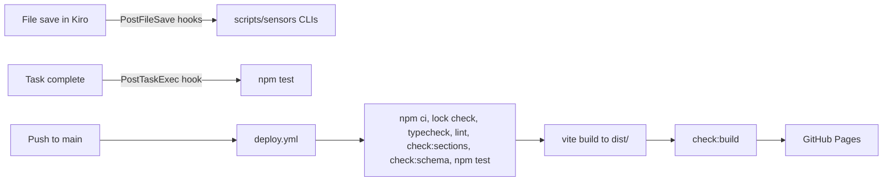

# Design Document: repo-foundation

## Overview
　
This design sets up the repository so that every later spec has a fixed place, fixed checks, and a public URL. It covers: the folder layout, one root Vite project that writes three static pages, four sensors in `scripts/sensors/`, four Kiro hooks, the GitHub Pages workflow, and the README and LICENSE.

Completion criterion: after one push to `main`, the Top_Page, Ghost_Mansion_App, and Moodwalk_App open at the Public_URL ("submittable state ①").

Guiding choice: the simplest thing that meets each criterion. No new tool beyond the list in R-FND-02.7. Items marked **(confirm in first task)** are decisions whose exact mechanics are verified when the first build runs; if one fails, the named fallback is used and recorded in `docs/decision-log.md`.

### Research findings that shape the design

- ESLint 9.37.0 extended the built-in `no-restricted-imports` to TypeScript import syntax: `import type`, inline type specifiers, and `import x = require(...)` ([typescript-eslint: no-restricted-imports](https://typescript-eslint.io/rules/no-restricted-imports/)). The `regex` option for patterns exists since ESLint 9.7.0 ([ESLint v9.7.0 release](https://eslint.org/blog/2024/07/eslint-v9.7.0-released/)).
- ESLint loads `eslint.config.ts` through `jiti`, or natively in Node.js when the `unstable_native_nodejs_ts_config` flag is set ([ESLint v9.18.0 release](https://eslint.org/blog/2025/01/eslint-v9.18.0-released/), [eslint/eslint#19985](https://github.com/eslint/eslint/issues/19985)). jiti is not in R-FND-02.7, so this design uses the native path.
- Node.js 26 has type stripping on by default and stable; it accepts erasable syntax only and refuses `.ts` files inside `node_modules` ([Node.js TypeScript docs](https://nodejs.org/learn/typescript/run-natively)). TypeScript's `erasableSyntaxOnly` flag enforces the same limit at type-check time.

Content was rephrased for compliance with licensing restrictions.

## Architecture



### Repository tree after this spec

```
.kiro/  steering/ specs/ hooks/ agents/ skills/      (existing + hooks added later by the hook tool)
.github/workflows/deploy.yml
core/model/scenario-schema.ts                        Zod envelope + LocalizedText
core/view/simple-page.ts                             generic DOM page renderer
apps/top-page.ts                                     Top_Page script (file, not a folder)
apps/ghost-mansion/ index.html main.ts text.ts scenarios/placeholder.json rules/.gitkeep theme/.gitkeep
apps/moodwalk/      index.html main.ts text.ts scenarios/placeholder.json rules/.gitkeep theme/.gitkeep
scripts/sensors/    (see Components)
docs/ intent.md decision-log.md process.md judges-tldr.md
index.html  package.json  package-lock.json  tsconfig.json  vite.config.ts  eslint.config.ts
.nvmrc  .gitignore  README.md  LICENSE
```

- Placeholder files: an empty `.gitkeep` keeps each otherwise-empty folder tracked (R-FND-01.1, 01.2). Folders that already hold a real file need none.
- `apps/` keeps exactly two subfolders (R-FND-01.5). The Top_Page script is the file `apps/top-page.ts`, because it names both apps and therefore cannot live in `core/`, and no new top-level folder is allowed.
- `docs/process.md` and `docs/judges-tldr.md`: one `#` heading and one English sentence stating the purpose (R-FND-01.4).

### Build: Vite multi-page

`vite.config.ts` exports two constants and the config:

```ts
export const PUBLIC_ORIGIN = "https://seimu1207.github.io";
export const BASE_PATH = "/SpatialCore/";
```

- `base: BASE_PATH`, `appType: "mpa"`, `build.outDir: "dist"`, and the build input = the three HTML files (R-FND-02.4).
- Vite version: `package.json` pins the exact Vite version (and so its major) at implementation time. The input key depends on that major: `build.rollupOptions.input` for a Rollup-based major, `build.rolldownOptions.input` for a Rolldown-based major. **(confirm in first task)** The first task records the pinned major and the chosen key in `docs/decision-log.md`.
- Output paths: with the repo root as Vite `root`, Vite writes `dist/apps/<app>/index.html`. A small plugin `flattenAppPages` defined inside `vite.config.ts` (no new dependency) has `apply: "build"` and `enforce: "post"`. Its `closeBundle(error)` hook moves `dist/apps/<app>/index.html` to `dist/<app>/index.html` with `fs.mkdir` + `fs.rename` for both apps, then removes the empty `dist/apps/` with `fs.rmdir` (which fails if the folder is not empty, so no stray output is deleted silently). This is the primary and only method. Because `base` is absolute, every asset reference in the HTML already starts with `/SpatialCore/assets/…`, so moving the HTML file does not break it. `check:build` fails if `dist/apps` still exists or a page is missing.
  - **Failed build (R-FND-02.6).** `closeBundle` takes the error argument. If `error` is set, or a source file `dist/apps/<app>/index.html` does not exist, the hook returns without doing anything. It never throws its own error in that case, so the original compile error, with its file name, is the one Vite prints. The existence check also covers a bundler version that does not pass the error argument.
  - **(confirm in first task)** Put a syntax error in a real file of the repo (for example `apps/moodwalk/main.ts`) once, run `npm run build`, and check that the error output names that file and that no `flattenAppPages` error appears. Then remove the syntax error. Nothing is committed.
- Dev server: no rewrite (YAGNI). In `vite` dev the app pages are at `/SpatialCore/apps/<app>/`. The Top_Page links are `${BASE_URL}ghost-mansion/` and `${BASE_URL}moodwalk/`, relative to `base`, which are correct in the built Site and on the Public_URL. In dev those two links do not resolve; a developer opens `/SpatialCore/apps/<app>/` directly. This difference is accepted. The back link on each app page (`${BASE_URL}`) works in both.
- The Vitest settings live in the `test` field of `vite.config.ts`: `include: ["**/*.test.ts"]`, `exclude: ["node_modules/**", "dist/**"]`, `watch: false`. `npm test` is `vitest run` (R-FND-10.1).
- No `404.html` is emitted, so unknown paths get the GitHub Pages not-found page (R-FND-03.9).

### Toolchain

- `package.json`: `"type": "module"`, `"engines": { "node": "<exact 26.x>" }`, no `imports` field (R-FND-04.9). `.nvmrc` holds the same string. The exact patch is the latest 26.x LTS at implementation time and is recorded in `docs/decision-log.md` (R-FND-02.2).
- Dependencies (all `devDependencies`): `typescript`, `vite`, `vitest`, `fast-check`, `eslint` (exact, ≥ 9.37.0), `typescript-eslint`, `@eslint/js`, `zod`, `@types/node`. React, react-dom, and the React Vite plugin are allowed by R-FND-02.7 but are **not installed** in this spec: three placeholder pages need only plain DOM code. The `core` spec adds them together with React Three Fiber and drei.
- `tsconfig.json` (one file, R-FND-02.3):

```json
{
  "compilerOptions": {
    "strict": true, "target": "ES2023", "lib": ["ES2023", "DOM", "DOM.Iterable"],
    "module": "nodenext", "moduleResolution": "nodenext",
    "noEmit": true, "allowImportingTsExtensions": true,
    "erasableSyntaxOnly": true, "verbatimModuleSyntax": true,
    "types": ["node", "vite/client"], "skipLibCheck": true
  },
  "include": ["core/**/*.ts", "core/**/*.tsx", "apps/**/*.ts", "apps/**/*.tsx", "scripts/**/*.ts", "scripts/**/*.tsx"]
}
```

  Choice for type stripping: `allowImportingTsExtensions` + `noEmit` (not `rewriteRelativeImportExtensions`, which is for emitting). `nodenext` forces explicit `.ts` extensions on relative imports, which Node.js needs at run time. `erasableSyntaxOnly` makes `tsc` reject `enum`, runtime `namespace`, and parameter properties (R-FND-02.10). It applies repo-wide because there is one tsconfig (kept repo-wide pending the human decision in Open questions). No `paths` key (R-FND-04.8). `vite.config.ts` and `eslint.config.ts` are type-checked because files under `scripts/` import them (`build-output.cli.ts` imports `vite.config.ts`; `boundary-rules.test.ts` imports `eslint.config.ts`).

  The `jsx` option and the separation of DOM types (pages) from Node types (sensors) are added by the `core` spec when React arrives. This spec keeps one `lib`/`types` set for all files.

## Components and Interfaces

### Pages (R-FND-03)

- `core/model/scenario-schema.ts` exports `LocalizedText` (type only is used by pages, so Zod is not bundled).
- `core/view/simple-page.ts`: `renderSimplePage(root: HTMLElement, page: SimplePage): void`. It sets `document.title`, writes one `h1`, an optional `p`, and a list of links, always using `text.en` (R-FND-03.7). It contains no app names.
- `apps/<app>/text.ts`: the app's `LocalizedText` values (`title`, `body`, `backLink`). Example: `title: { en: "Ghost Mansion", ja: "スマホ屋敷のおばけ退治" }`, `title: { en: "Moodwalk", ja: "Moodwalk" }`.
- `apps/<app>/main.ts`: calls `renderSimplePage` with the app title, body, and one link to `import.meta.env.BASE_URL` (R-FND-03.2–03.4).
- `apps/top-page.ts`: imports both `text.ts` files and renders the product name, one link per app (`${BASE_URL}ghost-mansion/`, `${BASE_URL}moodwalk/`) labeled with the app title (R-FND-03.1).
- HTML files hold no visible text: `<html lang="en">`, an empty `<title></title>`, `<div id="app"></div>`, and one `<script type="module" src="…">` (R-FND-03.6).

### Sensors (`scripts/sensors/`)

Every Sensor is a pure module plus a thin CLI, run by Node.js type stripping (`node scripts/sensors/<x>.ts`). Exit codes: `0` pass, `1` check failed, `2` bad argument or tool could not start.

| File | Role | Exported pure API |
|---|---|---|
| `required-sections.ts` | Required_Sections_Sensor logic | `checkRequiredSections(text: string): SectionsResult`, `isSpecDocumentPath(relPath: string): boolean` |
| `required-sections.cli.ts` | Reads files, prints findings, sets exit code | — |
| `schema.ts` | Schema_Sensor logic | `checkScenarioText(text: string): SchemaResult` |
| `schema.cli.ts` | Finds or reads Scenario_Files | — |
| `build-output.ts` | check:build scans | `checkLayout(files: string[]): string[]`, `findBadAssetRefs(html: string, base: string, files: Set<string>): string[]`, `findForeignUrls(text: string, origin: string, allow: readonly string[]): string[]` |
| `build-output.cli.ts` | Walks `dist/`, imports `PUBLIC_ORIGIN` and `BASE_PATH` from `../../vite.config.ts` | — |
| `typecheck.ts` | Type_Check_Sensor: checks `tsconfig.json` exists in the cwd, then spawns `process.execPath <repo>/node_modules/typescript/bin/tsc --noEmit -p tsconfig.json`, passes output through | — |
| `lint.ts` | Lint_Sensor: spawns ESLint's bin with `--max-warnings 0 core apps scripts` (plus `--flag unstable_native_nodejs_ts_config` if the pinned ESLint still requires it, **confirm in first task**) | — |
| `boundary-rules.ts` | Builds the selector and pattern lists for R-FND-04, imported by `eslint.config.ts` | `boundaryConfigs(): Linter.Config[]` |
| `repo-rules.ts` | Repo-level checks | `listFiles(dir)`, `findJsFiles(root)`, `findSelfImports(root, pkgName)`, `findAppNames(text)`, `checkDependencies(pkg)` |
| `hook-dispatch.ts` | Entry for Kiro hooks: reads the hook JSON from stdin, takes the saved file path if present, runs the matching CLI(s) with captured output, and on failure writes the captured stdout and stderr to stderr and exits 1 (see Kiro hooks) | — |

`typecheck.ts` and `lint.ts` resolve tool binaries from the repo path (`import.meta.dirname`), not with `createRequire` or `require.resolve`, which R-FND-04.10 forbids under `scripts/`.

Required-sections algorithm (R-FND-05.6, 05.7): scan lines in order. Track an open fence `{ char, len }`. A line matching `^ {0,3}(`{3,}|~{3,})` opens a fence when none is open; while open, a line matching `^ {0,3}(char){len,}\s*$` closes it; all lines while open are skipped. Outside a fence, a heading line matches `^ {0,3}#{1,6}(?:[ \t]+(.*?))?[ \t]*$`; remove a trailing ` #+` run, trim, compare lower-case with `pbt properties` and `safety`. `SectionsResult = { missing: Array<"PBT properties" | "Safety"> }` in that fixed order.

Spec_Document path (R-FND-05.4, 05.5): after normalizing `\` to `/` and making the path relative to the repo root, it must match `^\.kiro/specs/[^/]+/(requirements|design)\.md$` and exist.

npm scripts (R-FND-02.8):

| Script | Command |
|---|---|
| `build` | `vite build` |
| `test` | `vitest run` |
| `typecheck` | `node scripts/sensors/typecheck.ts` |
| `lint` | `node scripts/sensors/lint.ts` |
| `check:sections` | `node scripts/sensors/required-sections.cli.ts` |
| `check:schema` | `node scripts/sensors/schema.cli.ts` |
| `check:build` | `node scripts/sensors/build-output.cli.ts` (fails if `dist/` is missing, so it is meaningful only after `build`) |

### check:build scans (R-FND-10.11, 10.12, R-FND-02.11)

- Layout: fail if `dist/` is missing, if any of the three `index.html` files is missing, or if `dist/apps` exists.
- Asset refs: every `src` and `href` attribute in the three HTML files must start with `BASE_PATH`, and the remainder must name a file in `dist/`.
- Foreign URLs: in every `.html`, `.css`, `.js` file, find `https?://[^\s"'`<>)]+`. Allowed when the URL's origin equals `PUBLIC_ORIGIN` (read from `vite.config.ts`, not hard-coded), or it starts with `http://www.w3.org/`, or it starts with `https://react.dev/errors/`.
- **Decision (R-FND-02.11):** the one extra allowed prefix is `https://react.dev/errors/`. React DOM's production build embeds it as text inside error messages; the browser never requests it, so S-FND-1 still holds. React is not in this spec's bundle, but allowing it now means the `core` spec need not reopen this decision. No other URL is allowed.

### ESLint config (`eslint.config.ts`, R-FND-04, R-FND-07)

One flat config at the root:

1. `@eslint/js` recommended + `tseslint.configs.recommendedTypeChecked` for `core/**`, `apps/**`, `scripts/**` with `parserOptions: { projectService: true, tsconfigRootDir: import.meta.dirname }`. The project service finds `tsconfig.json`, which includes every Source_File.
2. `...boundaryConfigs()` from `scripts/sensors/boundary-rules.ts`.

`boundaryConfigs()` returns one config object per **disjoint** file scope, because a later flat-config object replaces an earlier object's options for the same rule:

| # | Scope (`files`, plus `ignores` inside the same object) | Forbidden specifier regexes | R-FND-04.10 selectors |
|---|---|---|---|
| 1 | `core/model/**/*.{ts,tsx}` | apps segment, view segment, core/model packages | yes |
| 2 | `core/view/**/*.{ts,tsx}` | apps segment | yes |
| 3 | `core/**/*.{ts,tsx}`, ignores `core/model/**`, `core/view/**` (covers `core/*.{ts,tsx}` and any other folder under `core/`) | apps segment | yes |
| 4 | `apps/ghost-mansion/**/*.{ts,tsx}` | moodwalk segment | yes |
| 5 | `apps/moodwalk/**/*.{ts,tsx}` | ghost-mansion segment | yes |
| 6 | `apps/**/*.{ts,tsx}`, ignores `apps/ghost-mansion/**`, `apps/moodwalk/**` (covers `apps/*.{ts,tsx}`, such as `apps/top-page.ts`) | none | yes |
| 7 | `scripts/**/*.{ts,tsx}` | none | yes |

**Coverage.** A Source_File is a `.ts`, `.tsx`, `.js`, `.jsx`, `.mjs`, or `.cjs` file under `core/`, `apps/`, or `scripts/`. R-FND-10.9 forbids the four JavaScript extensions there, so every Source_File is a `.ts` or `.tsx` file. Under `core/`, a path is in `core/model/` (scope 1), in `core/view/` (scope 2), or elsewhere (scope 3). Under `apps/`, a path is in `apps/ghost-mansion/` (4), in `apps/moodwalk/` (5), or elsewhere (6). Under `scripts/`, scope 7. So every Source_File path matches exactly one scope, and each scope carries the R-FND-04.10 selectors. The `ignores` make scopes 3 and 6 disjoint from their siblings, so no later object overrides an earlier one's rule options.

Regex sources (separator class `S = [\x2F\x5C]`, which is `/` or `\`, written with hex escapes so the same string works inside esquery regex literals):

- segment `x`: `(^|S)x(S|$)` for `apps`, `view`, `moodwalk`, `ghost-mansion`
- core/model packages: `^(three|react|react-dom)(S|$)`, `^@react-three(S|$)`, `^three-`, `^\.\.?S(.*S)?node_modules(S|$)`

From each regex list the builder emits:

- `no-restricted-imports` with `patterns: [{ regex, message }]`. This covers `import`, `import type`, `export … from`, `export * from`, and `import x = require(...)` (ESLint ≥ 9.37.0). **Recorded choice (R-FND-04.5): `import x = require()` is covered by `no-restricted-imports`.**
- `no-restricted-syntax` selectors (same regex `R`):
  - `ImportExpression[source.type='Literal'][source.value=/R/]`
  - `ImportExpression[source.type='TemplateLiteral'][source.expressions.length=0][source.quasis.0.value.cooked=/R/]`
  - `CallExpression[callee.name='require'][arguments.0.type='Literal'][arguments.0.value=/R/]`
  - `CallExpression[callee.name='require'][arguments.0.type='TemplateLiteral'][arguments.0.expressions.length=0][arguments.0.quasis.0.value.cooked=/R/]`
  - `TSImportType Literal[value=/R/]` (matches the type-position `import("…")` whichever property holds the string)

Selectors added to every scope (R-FND-04.10), each with a message starting `[boundary]` and naming the call:

- `ImportExpression[source.type!='Literal'][source.type!='TemplateLiteral']`, `ImportExpression[source.type='TemplateLiteral'][source.expressions.length>0]`
- `CallExpression[callee.name='require'][arguments.0.type!='Literal'][arguments.0.type!='TemplateLiteral']`, `CallExpression[callee.name='require'][arguments.0.type='TemplateLiteral'][arguments.0.expressions.length>0]`
- `MemberExpression[object.type='MetaProperty'][property.name='glob']` (`import.meta.glob`)
- `MemberExpression[object.name='require'][property.name='resolve']`
- `CallExpression[callee.name='createRequire']`, `MemberExpression[property.name='createRequire']`: `createRequire` itself is reported, which also covers calling its result (stricter than R-FND-04.10, recorded here).
- `CallExpression[callee.object.name='module'][callee.property.name='require']`
- `CallExpression[callee.name='eval']`
- `Identifier[name='Function']:not(TSTypeReference > Identifier):not(MemberExpression[computed=false] > Identifier.property):not(Property > Identifier.key)` and `MemberExpression[property.name='Function']` (any value use of the global `Function`, including `globalThis.Function`)

Every boundary message begins with `[boundary]`, so tests and readers can tell boundary errors from other findings. The selectors use esquery attribute paths with numeric indexes (`arguments.0`) and `length` comparisons; R-FND-10.8 tests each one, so a selector that does not match fails a test.

**Linter API tests and type info (R-FND-10.8), recorded choice:** `boundary-rules.test.ts` imports the default export of the committed `eslint.config.ts`, so the config under test is the one `npm run lint` uses. It makes exactly two changes before `new Linter({ cwd: repoRoot }).verify(code, config, { filename })`:

1. Every config object that sets `languageOptions.parserOptions.projectService` gets a copy with `projectService: false`. Nothing else in the object changes.
2. One object `{ files: ["**/*.{ts,tsx}"], ...tseslint.configs.disableTypeChecked }` is appended, which turns off the type-aware rules for the virtual files. Boundary rules are not type-aware, so they stay on.

Virtual files such as `core/model/x.ts` therefore need no tsconfig entry. The type-aware rules are covered by `npm run lint` on the real files. Because the test file is under `scripts/` and imports `eslint.config.ts`, `tsc` follows the import and `eslint.config.ts` (and `boundary-rules.ts`) is under type-check.

**TypeScript config loading, recorded choice:** `eslint.config.ts` is loaded by Node.js's native type stripping, not jiti. If the pinned ESLint version still needs `--flag unstable_native_nodejs_ts_config`, `lint.ts` passes it. **(confirm in first task)** Fallback: rename to `eslint.config.mjs` with `// @ts-check` JSDoc types; the test imports its default export the same way.

### Kiro hooks (R-FND-09)

Created later with Kiro's hook tool, not hand-written. All run `node scripts/sensors/hook-dispatch.ts <kind>`.

| Hook id | Trigger | Matcher (regex on file path) | Runs | `timeout` |
|---|---|---|---|---|
| `check-sections-on-save` | PostFileSave | `\.kiro[\\/]specs[\\/][^\\/]+[\\/](requirements\|design)\.md$` | `check:sections -- <path>` | default (60 s) |
| `check-code-on-save` | PostFileSave | `(^\|[\\/])(core\|apps\|scripts)[\\/].*\.tsx?$` | `typecheck`, then `lint` even if typecheck failed; exit non-zero if either failed | 180 s |
| `check-schema-on-save` | PostFileSave | `(^\|[\\/])apps[\\/][^\\/]+[\\/]scenarios[\\/].+\.json$` | `check:schema -- <path>` | default (60 s) |
| `test-on-task-done` | PostTaskExec | — | `npm test` | 180 s |

`check-code-on-save` gets 180 s because a full `tsc` plus type-aware ESLint run can pass the 60 s default on a cold cache.
`test-on-task-done` gets 180 s because `npm test` runs `tsc`, type-aware ESLint twice (R-FND-07.2), and the temporary-project builds, which together can pass 60 s.

Dispatcher behavior (`hook-dispatch.ts`):

- **Saved path.** It reads the hook's stdin JSON and takes the saved file path from the field confirmed in the first hook task. If stdin is empty, is not JSON, or has no saved path, it runs the check with no file argument, so the Sensor checks everything (all Spec_Documents, all Scenario_Files). The code hook never passes a file argument.
- **Output.** It spawns each child with stdout and stderr captured (not inherited). If every child exits 0, it prints nothing and exits 0. If any child fails, it writes that child's captured stdout and then its captured stderr to its own stderr, and exits 1. Kiro passes only stderr to the agent on a non-zero exit, so writing both streams to stderr is what makes `tsc` and ESLint findings (printed on stdout) visible in the session (R-FND-09.6).

**First hook task (confirm before the other hooks are created):** (a) the stdin JSON field name that holds the saved file path, by logging one real hook payload; (b) whether a human saving a file in the editor fires PostFileSave, or only agent writes do. If (b) is "only agent writes", the task adds one line to `docs/decision-log.md` stating that save hooks cover agent edits only and human edits rely on CI.

No hook runs `npm test` on save, and none runs `check:build` (R-FND-09.5).

### Deploy workflow (`.github/workflows/deploy.yml`, R-FND-11)

- `on: push: branches: [main]` and `workflow_dispatch`.
- `permissions: { contents: read, pages: write, id-token: write }`; `concurrency: { group: pages, cancel-in-progress: false }` (R-FND-11.7).
- Job `build`: `actions/checkout`, `actions/setup-node` with `node-version-file: .nvmrc` and npm cache, then one step each: `npm ci`, `git diff --exit-code package-lock.json`, `npm run typecheck`, `npm run lint`, `npm run check:sections`, `npm run check:schema`, `npm test`, `npm run build`, `npm run check:build`, `actions/configure-pages`, `actions/upload-pages-artifact` with `path: dist`.
- Job `deploy`: `needs: build`, `environment: github-pages`, `actions/deploy-pages`.
- A failing step stops the job, so nothing is uploaded and the last published Site stays (R-FND-11.3). Only the built-in `GITHUB_TOKEN` / OIDC token is used (R-FND-11.6). Action major versions are the current ones at implementation time.

### Core / app interface

For this spec the interface between `core/` and the apps is only:

1. **Scenario_Schema** in `core/model/scenario-schema.ts` (Zod): `schemaVersion` (integer ≥ 1), `id` (non-blank string), `title` (`LocalizedText`). The top-level `z.object` uses Zod's default behavior, which ignores unknown keys (R-FND-08.1). The file contains no app names (R-FND-08.2).
2. **`LocalizedText`** type and **`renderSimplePage`** in `core/view/simple-page.ts`, both generic.
3. **Import boundary**: `apps/` → `core/` only; `core/model` imports nothing from `core/view`, `three`, or React; neither app imports the other (R-FND-04).

`core/` knows no app name. The app names appear only in `apps/`.

## Data Models

```ts
// core/model/scenario-schema.ts
const nonBlank = z.string().refine((s) => s.trim().length >= 1, "must not be blank");
export const localizedTextSchema = z.object({ en: nonBlank, ja: z.string().optional() });
export type LocalizedText = z.infer<typeof localizedTextSchema>;
export const scenarioSchema = z.object({
  schemaVersion: z.number().int().min(1),
  id: nonBlank,
  title: localizedTextSchema,
});
export type ScenarioEnvelope = z.infer<typeof scenarioSchema>;

// core/view/simple-page.ts
export type SimplePage = { title: LocalizedText; body?: LocalizedText; links: { label: LocalizedText; href: string }[] };

// scripts/sensors
type SectionsResult = { missing: ("PBT properties" | "Safety")[] };
type SchemaResult =
  | { ok: true }
  | { ok: false; kind: "parse"; message: string }
  | { ok: false; kind: "schema"; issues: { path: string; message: string }[] }; // path like "title.en"
```

`refine` is used instead of `.trim()` so the parsed value is not changed. Placeholder Scenario_File (one per app, `apps/<app>/scenarios/placeholder.json`):

```json
{ "schemaVersion": 1, "id": "placeholder", "title": { "en": "Placeholder scenario", "ja": "仮のシナリオ" } }
```

## Correctness Properties

*A property is a characteristic or behavior that should hold true across all valid executions of a system-essentially, a formal statement about what the system should do. Properties serve as the bridge between human-readable specifications and machine-verifiable correctness guarantees.*

### PBT properties

The core PBT properties from intent.md 10.6 (save → load unchanged, edges point to existing nodes, same input → same result, removing edges never grows the reachable set) belong to the `core` spec. This spec tests only the pure functions of its two Sensors. Each property runs with `fc.assert(…, { numRuns: 100 })` or more, and each test name starts with its property ID. In the **Validates** lines, "Requirements X.Y" means R-FND-0X.Y (for example 5.1 = R-FND-05.1).

Shared generators (in the test files):

- `plainLine`: `fc.string()` with no `#`, `` ` ``, `~`, `\n`, `\r`, so it can be neither a fence line nor a heading line.
- `decoyLine`: `fc.constantFrom("#Safety", "## Safety notes", "# PBT", "### Other", "####### Safety", "    # Safety")` — lines that must not count (R-FND-05.7; the last has four leading spaces).
- `plainDoc`: `fc.array(fc.oneof(plainLine, decoyLine)).map(lines => lines.join("\n"))`.
- `anyDoc`: `fc.array(fc.oneof(plainLine, decoyLine, fc.constantFrom("# PBT properties", "## Safety", "```", "~~~~", "   ```", "# Safety #"))).map(join)`.
- `validScenario`: `fc.record({ schemaVersion: fc.integer({ min: 1 }), id: nonBlankString, title: fc.record({ en: nonBlankString, ja: fc.string() }, { requiredKeys: ["en"] }) })`, where `nonBlankString` is `fc.string()` filtered to `s.trim().length >= 1`.
- `extraFields`: `fc.dictionary(fc.string().filter(k => !["schemaVersion", "id", "title", "__proto__"].includes(k)), fc.jsonValue(), { minKeys: 1 })`.

### Property 1: P-FND-1 same input gives same result

*For any* Markdown text `t` from `anyDoc` or `fc.string()`, `checkRequiredSections(t)` called twice returns deep-equal results.

- Function: `checkRequiredSections` (`scripts/sensors/required-sections.ts`).
- Assertion: `expect(check(t)).toEqual(check(t))`.

**Validates: Requirements 5.1, 5.2**

### Property 2: P-FND-2 adding and removing a heading

*For any* `base` from `plainDoc`, `check(base + "\n# PBT properties\n## Safety")` has `missing = []`; `check(base + "\n## Safety")` has `missing = ["PBT properties"]`; and `check(base + "\n# PBT properties")` has `missing = ["Safety"]`.

- Function: `checkRequiredSections`.
- Generator: `plainDoc`, plus `fc.integer({ min: 1, max: 6 })` for the heading level of each appended heading.

**Validates: Requirements 5.1, 5.2, 5.7**

### Property 3: P-FND-3 headings in code blocks do not count

*For any* `base` from `plainDoc` and any fence `f` from `fc.constantFrom("```", "~~~", "````", "~~~~~")`, both `base + "\n" + f + "\n# PBT properties\n## Safety\n" + f` and the unclosed form `base + "\n" + f + "\n# PBT properties\n## Safety"` give `missing = ["PBT properties", "Safety"]`.

- Function: `checkRequiredSections`.

**Validates: Requirements 5.6**

### Property 4: P-FND-4 valid scenarios pass

*For any* `s` from `validScenario` and any `x` from `extraFields`, `checkScenarioText(JSON.stringify(s))` and `checkScenarioText(JSON.stringify({ ...x, ...s }))` both return `{ ok: true }`.

- Function: `checkScenarioText` (`scripts/sensors/schema.ts`).

**Validates: Requirements 8.1, 8.8**

### Property 5: P-FND-5 broken scenarios fail with the field path

*For any* `s` from `validScenario`, any field `p` from `fc.constantFrom("schemaVersion", "id", "title", "title.en")`, and any change from `fc.oneof(fc.constant("remove"), wrongTypeValue)` where `wrongTypeValue` is `fc.oneof(fc.boolean(), fc.constant(null), fc.array(fc.integer()))` plus `fc.string()` for `schemaVersion` and `fc.integer()` for `id`, `title`, `title.en`, applying the change to `p` makes `checkScenarioText(JSON.stringify(changed))` return `kind: "schema"` with at least one issue whose `path` equals `p`.

- Function: `checkScenarioText`.

**Validates: Requirements 8.7, 8.1**

## Error Handling

| Situation | Behavior | Exit |
|---|---|---|
| Spec_Document lacks a Required_Heading | Prints `<path>: missing "PBT properties"` (one line per missing heading); continues with other files | 1 |
| `check:sections` path missing or not a Spec_Document | Prints `<path>: rejected: <does not exist \| not a spec requirements.md or design.md>`; checks nothing else | 2 |
| Scenario_File not valid JSON | Prints `<path>: JSON could not be parsed: <parser message>` | 1 |
| Scenario_File fails the schema | Prints `<path>: <field path>: <message>` per issue | 1 |
| `check:schema` path missing or not `.json` | Prints `<path>: rejected: <reason>` | 2 |
| `check:schema` finds no Scenario_File | Prints `No Scenario_File found under apps/*/scenarios/` | 1 |
| `tsconfig.json` missing / TypeScript not installed | `typecheck.ts` prints `typecheck: <cause>` before or instead of spawning | 2 |
| `tsc` errors | `tsc` output passed through (file, line, message) | 1 |
| ESLint findings | Stylish output (file, line, rule); `--max-warnings 0` turns warnings into failure | 1 |
| ESLint config missing or invalid | ESLint's own message passed through; `lint.ts` adds `lint: ESLint could not load its config` | 2 |
| `dist/` missing or bad layout / foreign URL | Prints each finding with the file and URL | 1 |
| Build error | Vite prints the error with the file; non-zero exit | non-zero |
| Any CI step fails | Job stops; no artifact uploaded; Pages keeps the last site | — |

The CLIs never throw an unhandled exception for expected input errors; unexpected exceptions print the stack and exit 2.

## Testing Strategy

- **Property tests** (fast-check, ≥ 100 runs each): P-FND-1 to P-FND-3 in `scripts/sensors/required-sections.test.ts`, P-FND-4 and P-FND-5 in `scripts/sensors/schema.test.ts`. They call only the pure functions (R-FND-10.7). Each test carries the tag comment `Feature: repo-foundation, Property <n>: <P-FND-n title>`.
- **Temporary projects.** Tests that need a broken project create it inside the repo under `node_modules/.cache/fnd-tmp/<test-name>-<random>/`, so that `typescript`, `typescript-eslint`, and the other packages resolve by walking up to the repo's `node_modules/`. The folder is gitignored through `node_modules/`, so no broken file is ever committed; each test removes its folder in `afterEach`. Node.js refuses to strip types from `.ts` files under `node_modules`, so a temporary project's ESLint config is written as `eslint.config.mjs`, and the sensors themselves always run from `scripts/sensors/` with the temporary folder as `cwd`.
  - **Temporary-project ESLint config has no type information.** It is `[{ files: ["**/*.ts"], ...js.configs.recommended }]` with `js` from `@eslint/js`: plain JS rules, ESLint's default parser, no `typescript-eslint`, no `parserOptions.projectService`. So the project service is never involved and the temporary project needs no tsconfig entry for ESLint. Because the default parser reads only JavaScript, the `.ts` files in a temporary lint project use only syntax that is also valid JavaScript (for example an unused `const`, reported by `no-unused-vars`). Each temporary lint project has one such file in each of `core/`, `apps/`, and `scripts/`, because `lint.ts` passes all three folders to ESLint. **(confirm in first lint/typecheck test task)** that ESLint's default `**/node_modules/` ignore and `tsc`'s default `exclude` apply relative to the temporary project root and so do not skip its files. Fallback: a gitignored folder at the repo root, which changes `.gitignore` and needs a decision-log line (S-FND-4).
- **Timeouts.** Tests that spawn `tsc` or type-aware ESLint (`typecheck.test.ts`, `lint.test.ts`, the R-FND-02.6 case in `build-output.test.ts`) set a 60 s test timeout on their `describe` block (`describe(name, { timeout: 60_000 }, …)`), because Vitest's default `testTimeout` of 5 s is too short for these.
- **Example tests** next to their sources (R-FND-10.4):
  - `required-sections.cli.test.ts`, `schema.cli.test.ts`: argument handling, printed output, exit codes, the real placeholder Scenario_Files.
  - `schema.test.ts` value-constraint examples for R-FND-08.1, each expected to return `kind: "schema"` with an issue at the named path: whitespace-only `id` (`"   "`) → `id`; whitespace-only `title.en` (`" \t"`) → `title.en`; `schemaVersion: 0` → `schemaVersion`; `schemaVersion: 1.5` → `schemaVersion`; non-string `ja` (`title.ja: 3`) → `title.ja`.
  - `typecheck.test.ts`: tmp project with a type error (06.3), no `tsconfig.json` (06.5), and the no-output check after `npm run typecheck` (06.4).
  - `lint.test.ts`: tmp project with a finding (07.3), broken config (07.5), clean project (07.4), and two runs with identical output on the repo (07.2).
  - `boundary-rules.test.ts`: Linter API cases using the committed `eslint.config.ts` (see ESLint config). One case per form and folder in R-FND-04.1–04.5, 04.7, 04.10, and a clean case for 04.6. Virtual file paths cover every scope in the scope table, including:
    - `core/x.ts`: `import "../apps/x"` is reported (apps-segment ban, scope 3), and one R-FND-04.10 form (`import(name)`) is reported.
    - `apps/x.tsx`: one R-FND-04.10 form (`require(name)`) is reported, and `import "./ghost-mansion/text.ts"` gives no boundary error (scope 6 bans no segment).
  - `repo-rules.test.ts`: no JS files (10.9), no `imports` field (10.10), no `paths` (10.13), no self-imports (10.14), no app names in the schema file (10.15), dependency list and exact ESLint ≥ 9.37.0 (02.7).
  - `build-output.test.ts`: the three pure scans on small inputs, and one tmp Vite project with a syntax error for R-FND-02.6.
  - `scripts/sensors/fixtures/pbt-failure.fixture.test.ts` (R-FND-10.3, 10.6): the wrapper test, placed next to the fixture it runs (R-FND-10.4). It spawns `vitest run --config scripts/sensors/fixtures/vitest.fixture.config.ts`, which runs only `scripts/sensors/fixtures/pbt-failure.fixture.ts` (a property named `P-FND-FAIL` that always fails). The test passes when that run exits non-zero and its output contains the file name `pbt-failure.fixture.ts`, `P-FND-FAIL`, `Counterexample`, and `seed`.
    - `npm test` never runs the failing fixture itself. The root `include` is `**/*.test.ts`, which matches the wrapper but not `pbt-failure.fixture.ts`. `vitest.fixture.config.ts` is a standalone config (it does not extend `vite.config.ts`) whose `include` lists exactly `scripts/sensors/fixtures/pbt-failure.fixture.ts`, so the child run does not pick up the wrapper and cannot recurse.
- **Not PBT**: pages (manual on the Public_URL), the workflow (its own runs), hooks (manual trigger), and lint rules (a fixed list of forms, so one example per form).

### Verification map

Method keys: **FI** file inspection (`git ls-files`, reading the file), **RV** reviewer agent reads source, **MU** manual check on the Public_URL, **MH** manual hook trigger, **CI** a step of `deploy.yml`. Test files are in `scripts/sensors/`.

| Criterion | Method |
|---|---|
| R-FND-01.1 – 01.7 | FI (`git ls-files`, `.gitignore`) |
| R-FND-02.1 | CI (lock-file step) + FI (`package-lock.json` tracked) |
| R-FND-02.2 | FI (`.nvmrc`, `package.json`, decision-log line) |
| R-FND-02.3 | FI (`tsconfig.json`) + `npm run typecheck` |
| R-FND-02.4 | FI (`vite.config.ts`) |
| R-FND-02.5 | `check:build` + `build-output.test.ts` |
| R-FND-02.6 | `build-output.test.ts` |
| R-FND-02.7 | `repo-rules.test.ts` |
| R-FND-02.8 | FI (`package.json` scripts) |
| R-FND-02.9 | `*.cli.test.ts`, `typecheck.test.ts`, `lint.test.ts` + CI |
| R-FND-02.10 | `npm run typecheck` (`erasableSyntaxOnly`) + FI |
| R-FND-02.11 | FI (`vite.config.ts`, this design) |
| R-FND-03.1 – 03.5 | MU |
| R-FND-03.6 | RV |
| R-FND-03.7 | MU |
| R-FND-03.8 | `check:build` + MU (network panel) |
| R-FND-03.9 | MU |
| R-FND-04.1 – 04.5 | `boundary-rules.test.ts` |
| R-FND-04.6 | `boundary-rules.test.ts` + CI (`npm run lint`) |
| R-FND-04.7 | `boundary-rules.test.ts` |
| R-FND-04.8 | `repo-rules.test.ts` |
| R-FND-04.9 | `repo-rules.test.ts` |
| R-FND-04.10 | `boundary-rules.test.ts` |
| R-FND-05.1 – 05.2 | `required-sections.test.ts` (P-FND-1, P-FND-2) + `required-sections.cli.test.ts` |
| R-FND-05.3 – 05.5 | `required-sections.cli.test.ts` |
| R-FND-05.6 | `required-sections.test.ts` (P-FND-3 + unclosed-fence and long-fence examples) |
| R-FND-05.7 | `required-sections.test.ts` (P-FND-2 decoys + examples) |
| R-FND-06.1 | FI (`package.json`, `typecheck.ts`) |
| R-FND-06.2 – 06.5 | `typecheck.test.ts` |
| R-FND-07.1 | FI (`eslint.config.ts`) + CI (`npm run lint`) |
| R-FND-07.2 – 07.5 | `lint.test.ts` |
| R-FND-08.1 | `schema.test.ts` (P-FND-4, P-FND-5 + examples: whitespace-only `id`, whitespace-only `title.en`, `schemaVersion` 0, `schemaVersion` 1.5, non-string `ja`) |
| R-FND-08.2 | `repo-rules.test.ts` |
| R-FND-08.3 – 08.5 | `schema.cli.test.ts` + CI (`check:schema`) |
| R-FND-08.6 – 08.7 | `schema.test.ts` + `schema.cli.test.ts` |
| R-FND-08.8 | `schema.test.ts` (P-FND-4) + `schema.cli.test.ts` |
| R-FND-08.9 – 08.10 | `schema.cli.test.ts` |
| R-FND-09.1 – 09.7 | FI (hook files) + MH |
| R-FND-10.1 | FI (`vite.config.ts` `test` field) + `npm test` |
| R-FND-10.2 | `npm test` (CI) |
| R-FND-10.3 | `fixtures/pbt-failure.fixture.test.ts` (failing run's output contains `pbt-failure.fixture.ts` and `P-FND-FAIL`) |
| R-FND-10.4 | RV + FI |
| R-FND-10.5 | FI (test names) + `npm test` |
| R-FND-10.6 | `fixtures/pbt-failure.fixture.test.ts` (non-zero exit; output contains `Counterexample` and `seed`) |
| R-FND-10.7 | RV + property tests call pure functions |
| R-FND-10.8 | `boundary-rules.test.ts` (committed `eslint.config.ts`; virtual paths in every scope, including `core/x.ts` and `apps/x.tsx`) |
| R-FND-10.9, 10.10, 10.13 – 10.15 | `repo-rules.test.ts` |
| R-FND-10.11 – 10.12 | `check:build` + `build-output.test.ts` |
| R-FND-10.16 | FI (each listed test exists) + `npm test` |
| R-FND-11.1, 11.2, 11.5 – 11.7 | FI (`deploy.yml`) + first CI run |
| R-FND-11.3 | Manual, after one deliberately failed run |
| R-FND-11.4 | MU |
| R-FND-12.1, 12.3 – 12.6 | FI |
| R-FND-12.2 | Manual check of the GitHub repository page |

## Safety

Follows `safety.md` (intent.md ch. 9).

| Rule | Design measure |
|---|---|
| S-FND-1 no personal data, no login, no foreign requests | Pages are static DOM with no forms, storage, or fetch. `check:build` fails on any foreign URL except the W3C namespace and the `react.dev/errors/` text prefix, which are never requested. Network panel checked by hand. |
| S-FND-2 no attack content | The Empty_Apps show only a title, one sentence, and a back link. No attack card, hidden text, or command exists in this spec. |
| S-FND-3 no AI, no LLM, no image generation | No AI package in the dependency list; `repo-rules.test.ts` fails on any unlisted dependency. |
| S-FND-4 `.kiro/` committed | `.gitignore` lists only `node_modules/` and `dist/`; checked by FI. |
| S-FND-5 no secrets | The workflow uses only the GitHub-provided Pages token; no `secrets.*` reference. |
| S-FND-6 no unsourced claims | README and placeholder docs state only what the repo is, how to run it, and the URL. |

## Open questions

今のところありません。（GitHub ユーザー名は seimu1207。apps/top-page.ts の配置と erasableSyntaxOnly のリポジトリ全体適用は承認済み。）
